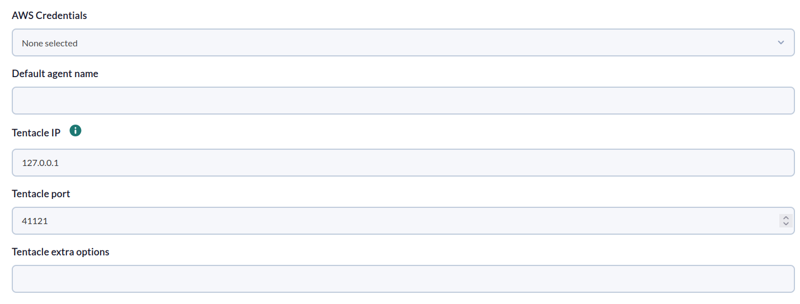
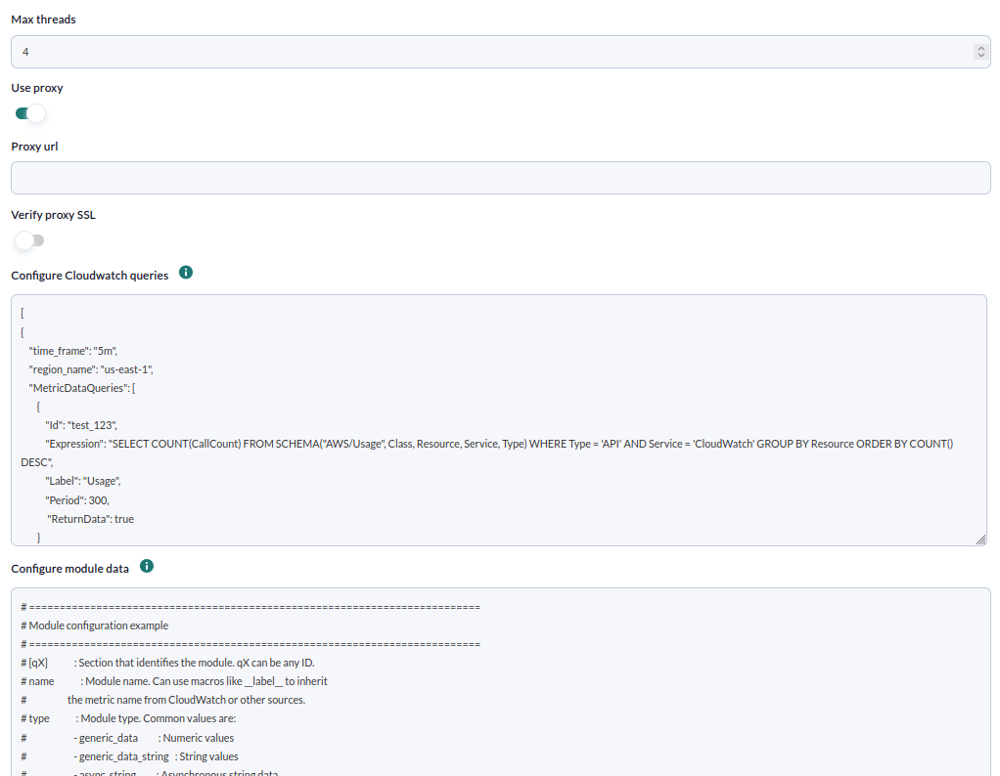
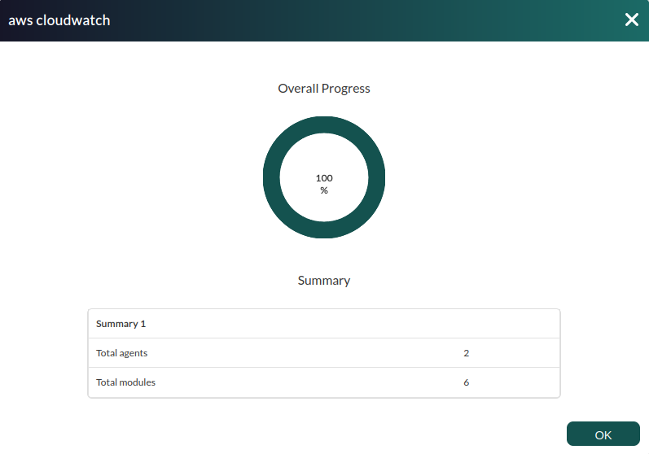

# Amazon CloudWatch Discovery

*Article last updated: 2026-10-26.*

## What it monitors

The Amazon CloudWatch Discovery addon turns the results of Amazon CloudWatch queries into Pandora FMS agents and modules. You define the queries yourself, using CloudWatch Metrics Insights or any other `MetricDataQueries` expression, and you define how each result becomes a module. A single query can produce hundreds of modules, for example one CPU module for each EC2 instance that the query returns.

A Discovery task:

1. Reads the queries you wrote, each one with its own region and time window.
2. Runs them against the CloudWatch API with an AWS access key.
3. Creates one module per result series and places it in the default agent, or in the agent you name in the module configuration.

The agents and modules that appear depend entirely on your configuration; the addon does not create any resource by itself.

## Prepare

### Compatibility

| Scope | State | Evidence |
|-------|-------|----------|
| Addon `pandorafms.aws.cloudwatch`, package version `1.0` | Documented target | The version this page describes. See [Addon identity](#addon-identity) |
| Network access from the Discovery server to the AWS CloudWatch API | `Required` | The addon calls the CloudWatch API in every region used by your queries |
| AWS access key with the permission listed in [AWS permissions](#aws-permissions) | `Required` | Prerequisite, not a compatibility statement |
| Operating system of the Discovery server | `Not validated` | No operating system has been recorded for this version |
| Specific Pandora FMS versions | `Not validated` | No version matrix has been recorded for this addon |

### Prerequisites

1. **Connectivity** from the Discovery server to the AWS API, directly or through an HTTPS proxy.
2. **An AWS access key** (access key ID and secret access key) registered in the Pandora FMS credential store as an AWS credential. The credential must provide the keys `access_key_id` and `secret_access_key`.
3. **Pandora FMS**: a Discovery server to run the task and the console to define it.

The addon ships as a ready-to-run package, so nothing else has to be installed on the Discovery server.

### AWS permissions

The addon performs read-only requests and only uses the CloudWatch `GetMetricData` operation. The access key needs the following IAM action:

| AWS action | Used for |
|------------|----------|
| `cloudwatch:GetMetricData` | Running every query you define |

```json
{
  "Version": "2012-10-17",
  "Statement": [
    {
      "Effect": "Allow",
      "Action": [
        "cloudwatch:GetMetricData"
      ],
      "Resource": "*"
    }
  ]
}
```

Attach the policy to a dedicated IAM user created for Pandora FMS and generate an access key for it.

### Install the addon

Download the `.disco` package from the Pandora FMS Marketplace entry, which is limited to licensed users:

[https://marketplace.pandorafms.com/entries/pandorafms.aws.cloudwatch](https://marketplace.pandorafms.com/entries/pandorafms.aws.cloudwatch)

Load it into Pandora FMS. Once loaded, the package appears in the list of Discovery packages as **Amazon Cloudwatch**, in the `cloud` section:


**Amazon Cloudwatch** is then available in the **Cloud** section when creating Discovery tasks.

## Configure the Discovery task

Create the task from the Discovery cloud applications and choose **Amazon Cloudwatch**. The console presents the fields in two steps; every field is documented in [Task parameters](#task-parameters).

1. **Cloudwatch base** — credentials, default agent and Tentacle destination:

    - **AWS Credentials**: the AWS credential registered in the credential store.
    - **Default agent name**: the agent that receives every module whose configuration does not name another agent.
    - **Tentacle IP**, **Tentacle port** and **Tentacle extra options**: where the generated agent data is sent. They rarely need changing.

    

2. **Cloudwatch detailed** — execution, proxy, queries and modules:

    - **Max threads**: number of parallel workers.
    - **Use proxy**, **Proxy url** and **Verify proxy SSL**: route the AWS requests through an HTTPS proxy.
    - **Configure Cloudwatch queries**: the queries to run, as described in [Query configuration](#query-configuration).
    - **Configure module data**: how each query result becomes a module, as described in [Module configuration](#module-configuration).

    

The task's group and interval come from the generic task-definition step. The group is applied to the agents the task creates, and the interval is both the execution period and the interval of those agents.

### Query configuration

The queries field contains a JSON list. Each element is one query block, and the blocks run independently:

```json
[
  {
    "time_frame": "5m",
    "region_name": "us-east-1",
    "MetricDataQueries": [
      {
        "Id": "q1",
        "Expression": "SELECT AVG(CPUUtilization) FROM SCHEMA(\"AWS/EC2\", InstanceId) GROUP BY InstanceId",
        "Label": "avg_cpu",
        "Period": 300
      }
    ]
  }
]
```

| Key | Required | Default | Description |
|-----|----------|---------|-------------|
| `time_frame` | No | `15m` | Window of data requested, counted back from the moment the query runs. A whole number followed by `m` (minutes) or `h` (hours), for example `5m`, `30m` or `1h` |
| `region_name` | No | `us-east-1` | AWS region the block queries |
| `MetricDataQueries` | No | empty list | List of CloudWatch `MetricDataQueries` items, with the structure of the AWS `GetMetricData` API (`Id`, `Expression`, `Label`, `Period`, `ReturnData`, ...) |

The `Id` of each item links the result to its [module configuration](#module-configuration). Inner double quotes in a `SCHEMA("...")` expression may be written either as `\"` or unescaped, as in the examples of the AWS documentation; the addon escapes them for you. Escape any other double quote inside an expression with `\"`.

### Module configuration

The module field contains one section per `Id` defined in the queries, in INI format. Lines that start with `#` are comments.

```ini
[q1]
name = __label__
type = generic_data
description = Average CPU utilization
unit = percent
value = average
min_warning = 75
min_critical = 85
agent = AWS EC2
```

| Key | Required | Default | Description |
|-----|----------|---------|-------------|
| Section name | Yes | — | Must equal the `Id` of the query item it configures |
| `name` | No | `module <Id>` | Module name. `__label__` takes the name from the label that CloudWatch returns for each series |
| `type` | Yes | — | Pandora FMS module type: `generic_data` (numeric), `generic_data_string` (string) or `async_string` |
| `value` | No | `last` | How the data points of the series become the module value: `last` or `average` (arithmetic mean of the data points returned) |
| `description`, `unit`, `min_warning`, `max_warning`, `min_critical`, `max_critical` | No | — | Module description, unit and warning and critical thresholds |
| `agent` | No | **Default agent name** | Agent that receives the module. It is created when it does not exist |

Any other key except `name`, `type`, `value` and `agent` is forwarded to the module definition. Any `value` other than `average` is processed as `last`: `max`, `min` and `sum` are not calculated. Do not use the `%` character in any value, for example `unit = %`; use a word such as `percent`.

A query item without a section in the module configuration, or whose section has no `type`, produces no module.

## Verify the first run

Force the task from the Discovery task list and check the result in this order.

1. **The task summary.** A task that completes successfully reports:

    - **Total agents**: agents that received data.
    - **Total modules**: modules sent.

    

    A task that does not complete successfully, or that completes with problems in some query, records the messages in its execution information. See [Troubleshoot](#troubleshoot).

2. **The agents.** The default agent, plus every agent named by an `agent` key.

    <!-- SCREENSHOT NEEDED: Agents list after an Amazon Cloudwatch task showing the default agent and an agent named by the module configuration, with lab names only. -->

3. **The modules.** One module for each series returned by each query.

## Understand the results

### Agents generated

| Agent | Name | Notes |
|-------|------|-------|
| Default agent | **Default agent name** | Receives every module without an `agent` key |
| Named agent | The `agent` value of the module configuration | Created when a module names it. Several modules can name the same agent |

Agents are identified by their name: tasks that use the same agent name report to the same agent and keep its history. All agents belong to the task's group and use the task's interval.

### Modules generated

| Result of a query item | Modules |
|------------------------|---------|
| A query that returns one series | One module |
| A query that returns several series, for example with `GROUP BY` | One module per series |

For each series:

- The module name is the series label when `name = __label__`, the fixed `name` otherwise, or `module <Id>` when `name` is not set. With a fixed `name`, all the series of the query produce modules with the same name in the same agent, so use `__label__` for queries that return several series.
- The module value is the `last` value or the `average` of the data points returned, as set by `value`.
- A series with no data points in the time window produces no module for that run.

### How the data is requested

- Each execution requests the data of `time_frame` back from the execution time.
- Each query block requests at most 100 data points and the addon does not request further pages, so a query that returns many series with many data points can be truncated. Narrow the query or the time window.
- The query blocks run in parallel, up to **Max threads** at the same time.

## Operate

### Manual execution

The addon can run outside a Discovery task. It takes three parameters, all required:

```bash
./pandora_aws_cloudwatch \
  --creds <BASE64_CREDENTIALS> \
  --conf <PATH_TO_CONFIG> \
  --query_conf <PATH_TO_QUERY_FILE>
```

- `--creds`: Base64 of the JSON `{"access_key_id": "<ACCESS_KEY_ID>", "secret_access_key": "<SECRET_ACCESS_KEY>"}`. A value passed as a command-line argument can be exposed in the shell history and in the process list of the operating system. Run it only on a host you control.
- `--conf`: the [configuration file](#configuration-file), which also contains the module configuration after the `[CONF]` section.
- `--query_conf`: a file with the [query configuration](#query-configuration).

It prints a JSON summary and sends one data file per agent:

```json
{"summary": {"Total agents": 3, "Total modules": 25}}
```

When errors occur, the JSON also contains an `info` key with the messages.

## Troubleshoot

The addon has no verbose or debug flag. Its diagnostic channel is the execution information of the task, which shows the messages below.

| Message | Meaning and action |
|---------|--------------------|
| `Error: empty creds` | No credential was selected |
| `Error with creds: ...` | The credential is not valid JSON with the keys `access_key_id` and `secret_access_key` |
| `Error parsing configuration: ...` | The queries are not valid JSON, or the module configuration contains an invalid line, for example a value with the `%` character |
| `ClientError AWS: ...`, `BotoCoreError AWS: ...` or `Error AWS: ...`, followed by `Error: query_charge failed for region '<region>' or query '<queries>': ...` | A query failed. Check the region, the expression syntax, the credential and the `cloudwatch:GetMetricData` permission. The same message appears when `time_frame` is not a whole number followed by `m` or `h` |
| `Empty values or invalid configuration for <Id>, aborting` | The query returned no data points in the time window. Increase `time_frame` or check the metric |
| `Module '<Id>' is missing 'type' in module_configuration` | There is no module section for that `Id`, or the section has no `type` |
| **Total modules** lower than expected | A query may be truncated by the limit of 100 data points, or its series returned no data |
| Several series overwrite each other | The module `name` is fixed. Use `name = __label__` |
| Errors reaching AWS through a proxy | Check **Proxy url**; only HTTPS requests are routed through the proxy |

## Reference

### Task parameters

#### Cloudwatch base

| Field | Macro | Type | Default | Notes |
|-------|-------|------|---------|-------|
| AWS Credentials | `_credentials_` | credential select (AWS) | — | Mandatory. Credential registered in the credential store |
| Default agent name | `_agentName_` | string | — | Optional in the task definition. If left empty, the agent is created with an empty alias |
| Tentacle IP | `_tentacleIP_` | string | `127.0.0.1` | Server that receives the agent data |
| Tentacle port | `_tentaclePort_` | number | `41121` | Tentacle port |
| Tentacle extra options | `_tentacleExtraOpt_` | string | — | Optional. This version of the addon does not apply it |

#### Cloudwatch detailed

| Field | Macro | Type | Default | Notes |
|-------|-------|------|---------|-------|
| Max threads | `_threads_` | number | `1` | Optional. Use `1` or more |
| Use proxy | `_useProxy_` | checkbox | off | Route AWS requests through a proxy |
| Proxy url | `_proxyUrl_` | string | — | Optional. Shown when **Use proxy** is on. Applied to HTTPS requests |
| Verify proxy SSL | `_sslCheck_` | checkbox | off | Shown when **Use proxy** is on. When off, the addon does not validate TLS certificates in its AWS connections |
| Configure Cloudwatch queries | `_configQueries_` | text area | empty | Mandatory. See [Query configuration](#query-configuration) |
| Configure module data | `_configModules_` | text area | commented template | Mandatory. See [Module configuration](#module-configuration). The commented template mentions `max` and `min` for `value`; they are not calculated |

Because **Verify proxy SSL** is only shown with **Use proxy**, a task that does not use a proxy always runs with TLS certificate validation disabled. Run such tasks only from a network you trust.

### Configuration file

Used by manual execution. The `[CONF]` section holds the options; each additional section is a [module configuration](#module-configuration) section.

| Key | Default | Description |
|-----|---------|-------------|
| `agents_group` | `0` | Numeric ID of the group of the generated agents. A value that is not a number is read as `0` |
| `agent_name` | `AWS Cloudwatch` | Default agent name |
| `interval` | `300` | Agent interval, in seconds |
| `threads` | `1` | Parallel workers. Use `1` or more |
| `transfer_mode` | `tentacle` | Transfer mode of the data files |
| `tentacle_ip` | `127.0.0.1` | Tentacle server address |
| `tentacle_port` | `41121` | Tentacle server port |
| `use_proxy` | `0` | `1` routes AWS requests through the proxy |
| `proxy_url` | empty | Proxy URL, applied to HTTPS requests |
| `ssl_check` | `0` | `1` validates TLS certificates; `0` does not |

Example:

```ini
[CONF]
agents_group  = 1
agent_name    = AWS General
interval      = 300
threads       = 3
transfer_mode = tentacle
tentacle_ip   = <TENTACLE_SERVER_IP>
tentacle_port = 41121
use_proxy     = 0
ssl_check     = 1

[q1]
name = __label__
type = generic_data
description = Average CPU utilization
unit = percent
value = average
agent = AWS EC2
```

### Addon identity

| Item | Value |
|------|-------|
| Name | Amazon Cloudwatch |
| Identifier | `pandorafms.aws.cloudwatch` |
| Package version | `1.0` |
| Type and section | Discovery, `cloud` |
| Marketplace entry | [pandorafms.aws.cloudwatch](https://marketplace.pandorafms.com/entries/pandorafms.aws.cloudwatch), last update 2025-10-22 |
| Availability | The Marketplace entry states that the download is limited to licensed users |
