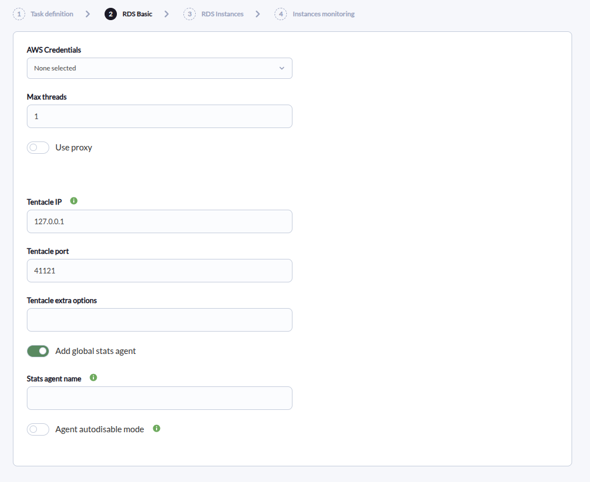
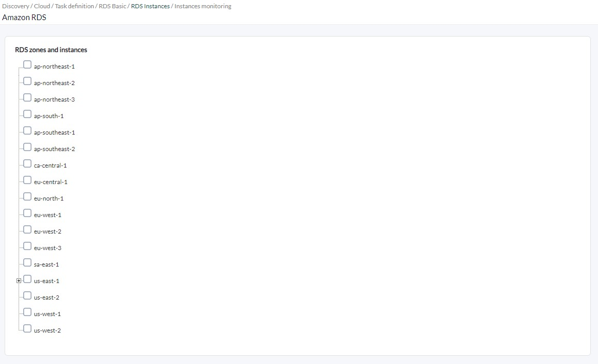
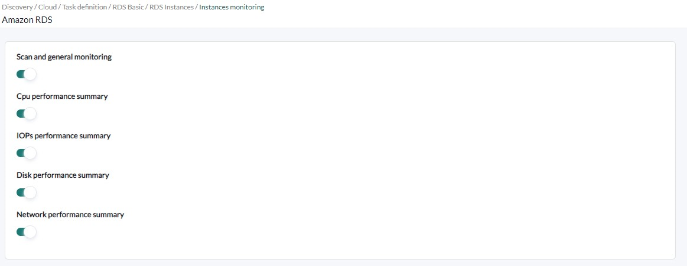
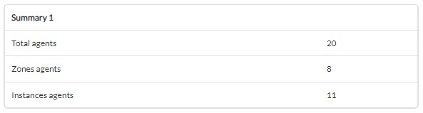

# Amazon RDS Discovery

*Article last updated: 2026-10-26.*

## What it monitors

The Amazon RDS Discovery addon monitors Amazon Web Services RDS database instances and the regions that contain them. It queries the AWS APIs and turns the result into Pandora FMS agents and modules: instance state, database connections, CPU, disk, IOPS and network performance.

A Discovery task generates three kinds of agents:

- **A global statistics agent** (optional) with the number of instances found.
- **One agent per monitored region**, with summary modules aggregated over the instances of that region.
- **One agent per monitored instance**, with its state and performance modules. The instance agent is a child of its region agent.

A region can be selected as a whole, in which case every instance it contains is monitored, including instances created later. Individual instances can also be selected without selecting their region.

## Prepare

### Compatibility

| Scope | State | Evidence |
|-------|-------|----------|
| Addon `pandorafms.aws.rds`, version `1.2` | Documented target | The version this page describes. See [Addon identity](#addon-identity) |
| Network access from the Discovery server to the AWS APIs | `Required` | The addon calls the AWS RDS and CloudWatch APIs |
| AWS access key with the permissions listed in [AWS permissions](#aws-permissions) | `Required` | Prerequisite, not a compatibility statement |
| Operating system of the Discovery server | `Not validated` | No operating system has been recorded for this version |
| Specific Pandora FMS versions | `Not validated` | No version matrix has been recorded for this addon |

### Prerequisites

1. **Connectivity** from the Discovery server to the AWS APIs, directly or through an HTTPS proxy.
2. **An AWS access key** (access key ID and secret access key) with the permissions described below, registered in the Pandora FMS credential store as an AWS credential.
3. **Pandora FMS**: a Discovery server to run the task and the console to define it.

The addon ships its own executables, `bin/pandora_aws_rds` and `bin/aws_rds`, so nothing else has to be installed on the Discovery server to run a task.

### AWS permissions

The addon performs read-only requests:

| AWS action | Used for |
|------------|----------|
| `rds:DescribeDBInstances` | Listing the instances of every region (always) |
| `cloudwatch:GetMetricData` | Connection, CPU, disk, IOPS and network metrics (when **Scan and general monitoring** is enabled) |

An IAM policy that grants both:

```json
{
  "Version": "2012-10-17",
  "Statement": [
    {
      "Effect": "Allow",
      "Action": [
        "rds:DescribeDBInstances",
        "cloudwatch:GetMetricData"
      ],
      "Resource": "*"
    }
  ]
}
```

Attach the policy to a dedicated IAM user created for Pandora FMS and generate an access key for it. Omit `cloudwatch:GetMetricData` if you will not enable **Scan and general monitoring**.

The credential stored in Pandora FMS must provide the keys `access_key_id` and `secret_access_key`; the addon reports `Error while parsing credentials` when either is missing.

### Install the addon

Download the `.disco` package from the Pandora FMS Marketplace entry, which is limited to licensed users:

[https://marketplace.pandorafms.com/entries/pandorafms.aws.rds](https://marketplace.pandorafms.com/entries/pandorafms.aws.rds)

Load it into Pandora FMS. Once loaded, **Amazon RDS** is available in the **Cloud** section when creating Discovery tasks.

## Configure the Discovery task

Create the task from the Discovery cloud applications and choose **Amazon RDS**. The console presents the fields in three steps; every field is documented in [Task parameters](#task-parameters).

1. **RDS Basic** — credentials, execution and agent options:

    - **AWS Credentials**: the AWS credential registered in the credential store.
    - **Max threads**: number of groups the monitored regions and instances are divided into.
    - **Use proxy**, **Proxy url** and **Verify proxy SSL**: route the AWS requests through an HTTPS proxy.
    - **Tentacle IP**, **Tentacle port** and **Tentacle extra options**: where and how the generated agent data is sent. They rarely need changing.
    - **Add global stats agent** and **Stats agent name**: create the global agent and optionally name it.
    - **Agent autodisable mode**: disables the agent when all its modules become unknown until data returns.

    

2. **RDS Instances** — a tree of regions and instances read from your AWS account with the selected credential. Check a region to monitor it and all of its instances, or check individual instances. Instances are listed under their region, under a node for their database engine. Select at least one region or instance.

    

3. **Instances monitoring** — the metrics collected:

    - **Scan and general monitoring**: enables database connections and the CPU, IOPs, disk and network options below.
    - **Cpu performance summary**, **IOPs performance summary**, **Disk performance summary**, **Network performance summary**: shown only when **Scan and general monitoring** is enabled.

    

The task's group and interval come from the generic task-definition step and are applied to the agents the task creates.

## Verify the first run

Force the task from the Discovery task list and check the result in this order.

1. **The task summary.** A task that completes successfully reports:

    - **Total agents**: all agents generated, including the global agent when enabled.
    - **Zones agents**: regions monitored.
    - **Instances agents**: instances monitored.

    A task that does not complete successfully records the errors in its execution information instead.

    

2. **The agents.** One per selected region, one per instance and, when enabled, the global agent. Instance agents are children of their region agent.

3. **The modules.** Every instance agent has `State` and `Instance State (bool)`. Performance modules appear only on instances in the `available` state; see [Understand the results](#understand-the-results).

## Understand the results

### Agents generated

| Agent | Alias | Parent | Notes |
|-------|-------|--------|-------|
| Global agent | The **Stats agent name**, or `Aws.rds` when empty | None | Created only when **Add global stats agent** is enabled |
| Region agent | The region name, for example `eu-west-1` | The global agent only when a **Stats agent name** was given | One per selected region |
| Instance agent | The instance identifier | Its region agent | One per instance, created once even when both the instance and its region are selected. The agent version is the instance class and the address is the instance endpoint address. The region agent is created only when the region itself is selected |

Agent identity does not depend on the task: region agents are identified by the access key and region, and instance agents by the access key and instance identifier. Moving a region or instance between tasks that use the same access key keeps reporting to the same agent and preserves its history.

Region and instance agents report the operating system name `Aws` and the operating system version `rds`. The global agent reports the operating system name `Aws`.

### Modules per agent

**Global agent**

| Module | Type | Description |
|--------|------|-------------|
| `AWS RDS Instances count` | `generic_data` | Instances found in the selected regions and instances |

**Region agent**

| Module | Condition | Description |
|--------|-----------|-------------|
| `summary.aws.rds.instances` | Always | Instances in the region |
| `summary.aws.rds.DBconnections` | **Scan and general monitoring** | Sum of the database connections of the available instances |
| `summary.aws.rds.CPUUtilization`, `summary.aws.rds.CPUCreditBalance`, `summary.aws.rds.CPUCreditUsage`, `summary.aws.rds.CPUSurplusCreditBalance`, `summary.aws.rds.CPUSurplusCreditsCharged` | **Scan and general monitoring** and **Cpu performance summary** | Sum over the available instances divided by the number of instances in the region |
| `summary.aws.rds.DiskReadBytes`, `summary.aws.rds.diskWriteBytes`, `summary.aws.rds.BinLogDiskUsage` | **Scan and general monitoring** and **Disk performance summary** | Sum over the available instances, in `Bytes` |
| `summary.aws.rds.DiskReadOps`, `summary.aws.rds.DiskWriteOps`, `summary.aws.rds.LVMReadIOPS`, `summary.aws.rds.LVMWriteIOPS` | **Scan and general monitoring** and **IOPs performance summary** | Sum over the available instances |
| `summary.aws.rds.NetworkReceiveThroughput`, `summary.aws.rds.NetworkTransmitThroughput` | **Scan and general monitoring** and **Network performance summary** | Sum over the available instances |

**Instance agent**

| Module | Type | Condition | CloudWatch metric |
|--------|------|-----------|-------------------|
| `State` | `generic_data_string` | Always | None. Instance status as reported by AWS |
| `Instance State (bool)` | `generic_proc` | Always | None. `1` when the status is `available`, `0` otherwise |
| `DatabaseConnections` | `generic_data` | Available, **Scan and general monitoring** | `DatabaseConnections` |
| `CPUUtilization`, `CPUCreditBalance`, `CPUCreditUsage`, `CPUSurplusCreditBalance`, `CPUSurplusCreditsCharged` | `generic_data` | Available, **Cpu performance summary** | The metric of the same name |
| `DiskReadBytes`, `DiskWriteBytes` | `generic_data` | Available, **Disk performance summary** | `ReadThroughput`, `WriteThroughput` (unit `Bytes`) |
| `BinLogDiskUsage` | `generic_data` | Available, **Disk performance summary** | `BinLogDiskUsage` (unit `Bytes`) |
| `DiskReadOps`, `DiskWriteOps` | `generic_data` | Available, **IOPs performance summary** | `ReadIOPS`, `WriteIOPS` |
| `LVMReadIOPS`, `LVMWriteIOPS` | `generic_data` | Available, **IOPs performance summary** | The metric of the same name |
| `NetworkReceiveThroughput`, `NetworkTransmitThroughput` | `generic_data` | Available, **Network performance summary** | The metric of the same name |

### How the values are obtained

- Each performance value is the average that AWS CloudWatch returns, in the `AWS/RDS` namespace, over a 10-minute period for the last 10 minutes. When CloudWatch returns no data point in that window, the module value is `0`. This includes metrics that AWS does not publish for a given instance.
- Performance modules are created only for instances whose status is `available`.

## Operate

### Manual execution

The addon can run outside a Discovery task. The executable takes a single parameter, the path to a configuration file described in [Configuration file](#configuration-file):

```bash
./pandora_aws_rds --conf <PATH_TO_CONFIG>
```

It prints a JSON summary and sends one data file per agent using the configured transfer mode:

```json
{"summary": {"Total agents": 5, "Zones agents": 2, "Instances agents": 2}}
```

When errors occur, the JSON also contains an `info` key with the messages and the exit code is `1`.

In `local` transfer mode the data files are moved to `data_dir`. In `tentacle` mode the `tentacle_client` executable must be available in the `PATH` of the user running the addon.

A configuration file contains the AWS access key encoded in `creds_b64`. Protect the file with restrictive permissions.

## Troubleshoot

The addon has no verbose or debug flag. Its diagnostic channel is the `info` field of the JSON execution result, which is shown in the task's execution information.

- **`Error while parsing credentials`**: the credential does not provide `access_key_id` and `secret_access_key`, or `creds_b64` is not valid base64-encoded JSON.
- **The instance tree is empty or lacks a region**: regions whose `DescribeDBInstances` request fails are omitted from the tree without an error. Check the `rds:DescribeDBInstances` permission of the key and the status of the region in AWS.
- **A region agent appears but has no instance agents**: the region has no instances, or the instance request for that region failed.
- **`Error while running threads: list index out of range`**: the task has no region or instance selected. Select at least one.
- **Fewer agents than expected**: only the regions and instances you checked are monitored.
- **`Error getting metric: <metric> : ...`**: the CloudWatch request failed. Check that the access key has `cloudwatch:GetMetricData` and that the clock of the Discovery server is correct; the message includes the current date seen by the addon.
- **Performance modules are `0`**: CloudWatch returned no data point in the last 10 minutes for that instance and metric.
- **No performance modules on an instance**: the instance status is not `available`, or **Scan and general monitoring** is disabled.
- **Errors reaching AWS through a proxy**: check **Proxy url**; only HTTPS requests are routed through it.

## Reference

### Task parameters

#### RDS Basic

| Field | Macro | Type | Default | Notes |
|-------|-------|------|---------|-------|
| AWS Credentials | `_credentials_` | credential select (AWS) | — | Mandatory. Credential registered in the credential store |
| Max threads | `_threads_` | number | `1` | Optional. Regions and instances are distributed in groups, never more groups than targets |
| Use proxy | `_useProxy_` | checkbox | off | Route AWS requests through a proxy |
| Proxy url | `_proxyUrl_` | string | — | Optional. Shown when **Use proxy** is on. Applied to HTTPS requests |
| Verify proxy SSL | `_sslCheck_` | checkbox | off | Shown when **Use proxy** is on. When off, the addon does not validate TLS certificates in its AWS connections |
| Tentacle IP | `_tentacleIP_` | string | `127.0.0.1` | Server that receives the agent data |
| Tentacle port | `_tentaclePort_` | number | `41121` | Tentacle port |
| Tentacle extra options | `_tentacleExtraOpt_` | string | — | Optional. Extra Tentacle client options |
| Add global stats agent | `_statsAgent_` | checkbox | on | Create the global agent |
| Stats agent name | `_statsAgentName_` | string | empty | Optional. Shown when **Add global stats agent** is on. When empty, the global agent alias is `Aws.rds` |
| Agent autodisable mode | `_agentautodisable_` | checkbox | off | Disables the agent when all its modules become unknown until data returns |

Because **Verify proxy SSL** is only shown with **Use proxy**, a task that does not use a proxy always runs with TLS certificate validation disabled. Run such tasks only from a network you trust.

#### RDS Instances

| Field | Macro | Type | Notes |
|-------|-------|------|-------|
| RDS zones and instances | `_rdsZones_`, `_rdsInstance_` | tree | Regions populate the region list and instances the instance list. Select at least one |

#### Instances monitoring

| Field | Macro | Type | Default | Notes |
|-------|-------|------|---------|-------|
| Scan and general monitoring | `_rdsInstanceSummary_` | checkbox | off | Enables database connections and the performance modules |
| Cpu performance summary | `_rdsCpuPerfSummary_` | checkbox | off | Shown with **Scan and general monitoring** |
| IOPs performance summary | `_rdsIopsPerfSummary_` | checkbox | off | Shown with **Scan and general monitoring** |
| Disk performance summary | `_rdsDiskPerfSummary_` | checkbox | off | Shown with **Scan and general monitoring** |
| Network performance summary | `_rdsNetworkPerfSummary_` | checkbox | off | Shown with **Scan and general monitoring** |

### Configuration file

Used by manual execution. One `key = value` per line. List values are JSON arrays. Numeric options accept `1` to enable and `0` to disable; a value that is not a number is read as `0`.

| Key | Default | Description |
|-----|---------|-------------|
| `agents_group_name` | `aws` | Group of the generated agents |
| `interval` | `300` | Agent interval, in seconds |
| `threads` | `1` | Number of groups the targets are distributed in |
| `transfer_mode` | `local` | `local` writes the data files to `data_dir`; any other value sends them with Tentacle |
| `tentacle_client` | `tentacle_client` | Tentacle client executable |
| `tentacle_ip` | `127.0.0.1` | Tentacle server address |
| `tentacle_port` | `41121` | Tentacle server port |
| `tentacle_opts` | empty | Extra Tentacle client options |
| `data_dir` | `/var/spool/pandora/data_in/` | Destination of the data files in `local` mode |
| `temporal` | `/tmp` | Directory where the data files are written before sending |
| `advance_monitoring` | `1` | Database connections and performance modules; required for the four options below |
| `cpu_summary` | `1` | CPU modules |
| `iops_summary` | `1` | IOPS modules |
| `disk_summary` | `1` | Disk modules |
| `network_summary` | `1` | Network modules |
| `aws_regions` | `[]` | Regions to monitor |
| `aws_instances` | `[]` | Instance identifiers to monitor |
| `stats_agent` | `1` | Global agent |
| `stats_agent_name` | empty | Name of the global agent; `Aws.rds` alias when empty |
| `agent_autodisable` | `0` | Autodisable mode |
| `use_proxy` | `0` | Use a proxy |
| `proxy_url` | empty | Proxy URL |
| `ssl_check` | `0` | `1` validates TLS certificates; `0` does not |
| `creds_b64` | empty | Mandatory. Base64 of the JSON `{"access_key_id": "<ACCESS_KEY_ID>", "secret_access_key": "<SECRET_ACCESS_KEY>"}` |

Example:

```ini
agents_group_name  = aws
interval           = 300
threads            = 2
transfer_mode      = tentacle
tentacle_ip        = <TENTACLE_SERVER_IP>
tentacle_port      = 41121

advance_monitoring = 1
cpu_summary        = 1
iops_summary       = 1
disk_summary       = 1
network_summary    = 1

stats_agent        = 1
stats_agent_name   = Rds

aws_regions        = ["us-east-1","eu-west-1"]
aws_instances      = ["<DB_INSTANCE_IDENTIFIER>"]

creds_b64          = <BASE64_CREDENTIALS>
```

### Addon identity

| Item | Value |
|------|-------|
| Name | Amazon RDS |
| Identifier | `pandorafms.aws.rds` |
| Version | `1.2` |
| Type and section | Discovery, `cloud` |
| Marketplace entry | [pandorafms.aws.rds](https://marketplace.pandorafms.com/entries/pandorafms.aws.rds), updated 2026-08-31 |
| Availability | The Marketplace entry states that the download is limited to licensed users |
