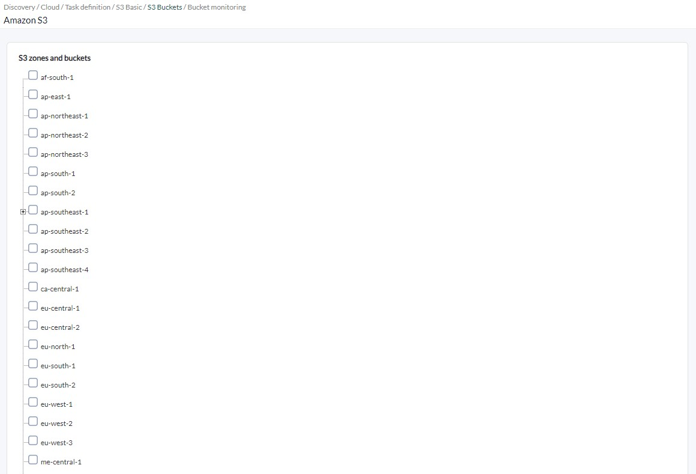
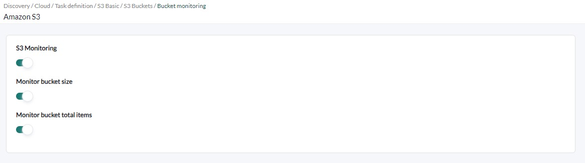
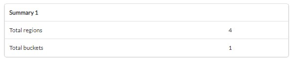

# Amazon S3 Discovery

*Article last updated: 2026-10-26.*

## What it monitors

The Amazon S3 Discovery addon monitors Amazon Web Services S3 buckets. It queries the AWS APIs and turns the result into Pandora FMS agents and modules: the number of buckets per region and, for each bucket, its number of objects and its size.

A Discovery task generates two kinds of agents:

- **A global statistics agent** (optional) with the number of monitored buckets.
- **One agent per monitored region**, with a module for the object count and a module for the size of each monitored bucket.

A region can be selected as a whole, in which case every bucket it contains is monitored, including buckets created later. Individual buckets can also be monitored without selecting their region (see [Configuration file](#configuration-file)).

## Prepare

### Compatibility

| Scope | State | Evidence |
|-------|-------|----------|
| Addon `pandorafms.aws.s3`, version `1.0` | Documented target | The version this page describes. See [Addon identity](#addon-identity) |
| Network access from the Discovery server to the AWS APIs | `Required` | The addon calls the AWS S3 API |
| AWS access key with the permissions listed in [AWS permissions](#aws-permissions) | `Required` | Prerequisite, not a compatibility statement |
| Operating system of the Discovery server | `Not validated` | No operating system has been recorded for this version |
| Specific Pandora FMS versions | `Not validated` | No version matrix has been recorded for this addon |

### Prerequisites

1. **Connectivity** from the Discovery server to the AWS APIs, directly or through an HTTPS proxy.
2. **An AWS access key** (access key ID and secret access key) with the permissions described below, registered in the Pandora FMS credential store as an AWS credential.
3. **Pandora FMS**: a Discovery server to run the task and the console to define it.

The addon ships its own executables, `bin/pandora_aws_s3` and `bin/aws_s3`, so nothing else has to be installed on the Discovery server to run a task.

### AWS permissions

The addon performs read-only requests:

| AWS action | Used for |
|------------|----------|
| `s3:ListAllMyBuckets` | Listing the buckets of the account |
| `s3:GetBucketLocation` | Finding the region of each bucket |
| `s3:ListBucket` | Listing the objects of a bucket to count them and add up their size |

An IAM policy that grants all of them:

```json
{
  "Version": "2012-10-17",
  "Statement": [
    {
      "Effect": "Allow",
      "Action": [
        "s3:ListAllMyBuckets",
        "s3:GetBucketLocation",
        "s3:ListBucket"
      ],
      "Resource": "*"
    }
  ]
}
```

Attach the policy to a dedicated IAM user created for Pandora FMS and generate an access key for it.

The credential stored in Pandora FMS must provide the keys `access_key_id` and `secret_access_key`; the addon fails with `Error while parsing credentials` when either is missing.

### Install the addon

Download the `.disco` package from the Pandora FMS Marketplace entry, which is limited to licensed users:

[https://marketplace.pandorafms.com/entries/pandorafms.aws.s3](https://marketplace.pandorafms.com/entries/pandorafms.aws.s3)

Load it into Pandora FMS. Once loaded, **Amazon S3** is available in the **Cloud** section when creating Discovery tasks.

## Configure the Discovery task

Create the task from the Discovery cloud applications and choose **Amazon S3**. The console presents the fields in three steps; every field is documented in [Task parameters](#task-parameters).

1. **S3 Basic** — credentials, execution and agent options:

    - **AWS Credentials**: the AWS credential registered in the credential store.
    - **Max threads**: number of groups the monitored regions are divided into.
    - **Use proxy**, **Proxy url** and **Verify proxy SSL**: route the AWS requests through an HTTPS proxy.
    - **Tentacle IP**, **Tentacle port** and **Tentacle extra options**: where and how the generated agent data is sent. They rarely need changing.
    - **Add global stats agent** and **Stats agent name**: create the global agent and optionally name it.

    <!-- SCREENSHOT NEEDED: S3 Basic wizard step showing credentials, Max threads, proxy, Tentacle and stats agent fields, with no real credentials or addresses. -->

2. **S3 Buckets** — a tree of S3 regions read from your AWS account with the selected credential. Check a region to monitor all the buckets it contains.

    

3. **Bucket monitoring** — the metrics collected:

    - **S3 Monitoring**: enables the bucket modules below.
    - **Monitor bucket size** and **Monitor bucket total items**: shown only when **S3 Monitoring** is enabled.

    

The task's group and interval come from the generic task-definition step and are applied to the agents the task creates.

## Verify the first run

Force the task from the Discovery task list and check the result in this order.

1. **The task summary.** A task that completes successfully reports:

    - **Total buckets**: buckets monitored.
    - **Total regions**: regions with monitored buckets or selected as a whole.

    A task that does not complete successfully records the errors in its execution information instead.

    

2. **The agents.** One per selected region and, when enabled, the global agent.

3. **The modules.** Each region agent has, for every monitored bucket, `bucket.items <bucket>` and `bucket.size <bucket>`; see [Understand the results](#understand-the-results).

## Understand the results

### Agents generated

| Agent | Alias | Parent | Notes |
|-------|-------|--------|-------|
| Global agent | The **Stats agent name**, or `Aws` when empty | None | Created only when **Add global stats agent** is enabled |
| Region agent | The region name, for example `eu-west-1` | The global agent only when a **Stats agent name** was given | One per selected region and per region that contains an individually selected bucket |

Buckets do not get their own agent: they are reported as modules of their region agent.

Region agent identity does not depend on the task: it is defined by the access key and the region. Moving a region between tasks that use the same access key keeps reporting to the same agent and preserves its history.

All agents report the operating system name `Aws`. Region agents report `ec2` as the operating system version.

### Modules per agent

**Global agent**

| Module | Type | Description |
|--------|------|-------------|
| `AWS S3 Buckets count` | `generic_data` | Buckets found in the selected regions and buckets |

**Region agent**

| Module | Type | Condition | Description |
|--------|------|-----------|-------------|
| `summary.Aws.ec2.buckets` | `generic_data` | Region selected as a whole | Buckets in the region |
| `bucket.items <bucket>` | `generic_data` | **S3 Monitoring** and **Monitor bucket total items** | Number of objects of the bucket |
| `bucket.size <bucket>` | `generic_data` | **S3 Monitoring** and **Monitor bucket size** | Size of the bucket, in `GB`, with eight decimals |

A region agent is created only if it has at least one module. A region selected as a whole always has `summary.Aws.ec2.buckets`.

## Operate

### Manual execution

The addon can run outside a Discovery task. The executable takes a single parameter, the path to a configuration file described in [Configuration file](#configuration-file):

```bash
./pandora_aws_s3 --conf <PATH_TO_CONFIG>
```

It prints a JSON summary and sends one data file per agent using the configured transfer mode:

```json
{"summary": {"Total buckets": 32, "Total regions": 7}}
```

When errors occur, the JSON also contains an `info` key with the messages and the exit code is `1`.

In `local` transfer mode the data files are moved to `data_dir`. In `tentacle` mode the `tentacle_client` executable must be available in the `PATH` of the user running the addon.

A configuration file contains the AWS access key encoded in `creds_b64`. Protect the file with restrictive permissions.

## Troubleshoot

The addon has no verbose or debug flag. Its diagnostic channel is the `info` field of the JSON execution result, which is shown in the task's execution information.

- **`Error while parsing credentials`**: the credential does not provide `access_key_id` and `secret_access_key`, or `creds_b64` is not valid base64-encoded JSON.
- **`Error while reading configuration file`**: the file passed to `--conf` cannot be read.
- **`Error while parsing configuration zones or buckets`**: `aws_regions` or `aws_buckets` is not a valid JSON array.
- **Fewer agents than expected**: only the regions and buckets you selected are monitored. A selected region with no buckets still produces its region agent.
- **No bucket modules**: **S3 Monitoring** is disabled, or both **Monitor bucket size** and **Monitor bucket total items** are.
- **Access errors while listing buckets or objects**: check that the access key has the three permissions in [AWS permissions](#aws-permissions). The message includes the error returned by AWS.
- **Errors reaching AWS through a proxy**: check **Proxy url**; only HTTPS requests are routed through it.
- **Tentacle errors**: the message is recorded in `info` prefixed with `Tentacle error:`. Check **Tentacle IP** and **Tentacle port**.

## Reference

### Task parameters

#### S3 Basic

| Field | Macro | Type | Default | Notes |
|-------|-------|------|---------|-------|
| AWS Credentials | `_credentials_` | credential select (AWS) | — | Mandatory. Credential registered in the credential store |
| Max threads | `_threads_` | number | `1` | Optional. Regions are distributed in groups, never more groups than regions |
| Use proxy | `_useProxy_` | checkbox | off | Route AWS requests through a proxy |
| Proxy url | `_proxyUrl_` | string | — | Optional. Shown when **Use proxy** is on. Applied to HTTPS requests |
| Verify proxy SSL | `_sslCheck_` | checkbox | off | Shown when **Use proxy** is on. When off, the addon does not validate TLS certificates in its AWS connections |
| Tentacle IP | `_tentacleIP_` | string | `127.0.0.1` | Server that receives the agent data |
| Tentacle port | `_tentaclePort_` | number | `41121` | Tentacle port |
| Tentacle extra options | `_tentacleExtraOpt_` | string | — | Optional. Extra Tentacle client options |
| Add global stats agent | `_statsAgent_` | checkbox | on | Create the global agent |
| Stats agent name | `_statsAgentName_` | string | `Aws` | Optional. Shown when **Add global stats agent** is on |

Because **Verify proxy SSL** is only shown with **Use proxy**, a task that does not use a proxy always runs with TLS certificate validation disabled. Run such tasks only from a network you trust.

#### S3 Buckets

| Field | Macro | Type | Notes |
|-------|-------|------|-------|
| S3 zones and buckets | `_s3Zone_` | tree | Selected regions. Optional |

#### Bucket monitoring

| Field | Macro | Type | Default | Notes |
|-------|-------|------|---------|-------|
| S3 Monitoring | `_s3Monitoring_` | checkbox | on | Enables the bucket modules |
| Monitor bucket size | `_s3Size_` | checkbox | on | Shown with **S3 Monitoring** |
| Monitor bucket total items | `_s3Items_` | checkbox | on | Shown with **S3 Monitoring** |

### Configuration file

Used by manual execution. One `key = value` per line. List values are JSON arrays. Numeric options accept `1` to enable and `0` to disable; a value that is not a number is read as `0`.

| Key | Default | Description |
|-----|---------|-------------|
| `agents_group_name` | `aws` | Group of the generated agents |
| `interval` | `300` | Agent interval, in seconds |
| `threads` | `1` | Number of groups the regions are distributed in |
| `transfer_mode` | `local` | `local` writes the data files to `data_dir`; any other value sends them with Tentacle |
| `tentacle_client` | `tentacle_client` | Tentacle client executable |
| `tentacle_ip` | `127.0.0.1` | Tentacle server address |
| `tentacle_port` | `41121` | Tentacle server port |
| `tentacle_opts` | empty | Extra Tentacle client options |
| `data_dir` | `/var/spool/pandora/data_in/` | Destination of the data files in `local` mode |
| `temporal` | `/tmp` | Directory where the data files are written before sending |
| `s3_monitoring` | `1` | Bucket modules; required for the two options below |
| `size_monitoring` | `1` | Bucket size modules |
| `items_monitoring` | `1` | Bucket object count modules |
| `aws_regions` | `[]` | Regions to monitor; every bucket of a listed region is monitored |
| `aws_buckets` | `[]` | Names of the buckets to monitor |
| `stats_agent` | `1` | Global agent |
| `stats_agent_name` | empty | Name of the global agent; `Aws` alias when empty |
| `use_proxy` | `0` | Use a proxy |
| `proxy_url` | empty | Proxy URL |
| `ssl_check` | `0` | `1` validates TLS certificates; `0` does not |
| `creds_b64` | empty | Mandatory. Base64 of the JSON `{"access_key_id": "<ACCESS_KEY_ID>", "secret_access_key": "<SECRET_ACCESS_KEY>"}` |

Example:

```ini
agents_group_name  = Aws
interval           = 300
threads            = 4
transfer_mode      = tentacle
tentacle_ip        = <TENTACLE_SERVER_IP>
tentacle_port      = 41121

s3_monitoring      = 1
size_monitoring    = 1
items_monitoring   = 1

stats_agent        = 1
stats_agent_name   = AwsCloud

aws_regions        = ["us-east-1","eu-west-1"]
aws_buckets        = ["<BUCKET_NAME>"]

creds_b64          = <BASE64_CREDENTIALS>
```

### Addon identity

| Item | Value |
|------|-------|
| Name | Amazon S3 |
| Identifier | `pandorafms.aws.s3` |
| Version | `1.0` |
| Type and section | Discovery, `cloud` |
| Marketplace entry | [pandorafms.aws.s3](https://marketplace.pandorafms.com/entries/pandorafms.aws.s3), updated 2025-06-01 |
| Availability | The Marketplace entry states that the download is limited to licensed users |
