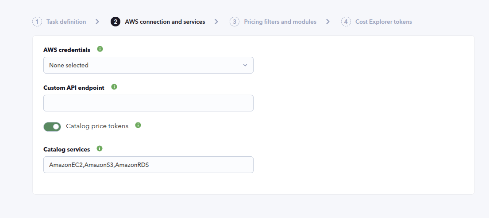
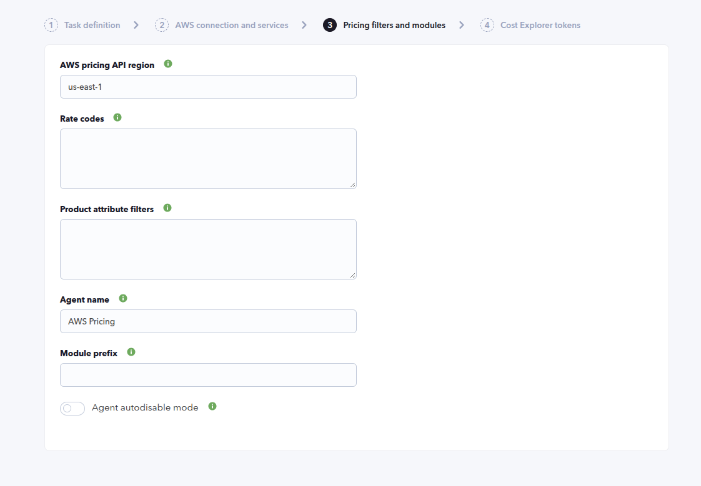
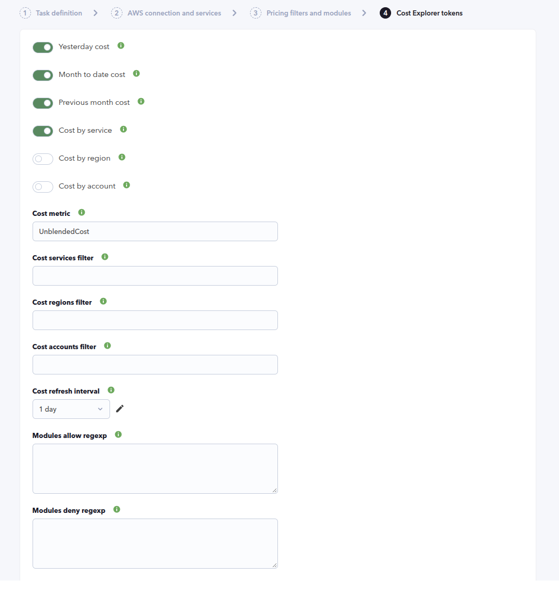
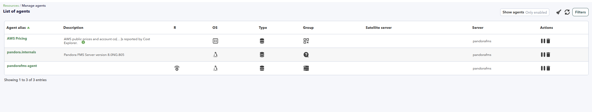
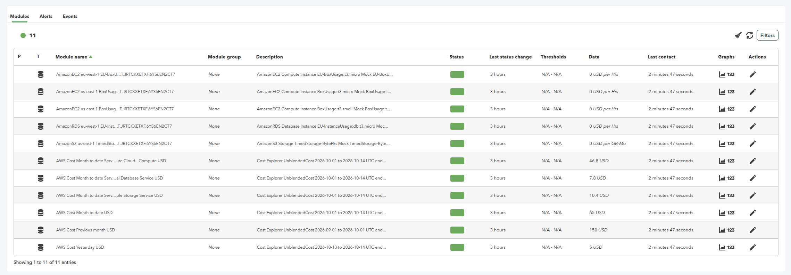
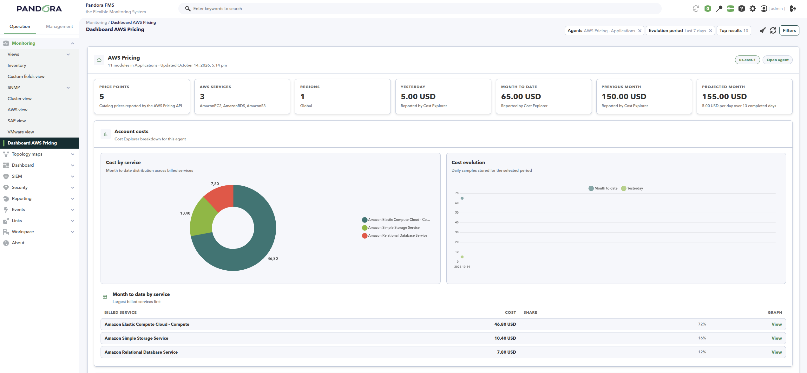
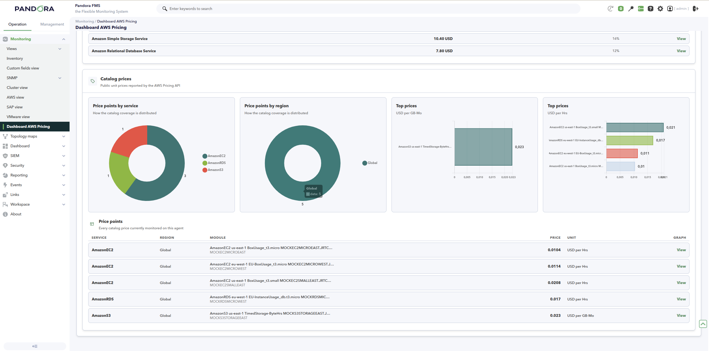

# AWS Pricing Discovery

*Article last updated: 2026-10-14.*

## What it monitors

The AWS Pricing Discovery plugin reads two AWS APIs to describe both the public price of AWS services and the costs billed to an AWS account:

- The **AWS Price List API** returns the public on-demand unit prices of the catalog services you select, for example EC2, S3 and RDS.
- The **AWS Cost Explorer API** returns the costs billed to the account: totals for the previous day, the current month to date and the previous month, and optional month-to-date breakdowns by billed service, region and linked account.

The plugin generates a single Pandora FMS agent that holds every configured catalog price and account cost as a module. It runs as a Discovery task: the console creates the task, the Discovery server runs the plugin, and the agent and its modules are created automatically. The task delivers the generated data through Tentacle.

A companion console extension, **Dashboard AWS Pricing**, presents the data of these agents as a dashboard. See [Dashboard AWS Pricing](#dashboard-aws-pricing).

## Prepare

### Compatibility

| Scope | State | Evidence |
| --- | --- | --- |
| Plugin version `1.0` (`pandorafms.aws.pricing`) | Documented target | The version this page describes, as identified by the package definition. |
| An AWS credential with read access to the AWS Price List API and the AWS Cost Explorer API | `Required` | The plugin performs read-only product, price and cost queries with the selected credential-store entry. |
| A specific AWS region, service or account | `Not validated` | No published test record establishes compatibility with a concrete AWS region, service catalog or account type. |
| Host operating system running the plugin | `Not validated` | No published test record establishes operating-system compatibility. |

### Requirements

- A Pandora FMS server with Discovery enabled to run the task, and a console to define it.
- An AWS credential-store entry with read access to the AWS Price List API (to read catalog prices) and to the AWS Cost Explorer API (to read account costs). The plugin only reads data; it never changes the AWS account. Grant the minimum read permissions your monitoring needs.
- The services you want to price, given as their AWS service codes (EC2 is `AmazonEC2`, S3 is `AmazonS3`, RDS is `AmazonRDS`).
- A target agent group and a monitoring interval for the generated agent. Both come from the Discovery task and are inherited by the agent.
- Network reachability to the Tentacle destination, because the task transfers the generated data through Tentacle.
- The plugin is distributed as a Pandora FMS Discovery application (`.disco` package) that the Discovery server executes on the Pandora FMS server.

### Install the plugin

Load the `.disco` package from **Management → Discovery → Manage disco packages**: choose **Select a file**, pick the package, and click **Upload DISCO**. After loading, **AWS Pricing** appears in the package list and under the **Applications** section of the Discovery wizard.

## Configure the Discovery task

Create the task from **Management → Discovery → Applications → AWS Pricing**. The wizard walks through the generic task definition and three plugin steps: **AWS connection and services**, **Pricing filters and modules** and **Cost Explorer tokens**. Every field is documented in [Task parameters](#task-parameters).

### Step 1 — Task definition

The generic step asks for the task **name**, the **agent group** and **server** on which the task runs, and the **interval**. The group and the interval are passed to the plugin and inherited by the generated agent.

### Step 2 — AWS connection and services

Connection details and the catalog services to price:

- **AWS credentials** selects the credential-store entry the plugin uses to reach the AWS APIs. Required.
- **Custom API endpoint** overrides the AWS API endpoint used for both the Price List and the Cost Explorer calls. Leave it empty to use AWS.
- **Catalog price tokens**, when enabled, collects the public unit prices of the catalog services listed below.
- **Catalog services** is the comma-separated list of AWS service codes to price. It is only shown when **Catalog price tokens** is enabled.



### Step 3 — Pricing filters and modules

Filters for the catalog prices and the identity of the generated agent:

- **AWS pricing API region** is the AWS Price List API endpoint region, usually `us-east-1`.
- **Rate codes** optionally keeps only the price dimensions whose AWS rate code matches one of the listed codes, one per line.
- **Product attribute filters** optionally keeps only products matching the exact AWS product attributes, one `Attribute=Value` pair per line (for example `location=US East (N. Virginia)`).
- **Agent name** is the name of the generated agent. It defaults to `AWS Pricing`.
- **Module prefix** optionally prepends text to every catalog price and account cost module name.
- **Agent autodisable mode**, when enabled, creates the generated agent in autodisabled mode.



### Step 4 — Cost Explorer tokens

Which account costs to read and how to query them:

- **Yesterday cost**, **Month to date cost** and **Previous month cost** create the account total modules for the previous day, the current month to date and the previous calendar month.
- **Cost by service**, **Cost by region** and **Cost by account** create one module per billed service, region and linked account for the current month to date.
- **Cost metric** selects the Cost Explorer metric to read. Use `UnblendedCost` for direct costs or `AmortizedCost` to spread prepaid reservation costs.
- **Cost services filter**, **Cost regions filter** and **Cost accounts filter** restrict the cost query to the listed billing names, region codes and 12-digit account IDs. Leave them empty to include everything the credentials can access.
- **Cost refresh interval** is the time between Cost Explorer API queries. Between refreshes the plugin reuses its cached cost results.
- **Modules allow regexp** and **Modules deny regexp** optionally keep or exclude module names matching the listed regular expressions, one per line.



## Verify the first run

Run the task from **Management → Discovery → Task list** and check the result in this order.

1. **The task summary** shows the overall progress and a summary with the number of resources discovered and the number of modules created.
2. **The agent.** Expect a single agent whose name is the configured **Agent name**. It appears in the agent list with `AWS` as its operating system.

   

3. **The modules.** The agent carries one module per discovered catalog price point plus, for each enabled Cost Explorer token, its cost module or modules.

   

4. **The execution information.** A successful run reports no errors. Any per-API failure is recorded there as information, and the rest of the modules are still generated.

If no agent is created, confirm that catalog prices or at least one Cost Explorer token is enabled, that at least one catalog service is listed when catalog prices are enabled, and that the credentials and the target group are valid.

## Understand the results

### Agents and identity

The plugin creates exactly one agent per Discovery task and fills it with every configured catalog price and account cost. The agent belongs to the task's agent group, inherits its interval, reports `AWS` as its operating system, and uses the AWS pricing API region as its address. The agent name is the configured **Agent name**; changing it later changes the identity of the generated agent.

### Modules by agent

The agent receives two module families, identified by the `extra_data` marker the plugin writes so that names can be translated, truncated or escaped safely:

| Family | Module name | Value |
| --- | --- | --- |
| Catalog price | `<module prefix><service code> <region> <usage type> <rate code>` | Public unit price |
| Cost total | `<module prefix>AWS Cost <token> <currency>` | Account cost for the token period |
| Cost by service | `<module prefix>AWS Cost Month to date Service <billing name> <currency>` | Month-to-date cost of that billed service |
| Cost by region | `<module prefix>AWS Cost Month to date Region <region> <currency>` | Month-to-date cost of that region |
| Cost by account | `<module prefix>AWS Cost Month to date Account <account> <currency>` | Month-to-date cost of that linked account |

Catalog price modules are of type *Generic data* and carry the currency and measure as their unit, for example `USD per Hrs` or `USD per GB-Mo`. Cost modules are of type *Generic data* and carry the currency returned by AWS as their unit. Credits and negative amounts are kept as reported.

The exact name and default state of every module are listed in [Generated modules](#generated-modules).

### Dashboard AWS Pricing

The **Dashboard AWS Pricing** extension is a console dashboard that reads the agents and modules created by this plugin. It does not query AWS: it only displays the modules the plugin already collected. It appears in the console's **Monitoring** menu as **Dashboard AWS Pricing** and is available with agent read permission (`AR`).

For each agent it shows one panel with:

- **Summary cards**: the number of **Price points**, **AWS services** and **Regions** in the catalog, the **Yesterday**, **Month to date** and **Previous month** account costs, and a **Projected month** estimate derived from the month-to-date cost and the completed days of the month.
- **Account costs**: a **Cost by service** doughnut, a **Cost evolution** line chart with the daily samples stored for the selected period, and a **Month to date by service** table. The region and account breakdowns appear when their tokens are enabled.
- **Catalog prices**: **Price points by service** and **Price points by region** doughnuts, one **Top prices** bar chart per price unit, and a **Price points** table with the service, region, module, price and unit of every catalog price.

A side filter narrows the view by **Agents**, **AWS services**, **Evolution period** and **Top results**. The dashboard needs the same extra_data markers the plugin writes; agents and modules created before the marker existed are recognised through the legacy `aws-cost` markers but should be refreshed by running the task again.





## Operate

### Manual execution

The plugin can also be run outside the Discovery wizard with a configuration file, for connectivity testing or a one-off run. Write a configuration file (see [Configuration file](#configuration-file)) and run the plugin entry point with it:

```sh
pandora_aws_pricing --conf /path/to/aws_pricing.conf
```

The run prints the generated agent and module data as a single JSON document. When the plugin runs as a Discovery task, the same information becomes the task execution information.

### Cost caching

Cost Explorer queries are cached. The plugin stores the returned cost modules in a temporary file and reuses them until the **Cost refresh interval** elapses, so repeated task runs normally do not issue additional cost requests. The cache is keyed by the cost configuration and the current day, and is only rewritten after a query succeeds, so a failed run keeps the previous data. Set a short refresh interval only while testing.

On the first day of the month there are no completed current-month days yet, so the month-to-date breakdown modules (by service, region and account) may not be created until the second day.

## Troubleshoot

| Symptom | Check |
| --- | --- |
| No agent is created | The plugin requires catalog prices or at least one Cost Explorer token. Enable one of them. |
| The task reports that at least one catalog service must be selected | **Catalog price tokens** is enabled but **Catalog services** is empty. List at least one service code. |
| The task reports that the credentials could not be decoded | Recreate the credential-store entry: it must contain an access key ID and a secret access key. |
| The task reports that the group ID must be greater than 0 | Select a target **agent group** in the task definition. |
| Catalog prices are missing but costs are present | The Price List query failed. Check the catalog service codes, the rate codes and the product attribute filters; any failure is reported as **AWS Pricing** information in the execution. |
| Costs are missing but catalog prices are present | The Cost Explorer query failed. Check the cost metric, the cost filters and the credential permissions; the failure is reported as **Cost Explorer** information in the execution, and the previous cached costs are kept. |
| A cost module is empty or zero on the first days of the month | The current month has few completed days. The value grows as the month advances. |
| Fewer catalog prices than expected | The catalog query stops at the configured product limit and reports a **Product limit reached** notice. Narrow the catalog services or the product attribute filters. |
| The dashboard shows no data for an agent | Confirm the agent was created by this plugin and that the module list is populated. The dashboard only reads the plugin's agents and modules. |

## Reference

### Task parameters

The console presents these fields after the generic task definition. The macro column is the identifier used in the generated task configuration.

#### AWS connection and services

| Field | Macro | Type | Default | Notes |
| --- | --- | --- | --- | --- |
| AWS credentials | `_credentials_` | select (credentials) | — | Credential-store entry with read access to the AWS APIs. Required |
| Custom API endpoint | `_apiEndpoint_` | string | — | Overrides the AWS API endpoint. Leave empty to use AWS |
| Catalog price tokens | `_catalogPrices_` | checkbox | on | Collects the public unit prices of the catalog services |
| Catalog services | `_serviceCodes_` | string | `AmazonEC2,AmazonS3,AmazonRDS` | Comma-separated AWS service codes. Only shown when **Catalog price tokens** is on |

#### Pricing filters and modules

| Field | Macro | Type | Default | Notes |
| --- | --- | --- | --- | --- |
| AWS pricing API region | `_pricingRegion_` | string | `us-east-1` | AWS Price List API endpoint region |
| Rate codes | `_rateCodes_` | textarea | — | One AWS rate code per line to keep only those price dimensions |
| Product attribute filters | `_productFilters_` | textarea | — | One `Attribute=Value` pair per line to keep only matching products |
| Agent name | `_agentName_` | string | `AWS Pricing` | Name of the generated agent |
| Module prefix | `_modulePrefix_` | string | — | Text prepended to every catalog price and account cost module name |
| Agent autodisable mode | `_agentautodisable_` | checkbox | off | Creates the generated agent in autodisabled mode |

#### Cost Explorer tokens

| Field | Macro | Type | Default | Notes |
| --- | --- | --- | --- | --- |
| Yesterday cost | `_costYesterday_` | checkbox | on | Total account cost for the previous UTC day |
| Month to date cost | `_costMonthToDate_` | checkbox | on | Total account cost from the first day of this month through yesterday UTC |
| Previous month cost | `_costPreviousMonth_` | checkbox | on | Total account cost for the entire previous calendar month |
| Cost by service | `_costByService_` | checkbox | on | One module per billed service for the current month to date |
| Cost by region | `_costByRegion_` | checkbox | off | One module per region for the current month to date, including global costs |
| Cost by account | `_costByAccount_` | checkbox | off | One module per linked account for the current month to date |
| Cost metric | `_costMetric_` | string | `UnblendedCost` | Cost Explorer metric: `UnblendedCost`, `NetUnblendedCost`, `BlendedCost`, `AmortizedCost` or `NetAmortizedCost` |
| Cost services filter | `_costServices_` | string | — | Comma-separated billing names. Empty selects all |
| Cost regions filter | `_costRegions_` | string | — | Comma-separated region codes. Empty includes all and global costs |
| Cost accounts filter | `_costAccounts_` | string | — | Comma-separated 12-digit linked account IDs. Empty selects all accessible accounts |
| Cost refresh interval | `_costRefreshInterval_` | select (interval) | `1 day` | Time between Cost Explorer queries; the cache is reused in between |
| Modules allow regexp | `_moduleAllow_` | textarea | — | One regular expression per line; only matching module names are kept |
| Modules deny regexp | `_moduleDeny_` | textarea | — | One regular expression per line; matching module names are excluded |

### Configuration file

The Discovery task builds a configuration file for the plugin. The same format is used for a manual execution. It is a plain text file of `key=value` lines; empty lines, comments and section headers are ignored.

| Key | Default | Description |
| --- | --- | --- |
| `interval` | `300` | Monitoring interval in seconds, inherited by the agent |
| `group_id` | — | ID of the group where the agent is created. Required, greater than 0 |
| `creds_b64` | — | Base64-encoded AWS credential object. Required |
| `api_endpoint` | — | AWS API endpoint override, used for both APIs |
| `catalog_prices_enabled` | `1` | Collects catalog prices when truthy |
| `service_codes` | `AmazonEC2,AmazonS3,AmazonRDS` | Catalog service codes to price |
| `pricing_region` | `us-east-1` | AWS Price List API endpoint region |
| `cost_yesterday` | `1` | Reads the previous-day total cost |
| `cost_month_to_date` | `1` | Reads the month-to-date total cost |
| `cost_previous_month` | `1` | Reads the previous-month total cost |
| `cost_by_service` | `1` | Reads the month-to-date per-service breakdown |
| `cost_by_region` | `0` | Reads the month-to-date per-region breakdown |
| `cost_by_account` | `0` | Reads the month-to-date per-account breakdown |
| `cost_metric` | `UnblendedCost` | Cost Explorer metric |
| `cost_services` | — | Cost query service filter, comma-separated |
| `cost_regions` | — | Cost query region filter, comma-separated |
| `cost_accounts` | — | Cost query account filter, comma-separated |
| `cost_refresh_interval` | `86400` | Seconds between Cost Explorer queries; `0` disables the cache |
| `cost_cache` | task temporary file | Path of the Cost Explorer cache file |
| `rate_codes_file` | — | File with one AWS rate code per line |
| `product_filters_file` | — | File with one `Attribute=Value` product filter per line |
| `module_allow_file` | — | File with one allow regular expression per line |
| `module_deny_file` | — | File with one deny regular expression per line |
| `max_products` | `250` | Maximum number of catalog price dimensions collected per run; `0` removes the limit |
| `module_prefix` | — | Prefix for catalog price and account cost module names |
| `agent_name` | `AWS Pricing` | Name of the generated agent |
| `agent_autodisable` | `0` | Creates the agent in autodisabled mode when truthy |

### Command line

| Argument | Description |
| --- | --- |
| `--conf <file>` | Runs the plugin with the given configuration file |
| `--mode discover` | Default mode: reads prices and costs and writes the generated agent and module data |
| `--mode get_services` | Returns the catalog service list the wizard offers as selectable services |
| `--creds <base64>` | Base64-encoded AWS credential object for wizard lookups |
| `--api-endpoint <url>` | AWS API endpoint override, used for both APIs |

### Generated modules

One agent is created with the configured name. Its modules are:

#### Catalog price

One module per collected price dimension of the selected services, after the rate-code, product-attribute, allow and deny filters are applied. The name follows `<module prefix><service code> <region> <usage type> <rate code>`, the description repeats the service, product family, usage type, price description and term type, and the unit is the currency and measure, for example `USD per Hrs` or `USD per GB-Mo`.

#### Account cost totals

Created for each enabled total token, using the currency returned by AWS:

| Token | Module name |
| --- | --- |
| **Yesterday cost** | `AWS Cost Yesterday <currency>` |
| **Month to date cost** | `AWS Cost Month to date <currency>` |
| **Previous month cost** | `AWS Cost Previous month <currency>` |

#### Account cost breakdowns

Created for each enabled breakdown token, one module per billed entry:

| Token | Module name |
| --- | --- |
| **Cost by service** | `AWS Cost Month to date Service <billing name> <currency>` |
| **Cost by region** | `AWS Cost Month to date Region <region> <currency>` |
| **Cost by account** | `AWS Cost Month to date Account <account> <currency>` |

### Plugin identity

The plugin marks its agent and modules with `extra_data` values so the console extension and any other view can identify them without depending on the agent or module name:

| Surface | Marker |
| --- | --- |
| Agent | `aws-pricing:agent:<pricing region>:<cost metric>` |
| Catalog price module | `aws-pricing:catalog:<service>:<region>:<sku>:<rate code>` |
| Account cost module | `aws-pricing:cost:<token>:<identity>:<currency>` |

Cost modules created by earlier versions of the plugin may use the legacy `aws-cost:<token>:<identity>:<currency>` marker; the dashboard recognises both.
