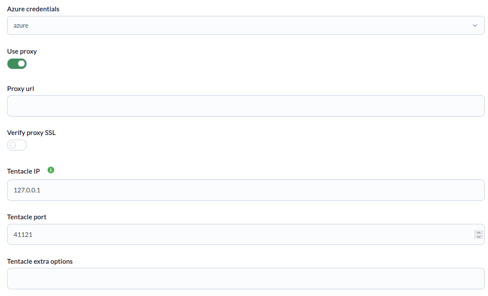
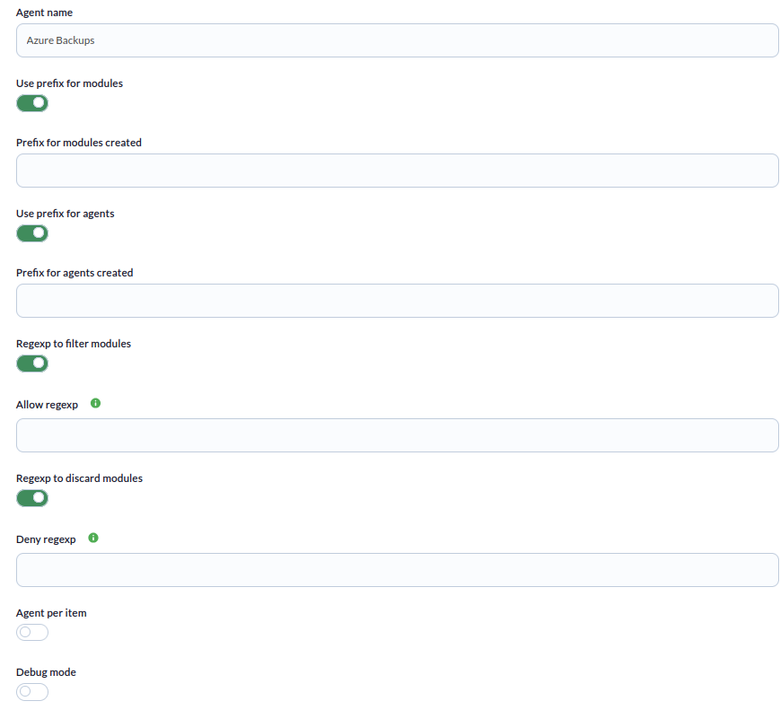

# Azure backup Discovery

*Article last updated: 2026-10-26.*

## What it monitors

The Azure backup Discovery addon monitors the state of the backups that Azure Backup keeps for the resources protected in an Azure subscription. It reads every Recovery Services vault of the subscription and, for each protected item, reports the time since the last backup, the number of recovery points, and the protection, last backup and health states. With it you can detect failed or stale backups and protection that has been paused, stopped or is in error.

The addon creates Pandora FMS agents and modules from that data. A Discovery task generates either:

- **One agent** (default) that holds the modules of every protected item.
- **One agent per protected item**, when **Agent per item** is enabled.

Every protected item has six modules, described in [Understand the results](#understand-the-results). A single task covers one Azure subscription, the one that belongs to the credential it uses.

## Prepare

### Compatibility

| Scope | State | Evidence |
|-------|-------|----------|
| Addon `pandorafms.azure.backup`, version `1.0` | Documented target | The version this page describes. See [Addon identity](#addon-identity) |
| Network access from the Discovery server to the Azure APIs | `Required` | The addon queries the Azure Recovery Services and Backup APIs |
| Azure application with read access to the backup vaults of the subscription | `Required` | See [Azure credentials](#azure-credentials) |
| Operating system of the Discovery server | `Not validated` | No operating system has been recorded for this version |
| Specific Pandora FMS versions | `Not validated` | No version matrix has been recorded for this addon |

### Prerequisites

1. **Connectivity** from the Discovery server to the Azure APIs, directly or through a proxy.
2. **An Azure credential** registered in the Pandora FMS credential store, built from an Azure application registration as described below.
3. **Pandora FMS**: a Discovery server to run the task and the console to define it.

The addon ships its own executable, `bin/pandora_azure_backup`, so nothing else has to be installed on the Discovery server to run a task.

### Azure credentials

The credential stored in Pandora FMS must provide these four values:

| Key | What to enter |
|-----|---------------|
| `subscription_id` | The ID of the subscription whose backups you want to monitor. It is shown in the subscription overview of the Azure portal |
| `tenant_domain` | The tenant (directory) ID of the Microsoft Entra ID tenant, shown in the Entra ID overview |
| `client_id` | The application (client) ID of an application registration |
| `application_secret` | A client secret created for that application registration |

Create the application registration in the Azure portal following the Microsoft documentation, and generate a client secret for it. The addon authenticates with the client ID and secret; if any of the four keys is missing, the task fails with `Error while parsing credentials`.

### Azure permissions

The addon performs read-only requests: it lists the vaults of the subscription, the protected items of each vault and the recovery points of each item. The application therefore needs read access to those resources. Earlier guidance for this addon assigned the built-in **Reader** role to the application at subscription scope, using **Access control (IAM)** > **Add role assignment** and selecting the application as a service principal member. This page does not establish that role as the minimum required.

### Install the addon

Download the `.disco` package from the Pandora FMS Marketplace entry:

[https://marketplace.pandorafms.com/entries/pandorafms.azure.backup](https://marketplace.pandorafms.com/entries/pandorafms.azure.backup)

Load it into Pandora FMS. Once loaded, **Azure backup** is available in the **Cloud** section when creating Discovery tasks.

## Configure the Discovery task

Create the task from the Discovery cloud applications and choose **Azure backup**. The console presents the fields in two steps; every field is documented in [Task parameters](#task-parameters).

1. **Azure Backup base** — credentials, proxy and data transfer:

    - **Azure credentials**: the Azure credential registered in the credential store.
    - **Use proxy** and **Proxy url**: route the Azure requests through a proxy. **Proxy url** is required when **Use proxy** is enabled.
    - **Verify proxy SSL**: shown when **Use proxy** is enabled.
    - **Tentacle IP**, **Tentacle port** and **Tentacle extra options**: where and how the generated agent data is sent. They rarely need changing.

    

2. **Azure Backup Detailed** — agent layout and filters:

    - **Agent name**: name of the agent that holds the modules when **Agent per item** is off.
    - **Use prefix for modules** and **Prefix for modules created**, **Use prefix for agents** and **Prefix for agents created**: prepend a text to every module or agent name.
    - **Regexp to filter modules** with **Allow regexp**, and **Regexp to discard modules** with **Deny regexp**: restrict which protected items are monitored.
    - **Agent per item**: create one agent per protected item.
    - **Debug mode**.

    

The task's group and interval come from the generic task-definition step. The group is applied to the agents the task creates.

## Verify the first run

Force the task from the Discovery task list and check the result in this order.

1. **The task summary.** A task that completes successfully reports **Total agents**, the number of agents generated. A task that does not complete successfully records the errors in its execution information instead.

    <!-- SCREENSHOT NEEDED: Discovery task execution summary for an Azure backup task showing Total agents. -->

2. **The agents.** One agent named after **Agent name** (default `Azure Backups`), or one per protected item when **Agent per item** is enabled.

3. **The modules.** Six modules per protected item, named `<item name> Last backup`, `<item name> Recovery points` and so on.

    <!-- SCREENSHOT NEEDED: Agent generated by an Azure backup task showing the six modules of one protected item, with lab identifiers only. -->

If no agent is created and **Total agents** is `0`, the subscription has no protected items, or the filters excluded all of them.

## Understand the results

### Agents generated

| Mode | Agent name | Notes |
|------|------------|-------|
| **Agent per item** off | **Agent name** (default `Azure Backups`) with **Prefix for agents created** prepended | One agent with the modules of all the protected items |
| **Agent per item** on | The protected item name with **Prefix for agents created** prepended | One agent per protected item. Items with the same name in different vaults report to the same agent |

The protected item name is the name Azure Backup gives the item, with every `;` replaced by `_`. Agents are created in the task's group, with a 300-second interval and the description `Created by plugin Azure Backups`. Agents are identified by name, so renaming the agent or changing a prefix creates new agents.

### Modules per protected item

Each module name is **Prefix for modules created**, followed by the item name and the suffix below.

| Module suffix | Type | Value | Description |
|---------------|------|-------|-------------|
| `Last backup` | `generic_data_string` | Time elapsed since the last backup, in hundredths of a second (unit `_timeticks_`). `0` when Azure reports no last backup time | The description holds the vault name and the date of the last backup |
| `Recovery points` | `generic_data` | Number of recovery points of the item. `0` when they cannot be listed | |
| `Protection state` | `generic_data` | Numeric code, see below | The description holds the protection state and the health status |
| `Last backup status` | `generic_data` | Numeric code, see below | The description holds the status reported by Azure |
| `Health status` | `generic_data` | Numeric code, see below | The description holds the status reported by Azure |
| `Protection status` | `generic_data` | Numeric code, see below | The description holds the status reported by Azure |

#### Numeric codes

A value that Azure does not report, or that is not in the tables below, is `0`.

| `Protection state` | Code |
|--------------------|------|
| `Protected` | `1` |
| `IRPending` | `2` |
| `Invalid` | `3` |
| `BackupsSuspended` | `4` |
| `ProtectionPaused` | `5` |
| `ProtectionStopped` | `6` |
| `ProtectionError` | `7` |

| `Last backup status` | Code |
|----------------------|------|
| `Failed` | `0` |
| `Completed`, `Healthy` | `1` |
| `IRPending` | `2` |
| `Invalid` | `3` |
| `Unhealthy` | `4` |

| `Health status` | Code |
|-----------------|------|
| `Passed` | `1` |
| `ActionSuggested` | `2` |
| `ActionRequired` | `3` |
| `Invalid` | `4` |

| `Protection status` | Code |
|---------------------|------|
| `Healthy` | `1` |
| `Unhealthy` | `2` |

`Failed` and an unreported last backup status both produce `0`; use the module description to tell them apart.

### How the filters work

**Allow regexp** and **Deny regexp** are evaluated against the protected item name, after the `;` replacement and before any prefix. They select items, not individual modules: the six modules of an item are all created or all skipped. The allow filter is applied first, and an item that matches the deny filter is skipped even if it matches the allow filter. Both use search semantics, so a pattern matches anywhere in the name.

## Operate

### Manual execution

The addon can run outside a Discovery task. The executable takes a single parameter, the path to a configuration file described in [Configuration file](#configuration-file):

```bash
./pandora_azure_backup --conf <PATH_TO_CONFIG>
```

It prints a JSON result with the number of agents generated and sends one data file per agent through Tentacle. When errors occur, the JSON also contains an `info` key with the messages and the exit code is `1`.

The configuration file contains the Azure credential encoded in `creds_b64`. Protect the file with restrictive permissions.

### Known limitations in this version

- **Verify proxy SSL** and **Debug mode** do not change the behavior of a task. The SSL value is read but not used, and the wizard does not set the addon's debug mode. Debug messages are only available through manual execution with `debug_mode = 1`.
- **Tentacle extra options** are accepted but not passed to the Tentacle client when the agent data is sent.
- The generated agents always use a 300-second interval, whatever the task interval is.

## Troubleshoot

The diagnostic channel is the `info` field of the JSON execution result, which is shown in the task's execution information.

- **`Error while parsing credentials`**: the credential does not provide `client_id`, `application_secret`, `tenant_domain` and `subscription_id`, or `creds_b64` is not valid base64-encoded JSON.
- **`[ERROR] The proxy URL needs to be specified.`**: **Use proxy** is enabled and **Proxy url** is empty.
- **`Error creating clients`**: the Azure client could not be created from the credential. The message includes the detail.
- **`[Error]: ...`**: a request to Azure failed while listing vaults or protected items, for example because the application lacks read access to the subscription or an allow/deny pattern is not a valid regular expression. The message includes the error returned.
- **`Total agents` is `0`**: no protected items exist in the subscription, or the allow and deny filters excluded all of them.
- **`Recovery points` is `0`**: the item has no recovery points, or they could not be listed. The addon does not report an error in the second case.
- **An item is missing from an agent in `Agent per item` mode**: a failure while building the modules of one item is silently skipped unless `debug_mode` is enabled in manual execution.

## Reference

### Task parameters

#### Azure Backup base

| Field | Macro | Type | Default | Notes |
|-------|-------|------|---------|-------|
| Azure credentials | `_credentials_` | credential select (Azure) | — | Mandatory. Credential registered in the credential store |
| Use proxy | `_useProxy_` | checkbox | off | Route Azure requests through a proxy |
| Proxy url | `_proxyUrl_` | string | — | Optional field. Shown when **Use proxy** is on; the task fails if it is empty while the proxy is enabled |
| Verify proxy SSL | `_sslCheck_` | checkbox | off | Shown when **Use proxy** is on. No effect in this version |
| Tentacle IP | `_tentacleIP_` | string | `127.0.0.1` | Server that receives the agent data |
| Tentacle port | `_tentaclePort_` | number | `41121` | Tentacle port |
| Tentacle extra options | `_tentacleExtraOpt_` | string | — | Optional. See [Known limitations](#known-limitations-in-this-version) |

#### Azure Backup Detailed

| Field | Macro | Type | Default | Notes |
|-------|-------|------|---------|-------|
| Agent name | `_agentName_` | string | `Azure Backups` | Used only when **Agent per item** is off |
| Use prefix for modules | `_usePrefixModules_` | checkbox | off | |
| Prefix for modules created | `_prefixModules_` | string | — | Shown with **Use prefix for modules** |
| Use prefix for agents | `_usePrefixAgents_` | checkbox | off | |
| Prefix for agents created | `_prefixAgents_` | string | — | Shown with **Use prefix for agents** |
| Regexp to filter modules | `_regexpFilter_` | checkbox | off | |
| Allow regexp | `_allowRegexp_` | string | — | Shown with **Regexp to filter modules**. Only protected items whose name matches are monitored |
| Regexp to discard modules | `_regexpDiscard_` | checkbox | off | |
| Deny regexp | `_denyRegexp_` | string | — | Shown with **Regexp to discard modules**. Protected items whose name matches are not monitored |
| Agent per item | `_agentPerVm_` | checkbox | off | One agent per protected item |
| Debug mode | `_sslCheck_` | checkbox | off | No effect in this version |

### Configuration file

Used by manual execution. One `key = value` per line. Numeric options accept `1` to enable and `0` to disable; a value that is not a number is read as `0`.

| Key | Default | Description |
|-----|---------|-------------|
| `agents_group_name` | empty | Group of the generated agents |
| `agent_name` | `Azure Backups` | Agent that holds the modules when `agent_per_vm` is `0` |
| `agent_prefix` | empty | Prefix for agent names |
| `module_prefix` | empty | Prefix for module names |
| `transfer_mode` | `tentacle` | Transfer mode of the generated data |
| `tentacle_ip` | `127.0.0.1` | Tentacle server address |
| `tentacle_port` | `41121` | Tentacle server port |
| `tentacle_opts` | empty | Accepted, but not passed to the Tentacle client in this version |
| `use_proxy` | `0` | Use a proxy |
| `proxy_url` | empty | Proxy URL. Mandatory when `use_proxy` is `1` |
| `agent_per_vm` | `0` | One agent per protected item |
| `debug_mode` | `0` | Adds messages about items whose agent or modules could not be created to the `info` output |
| `allow_regexp` | empty | Allow filter |
| `deny_regexp` | empty | Deny filter |
| `creds_b64` | empty | Mandatory. Base64 of the JSON `{"client_id": "<CLIENT_ID>", "application_secret": "<CLIENT_SECRET>", "tenant_domain": "<TENANT_ID>", "subscription_id": "<SUBSCRIPTION_ID>"}` |

Example:

```ini
agents_group_name = <AGENT_GROUP>
agent_name        = Azure Backups
transfer_mode     = tentacle
tentacle_ip       = <TENTACLE_SERVER_IP>
tentacle_port     = 41121
use_proxy         = 0
agent_per_vm      = 0
debug_mode        = 1
allow_regexp      =
deny_regexp       =
creds_b64         = <BASE64_CREDENTIALS>
```

### Addon identity

| Item | Value |
|------|-------|
| Name | Azure backup |
| Identifier | `pandorafms.azure.backup` |
| Version | `1.0` |
| Type and section | Discovery, `cloud` |
| Marketplace entry | [pandorafms.azure.backup](https://marketplace.pandorafms.com/entries/pandorafms.azure.backup), updated 2026-04-08 |
| Availability | The Marketplace entry does not state license restrictions |
