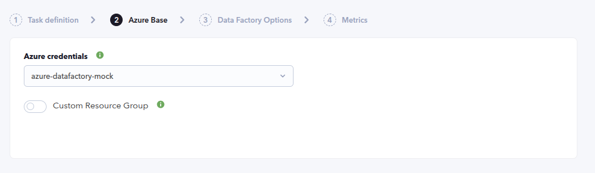
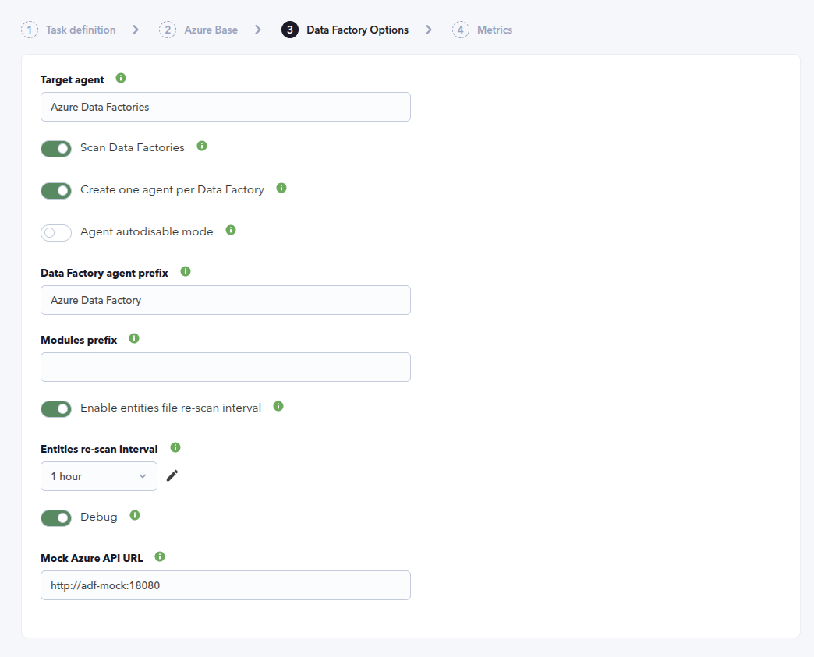
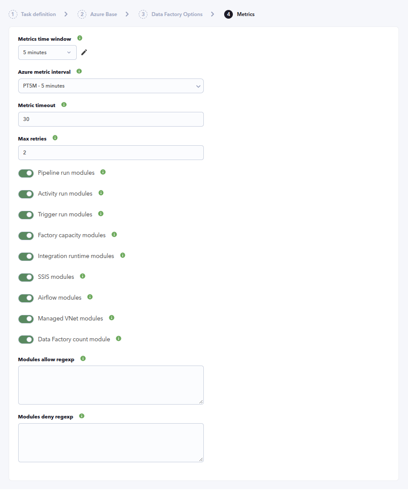
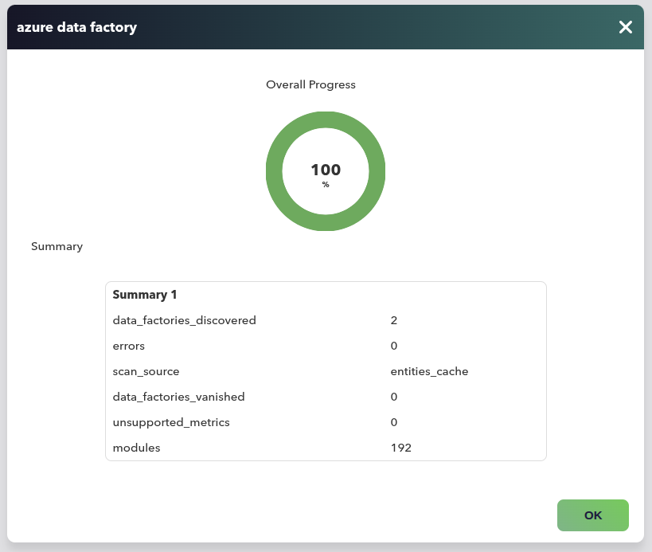
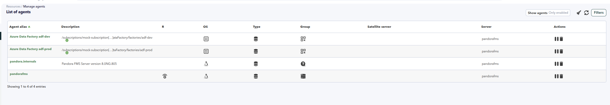
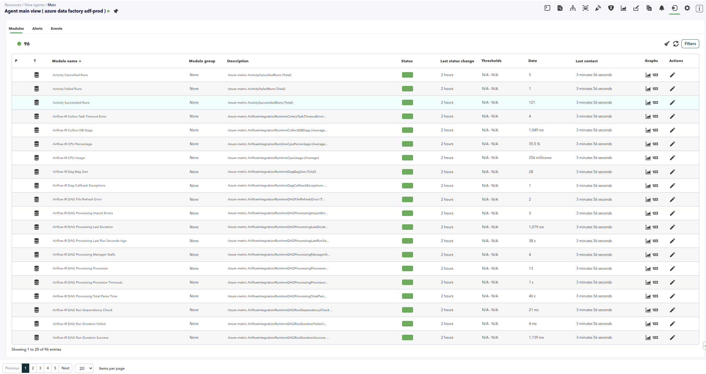
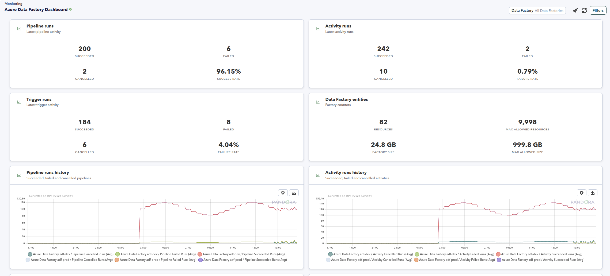
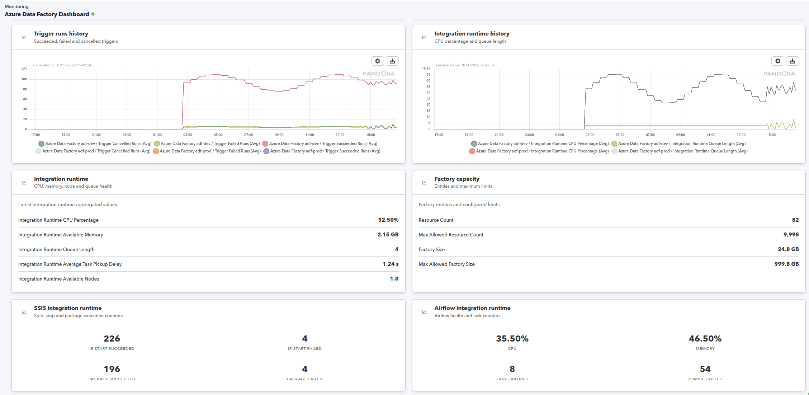
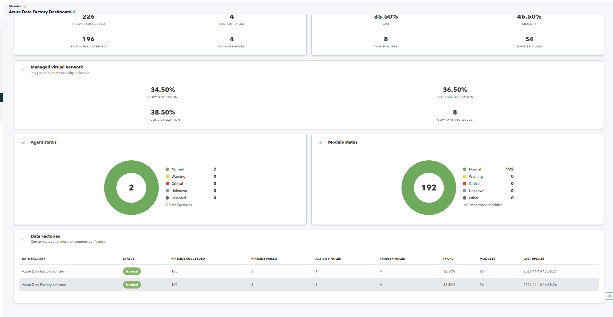

# Azure Data Factory Discovery

*Article last updated: 2026-11-10.*

## What it monitors

The Azure Data Factory Discovery plugin retrieves the Data Factories of a Microsoft Azure subscription and turns their Azure Monitor metrics into Pandora FMS agents and modules: pipeline, activity and trigger runs, factory capacity and entity limits, integration runtime health, SSIS activity, Airflow integration runtime activity and managed virtual network capacity.

By default it creates **one agent per Data Factory**, named with the Data Factory name and an optional prefix. It can also consolidate every retrieved Data Factory onto a single agent. Each agent carries a connection module, a Data Factory count and one module per enabled metric that Azure Monitor returns for the resource.

A companion console extension, **Azure Data Factory Dashboard**, presents the generated agents and modules in a consolidated view with run counters, history charts, integration runtime and capacity panels, status summaries and a per-Data Factory table.

## Prepare

### Compatibility

| Scope | State | Evidence |
| --- | --- | --- |
| Plugin version `1.0` (`pandorafms.azure.datafactory`) | Documented target | The version this page describes. See [Plugin identity](#plugin-identity) |
| Microsoft Azure Data Factory, Azure Resource Manager and Azure Monitor | `Required` | The plugin lists Data Factories with the Azure Resource Manager API and reads their metrics with the Azure Monitor API |
| A Microsoft Entra service principal able to list Data Factories and read their Azure Monitor metrics | `Required` | Prerequisite, not a compatibility statement. See [Prepare Azure access](#prepare-azure-access) |
| A Pandora FMS agent group with an ID greater than `0` | `Required` | The `All` group has ID `0` and cannot be used |
| Sovereign or custom Azure clouds | `Not validated` | The endpoints are the public Azure ones; no test record establishes operation against a non-public cloud |
| Host operating system running the plugin | `Not validated` | No test record establishes operating-system compatibility |

### Prerequisites

1. **A Pandora FMS server with Discovery enabled** to execute the task, and the console to define it.
2. **A Microsoft Azure subscription** containing Data Factories.
3. **An Azure credential** stored in the Pandora FMS credential store, or its values supplied directly for a manual run.
4. **A valid agent group** for the task. The `All` group is not valid, because its ID is `0`.

The plugin is distributed as a self-contained executable: the packaged Discovery app ships `bin/pandora_azure_datafactory`, so no additional runtime has to be installed on the Pandora FMS server or for a manual run.

### Prepare Azure access

Create a Microsoft Entra service principal that can list the Data Factories and read their Azure Monitor metrics, over the subscription or the Resource Group to be discovered. The plugin lists the Data Factories with the Azure Resource Manager API and reads the metrics with the Azure Monitor API, so the principal needs read access to both. Do not grant a broader role than your policy requires.

Store its **Client ID**, **Application secret**, **Tenant or domain name** and **Subscription id** as an Azure credential in the Pandora FMS credential store, so the task references the credential instead of carrying the secret itself.

A role with read access over the subscription or the Resource Group is enough in most environments. For example, the built-in `Reader` role can list the Data Factories and read their metrics; use the narrowest scope that your policy allows. The principal is created from Azure CLI with:

```bash
az ad sp create-for-rbac \
  --name pandora-azure-data-factory-discovery \
  --role Reader \
  --scopes /subscriptions/<SUBSCRIPTION_ID>
```

The command returns the values to store, mapped as follows:

```text
tenant       -> Tenant or domain name
appId        -> Client ID
password     -> Application secret
subscription -> Subscription id
```

### Install the plugin

Upload the `.disco` package from **Management → Discovery → Extension manager**. Once loaded, **Azure Data Factory** appears under the **Cloud** category of the Discovery wizard.

## Configure the Discovery task

Create the task from **Management → Discovery → Cloud → Azure Data Factory**. The wizard's generic first step defines the task; the package adds **Azure Base**, **Data Factory Options** and **Metrics**. Every field is documented in [Task parameters](#task-parameters).

**Step 1 — Task definition.** Name, group, server and interval. The group must have an ID greater than `0`; `All` cannot be used. The group and interval are passed to the plugin and inherited by every generated agent.

**Step 2 — Azure Base.** Which subscription to read and how much of it:

- **Azure credentials** selects the stored Azure credential. The credential contains the Client ID, Application secret, Tenant or domain name and Subscription ID.
- **Custom Resource Group** limits discovery to a single Resource Group, and **Resource group** names it exactly. Regular expressions are not accepted here.



**Step 3 — Data Factory Options.** Agent layout, discovery cache and diagnostics:

- **Target agent** is used only when **Create one agent per Data Factory** is disabled.
- **Scan Data Factories** queries Azure to retrieve the current Data Factories; when disabled the cached entities file is reused.
- **Create one agent per Data Factory** decides the agent layout: one agent per resource, or every module on the single **Target agent**.
- **Agent autodisable mode** creates the generated agents in Pandora FMS mode `2`.
- **Data Factory agent prefix** names the per-Data Factory agents.
- **Modules prefix** is prepended to every generated module name.
- **Enable entities file re-scan interval** and **Entities re-scan interval** control how long the discovered cache is reused before being rebuilt.
- **Debug** reveals the local mock option, which exists for testing only. Leave **Debug** off and **Mock Azure API URL** empty in real environments.



**Step 4 — Metrics.** Which metric families are collected:

- **Metrics time window** is the range queried in Azure Monitor and **Azure metric interval** is the time grain.
- **Metric timeout** bounds each request and **Max retries** covers temporary Azure errors and HTTP 429 responses.
- One toggle per metric family: **Pipeline run modules**, **Activity run modules**, **Trigger run modules**, **Factory capacity modules**, **Integration runtime modules**, **SSIS modules**, **Airflow modules**, **Managed VNet modules** and **Data Factory count module**.
- **Modules allow regexp** and **Modules deny regexp** filter the final module names.



## Verify the first run

Force the task from **Management → Discovery → Task list** and check the result in this order.

1. **The task summary** reports `data_factories_discovered`, `data_factories_vanished`, `modules`, `errors`, `unsupported_metrics` and `scan_source`. `scan_source` is `azure` when the run retrieved the Data Factories from Azure, or `entities_cache` when the entity cache was reused.

2. **The agents.** Named `<Data Factory agent prefix><Data Factory name>` by default, so `Azure Data Factory adf-prod`. Each one reports `Azure` as its operating system and `Azure Data Factory` as its version, and inherits the task's group and interval. The agent address is the Data Factory name and its description is the Azure resource ID.

3. **`Data Factory Connection`** is `1` on every retrieved Data Factory. A `0` means the Data Factory was in the cache but is no longer retrievable — see [Troubleshoot](#troubleshoot).

4. **`Data Factory Count`** is `1` on each per-Data Factory agent. In consolidated mode it reports the number of Data Factories retrieved in the run.

5. **The metric modules** for each enabled family, for those metrics Azure Monitor actually reports for the resource.





If no agent appears at all, the credential or its permissions are the first thing to check.

## Understand the results

### Agent layout

**With Create one agent per Data Factory enabled**, which is the default, the plugin creates one agent per Data Factory, named `<Data Factory agent prefix><Data Factory name>`. A separator is inserted when the prefix does not end in a space, a hyphen or an underscore, so a prefix of `Azure Data Factory` behaves like `Azure Data Factory `.

**With it disabled**, every module goes to the single **Target agent** and the Data Factory name is prepended to each module name instead. This matters for filtering: the allow and deny regular expressions are evaluated against the *final* module name, which in consolidated mode includes that Data Factory prefix.

Generated agents report `Azure` as their operating system, inherit the task's group and interval, and are created in Pandora FMS agent mode `2` when **Agent autodisable mode** is enabled, or mode `1` when it is disabled. The agent address is the Data Factory name and its description is the Azure resource ID.

### Discovery cache and disappearing resources

The plugin keeps a task-scoped entities cache under `entities_list`, seeded from the Data Factory API and reused across runs. The cache is scoped per task, so two tasks configured over the same subscription do not share their retrieved entities.

`Data Factory Connection` is always created, as `generic_proc`, with value `1` for a retrieved Data Factory. When a cached Data Factory stops being retrievable, its agent is kept and this module reports `0` until the entity is dropped during a cache rebuild.

### What gets created

`Data Factory Connection` is the only `generic_proc` module; its description records whether the resource was found in the current discovery. `Data Factory Count` is a local `generic_data` module that counts the Data Factories represented by the agent. Every Azure metric is a `generic_data` module and is grouped by the option that enables it:

| Enabled by | What you get |
| --- | --- |
| Pipeline run modules | `Pipeline Cancelled Runs`, `Pipeline Elapsed Time Runs`, `Pipeline Failed Runs` and `Pipeline Succeeded Runs` |
| Activity run modules | `Activity Cancelled Runs`, `Activity Failed Runs` and `Activity Succeeded Runs` |
| Trigger run modules | `Trigger Cancelled Runs`, `Trigger Failed Runs` and `Trigger Succeeded Runs` |
| Factory capacity modules | `Factory Size (GB)`, `Max Allowed Factory Size (GB)`, `Resource Count` and `Max Allowed Resource Count` |
| Integration runtime modules | `Integration Runtime Available Memory`, `Integration Runtime Available Nodes`, `Integration Runtime Average Task Pickup Delay`, `Integration Runtime CPU Percentage` and `Integration Runtime Queue Length` |
| SSIS modules | SSIS integration runtime start and stop counters and SSIS package execution counters |
| Airflow modules | Airflow integration runtime health, DAG processing, executor, scheduler, pool, task instance and trigger counters |
| Managed VNet modules | Managed virtual network copy, external and pipeline capacity utilization and waiting queue lengths |
| Data Factory count module | `Data Factory Count` |

Every Azure metric module carries the description `Azure metric <MetricName> (<Aggregation>)`. The plugin asks Azure Monitor which metrics are available for the resource and skips the rest. A metric that Azure rejects is retried on its own and, if it keeps failing, counted in `unsupported_metrics` instead of aborting the run. The exhaustive module inventory is in [Generated modules](#generated-modules).

Run metrics are collected at the Data Factory level. The plugin does not create separate agents or modules per pipeline, activity or trigger, and it does not create per-integration-runtime entities. Airflow and managed virtual network metrics only produce modules when Azure Monitor returns data for them; factories that do not use those integration runtimes simply produce no such modules.



### Companion dashboard

The **Azure Data Factory Dashboard** console extension is a separate package that presents the data generated by this plugin. Install it from the Pandora FMS extension manager; once installed, it appears under **Monitoring → Azure Data Factory Dashboard**.

The dashboard reads the agents and modules created by the Discovery task. It offers a Data Factory filter and a history period and shows:

- Pipeline, activity and trigger run KPIs with success and failure rates.
- Data Factory entity counts and capacity limits.
- Historical charts for pipeline, activity and trigger runs and for integration runtime CPU and queue length.
- Integration runtime and factory capacity summaries.
- SSIS, Airflow and managed virtual network panels when the corresponding metrics have data.
- Agent and module status summaries and a per-Data Factory table.

The extension identifies the plugin data by the discovery metadata stored on the generated agents and modules and falls back to their names. It shows a controlled empty state until the first Discovery run creates data. It does not require additional Azure credentials; it reads the values already stored by Pandora FMS.







## Troubleshoot

- **The task fails on the group** — the agent group must have an ID greater than `0`. `All` is group `0` and cannot be used.
- **No Data Factory is retrieved** — check the service principal in this order: the credential values, then that it can list the Data Factories and read their metrics, then whether **Custom Resource Group** is narrowing the search.
- **`Missing Azure credential values`** — no usable Azure credential was resolved. Select a valid Azure credential in **Azure Base**, or, for a manual run, provide `credentials` or the `tenant_id`, `client_id` and `client_secret` keys.
- **`subscription_id is required`** — the selected credential does not contain a Subscription ID. Store it in the Azure credential or provide `subscription_id` for a manual run.
- **An agent survives with `Data Factory Connection` at `0`** — the Data Factory is in the entity cache but is no longer retrievable, because it was deleted, renamed, or moved out of the configured scope. The agent is kept until the cache is rebuilt, which happens after **Entities re-scan interval**.
- **Expected modules are missing** — the allow and deny regular expressions are evaluated against the final module name. In consolidated mode that name carries the Data Factory name, so an expression written for per-Data Factory mode will not match. Airflow and managed virtual network metrics that Azure Monitor does not report for the resource are also skipped, and counted in `unsupported_metrics`.
- **Azure rejects a metric request with HTTP 400 `Failed to find metric configuration`** — one metric in the batch is not valid for that Data Factory. The plugin retries the metrics individually and skips the unsupported one, so the run still succeeds; check `unsupported_metrics` for the list.
- **Requests time out or fail with a retryable HTTP status** — raise **Metric timeout** or **Max retries**. The plugin retries the Azure HTTP statuses 429, 500, 502, 503 and 504 up to **Max retries** times, honoring the `Retry-After` header when present.
- **`scan_source` reports `entities_cache`** — the entity cache is still fresh, so the run reused the previously retrieved Data Factories instead of querying Azure. Increase the cache rebuild frequency or clear the cache if you need an immediate re-scan.
- **The dashboard is empty although agents exist** — verify that the Azure Data Factory Dashboard extension is installed and that the agents belong to the Azure Data Factory task. The extension shows an empty state until the generated agents and modules contain data.
- **Debug and Mock Azure API URL** exist to point the plugin at a local mock during testing. Leave **Debug** off and **Mock Azure API URL** empty in real environments.

## Reference

### Task parameters

The console presents the task fields in three steps after the generic task definition. The macro column is the identifier used in the generated task configuration.

#### Azure Base

| Field | Macro | Type | Default | Notes |
| --- | --- | --- | --- | --- |
| Azure credentials | `_credentials_` | select | — | Azure credential from the Pandora FMS credential store. Required |
| Custom Resource Group | `_customresourcegroup_` | checkbox | off | Limits discovery to one Resource Group |
| Resource group | `_resourcegroup_` | string | — | Exact Resource Group name. Shown only when the previous option is enabled; not a regular expression |

#### Data Factory Options

| Field | Macro | Type | Default | Notes |
| --- | --- | --- | --- | --- |
| Target agent | `_targetagent_` | string | `Azure Data Factories` | Agent used in consolidated mode. Only used when **Create one agent per Data Factory** is disabled |
| Scan Data Factories | `_scanfactories_` | checkbox | on | Queries Azure to retrieve the current Data Factories |
| Create one agent per Data Factory | `_agentperfactory_` | checkbox | on | Disabled sends every module to **Target agent** |
| Agent autodisable mode | `_agentautodisable_` | checkbox | off | Creates agents in mode `2` when enabled, mode `1` otherwise |
| Data Factory agent prefix | `_factoryagentprefix_` | string | `Azure Data Factory ` | Prefix for per-Data Factory agents |
| Modules prefix | `_modulesprefix_` | string | — | Prefix prepended to every generated module name |
| Enable entities file re-scan interval | `_enableentitiesinterval_` | checkbox | on | Reuses the retrieved cache until the interval expires |
| Entities re-scan interval | `_entitiesinterval_` | select | `3600` | Seconds before the cache is rebuilt. Shown only when the previous option is enabled |
| Debug | `_debug_` | checkbox | off | Reveals the local mock option below, which exists only for testing |
| Mock Azure API URL | `_mockapiurl_` | string | — | Local mock base URL. Shown only when **Debug** is enabled; leave empty in real environments |

#### Metrics

| Field | Macro | Type | Default | Notes |
| --- | --- | --- | --- | --- |
| Metrics time window | `_timewindow_` | select | `300` | Range queried in Azure Monitor for each request, in seconds |
| Azure metric interval | `_metricinterval_` | select | `PT5M` | Azure Monitor time grain (`PT1M`, `PT5M`, `PT15M`, `PT30M`, `PT1H`, `PT6H`, `PT12H`, `P1D`) |
| Metric timeout | `_metrictimeout_` | number | `30` | Request timeout in seconds; `0` or negative uses `30` |
| Max retries | `_maxretries_` | number | `2` | Retries for temporary Azure errors and HTTP 429 responses |
| Pipeline run modules | `_checkpipeline_` | checkbox | on | Pipeline cancelled, elapsed time, failed and succeeded runs |
| Activity run modules | `_checkactivity_` | checkbox | on | Activity cancelled, failed and succeeded runs |
| Trigger run modules | `_checktrigger_` | checkbox | on | Trigger cancelled, failed and succeeded runs |
| Factory capacity modules | `_checkfactory_` | checkbox | on | Factory size, maximum allowed size, resource count and maximum allowed resource count |
| Integration runtime modules | `_checkintegrationruntime_` | checkbox | on | Integration runtime memory, nodes, pickup delay, CPU and queue length |
| SSIS modules | `_checkssis_` | checkbox | on | SSIS integration runtime start and stop counters and SSIS package execution counters |
| Airflow modules | `_checkairflow_` | checkbox | on | Airflow integration runtime health, DAG processing, executor, scheduler, pool, task instance and trigger counters |
| Managed VNet modules | `_checkmvnet_` | checkbox | on | Managed virtual network copy, external and pipeline capacity utilization and waiting queue lengths |
| Data Factory count module | `_checkcount_` | checkbox | on | `Data Factory Count` |
| Modules allow regexp | `_moduleallowlist_` | textarea | — | One expression per line. Only module names matching at least one are kept |
| Modules deny regexp | `_moduledenylist_` | textarea | — | One expression per line. Matching module names are excluded. Deny takes precedence over allow |

### Configuration file keys

The Discovery task builds this file from its own fields; a manual run supplies it with `--conf`. The allow and deny lists are passed as file paths with the `module_allow_list_file` and `module_deny_list_file` keys, one expression per line.

| Key | Description | Default |
| --- | --- | --- |
| `agents_group_id` | Pandora FMS group ID assigned to generated agents. Must be greater than `0` | Required |
| `interval` | Monitoring interval inherited from the Discovery task | `300` for manual runs |
| `credentials` | Base64-encoded Azure credential generated by Pandora FMS | Empty |
| `subscription_id`, `tenant_id`, `client_id`, `client_secret` | Manual credential values, used when `credentials` is not provided | Empty |
| `resource_group` | Limits discovery to one exact Resource Group | Empty |
| `target_agent` | Agent used in consolidated mode | `Azure Data Factories` |
| `agent_per_data_factory` | Creates one agent per Data Factory when enabled | `1` |
| `agent_autodisable` | Uses Pandora FMS agent mode `2` when enabled and mode `1` otherwise | `0` |
| `data_factory_agent_prefix` | Prefix for per-Data Factory agents | `Azure Data Factory ` |
| `modules_prefix` | Prefix for all generated module names | Empty |
| `scan_data_factories` | Queries Azure to retrieve the Data Factories | `1` |
| `entities_list` | Path to the Data Factory entity cache | Empty in manual runs |
| `task_md5` | Task identifier used to scope the entity cache to this task | Empty in manual runs |
| `enable_entities_interval` | Retains cached entities until the configured interval expires | `1` |
| `entities_interval` | Entity cache rebuild interval in seconds | `3600` |
| `time_window` | Range queried in Azure Monitor, in seconds | `300` |
| `metric_interval` | Azure Monitor time grain | `PT5M` |
| `metric_timeout` | Azure request timeout in seconds | `30` |
| `max_retries` | Retries for retryable Azure errors and HTTP 429 | `2` |
| `output_format` | Output format, `json` or `xml` | `json` |
| `module_allow_list` / `module_allow_list_file` | Inline or file-based module allow regular expressions | Empty |
| `module_deny_list` / `module_deny_list_file` | Inline or file-based module deny regular expressions | Empty |
| `check_pipeline_modules` | Enables the pipeline run modules | `1` |
| `check_activity_modules` | Enables the activity run modules | `1` |
| `check_trigger_modules` | Enables the trigger run modules | `1` |
| `check_factory_modules` | Enables the factory capacity modules | `1` |
| `check_integration_runtime_modules` | Enables the integration runtime modules | `1` |
| `check_ssis_modules` | Enables the SSIS modules | `1` |
| `check_airflow_modules` | Enables the Airflow modules | `1` |
| `check_mvnet_modules` | Enables the managed virtual network modules | `1` |
| `check_count_module` | Enables the Data Factory count module | `1` |
| `mock_api_url` | Local mock base URL. Testing only | Empty |

### Command-line execution

The plugin reads a single configuration file. A manual run reproduces what the Discovery server does per task execution.

```bash
./pandora_azure_datafactory --conf <PATH_TO_CONFIG>
```

| Option | Description |
| --- | --- |
| `--conf` | Required path to the configuration file |
| `--version` | Prints the plugin version and exits |

A minimal configuration file for a manual run:

```ini
[CONF]
subscription_id=<SUBSCRIPTION_ID>
tenant_id=<TENANT_ID>
client_id=<CLIENT_ID>
client_secret=<CLIENT_SECRET>
agents_group_id=<GROUP_ID>
```

That file holds a credential in plain text. Restrict it to the account that runs the plugin, keep it out of shared directories and version control, and prefer the Pandora FMS credential store for task runs, where the task references the credential instead of carrying it.

### Generated modules

Every module below carries the Data Factory name prefix when **Create one agent per Data Factory** is disabled, and the **Modules prefix** when set.

#### Always created

- `Data Factory Connection`: `generic_proc`, `1` for a retrieved Data Factory and `0` when it is no longer retrievable. The description records the discovery state.
- `Data Factory Count`: `generic_data`, `1` per per-Data Factory agent or the number of retrieved Data Factories in consolidated mode.

#### Pipeline run modules

| Module | Type | Azure metric | Aggregation | Unit |
| --- | --- | --- | --- | --- |
| Pipeline Cancelled Runs | `generic_data` | `PipelineCancelledRuns` | Total | - |
| Pipeline Elapsed Time Runs | `generic_data` | `PipelineElapsedTimeRuns` | Total | - |
| Pipeline Failed Runs | `generic_data` | `PipelineFailedRuns` | Total | - |
| Pipeline Succeeded Runs | `generic_data` | `PipelineSucceededRuns` | Total | - |

#### Activity run modules

| Module | Type | Azure metric | Aggregation | Unit |
| --- | --- | --- | --- | --- |
| Activity Cancelled Runs | `generic_data` | `ActivityCancelledRuns` | Total | - |
| Activity Failed Runs | `generic_data` | `ActivityFailedRuns` | Total | - |
| Activity Succeeded Runs | `generic_data` | `ActivitySucceededRuns` | Total | - |

#### Trigger run modules

| Module | Type | Azure metric | Aggregation | Unit |
| --- | --- | --- | --- | --- |
| Trigger Cancelled Runs | `generic_data` | `TriggerCancelledRuns` | Total | - |
| Trigger Failed Runs | `generic_data` | `TriggerFailedRuns` | Total | - |
| Trigger Succeeded Runs | `generic_data` | `TriggerSucceededRuns` | Total | - |

#### Factory capacity modules

| Module | Type | Azure metric | Aggregation | Unit |
| --- | --- | --- | --- | --- |
| Factory Size (GB) | `generic_data` | `FactorySizeInGbUnits` | Maximum | GB |
| Max Allowed Factory Size (GB) | `generic_data` | `MaxAllowedFactorySizeInGbUnits` | Maximum | GB |
| Resource Count | `generic_data` | `ResourceCount` | Maximum | - |
| Max Allowed Resource Count | `generic_data` | `MaxAllowedResourceCount` | Maximum | - |

#### Integration runtime modules

| Module | Type | Azure metric | Aggregation | Unit |
| --- | --- | --- | --- | --- |
| Integration Runtime Available Memory | `generic_data` | `IntegrationRuntimeAvailableMemory` | Average | bytes |
| Integration Runtime Available Nodes | `generic_data` | `IntegrationRuntimeAvailableNodeNumber` | Average | - |
| Integration Runtime Average Task Pickup Delay | `generic_data` | `IntegrationRuntimeAverageTaskPickupDelay` | Average | s |
| Integration Runtime CPU Percentage | `generic_data` | `IntegrationRuntimeCpuPercentage` | Average | % |
| Integration Runtime Queue Length | `generic_data` | `IntegrationRuntimeQueueLength` | Average | - |

#### SSIS modules

| Module | Type | Azure metric | Aggregation | Unit |
| --- | --- | --- | --- | --- |
| SSIS IR Start Cancelled | `generic_data` | `SSISIntegrationRuntimeStartCancel` | Total | - |
| SSIS IR Start Failed | `generic_data` | `SSISIntegrationRuntimeStartFailed` | Total | - |
| SSIS IR Start Succeeded | `generic_data` | `SSISIntegrationRuntimeStartSucceeded` | Total | - |
| SSIS IR Stop Stuck | `generic_data` | `SSISIntegrationRuntimeStopStuck` | Total | - |
| SSIS IR Stop Succeeded | `generic_data` | `SSISIntegrationRuntimeStopSucceeded` | Total | - |
| SSIS Package Execution Cancelled | `generic_data` | `SSISPackageExecutionCancel` | Total | - |
| SSIS Package Execution Failed | `generic_data` | `SSISPackageExecutionFailed` | Total | - |
| SSIS Package Execution Succeeded | `generic_data` | `SSISPackageExecutionSucceeded` | Total | - |

#### Airflow modules

| Module | Type | Azure metric | Aggregation | Unit |
| --- | --- | --- | --- | --- |
| Airflow IR Celery Task Timeout Error | `generic_data` | `AirflowIntegrationRuntimeCeleryTaskTimeoutError` | Total | - |
| Airflow IR Collect DB Dags | `generic_data` | `AirflowIntegrationRuntimeCollectDBDags` | Average | ms |
| Airflow IR CPU Percentage | `generic_data` | `AirflowIntegrationRuntimeCpuPercentage` | Average | % |
| Airflow IR CPU Usage | `generic_data` | `AirflowIntegrationRuntimeCpuUsage` | Average | millicores |
| Airflow IR Dag Bag Size | `generic_data` | `AirflowIntegrationRuntimeDagBagSize` | Total | - |
| Airflow IR Dag Callback Exceptions | `generic_data` | `AirflowIntegrationRuntimeDagCallbackExceptions` | Total | - |
| Airflow IR DAG File Refresh Error | `generic_data` | `AirflowIntegrationRuntimeDAGFileRefreshError` | Total | - |
| Airflow IR DAG Processing Import Errors | `generic_data` | `AirflowIntegrationRuntimeDAGProcessingImportErrors` | Total | - |
| Airflow IR DAG Processing Last Duration | `generic_data` | `AirflowIntegrationRuntimeDAGProcessingLastDuration` | Average | ms |
| Airflow IR DAG Processing Last Run Seconds Ago | `generic_data` | `AirflowIntegrationRuntimeDAGProcessingLastRunSecondsAgo` | Average | s |
| Airflow IR DAG Processing Manager Stalls | `generic_data` | `AirflowIntegrationRuntimeDAGProcessingManagerStalls` | Total | - |
| Airflow IR DAG Processing Processes | `generic_data` | `AirflowIntegrationRuntimeDAGProcessingProcesses` | Total | - |
| Airflow IR DAG Processing Processor Timeouts | `generic_data` | `AirflowIntegrationRuntimeDAGProcessingProcessorTimeouts` | Average | s |
| Airflow IR DAG Processing Total Parse Time | `generic_data` | `AirflowIntegrationRuntimeDAGProcessingTotalParseTime` | Average | s |
| Airflow IR DAG Run Dependency Check | `generic_data` | `AirflowIntegrationRuntimeDAGRunDependencyCheck` | Average | ms |
| Airflow IR DAG Run Duration Failed | `generic_data` | `AirflowIntegrationRuntimeDAGRunDurationFailed` | Average | ms |
| Airflow IR DAG Run Duration Success | `generic_data` | `AirflowIntegrationRuntimeDAGRunDurationSuccess` | Average | ms |
| Airflow IR DAG Run First Task Scheduling Delay | `generic_data` | `AirflowIntegrationRuntimeDAGRunFirstTaskSchedulingDelay` | Average | ms |
| Airflow IR DAG Run Schedule Delay | `generic_data` | `AirflowIntegrationRuntimeDAGRunScheduleDelay` | Average | ms |
| Airflow IR Executor Open Slots | `generic_data` | `AirflowIntegrationRuntimeExecutorOpenSlots` | Total | - |
| Airflow IR Executor Queued Tasks | `generic_data` | `AirflowIntegrationRuntimeExecutorQueuedTasks` | Total | - |
| Airflow IR Executor Running Tasks | `generic_data` | `AirflowIntegrationRuntimeExecutorRunningTasks` | Total | - |
| Airflow IR Job End | `generic_data` | `AirflowIntegrationRuntimeJobEnd` | Total | - |
| Airflow IR Job Heartbeat Failure | `generic_data` | `AirflowIntegrationRuntimeJobHeartbeatFailure` | Total | - |
| Airflow IR Job Start | `generic_data` | `AirflowIntegrationRuntimeJobStart` | Total | - |
| Airflow IR Memory Percentage | `generic_data` | `AirflowIntegrationRuntimeMemoryPercentage` | Average | % |
| Airflow IR Memory Usage | `generic_data` | `AirflowIntegrationRuntimeMemoryUsage` | Average | bytes |
| Airflow IR Node Count | `generic_data` | `AirflowIntegrationRuntimeNodeCount` | Average | - |
| Airflow IR Operator Failures | `generic_data` | `AirflowIntegrationRuntimeOperatorFailures` | Total | - |
| Airflow IR Operator Successes | `generic_data` | `AirflowIntegrationRuntimeOperatorSuccesses` | Total | - |
| Airflow IR Pool Open Slots | `generic_data` | `AirflowIntegrationRuntimePoolOpenSlots` | Total | - |
| Airflow IR Pool Queued Slots | `generic_data` | `AirflowIntegrationRuntimePoolQueuedSlots` | Total | - |
| Airflow IR Pool Running Slots | `generic_data` | `AirflowIntegrationRuntimePoolRunningSlots` | Total | - |
| Airflow IR Pool Starving Tasks | `generic_data` | `AirflowIntegrationRuntimePoolStarvingTasks` | Total | - |
| Airflow IR Scheduler Critical Section Busy | `generic_data` | `AirflowIntegrationRuntimeSchedulerCriticalSectionBusy` | Total | - |
| Airflow IR Scheduler Critical Section Duration | `generic_data` | `AirflowIntegrationRuntimeSchedulerCriticalSectionDuration` | Average | ms |
| Airflow IR Scheduler Failed SLA Email Attempts | `generic_data` | `AirflowIntegrationRuntimeSchedulerFailedSLAEmailAttempts` | Total | - |
| Airflow IR Scheduler Heartbeat | `generic_data` | `AirflowIntegrationRuntimeSchedulerHeartbeat` | Total | - |
| Airflow IR Scheduler Orphaned Tasks Adopted | `generic_data` | `AirflowIntegrationRuntimeSchedulerOrphanedTasksAdopted` | Total | - |
| Airflow IR Scheduler Orphaned Tasks Cleared | `generic_data` | `AirflowIntegrationRuntimeSchedulerOrphanedTasksCleared` | Total | - |
| Airflow IR Scheduler Tasks Executable | `generic_data` | `AirflowIntegrationRuntimeSchedulerTasksExecutable` | Total | - |
| Airflow IR Scheduler Tasks Killed Externally | `generic_data` | `AirflowIntegrationRuntimeSchedulerTasksKilledExternally` | Total | - |
| Airflow IR Scheduler Tasks Running | `generic_data` | `AirflowIntegrationRuntimeSchedulerTasksRunning` | Total | - |
| Airflow IR Scheduler Tasks Starving | `generic_data` | `AirflowIntegrationRuntimeSchedulerTasksStarving` | Total | - |
| Airflow IR Started Task Instances | `generic_data` | `AirflowIntegrationRuntimeStartedTaskInstances` | Total | - |
| Airflow IR Task Instance Created Using Operator | `generic_data` | `AirflowIntegrationRuntimeTaskInstanceCreatedUsingOperator` | Total | - |
| Airflow IR Task Instance Duration | `generic_data` | `AirflowIntegrationRuntimeTaskInstanceDuration` | Average | ms |
| Airflow IR Task Instance Failures | `generic_data` | `AirflowIntegrationRuntimeTaskInstanceFailures` | Total | - |
| Airflow IR Task Instance Finished | `generic_data` | `AirflowIntegrationRuntimeTaskInstanceFinished` | Total | - |
| Airflow IR Task Instance Previously Succeeded | `generic_data` | `AirflowIntegrationRuntimeTaskInstancePreviouslySucceeded` | Total | - |
| Airflow IR Task Instance Successes | `generic_data` | `AirflowIntegrationRuntimeTaskInstanceSuccesses` | Total | - |
| Airflow IR Task Removed From DAG | `generic_data` | `AirflowIntegrationRuntimeTaskRemovedFromDAG` | Total | - |
| Airflow IR Task Restored To DAG | `generic_data` | `AirflowIntegrationRuntimeTaskRestoredToDAG` | Total | - |
| Airflow IR Triggers Blocked Main Thread | `generic_data` | `AirflowIntegrationRuntimeTriggersBlockedMainThread` | Total | - |
| Airflow IR Triggers Failed | `generic_data` | `AirflowIntegrationRuntimeTriggersFailed` | Total | - |
| Airflow IR Triggers Running | `generic_data` | `AirflowIntegrationRuntimeTriggersRunning` | Total | - |
| Airflow IR Triggers Succeeded | `generic_data` | `AirflowIntegrationRuntimeTriggersSucceeded` | Total | - |
| Airflow IR Zombies Killed | `generic_data` | `AirflowIntegrationRuntimeZombiesKilled` | Total | - |

#### Managed virtual network modules

| Module | Type | Azure metric | Aggregation | Unit |
| --- | --- | --- | --- | --- |
| MVNet IR Copy Available Capacity (%) | `generic_data` | `MVNetIRCopyAvailableCapacityPCT` | Maximum | % |
| MVNet IR Copy Capacity Utilization (%) | `generic_data` | `MVNetIRCopyCapacityUtilization` | Maximum | % |
| MVNet IR Copy Waiting Queue Length | `generic_data` | `MVNetIRCopyWaitingQueueLength` | Average | - |
| MVNet IR External Available Capacity (%) | `generic_data` | `MVNetIRExternalAvailableCapacityPCT` | Maximum | % |
| MVNet IR External Capacity Utilization (%) | `generic_data` | `MVNetIRExternalCapacityUtilization` | Maximum | % |
| MVNet IR External Waiting Queue Length | `generic_data` | `MVNetIRExternalWaitingQueueLength` | Average | - |
| MVNet IR Pipeline Available Capacity (%) | `generic_data` | `MVNetIRPipelineAvailableCapacityPCT` | Maximum | % |
| MVNet IR Pipeline Capacity Utilization (%) | `generic_data` | `MVNetIRPipelineCapacityUtilization` | Maximum | % |
| MVNet IR Pipeline Waiting Queue Length | `generic_data` | `MVNetIRPipelineWaitingQueueLength` | Average | - |

### Plugin identity

| Field | Value |
| --- | --- |
| App short name | `pandorafms.azure.datafactory` |
| Plugin version | `1.0` |
| Type | Discovery application (`.disco`) |
| Section | Discovery → Cloud |
| Companion console extension | `Azure Data Factory Dashboard` (`azure_datafactory_dashboard`) |
