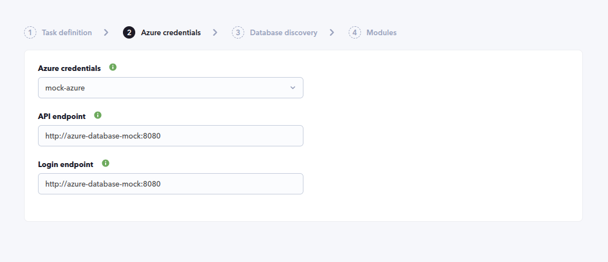
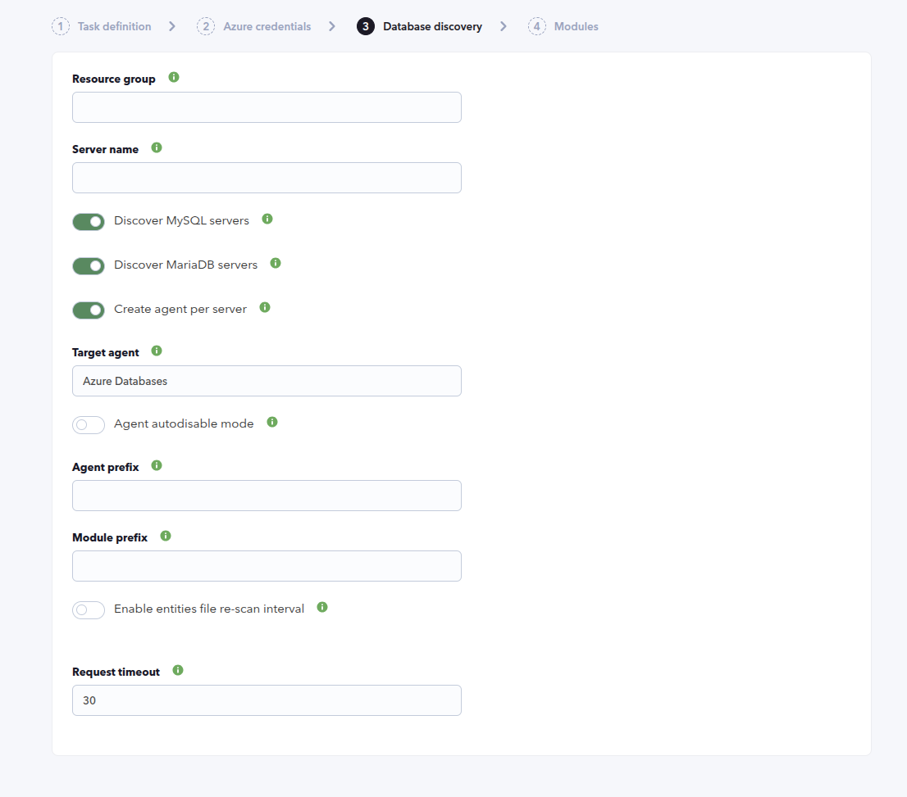
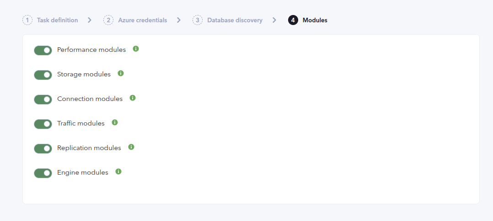
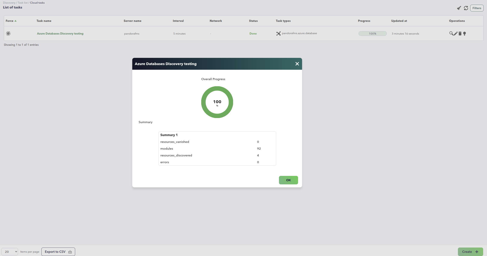
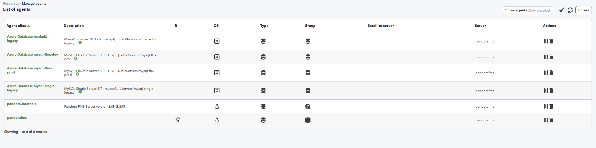
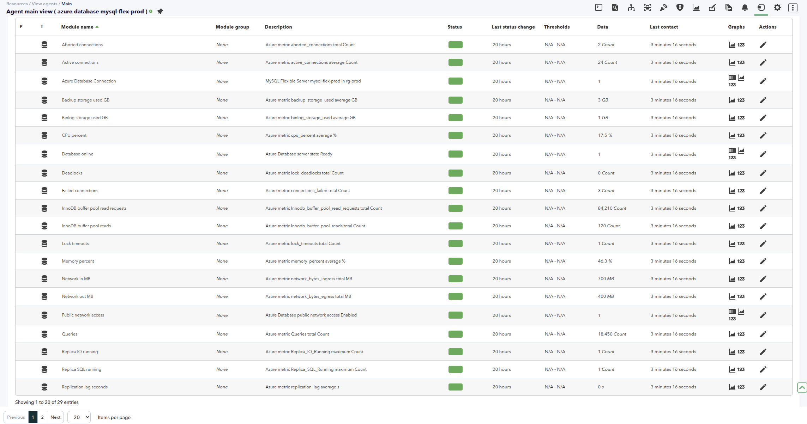

# Azure Databases Discovery

*Article last updated: 2026-11-06.*

## What it monitors

The Azure Databases Discovery plugin discovers the Azure Database for MySQL and Azure Database for MariaDB servers in a Microsoft Azure subscription and turns their state and Azure Monitor metrics into Pandora FMS agents and modules: CPU, memory and storage performance, storage and binlog usage, connections, traffic, replication and MySQL/InnoDB engine metrics.

By default it creates **one agent per database server**, named `[Agent prefix]Azure Database <server>`. It can also consolidate every discovered server onto a single **Target agent**, with the server name prepended to each module name. Each agent carries a reachability module, a server online module and one module per enabled metric group.

The plugin supports the MySQL family requested in the original feature request:

| Engine | Azure resource type |
| --- | --- |
| MySQL Flexible Server | `Microsoft.DBforMySQL/flexibleServers` |
| MySQL Single Server | `Microsoft.DBforMySQL/servers` |
| MariaDB Server | `Microsoft.DBforMariaDB/servers` |

Azure Database for MySQL and MariaDB do not expose Oracle engines, so this plugin does not cover Oracle. The Azure SQL Discovery plugin documents Azure SQL Database separately.

## Prepare

### Compatibility

| Scope | State | Evidence |
| --- | --- | --- |
| Plugin version `1.0` (`pandorafms.azure.database`) | Documented target | The version this page describes. See [Plugin identity](#plugin-identity) |
| An Azure subscription with Azure Database for MySQL or MariaDB servers | `Required` | The plugin discovers and reads database servers. Prerequisite, not a compatibility statement |
| A Microsoft Entra service principal with read permissions on the subscription or the Resource Group | `Required` | The plugin lists servers and reads their Azure Monitor metrics. The `Reader` role is usually enough. Prerequisite, not a compatibility statement. See [Prepare Azure access](#prepare-azure-access) |
| A Pandora FMS agent group with an ID greater than `0` | `Required` | The `All` group has ID `0` and cannot be used |
| Sovereign or custom Azure clouds | `Not validated` | The endpoints are configurable, but no test record establishes operation against a non-public cloud |
| Host operating system running the plugin | `Not validated` | No test record establishes operating-system compatibility |

### Prerequisites

1. **A Pandora FMS server with Discovery enabled** to execute the task, and the console to define it.
2. **A Microsoft Azure subscription** containing Azure Database for MySQL or MariaDB servers.
3. **An Azure credential** stored in the Pandora FMS credential store, or its values supplied directly for a manual run.
4. **A valid agent group** for the task. The `All` group is not valid, because its ID is `0`.

The plugin is distributed as a self-contained executable: the packaged Discovery app ships `bin/pandora_azure_database`, so no additional runtime has to be installed on the Pandora FMS server or for a manual run.

### Prepare Azure access

Create a Microsoft Entra service principal with read-only permissions and assign it the **Reader** role over the subscription or the Resource Group to be discovered. In most environments `Reader` is enough; when access is limited to a single Resource Group, configure the **Resource group** field in the task as well. The service principal must be able to:

- List `Microsoft.DBforMySQL/flexibleServers` resources.
- List `Microsoft.DBforMySQL/servers` resources.
- List `Microsoft.DBforMariaDB/servers` resources.
- Read server properties such as state, version, SKU and fully qualified domain name.
- Query Azure Monitor metrics for each server.

The provider for each engine must be registered in the subscription. The plugin skips an engine whose provider is not registered and reports it in the task information, so the other engines are still discovered.

Store the service principal's **Client ID**, **Application secret**, **Tenant or domain name** and **Subscription id** as an Azure credential in the Pandora FMS credential store, so the task references the credential instead of carrying the secret itself.

### Install the plugin

Upload the `.disco` package from **Management → Discovery → Extension manager**. Once loaded, **Azure Databases** appears under the **Cloud** category of the Discovery wizard.

## Configure the Discovery task

Create the task from **Management → Discovery → Cloud → Azure Databases**. The wizard's generic first step defines the task; the package adds **Azure credentials**, **Database discovery** and **Modules**. Every field is documented in [Task parameters](#task-parameters).

**Step 1 — Task definition.** Name, group, server and interval. The group must have an ID greater than `0`; `All` cannot be used. The group and interval are passed to the plugin and inherited by every generated agent.

**Step 2 — Azure credentials.** The credential and the Azure endpoints:

- **Azure credentials** selects the stored Azure credential. It is required.
- **API endpoint** and **Login endpoint** override the Azure Resource Manager and Azure authentication endpoints for sovereign or custom clouds. Empty values use the public Azure endpoints.



**Step 3 — Database discovery.** What to discover and how the agents are laid out:

- **Resource group** and **Server name** filter discovery. Each accepts several exact, case-insensitive values separated with `;`. Empty discovers everything.
- **Discover MySQL servers** includes both MySQL Flexible Server and MySQL Single Server resources.
- **Discover MariaDB servers** includes Azure Database for MariaDB resources.
- **Create agent per server** decides the agent layout, and **Target agent** is used only when it is disabled.
- **Agent prefix** and **Module prefix** are prepended to the agent names and module names.
- **Agent autodisable mode** creates the generated agents in Pandora FMS mode `2`.
- **Enable entities file re-scan interval** and **Re-scan entities file interval** control how long the discovered-server cache is reused before being rebuilt.
- **Request timeout** is the Azure HTTP timeout in seconds. The minimum applied value is `30`.

At least one of **Discover MySQL servers** or **Discover MariaDB servers** must remain enabled.



**Step 4 — Modules.** Which metric families are collected:

- **Performance modules**: CPU, memory and storage IO percent.
- **Storage modules**: storage used and limit, server log usage, backup storage and, when available, binlog storage.
- **Connection modules**: active, failed and, when available, total and aborted connections.
- **Traffic modules**: network in and network out.
- **Replication modules**: replication lag and, when available, replica IO and SQL thread status.
- **Engine modules**: queries, slow queries, threads running, InnoDB buffer pool reads and requests, deadlocks and lock timeouts.



## Verify the first run

Force the task from **Management → Discovery → Task list** and check the result in this order.

1. **The task summary** reports `resources_discovered`, `resources_vanished`, `modules` and `errors`. Expect one discovered resource per database server, and `errors` at `0`.

2. **The agents.** With **Create agent per server** enabled, one agent appears per discovered server, named `[Agent prefix]Azure Database <server>`. Each one reports `Azure` as its operating system and inherits the task's group and interval.

3. **`Azure Database Connection`** is `1` on every discovered server, and **`Database online`** is `1` when the server state is `Ready`, `Online` or `Running`.

4. **The metric modules** for each enabled family. A server only receives a module when Azure exposes the metric and supports the aggregation used by the plugin.

If no agent appears at all, the credential, its permissions or the filters are the first thing to check.





## Understand the results

### Agent layout

**With Create agent per server enabled**, which is the default, the plugin creates one agent per server, named `[Agent prefix]Azure Database <server>`, with the server FQDN as its address and the resource ID in its description.

**With it disabled**, every module goes to the single **Target agent** and the server name is prepended to each module name as `<server> <module name>`. This matters when reading the modules: in consolidated mode the module name identifies the server.

Generated agents report `Azure` as their operating system, `os_version` is the engine edition and version, they inherit the task's group and interval, and they are created in Pandora FMS agent mode `2` when **Agent autodisable mode** is enabled, or mode `1` when it is disabled.

### Discovery and filters

The **Resource group** and **Server name** filters use exact, case-insensitive matches rather than regular expressions; separate multiple values with `;`. The **Discover MySQL servers** and **Discover MariaDB servers** options decide which resource types are queried.

The discovered servers are persisted in the entities file. A stored entity that no longer appears in a scan is counted in `resources_vanished` and generates only `Azure Database Connection` with value `0`, so a deleted or renamed server is visible instead of silently disappearing. When the re-scan interval expires, the cache is rebuilt without comparing against the previous entities.

If an engine provider is not registered in the subscription, the plugin reports it in the task information and continues with the other engines instead of failing the whole task.

### What gets created

| Enabled by | What you get |
| --- | --- |
| Always | `Azure Database Connection` and `Database online` |
| Always, when Azure exposes the property | `Public network access` |
| Performance modules | `CPU percent`, `Memory percent`, `Storage IO percent` |
| Storage modules | `Storage used GB`, `Storage used percent`, `Storage limit GB`, `Server log used GB`, `Server log used percent`, `Backup storage used GB`, `Binlog storage used GB` |
| Connection modules | `Active connections`, `Failed connections`, `Total connections`, `Aborted connections` |
| Traffic modules | `Network in MB`, `Network out MB` |
| Replication modules | `Replication lag seconds`, `Replica IO running`, `Replica SQL running` |
| Engine modules | `Queries`, `Slow queries`, `Threads running`, `InnoDB buffer pool reads`, `InnoDB buffer pool read requests`, `Deadlocks`, `Lock timeouts` |

The plugin reads the metrics from Azure Monitor and only creates a metric module when the server exposes that metric and supports its aggregation. The exhaustive module inventory, units and aggregations are in [Generated modules](#generated-modules).



The screenshot shows a MySQL flexible server; MariaDB servers expose the subset of metrics available in their engine.

## Troubleshoot

- **The task fails on the group** — the agent group must have an ID greater than `0`. `All` is group `0` and cannot be used.
- **The task fails because no engine is selected** — enable at least one of **Discover MySQL servers** or **Discover MariaDB servers**.
- **No server is discovered** — check the service principal in this order: the credential values, then that it has the **Reader** role over the right scope, then whether **Resource group** or **Server name** are filtering out the servers. These fields match complete, case-insensitive values separated with `;`; they are not regular expressions.
- **An engine is reported as unavailable** — register its resource provider in the subscription (`Microsoft.DBforMySQL` or `Microsoft.DBforMariaDB`). The other engine is still discovered.
- **An agent survives with `Azure Database Connection` at `0`** — the server is in the entity cache but is no longer discoverable, because it was deleted or renamed. The agent is kept until the cache is rebuilt, which happens after **Re-scan entities file interval**.
- **A stopped server still has `Azure Database Connection` at `1`** — reachability of the Azure resource and the server state are separate: **`Database online`** reports `0` for a stopped server.
- **Some metric modules are missing** — a server may not expose every metric, or may not support the aggregation the plugin uses. The plugin asks Azure for the supported metric definitions and skips the metrics that are not available. For example, binlog storage is only available on MySQL servers with binary logging enabled.
- **Requests fail against a sovereign or custom cloud** — set **API endpoint** and **Login endpoint**. Empty values use `https://management.azure.com` and `https://login.microsoftonline.com`.
- **Requests time out** — raise **Request timeout**. The minimum applied value is `30` seconds.
- **Debug** displays full exceptions during a manual run; leave it off in production.

## Reference

### Task parameters

The console presents the task fields in three steps after the generic task definition. The macro column is the identifier used in the generated task configuration.

#### Azure credentials

| Field | Macro | Type | Default | Notes |
| --- | --- | --- | --- | --- |
| Azure credentials | `_credentials_` | select | — | Azure credential from the Pandora FMS credential store. Required |
| API endpoint | `_apiendpoint_` | string | — | Azure Resource Manager endpoint. Empty uses `https://management.azure.com` |
| Login endpoint | `_loginendpoint_` | string | — | Azure authentication endpoint. Empty uses `https://login.microsoftonline.com` |

#### Database discovery

| Field | Macro | Type | Default | Notes |
| --- | --- | --- | --- | --- |
| Resource group | `_resourcegroup_` | string | — | Exact Resource Group filter, `;`-separated. Empty discovers every Resource Group |
| Server name | `_servername_` | string | — | Exact server filter, `;`-separated. Empty discovers every server |
| Discover MySQL servers | `_discovermysql_` | checkbox | on | Includes MySQL flexible and single servers |
| Discover MariaDB servers | `_discovermariadb_` | checkbox | on | Includes MariaDB servers |
| Create agent per server | `_agentperserver_` | checkbox | on | Disabled sends every module to **Target agent** |
| Target agent | `_targetagent_` | string | `Azure Databases` | Agent used in consolidated mode |
| Agent autodisable mode | `_agentautodisable_` | checkbox | off | Creates agents in mode `2` when enabled, mode `1` otherwise |
| Agent prefix | `_agentprefix_` | string | — | Prefix prepended to the per-server agent names |
| Module prefix | `_moduleprefix_` | string | — | Prefix prepended to every generated module name |
| Enable entities file re-scan interval | `_enableentitiesinterval_` | checkbox | off | Reuses the discovered-server cache until the interval expires |
| Re-scan entities file interval | `_entitiesinterval_` | select | `86400` | Seconds before the cache is rebuilt. Shown only when the previous option is enabled |
| Request timeout | `_timeout_` | number | `30` | Azure HTTP timeout in seconds. The minimum applied value is `30` |

#### Modules

| Field | Macro | Type | Default | Notes |
| --- | --- | --- | --- | --- |
| Performance modules | `_performance_` | checkbox | on | CPU, memory and storage IO percent |
| Storage modules | `_storage_` | checkbox | on | Storage, server log, backup and binlog usage |
| Connection modules | `_connections_` | checkbox | on | Active, failed, total and aborted connections |
| Traffic modules | `_traffic_` | checkbox | on | Network in and network out |
| Replication modules | `_replication_` | checkbox | on | Replication lag and replica thread status |
| Engine modules | `_engine_` | checkbox | on | Queries, slow queries, InnoDB and lock metrics |

### Configuration file keys

The Discovery task builds this file from its own fields; a manual run supplies it with `--conf`. It has a `[CONF]` section.

| Key | Description | Default |
| --- | --- | --- |
| `credentials` | Base64-encoded Azure credential generated by Pandora FMS | Empty |
| `tenant_id`, `subscription_id`, `client_id`, `client_secret` | Manual credential values, used when `credentials` is not provided | Empty |
| `api_endpoint` | Azure Resource Manager endpoint | `https://management.azure.com` |
| `login_endpoint` | Azure authentication endpoint | `https://login.microsoftonline.com` |
| `resource_group` | Exact Resource Group filter, `;`-separated | Empty |
| `server_name` | Exact server filter, `;`-separated | Empty |
| `discover_mysql` | Discovers MySQL flexible and single servers | `1` |
| `discover_mariadb` | Discovers MariaDB servers | `1` |
| `agent_per_server` | Creates one agent per server when enabled | `1` |
| `target_agent` | Agent used in consolidated mode | `Azure Databases` |
| `agent_autodisable` | Uses Pandora FMS agent mode `2` when enabled and mode `1` otherwise | `0` |
| `agent_prefix` | Prefix for the per-server agent names | Empty |
| `module_prefix` | Prefix for all generated module names | Empty |
| `interval` | Monitoring interval inherited from the Discovery task | `300` |
| `group_id` | Pandora FMS group ID assigned to generated agents. Must be greater than `0` | Required |
| `timeout` | HTTP timeout in seconds. The minimum applied value is `30` | `30` |
| `entities_list` | Path to the entities file | `/tmp/pandora_azure_database_entities.txt` |
| `enable_entities_interval` | Rebuilds the entities file after the interval | `0` |
| `entities_interval` | Entities file rebuild interval in seconds | `86400` |
| `performance_metrics_enabled` | Enables the performance modules | `1` |
| `storage_metrics_enabled` | Enables the storage modules | `1` |
| `connection_metrics_enabled` | Enables the connection modules | `1` |
| `traffic_metrics_enabled` | Enables the traffic modules | `1` |
| `replication_metrics_enabled` | Enables the replication modules | `1` |
| `engine_metrics_enabled` | Enables the engine modules | `1` |

The entities file is scoped per task: the plugin appends a hash of the subscription, endpoints, engine selection and filters, so caches from different tasks never mix.

### Command-line execution

The plugin reads a single configuration file. A manual run reproduces what the Discovery server does per task execution.

```bash
./pandora_azure_database --conf <PATH_TO_CONFIG>
```

Every configuration key can also be passed as a command-line option, which overrides the file:

| Option | Description |
| --- | --- |
| `--conf`, `-c` | Path to the configuration file |
| `--credentials` | Base64-encoded Azure credential |
| `--tenant-id` | Azure tenant identifier |
| `--subscription-id` | Azure subscription identifier |
| `--client-id` | Service principal application identifier |
| `--client-secret` | Service principal secret |
| `--api-endpoint` | Azure Resource Manager endpoint |
| `--login-endpoint` | Azure authentication endpoint |
| `--resource-group` | Exact Resource Group filter, `;`-separated |
| `--server-name` | Exact server filter, `;`-separated |
| `--discover-mysql` | Enables MySQL server discovery |
| `--discover-mariadb` | Enables MariaDB server discovery |
| `--agent-per-server` | Enables one agent per server |
| `--target-agent` | Destination agent for consolidated mode |
| `--agent-autodisable` | Enables agent autodisable mode |
| `--agent-prefix` | Optional agent prefix |
| `--module-prefix` | Optional module prefix |
| `--interval` | Agent interval in seconds |
| `--group-id` | Agent group identifier. It must be greater than `0` |
| `--timeout` | HTTP timeout in seconds. The minimum applied value is `30` |
| `--entities-list` | Path to the entities file |
| `--enable-entities-interval` | Enables periodic reconstruction of the entities file |
| `--entities-interval` | Entities file reconstruction interval |
| `--performance-metrics-enabled` | Enables the performance modules |
| `--storage-metrics-enabled` | Enables the storage modules |
| `--connection-metrics-enabled` | Enables the connection modules |
| `--traffic-metrics-enabled` | Enables the traffic modules |
| `--replication-metrics-enabled` | Enables the replication modules |
| `--engine-metrics-enabled` | Enables the engine modules |
| `--debug` | Displays full exceptions |

A minimal configuration file for a manual run:

```ini
[CONF]
subscription_id=<SUBSCRIPTION_ID>
tenant_id=<TENANT_ID>
client_id=<CLIENT_ID>
client_secret=<CLIENT_SECRET>
group_id=<GROUP_ID>
```

That file holds a credential in plain text. Restrict it to the account that runs the plugin, keep it out of shared directories and version control, and prefer the Pandora FMS credential store for task runs, where the task references the credential instead of carrying the secret itself.

### Generated modules

Modules are named `[Module prefix]<base name>` in per-server mode, and `[Module prefix]<server> <base name>` in consolidated mode. Every metric module is `generic_data` and is created only when the server exposes the metric and supports its aggregation.

**Always created**

- `Azure Database Connection`: `generic_proc`, `1` for a discovered server and `0` for a vanished entity.
- `Database online`: `generic_proc`, `1` when the server state is `Ready`, `Online` or `Running`, `0` otherwise.
- `Public network access`: `generic_proc`, `1` when Azure reports public network access as `Enabled`, `0` when it is `Disabled`. Created only when Azure returns the property.

**Performance modules** (average)

| Module | Azure metric | Unit |
| --- | --- | --- |
| `CPU percent` | `cpu_percent` | `%` |
| `Memory percent` | `memory_percent` | `%` |
| `Storage IO percent` | `io_consumption_percent` | `%` |

**Storage modules**

| Module | Azure metric | Aggregation | Unit |
| --- | --- | --- | --- |
| `Storage used GB` | `storage_used` | average | `GB` |
| `Storage used percent` | `storage_percent` | average | `%` |
| `Storage limit GB` | `storage_limit` | maximum | `GB` |
| `Server log used GB` | `serverlog_storage_usage` | average | `GB` |
| `Server log used percent` | `serverlog_storage_percent` | average | `%` |
| `Backup storage used GB` | `backup_storage_used` | average | `GB` |
| `Binlog storage used GB` | `binlog_storage_used` | average | `GB` |

**Connection modules**

| Module | Azure metric | Aggregation | Unit |
| --- | --- | --- | --- |
| `Active connections` | `active_connections` | average | `Count` |
| `Failed connections` | `connections_failed` | total | `Count` |
| `Total connections` | `total_connections` | total | `Count` |
| `Aborted connections` | `aborted_connections` | total | `Count` |

**Traffic modules** (total)

| Module | Azure metric | Unit |
| --- | --- | --- |
| `Network in MB` | `network_bytes_ingress` | `MB` |
| `Network out MB` | `network_bytes_egress` | `MB` |

**Replication modules**

| Module | Azure metric | Aggregation | Unit |
| --- | --- | --- | --- |
| `Replication lag seconds` | `replication_lag` or `seconds_behind_master` | average | `s` |
| `Replica IO running` | `Replica_IO_Running` | maximum | `Count` |
| `Replica SQL running` | `Replica_SQL_Running` | maximum | `Count` |

**Engine modules** (total)

| Module | Azure metric | Unit |
| --- | --- | --- |
| `Queries` | `Queries` | `Count` |
| `Slow queries` | `Slow_queries` | `Count` |
| `Threads running` | `Threads_running` | `Count` |
| `InnoDB buffer pool reads` | `Innodb_buffer_pool_reads` | `Count` |
| `InnoDB buffer pool read requests` | `Innodb_buffer_pool_read_requests` | `Count` |
| `Deadlocks` | `lock_deadlocks` | `Count` |
| `Lock timeouts` | `lock_timeouts` | `Count` |

### Plugin identity

| Field | Value |
| --- | --- |
| App short name | `pandorafms.azure.database` |
| Plugin version | `1.0` |
| Type | Discovery application (`.disco`) |
| Section | Discovery → Cloud |
