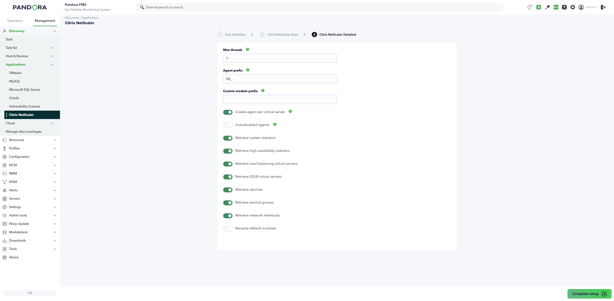
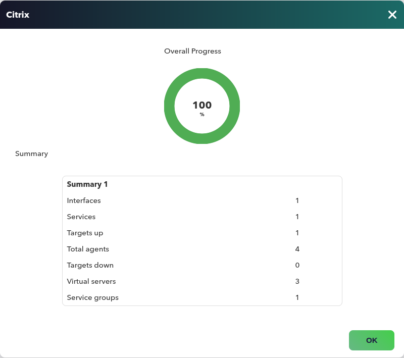
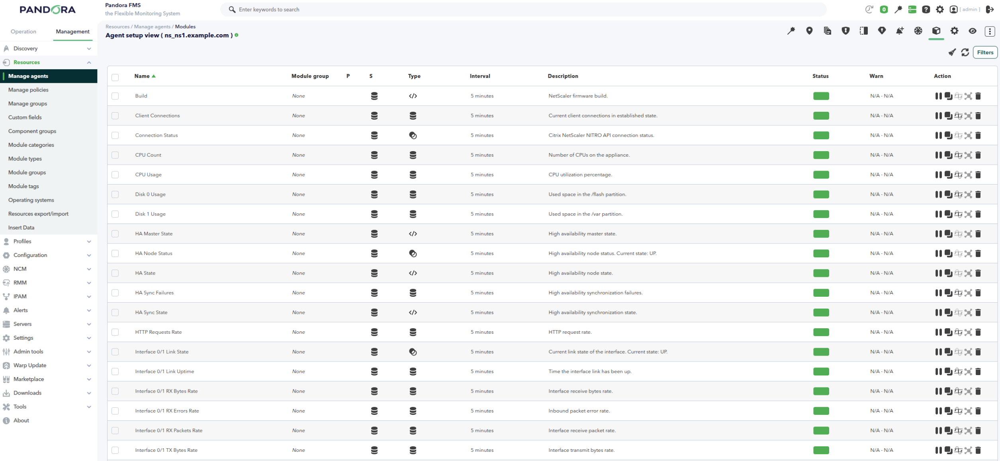
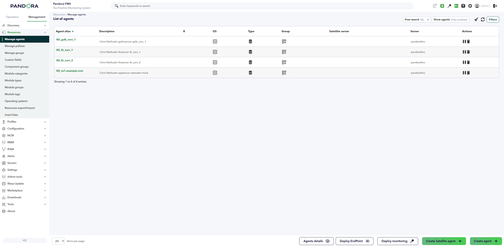

# Citrix NetScaler Discovery

*Article last updated: 2026-11-04.*

## What it monitors

The Citrix NetScaler Discovery addon monitors Citrix NetScaler ADC appliances through the NITRO REST API and turns appliance health, high availability, virtual servers, services, service groups and network interfaces into Pandora FMS agents and modules.

A Discovery task creates one agent for each configured appliance. With **Create agent per virtual server** enabled, it also creates one agent for each load balancing virtual server and each GSLB virtual server. The appliance agent carries the connection status, system statistics, high availability state, services, service groups and network interfaces. Virtual server agents carry the state and traffic modules of their virtual server.

The task selects which resource families are collected, so the generated agents and modules follow the part of the ADC environment you want to monitor.

A companion console extension, **Dashboard Citrix NetScaler**, presents the data of these agents as a dashboard. See [Dashboard Citrix NetScaler](#dashboard-citrix-netscaler).

## Prepare

### Compatibility

| Scope | State | Evidence |
| --- | --- | --- |
| Plugin version `1.0` (`pandorafms.citrix_netscaler`) | Documented target | The version this page describes, as identified by the package definition. See [Plugin identity](#plugin-identity). |
| A Citrix NetScaler ADC appliance with the NITRO stat API reachable over HTTP or HTTPS | `Required` | The addon reads the stat objects of each configured appliance through the NITRO REST API. Prerequisite, not a compatibility statement. |
| A credential with read access to the NITRO stat API | `Required` | The addon authenticates against the NITRO API and only reads statistics. Prerequisite, not a compatibility statement. |
| A specific Citrix NetScaler model or firmware version | `Not validated` | No published test record establishes a model or firmware compatibility matrix for this version. |
| Pandora FMS NG 784 and later | Stated by the Marketplace | General notice shown on the Marketplace for all entries, not specific to this addon. |
| The operating system of the environment executing the addon | `Not validated` | No operating system has been recorded for this version. |

### Requirements

1. **A Pandora FMS environment with Discovery enabled** to run the task, and a console to define it.
2. **One or more Citrix NetScaler ADC appliances** with the NITRO stat API reachable from the environment executing the addon, over HTTP or HTTPS.
3. **A credential with read access to the NITRO stat API**, stored in the Pandora FMS credential store and selected in the task.
4. **A target agent group and a monitoring interval** for the generated agents, taken from the Discovery task.
5. **TLS access as required by the appliance.** Certificate verification is optional and disabled by default; enable it when the appliance certificate can be validated, or keep it disabled for a trusted self-signed certificate.

The addon is distributed as a Pandora FMS Discovery application (`.disco` package) that the console loads and the Discovery server executes. No additional runtime has to be installed for a normal task run.

### Install the addon

Load the `.disco` package from **Management → Discovery → Extension manager** (the *Manage disco packages* view). Once loaded, **Citrix NetScaler** appears under the **Applications** category of the Discovery wizard.

## Configure the Discovery task

Create the task from **Management → Discovery → Applications → Citrix NetScaler**. The generic first step defines the task; the package adds **Citrix NetScaler Base** and **Citrix NetScaler Detailed**. Every field is documented in [Task parameters](#task-parameters).

**Step 1 - Task definition.** Name, agent group, Discovery server and interval. The group ID and the interval are passed to the addon and applied to every generated agent.

**Step 2 - Citrix NetScaler Base.** What to connect to and how:

- **NetScaler targets** is the list of NITRO stat API URLs to monitor, comma-separated or one per line. Lines starting with `#` are comments. A target without a scheme uses HTTPS. A target without the `/nitro/v1/stat` path gets that path appended. Append `|AgentName` to override the generated appliance agent name for that target.
- **NetScaler Credentials** selects a credential from the Pandora FMS credential store. The credential must contain a user and password with read access to the NITRO stat API.
- **Verify SSL certificate** enables TLS certificate verification. It is disabled by default, which allows self-signed appliance certificates.
- **Connection timeout** is the maximum time in seconds allowed to establish the connection. The default is `10`.
- **Read timeout** is the maximum time in seconds allowed to wait for each API response. The default is `30`.
- **Enable debug** writes execution and API call traces, and **Debug log directory** (default `/tmp`) is where they are stored. The directory field is shown only when debug is enabled.

**Step 3 - Citrix NetScaler Detailed.** Execution, agent layout and which resource families are collected:

- **Max threads** distributes the configured appliances across parallel workers.
- **Agent prefix** is prepended to the name of every generated agent.
- **Custom module prefix** is prepended to every generated module name.
- **Create agent per virtual server** creates one agent for each load balancing virtual server and each GSLB virtual server. It is enabled by default. When disabled, their modules are added to the appliance agent.
- **Autodisabled agents** creates the generated agents in disabled mode, so they stay idle until you enable them in the console.
- The **Monitoring modules** toggles select the collected resource families: system statistics, high availability statistics, load balancing virtual servers, GSLB virtual servers, services, service groups and network interfaces. All are enabled by default except GSLB virtual servers.
- **Rename default modules** and **Modules names** let you replace the default module labels with a `[MODULE_NAMES]` block. Renaming is disabled by default.



## Verify the first run

Force the task from **Management → Discovery → Task list** and check the result in this order.

1. **The task result** reports the generated agents and the discovered resources:

    - **Total agents**: appliance agents plus virtual server agents.
    - **Targets up** and **Targets down**: configured appliances that answered or did not answer.
    - **Virtual servers**: load balancing and GSLB virtual servers discovered.
    - **Services**, **Service groups** and **Interfaces**: resources discovered in those families.

2. **The agents.** One appliance agent appears for each reachable target. With **Create agent per virtual server** enabled, one child agent appears for each load balancing and GSLB virtual server. A target that cannot be reached is counted in **Targets down** and still produces an appliance agent whose **Connection Status** module reports `0`.

3. **The appliance modules.** A reachable appliance carries the connection status, the system modules selected in the task, the high availability modules when the `ns` stat object is available, and the service, service group and interface modules selected in the task.

4. **The virtual server modules.** Each virtual server agent carries the state and traffic modules of its virtual server. When **Create agent per virtual server** is disabled, those modules appear on the appliance agent with `Virtual server <name>` or `GSLB virtual server <name>` as the prefix.



## Understand the results

### Agents and identity

The addon creates one appliance agent per configured target. Its name is the **Agent prefix** followed by the target override, the appliance hostname reported by the NITRO API, or the target host when the hostname cannot be read. Its address is the target host, its operating system is `NetScaler`, and its version is the firmware version and build reported by the appliance when the `ns` configuration is readable. The agent belongs to the task group and inherits the task interval.

With **Create agent per virtual server** enabled, the addon also creates one child agent per load balancing virtual server and per GSLB virtual server. The child agent name is the **Agent prefix** followed by the virtual server name, and its parent is the appliance agent. If two generated agents would share a name, the addon appends the entity type and a counter to keep them distinct.

Changing **Agent prefix** changes the generated agent names. The previous agents are not renamed or deleted automatically.

An unreachable target still produces an appliance agent whose **Connection Status** module reports `0`. The connection error is recorded in the task information. Because the appliance hostname cannot be read in that situation, the agent name uses the target host and may differ from the name used by a successful run.

### Modules by agent

| Agent | Created when | Modules it carries |
| --- | --- | --- |
| Appliance agent | A target is configured, whether or not the connection succeeds | Connection status, firmware identity, system statistics, high availability statistics, services, service groups and network interfaces, according to the enabled toggles |
| Load balancing virtual server agent | **Create agent per virtual server** enabled and a load balancing virtual server is returned by the NITRO API | State, health, connections, request and response rates, byte rates, totals, persistence sessions, surge count and service counts |
| GSLB virtual server agent | **Create agent per virtual server** enabled and a GSLB virtual server is returned by the NITRO API | State, health, connections, request rate and total requests |

Module names are prefixed with **Custom module prefix**. The default module labels and the groups they belong to are listed in [Generated modules and agents](#generated-modules-and-agents).





### Dashboard Citrix NetScaler

The **Dashboard Citrix NetScaler** extension is a console dashboard that reads the agents and modules created by this plugin. It does not query the appliance: it only displays the data already collected in Pandora FMS. It appears in the **Monitoring** menu as **Citrix NetScaler** and is available with agent read permission (`AR` or `RR`).

The dashboard presents:

- **Summary cards** for the selected appliances, load balancing virtual servers, GSLB virtual servers, services, service groups and network interfaces.
- **Charts** of the virtual server state, the top virtual servers by client connections and the service state.
- **One panel per appliance** with the connection status, CPU, memory, disk usage, uptime and serial number, a system usage evolution chart, a services table, a network interfaces table and a service groups table.
- **One panel per virtual server** with its state, health, connections, request rates and totals, evolution charts for the available metrics and a table of current values.

A side filter narrows the view by **Agents**, **Resource type**, **State**, **Evolution period** and **Top results**. The state filter applies to virtual server and service states. The dashboard needs the `extra_data` markers written by the Discovery plugin; agents created before the marker was added should be refreshed by running the task again. The extension is installed separately in the console and needs no additional credentials or NITRO access.

## Operate

### Manual execution

The addon can run outside a Discovery task with a configuration file and a target file:

```bash
./pandora_citrix_netscaler --conf <PATH_TO_CONFIG> --targets <PATH_TO_TARGETS>
```

The configuration file and the target file are described in [Configuration file](#configuration-file) and [Target file](#target-file). The addon prints a JSON document with the summary, the generated agents and modules, and an `info` field when errors were recorded. The exit code is `1` when a configuration error prevents the run.

The configuration file contains the credential material generated by the console from the selected credential. Protect it with restrictive permissions and keep it out of shared directories, logs and version control.

### Debug logs

With **Enable debug** on, the addon writes `pandora_citrix_netscaler_debug.log` in **Debug log directory** (default `/tmp`). The log records every NITRO request, the stat objects exposed by the appliance and the connection errors. Debug logging is a diagnostic aid; leave it off for normal runs.

### Timeouts and connection recovery

**Connection timeout** and **Read timeout** bound every request. When the initial connection to a target fails or times out, the target is reported in **Targets down** and its appliance agent keeps a **Connection Status** value of `0`. Other targets continue independently. A failed resource family inside a reachable appliance is recorded as a warning in the task information and does not stop the remaining families.

## Troubleshoot

| Symptom | Check |
| --- | --- |
| The task fails with `Parameter [credentials] not defined or invalid` | Select a credential in **NetScaler Credentials**. The credential must contain a user and password. |
| The task fails with `NetScaler targets not defined` | Add at least one valid NITRO stat API URL to **NetScaler targets**. |
| A target is reported **Targets down** and its **Connection Status** is `0` | Confirm the appliance is reachable from the environment executing the addon, that the URL resolves, that the NITRO stat API is enabled, and that the credential is accepted. |
| The task reports an authentication error | Confirm the credential user and password, that the account can read the NITRO stat API, and that the appliance accepts header or session authentication. |
| The task reports an SSL error | Enable or disable **Verify SSL certificate** according to the appliance certificate, or install the certificate authority used by the appliance. |
| Expected GSLB modules are missing | Enable **Retrieve GSLB virtual servers** and confirm the appliance exposes the `gslbvserver` stat object. |
| Expected high availability modules are missing | Confirm the appliance exposes the `ns` stat object and that high availability is configured. |
| The firmware version, build or serial number is missing | The appliance did not allow reading the `ns` configuration. The addon continues with the other modules. |
| Expected system modules are missing | Confirm the `system` stat object is available and that the appliance firmware exposes the corresponding statistic. |
| Expected service or interface modules are missing | Confirm the corresponding stat object is available and returns at least one resource. |
| A target is slow or the task times out | Lower **Connection timeout** and **Read timeout**, and confirm the appliance answers the NITRO stat API. |
| Generated agents appear disabled | **Autodisabled agents** is enabled. Enable the agents in the console, or turn the option off and run the task again. |
| Old agents remain after changing the agent layout or prefix | The addon does not delete agents. Remove the obsolete agents in the console or keep a stable prefix and layout. |

## Reference

### Plugin identity

| Field | Value |
| --- | --- |
| Short name | `pandorafms.citrix_netscaler` |
| Display name | Citrix NetScaler |
| Version | `1.0` |
| Section | Applications |
| Primary workflow | Discovery task |

### Task parameters

The console presents the task fields in two steps after the generic task definition. The macro column is the identifier used in the generated task configuration.

#### Citrix NetScaler Base

| Field | Macro | Type | Default | Notes |
| --- | --- | --- | --- | --- |
| NetScaler targets | `_nsTargets_` | textarea | - | List of NITRO stat API URLs. Required. Comma-separated or one per line; `#` starts a comment; `|AgentName` overrides the appliance agent name |
| NetScaler Credentials | `_credentials_` | select | - | Credential from the Pandora FMS credential store. Required |
| Verify SSL certificate | `_verifySSL_` | checkbox | off | Enables TLS certificate verification |
| Connection timeout | `_connectionTimeout_` | number | `10` | Maximum seconds allowed to establish the connection |
| Read timeout | `_readTimeout_` | number | `30` | Maximum seconds allowed to wait for each API response |
| Enable debug | `_debug_` | checkbox | off | Writes execution and API call traces |
| Debug log directory | `_debugDirectory_` | string | `/tmp` | Directory for the debug log. Shown only when **Enable debug** is enabled |

#### Citrix NetScaler Detailed

| Field | Macro | Type | Default | Notes |
| --- | --- | --- | --- | --- |
| Max threads | `_threads_` | number | `1` | Workers that distribute the configured appliances |
| Agent prefix | `_agentPrefix_` | string | - | Prefix for every generated agent name |
| Custom module prefix | `_prefixModuleName_` | string | - | Prefix for every generated module name |
| Create agent per virtual server | `_agentPerVServer_` | checkbox | on | Creates one agent per load balancing and GSLB virtual server |
| Autodisabled agents | `_autodisabledAgents_` | checkbox | off | Creates the generated agents in disabled mode |
| Retrieve system statistics | `_scanSystem_` | checkbox | on | Collects the appliance system statistics |
| Retrieve high availability statistics | `_scanHA_` | checkbox | on | Collects the high availability statistics |
| Retrieve load balancing virtual servers | `_scanLBVServer_` | checkbox | on | Collects load balancing virtual servers |
| Retrieve GSLB virtual servers | `_scanGSLBVServer_` | checkbox | off | Collects GSLB virtual servers |
| Retrieve services | `_scanService_` | checkbox | on | Collects services |
| Retrieve service groups | `_scanServiceGroup_` | checkbox | on | Collects service groups |
| Retrieve network interfaces | `_scanInterfaces_` | checkbox | on | Collects network interfaces |
| Rename default modules | `_renameModules_` | checkbox | off | Applies the `[MODULE_NAMES]` labels |
| Modules names | `_ModulesNames_` | textarea | Default mapping | `[MODULE_NAMES]` block that renames the default modules. Shown only when **Rename default modules** is enabled |

### Configuration file

The Discovery task builds a temporary `--conf` file from its own fields. A manual run supplies it directly. The file has a `[CONF]` section and an optional `[MODULE_NAMES]` section.

| Key | Default | Description |
| --- | --- | --- |
| `agents_group_id` | `10` | ID of the group where the generated agents are created |
| `interval` | `300` | Monitoring interval in seconds, inherited by the generated agents |
| `credentials` | Empty | Credential material generated by the console from the selected credential. Required |
| `threads` | `1` | Number of parallel workers across configured appliances |
| `agent_prefix` | Empty | Prefix for every generated agent name |
| `modules_prefix` | Empty | Prefix for every generated module name |
| `verify_ssl` | `0` | Enables TLS certificate verification |
| `connection_timeout` | `10` | Maximum seconds allowed to establish the connection |
| `read_timeout` | `30` | Maximum seconds allowed to wait for each API response |
| `agent_per_vserver` | `1` | Creates one agent per load balancing and GSLB virtual server |
| `autodisabled_agents` | `0` | Creates the generated agents in disabled mode |
| `scan_system` | `1` | Collects system statistics |
| `scan_ha` | `1` | Collects high availability statistics |
| `scan_lbvserver` | `1` | Collects load balancing virtual servers |
| `scan_gslbvserver` | `0` | Collects GSLB virtual servers |
| `scan_service` | `1` | Collects services |
| `scan_servicegroup` | `1` | Collects service groups |
| `scan_interfaces` | `1` | Collects network interfaces |
| `rename_modules` | `0` | Applies the `[MODULE_NAMES]` labels |
| `debug` | `0` | Writes execution and API call traces |
| `debug_directory` | `/tmp` | Directory for the debug log |

The credential is stored in the configuration file in the form generated by the console. A configuration file without `credentials` can use the legacy `user` and `password` keys; the Discovery task always writes `credentials`. Restrict the file to the account that runs the addon and keep it out of shared directories, logs and version control.

### Target file

The `--targets` file contains one or more NITRO stat API URLs. Entries can be comma-separated or one per line. Lines starting with `#` are ignored.

```text
https://ns1.example.com/nitro/v1/stat
https://ns2.example.com/nitro/v1/stat|NetScaler 2
# https://ns3.example.com/nitro/v1/stat
```

- A target without a scheme uses `https://`.
- A target without the `/nitro/v1/stat` path gets that path appended.
- `|AgentName` overrides the appliance agent name for that target. The **Agent prefix** is still prepended.

### Command-line execution

| Option | Required | Description |
| --- | --- | --- |
| `--conf` | Yes | Path to the configuration file |
| `--targets` | Yes | Path to the target file |
| `--help`, `-h` | No | Displays command help |

### Generated modules and agents

Module names are prefixed with **Custom module prefix**; the labels below omit that prefix. State modules are `generic_proc` and report `1` when the state is `UP` or `7`, and `0` otherwise. Total counters use `generic_data_inc`; gauges use `generic_data`; identity and HA state labels use `generic_data_string`.

**Appliance agent**

| Group | Default modules | Unit or notes |
| --- | --- | --- |
| Connection | `Connection Status` | `1` when the NITRO API answered, `0` otherwise |
| Identity | `Version`, `Build`, `Serial Number` | Read from the `ns` configuration when available |
| System | `CPU Usage`, `Memory Usage`, `Disk 0 Usage`, `Disk 1 Usage` | `%` |
| System | `CPU Count`, `Memory Size`, `Memory Used`, `Uptime` | `MB`, `s` |
| System | `Network Receive Rate`, `Network Transmit Rate` | `Mbps` |
| System | `Client Connections`, `Server Connections` | Connections in established state |
| System | `HTTP Requests Rate`, `SSL Transactions Rate` | `req/s`, `tx/s` |
| System | `SSL Cards Up`, `SSL Cards`, `Power Supply 1` to `Power Supply 4` | Present only when the appliance exposes the statistic |
| High availability | `HA State`, `HA Node Status`, `HA Master State`, `HA Sync State`, `HA Sync Failures` | Present when the `ns` stat object is available |
| Services | `Service <name> State`, `Service <name> Client Connections`, `Service <name> Server Connections`, `Service <name> Requests Rate`, `Service <name> Responses Rate`, `Service <name> Surge Count`, `Service <name> Total Requests`, `Service <name> Active Transactions` | Modules exist for each service returned |
| Service groups | `Service group <name> State` | One module per service group |
| Network interfaces | `Interface <id> Link State`, `Interface <id> RX Bytes Rate`, `Interface <id> TX Bytes Rate`, `Interface <id> RX Packets Rate`, `Interface <id> TX Packets Rate`, `Interface <id> RX Errors Rate`, `Interface <id> TX Errors Rate`, `Interface <id> Link Uptime` | One group per interface |
| Virtual servers when **Create agent per virtual server** is disabled | `Virtual server <name> <module>`, `GSLB virtual server <name> <module>` | Uses the labels of the virtual server agents |

**Load balancing virtual server agent**

| Default module | Type | Unit |
| --- | --- | --- |
| `State` | `generic_proc` | |
| `Health` | `generic_data` | `%` |
| `Client Connections` | `generic_data` | connections |
| `Server Connections` | `generic_data` | connections |
| `Established Connections` | `generic_data` | connections |
| `Requests Rate` | `generic_data` | `req/s` |
| `Responses Rate` | `generic_data` | `resp/s` |
| `Request Bytes Rate` | `generic_data` | `B/s` |
| `Response Bytes Rate` | `generic_data` | `B/s` |
| `Total Requests` | `generic_data_inc` | requests |
| `Total Responses` | `generic_data_inc` | responses |
| `Persistence Sessions` | `generic_data` | sessions |
| `Surge Count` | `generic_data` | requests |
| `Active Services` | `generic_data` | services |
| `Inactive Services` | `generic_data` | services |

**GSLB virtual server agent**

| Default module | Type | Unit |
| --- | --- | --- |
| `State` | `generic_proc` | |
| `Health` | `generic_data` | `%` |
| `Client Connections` | `generic_data` | connections |
| `Requests Rate` | `generic_data` | `req/s` |
| `Total Requests` | `generic_data_inc` | requests |

**Rename default modules.** The `Modules names` field accepts a `[MODULE_NAMES]` block. Each key identifies a default module and the value replaces its label. The keys are the identifiers used by the addon, for example `lbvserver_state`, `lbvserver_health`, `service_state` and `interface_state`. The default mapping is preloaded in the field when renaming is enabled.
