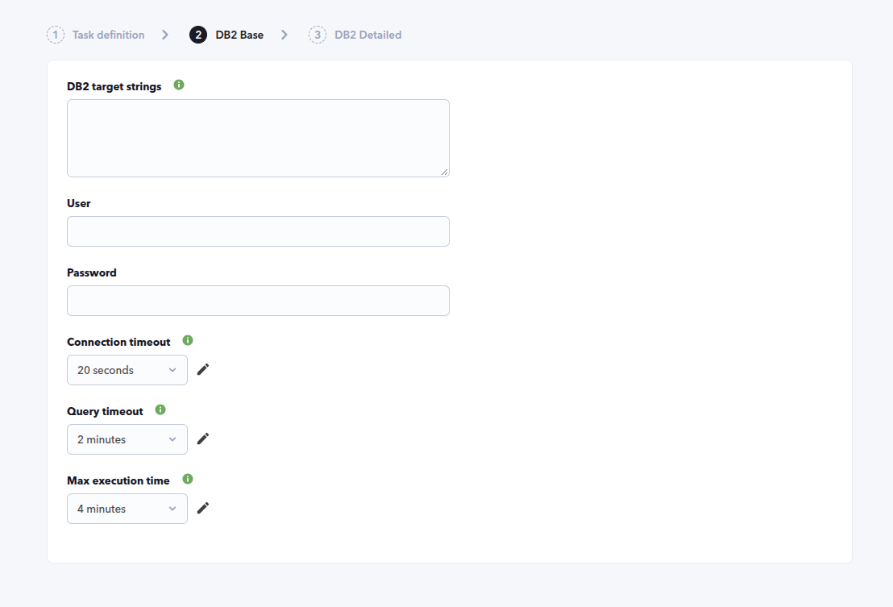
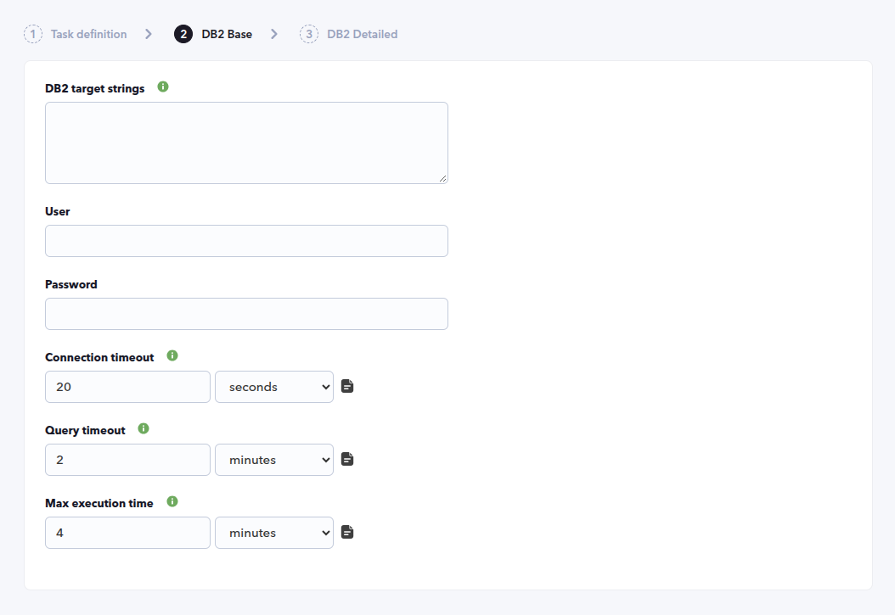

# DB2 Discovery

*Article last updated: 2026-10-28.*

## What it monitors

The DB2 Discovery addon monitors IBM Db2 databases remotely. A Discovery task connects to each database you list and turns the result into Pandora FMS agents and modules: connection availability, database performance summary, transaction log utilization, database size, active connections and buffer pool cache statistics. It can also run your own read-only `SELECT` queries and publish their result as modules.

A Discovery task generates **one agent per target database**. Nothing is installed on the database server: the addon connects over TCP/IP from the Discovery server with a database user and password.

## Prepare

### Compatibility

| Scope | State | Evidence |
|-------|-------|----------|
| Addon `pandorafms.db2`, version `1.3` | Documented target | The version this page describes. See [Addon identity](#addon-identity) |
| Network access from the Discovery server to each Db2 listener (TCP, default port `50000`) | `Required` | The addon connects with the TCP/IP protocol |
| A Db2 user with the grants listed in [Database user](#database-user) | `Required` | Prerequisite, not a compatibility statement |
| Db2 server versions and platforms | `Not validated` | No Db2 version matrix has been recorded for this addon |
| Operating system of the Discovery server | `Not validated` | No operating system has been recorded for this version |
| Specific Pandora FMS versions | `Not validated` | No version matrix has been recorded for this addon |

### Prerequisites

1. **Connectivity** from the Discovery server to every Db2 listener you want to monitor.
2. **A database user and password** for the databases, with the grants described below. The same user and password are used for every target of the task.
3. **Pandora FMS**: a Discovery server to run the task and the console to define it.

No IBM Db2 client has to be installed on the Discovery server.

### Database user

Each option reads Db2 administrative views, so the user needs `SELECT` access to the views of the options you enable. When a query is refused, the addon reports an error that asks you to verify the grants (see [Troubleshoot](#troubleshoot)).

| Option | Db2 view read |
|--------|---------------|
| Always | `SYSIBMADM.ENV_INST_INFO` (instance service level, shown as the agent operating system version) |
| **Get database summary** | `SYSIBMADM.MON_DB_SUMMARY` |
| **Check transactional log utilization** | `SYSIBMADM.MON_TRANSACTION_LOG_UTILIZATION` |
| **Check DB size** | `SYSIBMADM.ADMINTABINFO` |
| **Get number of connections** | `SYSIBMADM.MON_CONNECTION_SUMMARY` |
| **Retrieve cache statistics** | `SYSIBMADM.BP_HITRATIO` |
| **Execute custom queries** | Whatever objects your own queries read |

No official source identifies a narrower set of privileges than these reads; grant only what the options you enable need.

The password is written to the task's temporary configuration file on the Discovery server while the task runs. Use a dedicated user for Pandora FMS.

### Install the addon

Download the `.disco` package from the Pandora FMS Marketplace entry, which is limited to licensed users:

[https://marketplace.pandorafms.com/entries/pandorafms.db2](https://marketplace.pandorafms.com/entries/pandorafms.db2)

Load it into Pandora FMS. Once loaded, **DB2** is available when creating Discovery tasks of the application type.

<!-- SCREENSHOT NEEDED: Discovery task creation screen showing the DB2 application entry once the package is loaded. -->

## Configure the Discovery task

Create the task and choose **DB2**. The console presents the fields in two steps; every field is documented in [Task parameters](#task-parameters).

1. **DB2 Base** — targets, credentials and time limits:

    - **DB2 target strings**: the databases to monitor, one `SERVER:PORT/DATABASE` per entry, separated by commas or one per line. Lines starting with `#` are comments. See [Target format](#target-format).
    - **User** and **Password**: the Db2 credentials. Both are required.
    - **Connection timeout**, **Query timeout** and **Max execution time**: how long the addon may spend connecting, running each query and completing the whole execution. See [Timeouts](#timeouts).

    

2. **DB2 Detailed** — execution and what to collect:

    - **Max threads**: how many targets are processed in parallel.
    - **Target agent**: names for the generated agents.
    - **Custom module prefix**: text added in front of every module name.
    - **Get database summary**, **Check transactional log utilization**, **Get number of connections**, **Check DB size** and **Retrieve cache statistics**: enable each group of modules. All are enabled by default.
    - **Execute custom queries** and **Custom queries**: run your own queries. The text box is shown when **Execute custom queries** is enabled. See [Custom queries](#custom-queries).

    <!-- SCREENSHOT NEEDED: DB2 Detailed wizard step showing Max threads, Target agent, Custom module prefix and the collection checkboxes. -->

The task's group and interval come from the generic task-definition step and are applied to the agents the task creates.

### Timeouts

The three timeout fields are time selectors: choose a predefined period, or — as an administrator — use the edit (pencil) control to enter a custom amount and unit. The addon reads the value in seconds.

| Field | Default | Limits |
|-------|---------|--------|
| **Connection timeout** | `20` seconds | Establishing the connection and running the initial test query of each target |
| **Query timeout** | `120` seconds | Each individual query |
| **Max execution time** | `240` seconds | The whole execution, counting every target |

- **Connection timeout.** A target that does not connect and answer the test query within this time is reported under **Targets down** with `Connection timed out after <N> seconds`, and its agent is still created with `DB2 connection` at `0`.
- **Query timeout.** A query that does not finish in time fails with `Query timed out after <N> seconds` in the task information. The addon discards that session and opens a new connection for the next query, so one slow query does not stop the remaining checks. The timeout is capped to the time left before **Max execution time**.
- **Max execution time.** This is the budget of the whole run. When less than five seconds remain, the addon stops launching pending custom queries, does not send new queries, reports how many custom queries were skipped and finishes with the data collected so far. Set `0` to disable it.

Keep **Max execution time** lower than the timeout of the Discovery task. If the task timeout is reached first, Pandora FMS stops the addon with `SIGTERM`; the addon then returns the partial result collected until that moment and records `Execution interrupted by SIGTERM (task timeout?). Partial data returned.` in the task information.

A non-positive or non-numeric connection or query timeout falls back to its default.



### Target format

Each target identifies a host, optionally a port, and a database:

| Form | Host | Port | Database |
|------|------|------|----------|
| `<HOST>:<PORT>/<DATABASE>` | `<HOST>` | `<PORT>` | `<DATABASE>` |
| `<HOST>/<DATABASE>` | `<HOST>` | `50000` | `<DATABASE>` |

A database name is required to connect. A target without one (`<HOST>` or `<HOST>:<PORT>`) is accepted but cannot connect, so its agent reports `DB2 connection` as `0`.

Example for two targets:

```text
# Production
<DB2_HOST_1>:50000/<DATABASE_1>, <DB2_HOST_2>/<DATABASE_2>
```

### Agent names

By default the agent is named after its target string, for example `<HOST>:<PORT>/<DATABASE>`. To choose other names, fill **Target agent** with a comma-separated list, one name per target and in the same order as the targets. A target without a matching name keeps its target string as the agent name.

### Custom queries

Custom queries let you publish any `SELECT` result as a module. They apply to every target of the task. Each query is a block of lines between `check_begin` and `check_end`; each line is a key followed by its value. Lines starting with `#` are comments.

```text
check_begin
name Blocked applications
description Applications waiting on a lock
operation value
datatype generic_data
target SELECT COUNT(*) FROM SYSIBMADM.SNAPLOCKWAIT
max_warning 5
max_critical 10
check_end

check_begin
name Lock waits (detail)
operation full
target SELECT AGENT_ID, LOCK_MODE, LOCK_OBJECT_TYPE FROM SYSIBMADM.SNAPLOCKWAIT
crontab */30 * * * *
check_end
```

| Key | Required | Description |
|-----|----------|-------------|
| `name` | Yes | Module name. A query without it is skipped |
| `target` | Yes | The query. Only statements that start with `SELECT` (case-insensitive) are accepted; any other statement is removed and reported in the task information |
| `operation` | No | `value` returns the first column of the first row as a single value. Any other value, or none, returns all rows as text |
| `datatype` | No | Module type: `generic_data`, `generic_data_string` or `generic_proc`. Default `generic_data_string`. Always `generic_data_string` when `operation` is not `value` |
| `description` | No | Module description. Default `Execution OK`, or the database error when the query fails |
| `crontab` | No | Five-field cron expression that schedules the query. See below |
| `min_warning`, `max_warning`, `min_critical`, `max_critical` | No | Numeric thresholds of the module |
| `str_warning`, `str_critical` | No | String thresholds of the module |

When `operation` returns all rows, each row becomes one line with its columns separated by `|`. An empty result is published as `No output.` for string modules.

The console comes with two example queries (`DB Blocks` and `Blocking elements`) already loaded in the **Custom queries** box.

**Scheduling with `crontab`.** A query with a `crontab` runs only when at least one occurrence of the expression is pending since its last successful run, and the run time is saved between task executions. A query that fails is retried on the next task execution. The first time a scheduled query is seen, only an occurrence that falls inside the current task interval counts, so enabling an old daily or monthly schedule does not run it immediately. A scheduled query that is not due produces no value in that execution, so define its module as asynchronous. An expression that does not have five fields, or is invalid, is skipped and reported in the task information.

**Known limitations of this version.** Treat these keys and placeholders as not available:

- `target_databases` is read, but a query runs on every target only when it is omitted or set to `all`. A list of specific database names makes the query run nowhere.
- The placeholder `$__self_dbname` mentioned in the console help is replaced by an empty string, not by the database name.
- The keys `unit`, `interval`, `parent`, `inverse_warning` and `inverse_critical` that appear in the console help are not applied to the module.

## Verify the first run

Force the task from the Discovery task list and check the result in this order.

1. **The task summary.** A task that completes reports:

    - **Total agents**: agents generated, one per target.
    - **Targets up**: targets the addon connected to.
    - **Targets down**: targets it could not connect to.

    The connection errors are recorded in the task's execution information.

    <!-- SCREENSHOT NEEDED: Discovery task execution summary for a DB2 task showing Total agents, Targets up and Targets down. -->

2. **The agents.** One per target, named after the target or the **Target agent** list.

3. **The modules.** Every agent has `DB2 connection`, `1` when the connection succeeded. The remaining modules appear only when the connection succeeded; see [Understand the results](#understand-the-results).

## Understand the results

### Agents generated

| Property | Value |
|----------|-------|
| Agent name and alias | The **Target agent** entry for the target, or the target string when there is none |
| Operating system | `DB2` |
| Operating system version | The instance service level read from `SYSIBMADM.ENV_INST_INFO`; `Discovery` when it could not be read |
| Address | The host of the target |
| Group and interval | Those of the Discovery task |

When a target cannot be reached, its agent is still generated with `DB2 connection` set to `0` and no other module.

### Modules generated

Module names are prefixed with **Custom module prefix** when one is set.

| Module | Type | Condition | Description |
|--------|------|-----------|-------------|
| `DB2 connection` | `generic_proc` | Always | `1` when the connection and a test query succeeded, `0` otherwise |
| `AGENT_WAIT_TIME_PERCENT`, `CF_WAIT_TIME_PERCENT`, `IO_WAIT_TIME_PERCENT`, `LOCK_WAIT_TIME_PERCENT`, `NETWORK_WAIT_TIME_PERCENT`, `RECLAIM_WAIT_TIME_PERCENT`, `RQST_WAIT_TIME_PERCENT`, `ROUTINE_TIME_RQST_PERCENT`, `TOTAL_BP_HIT_RATIO_PERCENT`, `TRANSACT_END_PROC_TIME_PERCENT` | `generic_data` | **Get database summary** | Percentages from `MON_DB_SUMMARY`, unit `%` |
| `APP_RQSTS_COMPLETED_TOTAL`, `AVG_RQST_CPU_TIME` | `generic_data` | **Get database summary** | Completed application requests and average request CPU time from `MON_DB_SUMMARY` |
| `Log utilization percent` | `generic_data` | **Check transactional log utilization** | Percentage of the transaction log in use; the description states the KB used and available |
| `Database size ` | `generic_data` | **Check DB size** | Sum of the data, index, long, LOB and XML object sizes of all tables, in `MB`. The module name ends with a space |
| `Active connections` | `generic_data` | **Get number of connections** | Number of rows in `MON_CONNECTION_SUMMARY` |
| `cache hit ratio (<BUFFER_POOL>)` | `generic_data` | **Retrieve cache statistics** | Index hit ratio of each buffer pool, in `%`. The plugin sets default warning and critical thresholds on these modules; review them in the module configuration |
| Your custom queries | As defined | **Execute custom queries** | One module per query that applies and is due |

The summary, log, size, connection and cache groups are independent: if one query is refused, its modules are missing but the others are still created.

## Operate

### Manual execution

The addon can run outside a Discovery task. It takes four file paths and prints a JSON result:

```bash
pandora_db2 --conf <PATH_TO_CONFIG> --target_databases <PATH_TO_TARGETS> [--target_agents <PATH_TO_AGENTS>] [--custom_queries <PATH_TO_QUERIES>]
```

| Argument | Required | Content |
|----------|----------|---------|
| `--conf` | Yes | Configuration file described in [Configuration file](#configuration-file) |
| `--target_databases` | Yes | Targets, in the format of **DB2 target strings** |
| `--target_agents` | No | Agent names, in the format of **Target agent** |
| `--custom_queries` | No | Custom queries, in the format of **Custom queries** |

The result contains a `summary` with `Total agents`, `Targets up` and `Targets down`, an `info` key with messages when something went wrong, and `monitoring_data` with the agents and modules. The exit code is `1` when a required parameter is missing, an input file cannot be read or a worker fails.

The configuration file contains the password: protect it with restrictive permissions.

### Run time notes

- The addon removes the contents of its Db2 client diagnostic directory at the start of every execution.
- Each target uses one connection that is closed when the target has been processed. When a query times out, that connection is discarded and a new one is opened for the next query. The number of parallel connections never exceeds the number of targets.

## Troubleshoot

The addon has no verbose or debug flag. Its diagnostic channel is the `info` field of the JSON execution result, which is shown in the task's execution information.

- **`Parameter [user] not defined`, `Parameter [password] not defined` or `Database targets not defined`**: a required field is empty. The task ends with exit code `1` and generates nothing.
- **A connection error and `Targets down` greater than zero**: the database could not be reached. Check the host, port and database name of the target, the credentials and the network path. The agent is still generated with `DB2 connection` set to `0`.
- **A target without a database name**: it cannot connect; use the `<HOST>:<PORT>/<DATABASE>` form.
- **`Connection timed out after <N> seconds`**: the target did not answer within **Connection timeout**. Raise it or check the network path and the Db2 listener.
- **`Query timed out after <N> seconds`**: a query exceeded **Query timeout**. Raise it if the query is expected to be slow; the addon discards that session and reconnects for the remaining checks.
- **`Execution deadline reached` and a message reporting skipped custom queries**: the run used its whole **Max execution time**. Raise it, keeping it below the task timeout, or shorten or reschedule the slow custom queries.
- **`Execution interrupted by SIGTERM (task timeout?). Partial data returned.`**: the Discovery task timeout was reached before the addon finished. Set **Max execution time** below the task timeout so it can finish cleanly.
- **`DB2 error, please verify you have grants to ...`**: the user cannot read the view used by that option (summary, log utilization, database size, number of connections or hit ratio). Grant `SELECT` on it or disable the option.
- **`Removed [<query>] from custom queries, only select queries are allowed.`**: the `target` of a custom query does not start with `SELECT`.
- **`Invalid custom query crontab expression`**: the `crontab` of a query does not have five fields or is invalid; the query is skipped.
- **A custom query module is missing**: the query has no `name` or `target`, it has a `crontab` that is not due, or it uses a `target_databases` list (see [Custom queries](#custom-queries)).
- **`Failed to execute query: ...` in a module description**: the database rejected the custom query.
- **`Can't update custom query crontab state`**: the addon cannot write the schedule state, so the scheduled query may run again on the next execution.
- **`Error while runing single thread`**: an unexpected error stopped one worker; the exit code is `1`.

## Reference

### Task parameters

#### DB2 Base

| Field | Macro | Type | Default | Notes |
|-------|-------|------|---------|-------|
| DB2 target strings | `_dbstrings_` | text area | empty | Mandatory. `SERVER:PORT/DATABASE`, comma separated or one per line; `#` starts a comment line |
| User | `_dbuser_` | string | empty | Mandatory |
| Password | `_dbpass_` | password | empty | Mandatory |
| Connection timeout | `_connectionTimeout_` | select (time) | `20` | Optional. Maximum time to establish the connection and run the test query of a target. Stored in seconds |
| Query timeout | `_queryTimeout_` | select (time) | `120` | Optional. Maximum time for each query. Stored in seconds |
| Max execution time | `_maxExecutionTime_` | select (time) | `240` | Optional. Total budget of the run; pending queries are skipped when it is reached. `0` disables it. Must be below the task timeout |

#### DB2 Detailed

| Field | Macro | Type | Default | Notes |
|-------|-------|------|---------|-------|
| Max threads | `_threads_` | number | `1` | Optional. Targets are distributed among the threads; never more threads than targets |
| Target agent | `_engineAgent_` | string | empty | Optional. Comma-separated agent names, in target order. Empty uses the target string |
| Custom module prefix | `_prefixModuleName_` | string | empty | Optional. Prepended to every module name |
| Get database summary | `_checkDbSummary_` | checkbox | on | Summary modules |
| Check transactional log utilization | `_checkTransactionalLogUtilization_` | checkbox | on | `Log utilization percent` |
| Get number of connections | `_checkConnections_` | checkbox | on | `Active connections` |
| Check DB size | `_checkDbSize_` | checkbox | on | `Database size ` |
| Retrieve cache statistics | `_checkCache_` | checkbox | on | `cache hit ratio` modules |
| Execute custom queries | `_executeCustomQueries_` | checkbox | on | Runs the custom queries |
| Custom queries | `_customQueries_` | text area | Two example queries | Optional. Shown when **Execute custom queries** is on |

### Configuration file

Used by manual execution. One `key = value` per line. Numeric options accept `1` to enable and `0` to disable; a value that is not a number is read as `0`.

| Key | Default | Description |
|-----|---------|-------------|
| `agents_group_id` | `10` | Group ID of the generated agents |
| `interval` | `300` | Agent interval, in seconds |
| `user` | empty | Db2 user. Required |
| `password` | empty | Db2 password. Required |
| `threads` | `1` | Number of parallel threads |
| `connection_timeout` | `20` | Maximum seconds to establish the connection and run the test query of a target. A non-positive value uses `20` |
| `query_timeout` | `120` | Maximum seconds for each query. A non-positive value uses `120` |
| `max_execution_time` | `240` | Total budget of the run in seconds. `0` disables it. Must be below the task timeout |
| `modules_prefix` | empty | Prefix for every module name |
| `execute_custom_queries` | `1` | Run custom queries |
| `analyze_connections` | `1` | `Active connections` module |
| `cache_stats` | `1` | Cache hit ratio modules |
| `database_summary` | `1` | Summary modules |
| `transactional_log` | `1` | Log utilization module |
| `db_size` | `1` | Database size module |
| `cron_state_dir` | `pandora_db2_cron_state` in the system temporary directory | Directory where the run times of scheduled custom queries are kept |

Example:

```ini
agents_group_id        = 10
interval               = 300
user                   = <DB2_USER>
password               = <DB2_PASSWORD>
threads                = 2
connection_timeout     = 20
query_timeout          = 120
max_execution_time     = 240
modules_prefix         = db2_
execute_custom_queries = 1
analyze_connections    = 1
cache_stats            = 1
database_summary       = 1
transactional_log      = 1
db_size                = 1
```

### Addon identity

| Property | Value |
|----------|-------|
| Marketplace identifier | `pandorafms.db2` |
| Name | DB2 |
| Version | `1.3` |
| Marketplace last update | 2026-08-28 |
| Availability | Download limited to licensed users |
