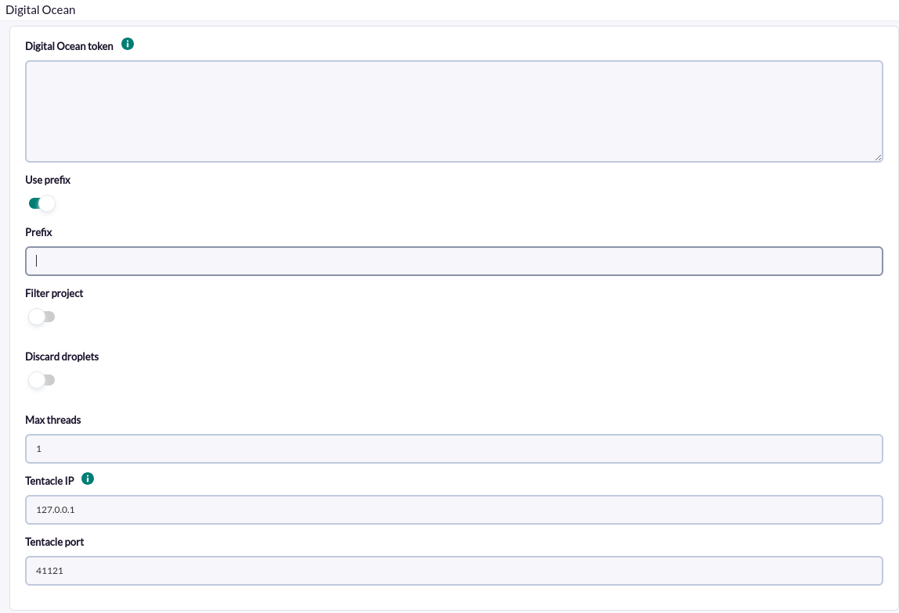
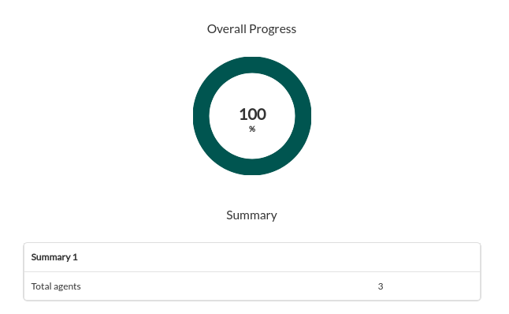

# Digital Ocean Discovery

*Article last updated: 2026-10-26.*

## What it monitors

The Digital Ocean Discovery addon monitors the droplets of a DigitalOcean account. It queries the DigitalOcean API with an API token and turns the result into Pandora FMS agents and modules: droplet status, CPU, memory, load and network traffic, file system usage, the date of the latest backup, the date of every snapshot and the account balance.

A Discovery task generates two kinds of agents:

- **One global agent** for the account, with the number of droplets and the account balance and usage figures.
- **One agent per monitored droplet**, with its status, performance and backup modules.

By default every droplet returned by the API is monitored. You can restrict the task to the droplets of one DigitalOcean project and discard individual droplets by name.

## Prepare

### Compatibility

| Scope | State | Evidence |
|-------|-------|----------|
| Addon `pandorafms.digitalocean`, version `1.0` | Documented target | The version this page describes. See [Addon identity](#addon-identity) |
| Network access from the Discovery server to `api.digitalocean.com` | `Required` | The addon calls the DigitalOcean API over HTTPS |
| DigitalOcean API token | `Required` | See [Create the API token](#create-the-api-token) |
| Operating system of the Discovery server | `Not validated` | No operating system has been recorded for this version |
| Specific Pandora FMS versions | `Not validated` | No version matrix has been recorded for this addon |

### Prerequisites

1. **Connectivity** from the Discovery server to the DigitalOcean API.
2. **A DigitalOcean API token** with read access, described below.
3. **Droplet monitoring enabled** in DigitalOcean on every droplet whose CPU, memory, load and traffic modules you need. Droplets without it still generate an agent, with the `Status`, backup, snapshot and file system modules but without the CPU, memory, load and traffic modules.
4. **Pandora FMS**: a Discovery server to run the task and the console to define it.

The addon ships its own executable, `bin/pandora_digitalocean`, so nothing else has to be installed on the Discovery server to run a task.

### Create the API token

The addon sends only read requests (`GET`) to the DigitalOcean API. Create a personal access token in the DigitalOcean control panel (**API** section) and paste it in the task. The token must allow the addon to read:

| Data | Used for |
|------|----------|
| Droplets | Listing the droplets and their status, features and networks (always) |
| Droplet metrics | CPU, memory, load, bandwidth and file system modules |
| Droplet backups and snapshots | Backup and snapshot modules |
| Account balance | Global agent modules (always) |
| Projects and project resources | Only when **Filter project** is enabled |

The token is shown only once when DigitalOcean creates it; store it safely. DigitalOcean lets you create a new one at any time.

The token is stored in the task definition and written, in clear text, to the temporary configuration file the Discovery server uses to run the addon. Restrict access to the Pandora FMS console users that can edit Discovery tasks, and prefer a token created only for Pandora FMS.

### Install the addon

Download the `.disco` package from the Pandora FMS Marketplace entry:

[https://marketplace.pandorafms.com/entries/pandorafms.digitalocean](https://marketplace.pandorafms.com/entries/pandorafms.digitalocean)

Load it into Pandora FMS.

<!-- SCREENSHOT NEEDED: Discovery Load DISCO screen listing the Digital Ocean addon after loading, showing its section. -->

Once loaded, **Digital Ocean** is available in the **Cloud** section when creating Discovery tasks.

## Configure the Discovery task

Create the task from the Discovery cloud applications and choose **Digital Ocean**. The console presents all the fields in a single step, **Digital Ocean base**; every field is documented in [Task parameters](#task-parameters).

- **Digital Ocean token**: the API token.
- **Use prefix** and **Prefix**: text added in front of the name and alias of every generated agent. **Prefix** is shown when **Use prefix** is on.
- **Filter project** and **Project**: monitor only the droplets that belong to the DigitalOcean project with that name. **Project** is shown when **Filter project** is on.
- **Discard droplets** and **Select the droplets to be discarded**: skip individual droplets by name. The list is a JSON array of droplet names, for example `["ubuntu-s-1vcpu-1gb-sfo3-01","ubuntu-s-1vcpu-4gb-sfo3-03"]`. It is shown when **Discard droplets** is on.
- **Max threads**: number of groups the droplets are divided into.
- **Tentacle IP** and **Tentacle port**: where the generated agent data is sent. They rarely need changing.



The image shows the wizard with **Use prefix** on; **Project** and the discard list appear when **Filter project** and **Discard droplets** are turned on.

The task's group and interval come from the generic task-definition step and are applied to the agents the task creates.

## Verify the first run

Force the task from the Discovery task list and check the result in this order.

1. **The task summary.** A task that completes successfully reports **Total agents**: the global agent plus one agent per monitored droplet. A task that does not complete successfully records the errors in its execution information instead.

    

2. **The agents.** One global agent, whose alias is `Digital Ocean` (with the prefix, when set), and one agent per droplet, with the droplet name as alias.

3. **The modules.** Every droplet agent has a `Status` module. The performance modules appear only on droplets with monitoring enabled; see [Understand the results](#understand-the-results).

## Understand the results

### Agents generated

| Agent | Alias | Notes |
|-------|-------|-------|
| Global agent | `<prefix>Digital Ocean` | One per task. Described as `DigitalOcean global agent` |
| Droplet agent | `<prefix><droplet name>` | One per monitored droplet. Described as `DigitalOcean Droplet`. Its address is the second IPv4 network entry that DigitalOcean reports for the droplet |

Agent identity is derived from the prefix and the name, not from the task or the droplet ID. The same task or another task that produces the same prefix and name reports to the same agent and keeps its history. Renaming a droplet in DigitalOcean, or changing the prefix, creates new agents. Two droplets with the same name share one agent.

### Modules per agent

**Global agent**

| Module | Type | Description |
|--------|------|-------------|
| `Droplets` | `generic_data` | Number of droplets that DigitalOcean reports for the account |
| `Month to data balance` | `generic_data` | Current month's incurred charges (`month_to_date_balance`) |
| `Account balance` | `generic_data` | Total available funds in the account |
| `Month to date usage` | `generic_data` | Current month's service usage |

**Droplet agent**

| Module | Type | Condition | Description |
|--------|------|-----------|-------------|
| `Status` | `generic_proc` | Always | `1` when the droplet status is `active`, `0` otherwise |
| `Cpu %` | `generic_data` | Droplet monitoring enabled | CPU used, in `%` |
| `Mem %` | `generic_data` | Droplet monitoring enabled | Memory used, in `%` |
| `Load 1`, `Load 5`, `Load 15` | `generic_data` | Droplet monitoring enabled | Average system load over the last one, five and fifteen minutes |
| `Public inbound`, `Public outbound` | `generic_data` | Droplet monitoring enabled | Incoming and outgoing traffic on the public interface |
| `Private inbound`, `Private outbound` | `generic_data` | Droplet monitoring enabled | Incoming and outgoing traffic on the private interface |
| `<backup name>` | `generic_data` | The droplet has backups | Creation date of the latest backup. Unit `_timeticks_` |
| `<snapshot name>` | `generic_data` | The droplet has snapshots | One module per snapshot with its creation date. Unit `_timeticks_` |
| `<device>` | `generic_data` | File system metrics returned by DigitalOcean for the droplet | One module per file system device with its usage, in `%` |

Backup, snapshot and file system modules take their names from the backup, the snapshot and the device. A new snapshot or a different latest backup therefore creates a new module.

### How the values are obtained

- The addon reads the DigitalOcean monitoring metrics for the last hour at each execution.
- `Cpu %` is 100 minus the idle share of the hourly mean CPU time by mode.
- `Mem %` is computed from the most recent total and available memory samples of that hour.
- Load, bandwidth and file system values are the mean of the samples of that hour. The addon does not convert the bandwidth values: they are shown as the DigitalOcean monitoring API returns them.
- Backup and snapshot values are the creation date expressed as timeticks, which the console displays as an elapsed time.

## Operate

### Manual execution

The addon can run outside a Discovery task. The executable takes a single parameter, the path to a configuration file described in [Configuration file](#configuration-file):

```bash
./pandora_digitalocean --conf <PATH_TO_CONFIG>
```

It sends one data file per agent and prints a JSON summary:

```json
{"summary": {"Total agents": 12}}
```

When errors occur, the JSON also contains an `info` key with the messages and the exit code is `1`. The configuration file contains the API token in clear text; protect it with restrictive permissions.

## Troubleshoot

The addon has no verbose or debug flag. Its diagnostic channel is the `info` field of the JSON execution result, which is shown in the task's execution information.

- **The task fails and no agent is generated**: the token is missing, invalid or expired, or the Discovery server cannot reach `api.digitalocean.com`.
- **The task fails after listing droplets and no droplet agent appears**: the global agent reads the account balance before any droplet agent is created. Check that the token can read the account balance.
- **`Error extracting information from droplets`**: with **Filter project** enabled, the project name was not found. The match is exact and case-sensitive; check the spelling against the project in DigitalOcean.
- **`Error while parsing configuration zones or instances`**: the discard list is not a valid JSON array. Use double quotes, for example `["<DROPLET_NAME>"]`. While the list is invalid, no droplet is discarded.
- **A droplet is still monitored after discarding it**: the name must match the droplet name exactly, including case.
- **Droplet agents without `Cpu %`, `Mem %`, load and traffic modules**: droplet monitoring is not enabled on that droplet in DigitalOcean.
- **`Error while running threads`**: there were no droplets to monitor after applying the project filter and the discard list.
- **Agents that stop updating after a rename**: the agent identity depends on the droplet name and the prefix; see [Agents generated](#agents-generated).

## Reference

### Task parameters

#### Digital Ocean base

| Field | Macro | Type | Default | Notes |
|-------|-------|------|---------|-------|
| Digital Ocean token | `_token_` | text area | empty | Bearer token used to authenticate against the API. The wizard does not mark it mandatory, but the task cannot read any data without it |
| Use prefix | `_usePrefix_` | checkbox | off | Shows **Prefix** |
| Prefix | `_prefix_` | string | empty | Optional. Added in front of the name and alias of every agent. Shown when **Use prefix** is on |
| Filter project | `_filterProject_` | checkbox | off | Shows **Project** |
| Project | `_project_` | string | empty | Optional. Exact, case-sensitive name of the DigitalOcean project whose droplets are monitored. Shown when **Filter project** is on |
| Discard droplets | `_discardActivate_` | checkbox | off | Shows the discard list |
| Select the droplets to be discarded | `_discardDroplets_` | text area | `[]` | Optional. JSON array of exact droplet names. Shown when **Discard droplets** is on |
| Max threads | `_threads_` | number | `1` | Optional. Number of groups the droplets are divided into, never more groups than droplets |
| Tentacle IP | `_tentacleIP_` | string | `127.0.0.1` | Server that receives the agent data |
| Tentacle port | `_tentaclePort_` | number | `41121` | Tentacle port |

The Discovery task always sends the data with Tentacle.

### Configuration file

Used by manual execution. One `key = value` per line. List values are JSON arrays. A numeric value that is not a number is read as `0`.

| Key | Default | Description |
|-----|---------|-------------|
| `token` | empty | API token. Mandatory in practice |
| `agents_group_name` | empty | Group of the generated agents |
| `interval` | `300` | Agent interval, in seconds |
| `use_prefix` | empty | Prefix flag written by the Discovery task. The prefix is applied when `prefix` is not empty |
| `prefix` | empty | Prefix of agent names and aliases |
| `applicate_project` | empty | Project filter flag written by the Discovery task. The filter is applied when `filter_project` is not empty |
| `filter_project` | empty | Project name |
| `discard_activate` | empty | Discard flag written by the Discovery task. Droplets named in `discard_droplets` are discarded |
| `discard_droplets` | `[]` | JSON array of droplet names to discard |
| `threads` | `1` | Number of groups the droplets are distributed in |
| `transfer_mode` | empty | The Discovery task sets `tentacle` |
| `data_dir` | empty | Data directory, read by the addon |
| `tentacle_ip` | empty | Tentacle server address |
| `tentacle_port` | `41121` | Tentacle server port |

Example:

```ini
agents_group_name = <AGENT_GROUP>
interval          = 300
transfer_mode     = tentacle
token             = <DIGITALOCEAN_API_TOKEN>
prefix            = do-
applicate_project = 1
filter_project    = <PROJECT_NAME>
discard_droplets  = ["<DROPLET_NAME>"]
threads           = 1
tentacle_ip       = <TENTACLE_SERVER_IP>
tentacle_port     = 41121
```

### Addon identity

| Item | Value |
|------|-------|
| Name | Digital Ocean |
| Identifier | `pandorafms.digitalocean` |
| Version | `1.0` |
| Type and section | Discovery, `cloud` |
| Marketplace entry | [pandorafms.digitalocean](https://marketplace.pandorafms.com/entries/pandorafms.digitalocean), updated 2025-06-01 |
| Availability | The Marketplace entry marks the download as free |
