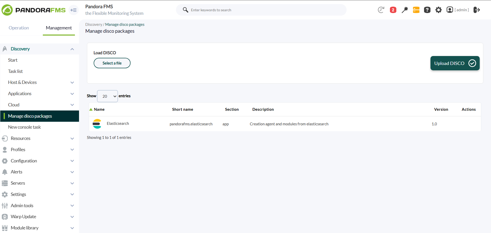
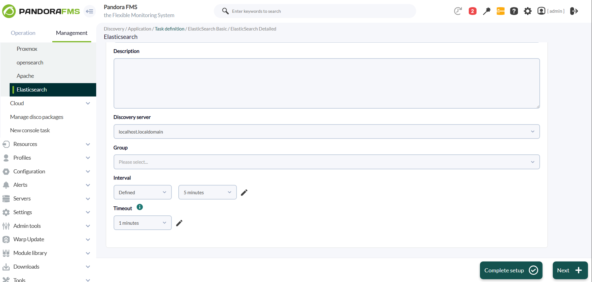
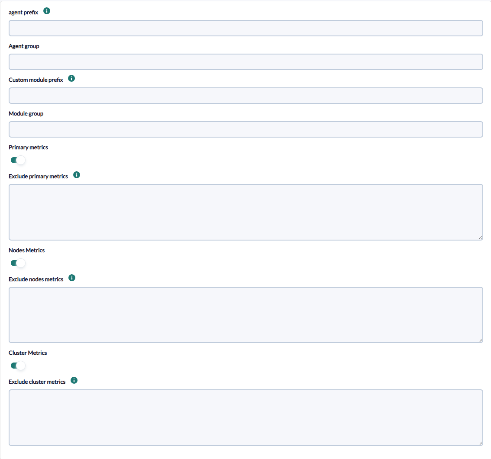
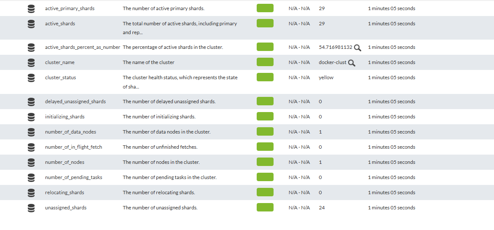
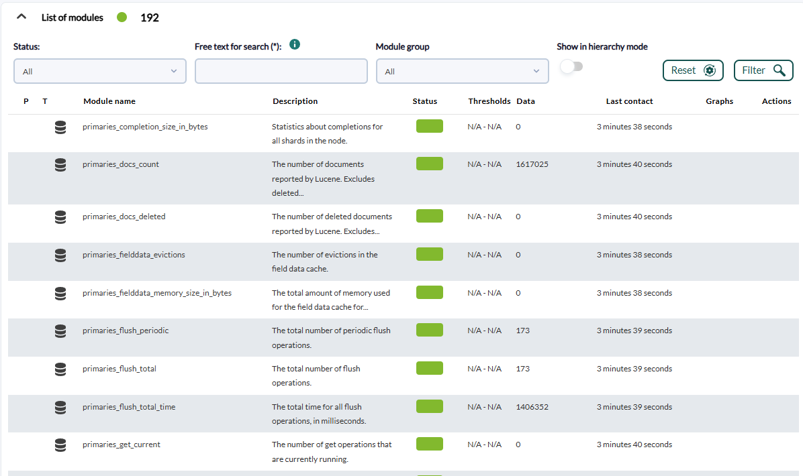
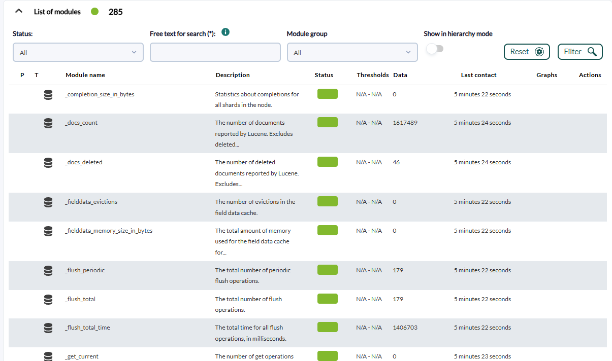
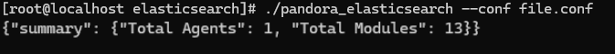
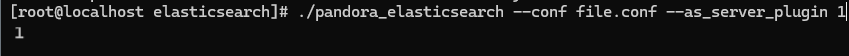

# Elasticsearch Discovery

*Article last updated: 2026-10-26.*

## What it monitors

The Elasticsearch Discovery addon monitors an Elasticsearch cluster through its REST API. Instead of building a single agent, it splits the monitoring by functional role and creates one agent per role:

- **A primary metrics agent** with the indexing, search, merge, cache, segment and translog statistics of all indices, once for the primary shards and once for the total (primary plus replica) shards.
- **A cluster agent** with the cluster health: status, number of nodes and shard allocation.
- **One agent per node** with operating system, process, JVM, thread pool, transport, HTTP, circuit breaker, cache and disk metrics, plus the index statistics seen by that node.

Each role is optional and can be switched on or off in the Discovery task. Individual metrics can be excluded by name.

## Prepare

### Compatibility

| Scope | State | Evidence |
|-------|-------|----------|
| Addon `pandorafms.elastic`, version `1.0` | Documented target | The version this page describes. See [Addon identity](#addon-identity) |
| Network access from the Discovery server to the Elasticsearch HTTP(S) port | `Required` | The addon queries the cluster health, node statistics and index statistics APIs |
| Access to the Elasticsearch cluster with read permission on those APIs | `Required` | Prerequisite, not a compatibility statement |
| Elasticsearch server versions | `Not validated` | No version matrix has been recorded for this addon |
| Operating system of the Discovery server | `Not validated` | No operating system has been recorded for this version |
| Specific Pandora FMS versions | `Not validated` | No version matrix has been recorded for this addon |

### Prerequisites

1. **Connectivity** from the Discovery server to the Elasticsearch node you point the task at (IP address and port, usually `9200`).
2. **Credentials** when the cluster requires authentication. The user and password are optional in the task; the addon authenticates with basic authentication only when both are set. The account must be able to call the cluster health, node statistics and index statistics APIs. This page does not prescribe a narrower role, because no official statement of the minimum privileges was recorded.
3. **Pandora FMS**: a Discovery server to run the task and the console to define it. The addon sends the generated agent data with Tentacle by default, so the Tentacle server address must be reachable from the Discovery server.

The addon package ships everything it needs to run, so nothing else has to be installed on the Discovery server.

### Install the addon

Download the `.disco` package from the Pandora FMS Marketplace entry, which is limited to licensed users:

[https://marketplace.pandorafms.com/entries/pandorafms.elastic](https://marketplace.pandorafms.com/entries/pandorafms.elastic)

Load it in **Management > Discovery > Manage disco packages**.



Once loaded, **Elasticsearch** is available in **Management > Discovery > Applications** when creating Discovery tasks.

## Configure the Discovery task

Create the task from **Management > Discovery > Applications > Elasticsearch**. After the generic task definition (name, Discovery server, group, interval), the console presents two steps. Every field is documented in [Task parameters](#task-parameters).



1. **ElasticSearch Basic** — connection and transfer:

    - **ElasticSearch IP** and **ElasticSearch Port**: address of the Elasticsearch node. Both are mandatory.
    - **User** and **Password**: optional credentials.
    - **Verify SSL**: connect over HTTPS when enabled and over HTTP when disabled. Enabled by default.
    - **Verify Certs**: validate the TLS certificate of the server. Disabled by default.
    - **transfer mode**, **tentacle ip** and **tentacle port**: how the generated agent data reaches Pandora FMS. They rarely need changing.

    

2. **ElasticSearch Detailed** — naming and metric selection:

    - **agent prefix**, **Agent group**, **Custom module prefix** and **Module group**: names applied to the generated agents and modules.
    - **Primary metrics**, **Nodes Metrics** and **Cluster Metrics**: choose which agents are created. All three are enabled by default.
    - **Exclude primary metrics**, **Exclude nodes metrics** and **Exclude cluster metrics**: shown when the matching metrics option is enabled. Names of the modules that must not be created, see [Exclude metrics](#exclude-metrics).

    

The task interval defined in the generic step becomes the interval of the generated agents.

## Verify the first run

Force the task from the Discovery task list and check the result in this order.

1. **The task summary.** A task that completes reports **Total Agents** and **Total Modules**. Errors found while querying the cluster are recorded in the task execution information.

    <!-- SCREENSHOT NEEDED: Discovery task execution summary for an Elasticsearch task showing Total Agents and Total Modules, captured with the current addon version. -->

2. **The agents.** One primary metrics agent, one cluster agent and one agent per node, depending on the metrics options you enabled. With all options enabled and a single-node cluster the task creates three agents.
3. **The modules.** Open the cluster agent: it has 13 modules such as `cluster_status` and `number_of_nodes`.

    

## Understand the results

### Agents generated

| Agent | Alias | Created when | Modules |
|-------|-------|--------------|---------|
| Primary metrics | `<agent prefix>_primary_metrics` | **Primary metrics** is enabled | 192 |
| Cluster | `<agent prefix>_cluster_metrics` | **Cluster Metrics** is enabled | 13 |
| Node | `<agent prefix>_node_metrics_<node name>` | **Nodes Metrics** is enabled; one per node reported by the cluster | 285 |

The agent name is derived from the alias, so agent identity depends only on the **agent prefix** and the role (and the node name), not on the task or the cluster address. Use a distinct **agent prefix** for each cluster; two tasks with the same prefix write to the same agents. When **agent prefix** is empty the alias starts with an underscore, for example `_cluster_metrics`.

All agents are created in the **Agent group** when it is set, report the description `Created by elasticsearch plugin` and have no parent, operating system or address. The module counts above are the counts before applying exclusions and **Custom module prefix**.





### Module groups

- **Primary metrics agent**: the statistics of all indices (`_all`) for the primary shards, named `primaries_<metric>`, and for all shards, named `total_<metric>`. Both sets contain the same 96 metrics.
- **Cluster agent**: cluster name and health status, nodes, shard allocation and pending tasks.
- **Node agent**: operating system, process, JVM, thread pools, transport, HTTP, circuit breakers, indexing pressure and caches of the node, the disk space of its data paths, and the index statistics of the node (the same 96 metrics, named `_<metric>`).

When **Custom module prefix** is set, every module name becomes `<prefix>_<name>`. **Module group** is applied to every module.

## Operate

### Exclude metrics

Each exclusion field accepts a **comma-separated** list. Every entry is matched, case-insensitively, as a regular expression against the module name; a module whose name matches any entry is not created. Because the match is a search and not an exact comparison, `cache` removes every module with `cache` in its name, and `^total_` removes only the modules that start with `total_`.

- Separate entries with commas. A list written one entry per line is not split into several entries.
- Exclusions are evaluated on the module name **before** the **Custom module prefix** is added.
- An invalid regular expression makes the query of that role fail; the error is recorded in the execution information and no agent is created for that role.
- On the nodes role, do not use a pattern that matches the text `node_name`. The node name is carried in an internal entry of the same set; if it is excluded, the agent creation stops with `Error create agent <prefix>: 'node_name'`: no node agent is created and the agents of the roles that follow (the cluster agent) are not created either.

### Manual execution

The package ships the executable `bin/pandora_elasticsearch`, which can run outside a Discovery task with a configuration file described in [Configuration file](#configuration-file):

```bash
./pandora_elasticsearch --conf <PATH_TO_CONFIG>
```

It sends one data file per agent and prints a JSON summary:

```json
{"summary": {"Total Agents": 1, "Total Modules": 13}}
```



With `--as_server_plugin 1` the executable prints only `1` when at least one agent was created and no error was recorded, and `0` otherwise. Use this form when running it as a server plugin:

```bash
./pandora_elasticsearch --as_server_plugin 1 --conf <PATH_TO_CONFIG>
```



The configuration file contains the password in clear text. Protect it with restrictive permissions.

## Troubleshoot

The addon has no verbose or debug flag. Its diagnostic channel is the information of the task execution (or the JSON output of a manual execution).

- **`Error file: <path> does not exist`**: manual execution with a missing or empty `--conf` path.
- **`Error while reading configuration file: ...`**: the configuration file cannot be parsed.
- **`Error: Could not connect to OpenSearch primary|node|cluster with <host>:<port>`**: the cluster could not be reached for that role. The text mentions OpenSearch even when the target is Elasticsearch. Check the IP, port, firewall and the **Verify SSL** setting: a cluster that serves HTTPS needs it enabled, one that serves plain HTTP needs it disabled.
- **`Error: The index does not exist in the cluster.`**: the primary metrics query did not find the statistics it requested.
- **`Error: when attempting to obtain node data ...` or `... cluster statistics ...`**: the cluster answered with an error, for example because the account lacks permission. The message includes the error returned by the cluster.
- **`Unable to obtain OpenSearch metrics.`**: no role produced data. Either all three metrics options are disabled, or every query failed.
- **Fewer agents than expected**: a role that fails is skipped without stopping the others, so the task can finish with only some agents. Read the execution information for the failing role.
- **Authentication fails although credentials are set**: a password that contains the `%` character is not read correctly from the configuration file the task generates, and the addon then connects without credentials. Avoid `%` in the password of the account used by the task.
- **`Error create agent <prefix>: ...`**: building the agent of a role failed after the data was read. In the nodes role it usually follows an exclusion pattern, see [Exclude metrics](#exclude-metrics).

## Reference

### Task parameters

#### ElasticSearch Basic

| Field | Macro | Type | Required | Default | Notes |
|-------|-------|------|----------|---------|-------|
| ElasticSearch IP | `_elasticsearchIp_` | string | Yes | — | Address of the Elasticsearch node |
| ElasticSearch Port | `_elasticsearchPort_` | number | Yes | — | HTTP(S) port, usually `9200` |
| User | `_elasticsearchUser_` | string | No | empty | Used only together with **Password** |
| Password | `_elasticsearchPassword_` | password | No | empty | Used only together with **User** |
| Verify SSL | `_verifySSL_` | checkbox | No | on | On connects with HTTPS, off with HTTP |
| Verify Certs | `_verifyCerts_` | checkbox | No | off | Validates the server TLS certificate |
| transfer mode | `_transferMode_` | string | No | `tentacle` | How the agent data is sent. `tentacle` sends it with the Tentacle client; other values are passed to the transfer tools of the package and have not been validated for this page |
| tentacle ip | `_tentacleIp_` | string | No | `127.0.0.1` | Tentacle server address |
| tentacle port | `_tentaclePort_` | number | No | `41121` | Tentacle server port |

#### ElasticSearch Detailed

| Field | Macro | Type | Required | Default | Notes |
|-------|-------|------|----------|---------|-------|
| agent prefix | `_prefixAgent_` | string | No | empty | Prefix of the agent aliases |
| Agent group | `_agentGroup_` | string | No | empty | Group assigned to the agents |
| Custom module prefix | `_prefixModuleName_` | string | No | empty | Prefix of every module name |
| Module group | `_moduleGroup_` | string | No | empty | Group assigned to the modules |
| Primary metrics | `_tokenPrimaryMetrics_` | checkbox | No | on | Creates the primary metrics agent |
| Exclude primary metrics | `_excludePrimaryMetrics_` | textarea | No | empty | Shown when **Primary metrics** is on |
| Nodes Metrics | `_tokenNodesMetrics_` | checkbox | No | on | Creates one agent per node |
| Exclude nodes metrics | `_excludeNodesMetrics_` | textarea | No | empty | Shown when **Nodes Metrics** is on |
| Cluster Metrics | `_tokenClusterMetrics_` | checkbox | No | on | Creates the cluster agent |
| Exclude cluster metrics | `_excludeClusterMetrics_` | textarea | No | empty | Shown when **Cluster Metrics** is on |

### Configuration file

Used by manual execution. One `key = value` per line, with no section header. A key that is missing is read as empty (`0` for numbers, off for booleans). Boolean values accept `yes`, `true`, `t`, `y` and `1`; any other value is off.

| Key | Required | Default | Description |
|-----|----------|---------|-------------|
| `elastic_search_ip` | Yes | none | Address of the Elasticsearch node |
| `elastic_search_port` | Yes | none | HTTP(S) port |
| `user` | No | none | Basic authentication user; used only together with `password` |
| `password` | No | none | Basic authentication password. Do not use `%` |
| `verify_ssl` | No | off | On connects with HTTPS, off with HTTP. Set it explicitly: a missing key means HTTP |
| `verify_certs` | No | off | Validates the server TLS certificate |
| `transfer_mode` | Yes | none | Transfer mode, for example `tentacle` |
| `tentacle_ip` | With Tentacle | none | Tentacle server address |
| `tentacle_port` | With Tentacle | none | Tentacle server port |
| `agent_prefix` | No | empty | Prefix of the agent aliases |
| `agents_group` | No | empty | Group of the agents |
| `module_prefix` | No | empty | Prefix of the module names |
| `module_group` | No | empty | Group of the modules |
| `token_primary_metrics` | No | off | Creates the primary metrics agent |
| `exclude_primary_metrics` | No | empty | Comma-separated exclusion patterns |
| `token_nodes_metrics` | No | off | Creates the node agents |
| `exclude_nodes_metrics` | No | empty | Comma-separated exclusion patterns |
| `token_cluster_metrics` | No | off | Creates the cluster agent |
| `exclude_cluster_metrics` | No | empty | Comma-separated exclusion patterns |
| `interval` | No | `0` | Interval of the agents, in seconds. Set it explicitly, for example `300` |

Example:

```ini
elastic_search_ip = <ELASTICSEARCH_HOST>
elastic_search_port = 9200
user = <USERNAME>
password = <PASSWORD>
verify_ssl = true
verify_certs = false
transfer_mode = tentacle
tentacle_ip = <TENTACLE_SERVER_IP>
tentacle_port = 41121
agent_prefix = prod
module_prefix =
token_primary_metrics = 1
token_nodes_metrics = 1
exclude_nodes_metrics = thread_pool, breakers
token_cluster_metrics = 1
exclude_cluster_metrics = delayed
interval = 300
```

### Cluster agent modules

| Module | Description |
|--------|-------------|
| `cluster_name` | Name of the cluster |
| `cluster_status` | Cluster health: `green`, `yellow` or `red` |
| `number_of_nodes` | Nodes in the cluster |
| `number_of_data_nodes` | Data nodes in the cluster |
| `active_primary_shards` | Active primary shards |
| `active_shards` | Active shards, primary and replica |
| `relocating_shards` | Relocating shards |
| `initializing_shards` | Initializing shards |
| `unassigned_shards` | Unassigned shards |
| `delayed_unassigned_shards` | Delayed unassigned shards |
| `number_of_pending_tasks` | Pending tasks in the cluster |
| `number_of_in_flight_fetch` | Unfinished fetches |
| `active_shards_percent_as_number` | Percentage of active shards, in `%` |

### Index statistics modules

The primary metrics agent creates these 96 metrics twice, named `primaries_<metric>` and `total_<metric>`. The node agent creates them once, named `_<metric>`. Metrics expressed in time are in milliseconds and in size in bytes, as the metric name states.

| Group | Metrics |
|-------|---------|
| Documents | `docs_count`, `docs_deleted` |
| Store | `store_size_in_bytes`, `store_reserved_in_bytes` |
| Indexing | `indexing_index_total`, `indexing_time`, `indexing_current`, `indexing_failed`, `indexing_delete_total`, `indexing_delete_time`, `indexing_delete_current`, `indexing_noop_update_total`, `indexing_throttle_time` |
| Get | `get_total`, `get_time`, `get_exists_total`, `get_exists_time`, `get_missing_total`, `get_missing_time`, `get_current` |
| Search | `search_open_contexts`, `search_query_total`, `search_query_time`, `search_query_current`, `search_concurrent_query_total`, `search_concurrent_query_time`, `search_concurrent_query_current`, `search_concurrent_avg_slice_count`, `search_fetch_total`, `search_fetch_time`, `search_fetch_current`, `search_scroll_total`, `search_scroll.time`, `search_scroll_current`, `search_point_time_total`, `search_point_time_time`, `search_point_time_current`, `search_suggest_total`, `search_suggest_time`, `search_suggest_current`, `search_search_idle_reactivate_count_total` |
| Merges | `merges_current`, `merges_current_docs`, `merges_current_size_in_bytes`, `merges_total`, `merges_total_time`, `merges_total_docs`, `merges_total_size_in_bytes`, `merges_total_stopped_time`, `merges_total_throttled_time`, `merges_total_auto_throttle_in_bytes` |
| Refresh | `refresh_total`, `refresh_total_time`, `refresh_external_total`, `refresh_external_total_time`, `refresh_listeners` |
| Flush | `flush_total`, `flush_periodic`, `flush_total_time` |
| Warmer | `warmer_current`, `warmer_total`, `warmer_total_time` |
| Query cache | `query_cache_memory_size_in_bytes`, `query_cache_total_count`, `query_cache_hit_count`, `query_cache_miss_count`, `query_cache_cache_size`, `query_cache_cache_count`, `query_cache_evictions` |
| Field data and completion | `fielddata_memory_size_in_bytes`, `fielddata_evictions`, `completion_size_in_bytes` |
| Segments | `segments_count`, `segments_memory_in_bytes`, `segments_terms_memory_in_bytes`, `segments_stored_fields_memory_in_bytes`, `segments_term_vectors_memory_in_bytes`, `segments_norms_memory_in_bytes`, `segments_points_memory_in_bytes`, `segments_doc_values_memory_in_bytes`, `segments_index_writer_memory_in_bytes`, `segments_version_map_memory_in_bytes`, `segments_fixed_bit_set_memory_in_bytes`, `segments_max_unsafe_auto_id_timestamp` |
| Translog | `translog_operations`, `translog_size_in_bytes`, `translog_uncommitted_operations`, `translog_uncommitted_size_in_bytes`, `translog_earliest_last_modified_age` |
| Request cache | `request_cache_memory_size_in_bytes`, `request_cache_evictions`, `request_cache_hit_count`, `request_cache_miss_count` |
| Recovery | `recovery_current_as_source`, `recovery_current_as_target`, `recovery_throttle_time` |

### Node agent modules

Besides the 96 index statistics modules (`_<metric>`), each node agent has these 189 modules.

| Group | Modules |
|-------|---------|
| Operating system (13) | `os_timestamp`, `os_cpu_percent`, `os_cpu_load_average_1m`, `os_cpu_load_average_5m`, `os_cpu_load_average_15m`, `os_mem_total_in_bytes`, `os_mem_free_in_bytes`, `os_mem_used_in_bytes`, `os_mem_free_percent`, `os_mem_used_percent`, `os_swap_total_in_bytes`, `os_swap_free_in_bytes`, `os_swap_used_in_bytes` |
| Process (6) | `process_timestamp`, `process_open_file_descriptors`, `process_max_file_descriptors`, `process_cpu_percent`, `process_cpu_total_time`, `process_mem_total_virtual_in_bytes` |
| JVM (28) | `jvm_timestamp`, `jvm_uptime_time`, `jvm_mem_heap_used_in_bytes`, `jvm_mem_heap_used_percent`, `jvm_mem_heap_committed_in_bytes`, `jvm_mem_heap_max_in_bytes`, `jvm_mem_non_heap_used_in_bytes`, `jvm_mem_non_heap_committed_in_bytes`, `jvm_mem_pools_<pool>_<value>` for the pools `young`, `old` and `survivor` and the values `used_in_bytes`, `max_in_bytes`, `peak_used_in_bytes`, `peak_max_in_bytes` (12), `jvm_threads_count`, `jvm_threads_peak_count`, `jvm_gc_collectors_<collector>_collection_count` and `jvm_gc_collectors_<collector>_collection_time` for the collectors `young`, `G1_Concurrent_GC` and `old` (6) |
| Thread pools (86) | `thread_pool_<pool>_<value>` for the pools `fetch_shard_started`, `fetch_shard_store`, `flush`, `force_merge`, `generic`, `get`, `index_searcher`, `listener`, `management`, `refresh`, `search`, `snapshot`, `warmer` and `write`, and the values `threads`, `queue`, `active`, `rejected`, `largest` and `completed` (84); plus `thread_pool_index_searcher_total_wait_time_in_nanos` and `thread_pool_search_total_wait_time_in_nanos` |
| Transport (6) | `transport_server_open`, `transport_total_outbound_connections`, `transport_rx_count`, `transport_rx_size_in_bytes`, `transport_tx_count`, `transport_tx_size_in_bytes` |
| HTTP (2) | `http_current_open`, `http_total_opened` |
| Circuit breakers (24) | `breakers_<breaker>_<value>` for the breakers `request`, `fielddata`, `in_flight_requests` and `parent` and the values `limit_size_in_bytes`, `limit_size`, `estimated_size_in_bytes`, `estimated_size`, `overhead` and `tripped` |
| Indexing pressure (14) | `indexing_pressure_memory_current_combined_coordinating_and_primary_in_bytes`, `indexing_pressure_memory_current_coordinating_in_bytes`, `indexing_pressure_memory_current_primary_in_bytes`, `indexing_pressure_memory_current_replica_in_bytes`, `indexing_pressure_memory_current_all_in_bytes`, `indexing_pressure_memory_total_combined_coordinating_and_primary_in_bytes`, `indexing_pressure_memory_total_coordinating_in_bytes`, `indexing_pressure_memory_total_primary_in_bytes`, `indexing_pressure_memory_total_replica_in_bytes`, `indexing_pressure_memory_total_all_in_bytes`, `indexing_pressure_memory_total_coordinating_rejections`, `indexing_pressure_memory_total_primary_rejections`, `indexing_pressure_memory_total_replica_rejections`, `indexing_pressure_memory_limit_in_bytes` |
| Caches (6) | `caches_request_cache_size_in_bytes`, `caches_request_cache_evictions`, `caches_request_cache_hit_count`, `caches_request_cache_miss_count`, `caches_request_cache_item_count`, `caches_request_cache_store_name` |
| Disk (4) | `fs_disk_total`, `fs_disk_avail`, `fs_disk_used` (bytes) and `fs_disk_percent` (`%`), aggregated over the data paths of the node |

Values that the cluster does not report for a node are created with the value `0`.

### Addon identity

| Item | Value |
|------|-------|
| Name | Elasticsearch |
| Marketplace identifier | `pandorafms.elastic` |
| Package short name | `pandorafms.elasticsearch` |
| Version | `1.0` |
| Type and section | Discovery, `app` |
| Marketplace entry | [pandorafms.elastic](https://marketplace.pandorafms.com/entries/pandorafms.elastic), updated 2026-02-05 |
| Availability | The Marketplace entry states that the download is limited to licensed users |
