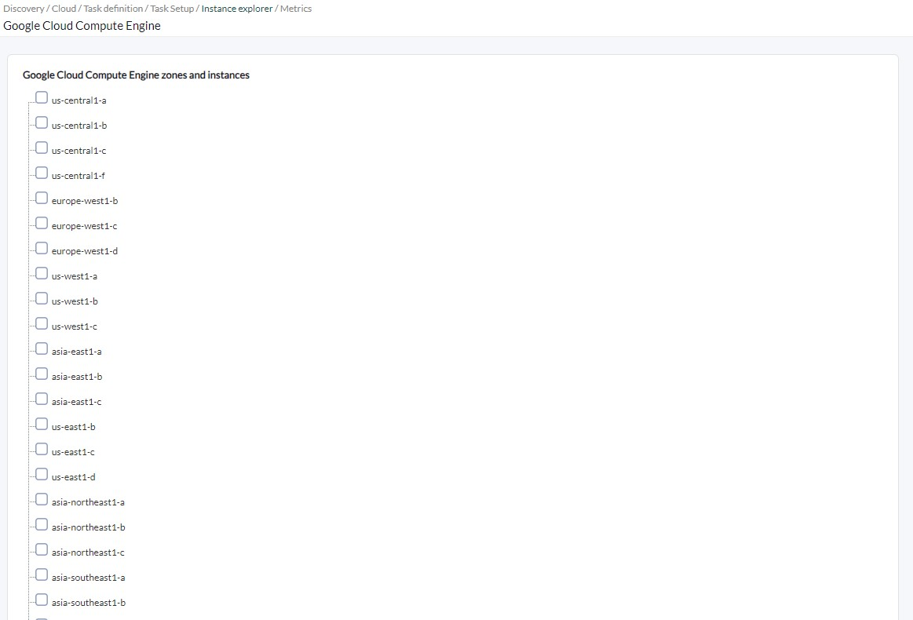
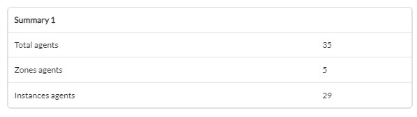

# Google Cloud Compute Engine Discovery

*Article last updated: 2026-10-26.*

## What it monitors

The Google Cloud Compute Engine Discovery addon monitors Google Cloud Compute Engine virtual machine instances and the zones that contain them. It queries the Compute Engine and Cloud Monitoring APIs of a Google Cloud project and turns the result into Pandora FMS agents and modules: instance state and, optionally, CPU, memory, disk, IOPS and network performance.

A Discovery task generates three kinds of agents:

- **A global statistics agent** (optional) with the number of monitored instances.
- **One agent per monitored zone**, with summary modules aggregated over the monitored instances of that zone.
- **One agent per monitored instance**, with its state and performance modules. The instance agent is a child of its zone agent.

A zone can be selected as a whole, in which case every instance it contains is monitored, including instances created later. Individual instances can also be selected without selecting their zone.

## Prepare

### Compatibility

| Scope | State | Evidence |
|-------|-------|----------|
| Addon `pandorafms.gcp.ce`, version `1.1` | Documented target | The version this page describes. See [Addon identity](#addon-identity) |
| Network access from the Discovery server to the Google Cloud APIs | `Required` | The addon calls the Compute Engine API (`compute`, `v1`) and the Cloud Monitoring API (`monitoring`, `v3`) |
| Service account key of the Google Cloud project to monitor | `Required` | Prerequisite, not a compatibility statement. See [Prerequisites](#prerequisites) |
| Operating system of the Discovery server | `Not validated` | No operating system has been recorded for this version |
| Specific Pandora FMS versions | `Not validated` | No version matrix has been recorded for this addon |

### Prerequisites

1. **Connectivity** from the Discovery server to the Google Cloud APIs, directly or through an HTTP proxy.
2. **A service account key** (the JSON key file) of the Google Cloud project that contains the instances, registered in the Pandora FMS credential store as a Google Cloud Platform credential. The key must include the `project_id` and `client_email` fields; the addon monitors the project named in `project_id`.
3. **Pandora FMS**: a Discovery server to run the task and the console to define it.

The addon ships its own executables, `bin/pandora_gcp_ce` and `bin/google_instances`, so nothing else has to be installed on the Discovery server to run a task.

### Google Cloud permissions

The addon performs read-only requests with the service account. Which ones it issues depends on the options you enable:

| API request | Used for |
|-------------|----------|
| Compute Engine `instances.aggregatedList` | Listing zones and instances (always) |
| Cloud Monitoring `projects.timeSeries.list` | CPU, memory, disk, IOPS and network values (when **Scan and general monitoring** is enabled) |

Grant the service account roles or permissions that allow these two requests on the project. No specific predefined role has been verified for this version, so choose the narrowest role that covers them in your organization.

Treat the key file as a secret: anyone who holds it can act as the service account.

### Install the addon

Download the `.disco` package from the Pandora FMS Marketplace entry, which is limited to licensed users:

[https://marketplace.pandorafms.com/entries/pandorafms.gcp.ce](https://marketplace.pandorafms.com/entries/pandorafms.gcp.ce)

Load it into Pandora FMS. Once loaded, **Google Cloud Compute Engine** is available in the **Cloud** section when creating Discovery tasks.

## Configure the Discovery task

Create the task from the Discovery cloud applications and choose **Google Cloud Compute Engine**. The console presents the fields in three steps; every field is documented in [Task parameters](#task-parameters).

1. **Task Setup** — credentials, execution and agent options:

    - **GCP Credentials**: the Google Cloud credential registered in the credential store.
    - **Max threads**: number of groups the monitored zones and instances are divided into.
    - **Use proxy** and **Proxy url**: route the Google Cloud requests through a proxy.
    - **Tentacle IP**, **Tentacle port** and **Tentacle extra options**: where and how the generated agent data is sent. They rarely need changing.
    - **Add global stats agent** and **Stats agent name**: create the global agent and optionally name it.

    <!-- SCREENSHOT NEEDED: Task Setup wizard step showing GCP Credentials, Max threads, proxy, Tentacle and stats agent fields, with no real credentials or addresses. -->

2. **Instance explorer** — a tree of zones and instances read from your Google Cloud project with the selected credential. Check a zone to monitor it and all of its instances, or check individual instances. Instances are grouped by machine type under each zone.

    

3. **Metrics** — the performance values collected:

    - **Scan and general monitoring**: enables the options below.
    - **Cpu performance summary**, **IOPs performance summary**, **Disk performance summary**, **Network performance summary** and **Memory performance summary**: shown only when **Scan and general monitoring** is enabled.

    <!-- SCREENSHOT NEEDED: Metrics wizard step showing Scan and general monitoring and the performance summary checkboxes. -->

The task's group and interval come from the generic task-definition step and are applied to the agents the task creates.

## Verify the first run

Force the task from the Discovery task list and check the result in this order.

1. **The task summary.** A task that completes successfully reports:

    - **Total agents**: all agents generated, including the global agent when enabled.
    - **Zones agents**: zones monitored.
    - **Instances agents**: instances monitored.

    A task that does not complete successfully records the errors in its execution information instead.

    

2. **The agents.** One per selected zone, one per instance and, when enabled, the global agent. Instance agents are children of their zone agent.

3. **The modules.** Every instance agent has `State` and `Instance State (bool)`. Performance modules appear only on running instances; see [Understand the results](#understand-the-results).

## Understand the results

### Agents generated

| Agent | Alias | Parent | Notes |
|-------|-------|--------|-------|
| Global agent | The **Stats agent name**, or `Google Cloud Platform` when empty | None | Created only when **Add global stats agent** is enabled |
| Zone agent | The zone name, for example `europe-west1-b` | The global agent only when a **Stats agent name** was given | One per selected zone |
| Instance agent | The instance name | Its zone agent | One per instance, created once even when both the instance and its zone are selected. The agent version is the machine type and the address is the internal IP address followed by the external address, when it has one |

Agent identity does not depend on the task. Zone agents are identified by the service account (`client_email`) and the zone, and instance agents by the service account and the instance name. The global agent is identified by the service account when it has no name, and by the **Stats agent name** otherwise. Moving a zone or instance between tasks that use the same service account keeps reporting to the same agent and preserves its history.

All agents report the operating system name `Google`, and `compute engine` as the operating system version for zones and instances.

### Modules per agent

**Global agent**

| Module | Type | Description |
|--------|------|-------------|
| `GCP CE Instances count` | `generic_data` | Instances found in the selected zones and instances |

**Zone agent**

| Module | Condition | Description |
|--------|-----------|-------------|
| `summary.google.compute engine.instances` | Always | Instances monitored in the zone |
| `summary.google.compute engine.CPUUtilization` | **Scan and general monitoring** and **Cpu performance summary** | CPU of the running instances divided by the number of instances in the zone |
| `summary.google.compute engine.Ram Used`, `summary.google.compute engine.SwapInBytes` | **Scan and general monitoring** and **Cpu performance summary** | Sum over the running instances that report these values |
| `summary.google.compute engine.DiskReadBytes`, `summary.google.compute engine.diskWriteBytes` | **Scan and general monitoring** and **Disk performance summary** | Sum over the running instances, in `Bytes` |
| `summary.google.compute engine.diskAverageIOLatency` | **Scan and general monitoring** and **Disk performance summary** | Sum of the average I/O latency of the running instances that report it |
| `summary.google.compute engine.DiskReadOps`, `summary.google.compute engine.DiskWriteOps` | **Scan and general monitoring** and **IOPs performance summary** | Sum over the running instances |
| `summary.google.compute engine.NetworkPacketsIn`, `summary.google.compute engine.NetworkPacketsOut` | **Scan and general monitoring** and **Network performance summary** | Sum over the running instances, in `packets` |

**Instance agent**

| Module | Type | Condition | Description |
|--------|------|-----------|-------------|
| `State` | `generic_data_string` | Always | Instance status as reported by Google Cloud |
| `Instance State (bool)` | `generic_proc` | Always | `1` when the status is `RUNNING`, `0` otherwise |
| `CPUUtilization` | `generic_data` | Running, **Cpu performance summary** | CPU usage |
| `Memory % Used` | `generic_data` | Running, **Memory performance summary**, value available | Percentage of memory used, in `%` |
| `Ram Used`, `SwapInBytesCount` | `generic_data` | Running, **Memory performance summary**, value available | Memory used in the VM and memory read into the guest from its own swap space. Reported by Google Cloud only for VMs of the e2 family |
| `DiskReadBytes`, `DiskWriteBytes` | `generic_data` | Running, **Disk performance summary** | Disk bytes read and written, in `Bytes` |
| `DiskAverageIOLatency` | `generic_data` | Running, **Disk performance summary**, value available | Average disk I/O latency |
| `Disk % Used` | `generic_data` | Running, **Disk performance summary**, value available | Percentage of disk used, in `%` |
| `DiskReadOps`, `DiskWriteOps` | `generic_data` | Running, **IOPs performance summary** | Disk read and write operations |
| `NetworkPacketsIn`, `NetworkPacketsOut` | `generic_data` | Running, **Network performance summary** | Network packets received and sent, in `packets` |
| `NetworkBytesIn`, `NetworkBytesOut` | `generic_data` | Running, **Network performance summary** | Network bytes received and sent, in `bytes` |
| `TCPConnections` | `generic_data` | Running, **Network performance summary**, value available | TCP connections |

"Value available" means that Cloud Monitoring returned a data point for the metric. The module is not created otherwise.

### How values are obtained

- Performance values are read from Cloud Monitoring over a window as long as the task interval, with a minimum of 300 seconds, and the first data point returned is used.
- Performance modules are created only for instances in the `RUNNING` state.
- `Memory % Used`, `Disk % Used` and `TCPConnections` come from metrics published under `agent.googleapis.com`; the other performance values come from `compute.googleapis.com/instance/`.

## Operate

### Manual execution

The addon can run outside a Discovery task. The executable takes a single parameter, the path to a configuration file described in [Configuration file](#configuration-file):

```bash
./pandora_gcp_ce --conf <PATH_TO_CONFIG>
```

It prints a JSON summary and sends one data file per agent using the configured transfer mode:

```json
{"summary": {"Total agents": 35, "Zones agents": 5, "Instances agents": 29}}
```

When errors occur, the JSON also contains an `info` key with the messages and the exit code is `1`.

In `local` transfer mode the data files are moved to `data_dir`. In any other mode they are sent with Tentacle, and the `tentacle_client` executable must be available in the `PATH` of the user running the addon.

A configuration file contains the service account key encoded in `creds_b64`. Protect the file with restrictive permissions.

## Troubleshoot

The addon has no verbose or debug flag. Its diagnostic channel is the `info` field of the JSON execution result, which is shown in the task's execution information.

- **The instance tree is empty**: the **Instance explorer** step prints `Error while parsing credentials: <error>` when the credential is not valid base64-encoded JSON or lacks `project_id`. Otherwise check the connectivity, the proxy and the permissions of the service account for the Compute Engine API.
- **`Error while parsing configuration zones or instances`**: in a configuration file, `gcp_zones` or `gcp_instances` is not a valid JSON array.
- **`Cannot create client to Google Compute API` or `Cannot create client to Google Monitoring API`**: the addon could not create the API client. Check the connectivity and the proxy settings.
- **Fewer agents than expected**: only the zones and instances you checked are monitored.
- **No performance modules on an instance**: the instance is not `RUNNING`, **Scan and general monitoring** is disabled, or the matching option is disabled.
- **`Error while runing single thread`**: processing of a group of targets stopped with the error that follows. This can happen when Cloud Monitoring returns no data point for a performance metric of an instance. The remaining targets of that group do not produce agents in that run.
- **Memory, `Disk % Used` or `TCPConnections` modules are missing**: Cloud Monitoring returned no data point for those metrics, which are only available when the VM publishes them.
- **Errors reaching Google Cloud through a proxy**: check **Proxy url**. If it has no scheme, `http://` is added to it.
- **`Tentacle error:`**: the data file could not be sent. The message includes the error returned by the Tentacle client.

## Reference

### Task parameters

#### Task Setup

| Field | Macro | Type | Default | Notes |
|-------|-------|------|---------|-------|
| GCP Credentials | `_credentials_` | credential select (Google Cloud Platform) | — | Mandatory. Credential registered in the credential store |
| Max threads | `_threads_` | number | `1` | Optional. Zones and instances are distributed in groups, never more groups than targets |
| Use proxy | `_useProxy_` | checkbox | off | Route Google Cloud requests through a proxy |
| Proxy url | `_proxyUrl_` | string | — | Optional. Shown when **Use proxy** is on |
| Tentacle IP | `_tentacleIP_` | string | `127.0.0.1` | Server that receives the agent data |
| Tentacle port | `_tentaclePort_` | number | `41121` | Tentacle port |
| Tentacle extra options | `_tentacleExtraOpt_` | string | — | Optional. Extra Tentacle client options |
| Add global stats agent | `_statsAgent_` | checkbox | on | Create the global agent |
| Stats agent name | `_statsAgentName_` | string | `Google Cloud Platform` (alias) | Optional. Shown when **Add global stats agent** is on |

#### Instance explorer

| Field | Macro | Type | Notes |
|-------|-------|------|-------|
| Google Cloud Compute Engine zones and instances | `_googleCEZones_`, `_googleCEInstance_` | tree | Zones populate the zone list and instances the instance list. Optional |

#### Metrics

| Field | Macro | Type | Default | Notes |
|-------|-------|------|---------|-------|
| Scan and general monitoring | `_googleCEInstanceSummary_` | checkbox | off | Enables performance modules |
| Cpu performance summary | `_googleCECpuPerfSummary_` | checkbox | off | Shown with **Scan and general monitoring** |
| IOPs performance summary | `_googleCEIopsPerfSummary_` | checkbox | off | Shown with **Scan and general monitoring** |
| Disk performance summary | `_googleCEDiskPerfSummary_` | checkbox | off | Shown with **Scan and general monitoring** |
| Network performance summary | `_googleCENetworkPerfSummary_` | checkbox | off | Shown with **Scan and general monitoring** |
| Memory performance summary | `_googleCEMemPerfSummary_` | checkbox | off | Shown with **Scan and general monitoring** |

### Configuration file

Used by manual execution. One `key = value` per line. List values are JSON arrays. Numeric options accept `1` to enable and `0` to disable; a value that is not a number is read as `0`. Unknown keys are ignored.

| Key | Default | Description |
|-----|---------|-------------|
| `agents_group_name` | `google` | Group of the generated agents |
| `interval` | `300` | Agent interval, in seconds |
| `threads` | `1` | Number of groups the targets are distributed in |
| `transfer_mode` | `local` | `local` moves the data files to `data_dir`; any other value sends them with Tentacle, which requires `tentacle_ip` |
| `tentacle_client` | `tentacle_client` | Tentacle client executable |
| `tentacle_ip` | empty | Tentacle server address |
| `tentacle_port` | `41121` | Tentacle server port |
| `tentacle_opts` | empty | Extra Tentacle client options |
| `data_dir` | `/var/spool/pandora/data_in/` | Destination of the data files in `local` mode |
| `temporal` | `/tmp` | Directory where the data files are written before sending |
| `advance_monitoring` | `1` | Performance modules; required for the five options below |
| `cpu_summary` | `1` | CPU modules |
| `mem_summary` | `1` | Memory modules |
| `iops_summary` | `1` | IOPS modules |
| `disk_summary` | `1` | Disk modules |
| `network_summary` | `1` | Network modules |
| `stats_agent` | `1` | Global agent |
| `stats_agent_name` | empty | Name of the global agent; `Google Cloud Platform` alias when empty |
| `gcp_zones` | `[]` | Zones to monitor. Every instance found in a listed zone is monitored |
| `gcp_instances` | `[]` | Instance names to monitor |
| `use_proxy` | `0` | Use a proxy |
| `proxy_url` | empty | Proxy URL |
| `creds_b64` | empty | Mandatory. Base64 of the service account JSON key file |

Example:

```ini
agents_group_name  = google
interval           = 300
threads            = 4
transfer_mode      = tentacle
tentacle_ip        = <TENTACLE_SERVER_IP>
tentacle_port      = 41121

advance_monitoring = 1
cpu_summary        = 1
mem_summary        = 1
iops_summary       = 1
disk_summary       = 1
network_summary    = 1

stats_agent        = 1
stats_agent_name   = GoogleCloud

gcp_zones          = ["<ZONE_NAME>"]
gcp_instances      = ["<INSTANCE_NAME>"]

creds_b64          = <BASE64_SERVICE_ACCOUNT_KEY>
```

### Addon identity

| Item | Value |
|------|-------|
| Name | Google Cloud Compute Engine |
| Identifier | `pandorafms.gcp.ce` |
| Version | `1.1` |
| Type and section | Discovery, `cloud` |
| Marketplace entry | [pandorafms.gcp.ce](https://marketplace.pandorafms.com/entries/pandorafms.gcp.ce), updated 2025-06-01 |
| Availability | The Marketplace entry states that the download is limited to licensed users |
