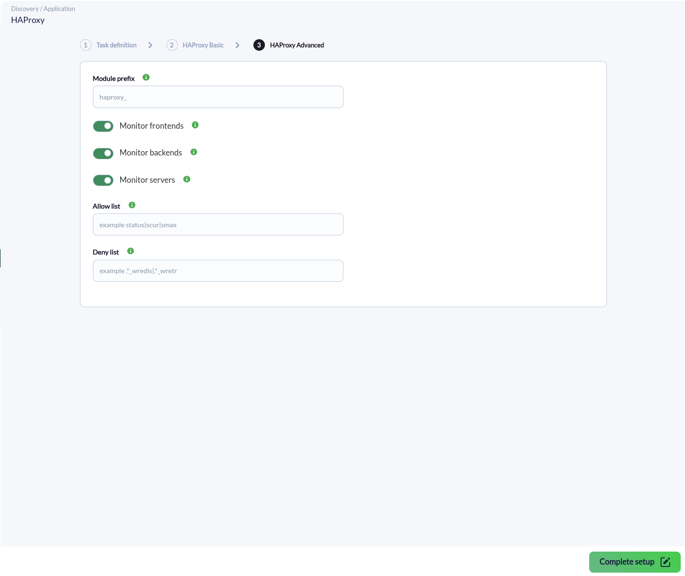

# HAProxy Discovery

*Article last updated: 2026-10-26.*

## What it monitors

The HAProxy Discovery addon monitors HAProxy load balancers through the CSV export of the HAProxy statistics endpoint (`/stats;csv`). It reads that export and turns each statistic of each proxy into a Pandora FMS module: sessions, bytes transferred, queues, errors, health checks, HTTP response classes, timings and the operational status of every frontend, backend and server.

The addon creates **one agent per HAProxy URL**. A Discovery task accepts several URLs at once, so a single task covers a whole set of HAProxy instances. Each agent contains one module per available statistic and per proxy row, plus a numeric `status` module for every row that you can use to alert on `DOWN`, `MAINT` or `STOP` states.

## Prepare

### Compatibility

| Scope | State | Evidence |
|-------|-------|----------|
| Addon `pandorafms.haproxy`, version `1.0` | Documented target | The version this page describes. See [Addon identity](#addon-identity) |
| HAProxy statistics endpoint serving the CSV export, over HTTP or HTTPS, with or without basic authentication | `Required` | Prerequisite, not a compatibility statement. See [Enable the statistics endpoint](#enable-the-statistics-endpoint) |
| Network reachability from the Discovery server to the statistics endpoint | `Required` | The addon performs one HTTP request per URL |
| Specific HAProxy releases | `Not validated` | No version matrix has been recorded for this addon |
| Operating system of the Discovery server | `Not validated` | No operating system has been recorded for this version |
| Specific Pandora FMS versions | `Not validated` | No version matrix has been recorded for this addon |

### Prerequisites

1. **The statistics endpoint must be enabled and reachable** from the machine that runs the addon. Enabling it is covered in [Enable the statistics endpoint](#enable-the-statistics-endpoint).
2. **Credentials**, only when the endpoint is protected with HTTP basic authentication.
3. **Pandora FMS**: a Discovery server to run the task and the console to define it.

The addon is distributed as a self-contained executable, `bin/pandora_haproxy`, so nothing else has to be installed on the Discovery server to run a task.

### Install the addon

Download the `.disco` package from the Pandora FMS Marketplace entry, which is limited to licensed users:

[https://marketplace.pandorafms.com/entries/pandorafms.haproxy](https://marketplace.pandorafms.com/entries/pandorafms.haproxy)

Load it into Pandora FMS. Once loaded, **HAProxy** is available in **Management → Discovery → Application** when creating Discovery tasks.

### Enable the statistics endpoint

For the addon to obtain the statistics, HAProxy must expose its statistics page. Enabling it is done by editing the HAProxy configuration file, `haproxy.cfg` (by default `/etc/haproxy/haproxy.cfg`). Pick the variant that matches how the endpoint should be protected. None of them needs the `stats admin` option, because the addon only reads data.

#### Minimal configuration (no authentication, no SSL)

Add a dedicated `frontend` for the statistics:

```
frontend stats
    bind *:8404
    stats enable
    stats uri /stats
    stats refresh 10s
```

The URL to give to the addon is the host and port, without a path:

```
http://<HAPROXY_HOST>:8404
```

The addon appends `/stats;csv` to the path you provide instead of replacing it, so the address of the statistics page does not work as it is: `http://<HAPROXY_HOST>:8404/stats` is requested as `http://<HAPROXY_HOST>:8404/stats/stats;csv` and HAProxy answers `404`. Enter the host and port alone, or a URL that already ends in `stats;csv`. See [How the URL is normalized](#how-the-url-is-normalized).

#### Basic authentication

Define a `userlist` and require authentication in the statistics frontend:

```
frontend stats
    bind *:8404
    stats enable
    stats uri /stats
    stats refresh 10s

    acl auth_ok http_auth(stats_users)
    http-request auth realm stats if !auth_ok

userlist stats_users
    user <USERNAME> password <PASSWORD_HASH>
```

Generate the password hash, which HAProxy reads in `crypt(3)` format, with:

```bash
openssl passwd -6 <PASSWORD>
```

Give the addon the same user name and password in the **Username** and **Password** fields.

#### SSL/TLS

Serve the statistics over HTTPS by adding `ssl crt` to the `bind` line:

```
frontend stats
    bind *:8404 ssl crt /etc/haproxy/certs/stats.pem
    stats enable
    stats uri /stats
    stats refresh 10s
```

To create a self-signed certificate for testing:

```bash
openssl req -x509 -nodes -days 365 -newkey rsa:2048 \
  -keyout /etc/haproxy/certs/stats.key \
  -out /etc/haproxy/certs/stats.crt \
  -subj "/CN=localhost"
cat /etc/haproxy/certs/stats.crt /etc/haproxy/certs/stats.key > /etc/haproxy/certs/stats.pem
```

Use a URL with the `https://` scheme in the task. Enable **Verify SSL** only when the certificate is valid for the host name in the URL and its issuer is trusted by the Discovery server; leave it disabled for self-signed certificates.

#### SSL and authentication together

Combine both blocks in the statistics frontend:

```
frontend stats
    bind *:8404 ssl crt /etc/haproxy/certs/stats.pem
    stats enable
    stats uri /stats
    stats refresh 10s

    acl auth_ok http_auth(stats_users)
    http-request auth realm stats if !auth_ok

userlist stats_users
    user <USERNAME> password <PASSWORD_HASH>
```

After editing `haproxy.cfg`, reload the service:

```bash
sudo systemctl reload haproxy
```

### Confirm the endpoint responds

Before creating the task, request the CSV export by hand from the Discovery server. Quote the URL, because `;` is a special character in the shell:

```bash
curl -u <USERNAME>:<PASSWORD> 'http://<HAPROXY_HOST>:8404/stats;csv'
```

Passing a password on the command line exposes it in the shell history and in the operating system process list. Omit `-u` when the endpoint has no authentication. For an HTTPS endpoint with a self-signed certificate add `-k`.

The first line of the answer must be a header that starts with `# pxname,svname,qcur,qmax,...`, followed by one row per frontend, backend and server. If this request fails, the task fails too: fix it here rather than in the console.

## Configure the Discovery task

Create the task from **Management → Discovery → Application → HAProxy**. After the generic task-definition step, the console presents the fields in two steps. Every field is documented in [Task parameters](#task-parameters).

1. **HAProxy Basic** — the endpoints and how to reach them:

    - **HAProxy Stats URLs**: statistics URLs, separated by commas or one per line. **Each URL generates one agent.** Mandatory.
    - **Username** and **Password**: only when the endpoint requires HTTP basic authentication. Authentication is sent only when both are filled in.
    - **Verify SSL**: validate the certificate of an `https://` URL. Disabled by default.
    - **Transfer mode**, **Tentacle IP** and **Tentacle port**: how the data reaches Pandora FMS. `native` lets the Discovery server read the data directly; `tentacle` sends it with the Tentacle client. The Tentacle fields only matter in `tentacle` mode.

    <!-- SCREENSHOT NEEDED: HAProxy Basic wizard step showing the URL textarea, Username, Password, Verify SSL and Transfer mode with Tentacle fields, using documentation placeholders (for example http://<HAPROXY_HOST>:8404) and no private IP addresses. -->

2. **HAProxy Advanced** — optional shaping of the result:

    - **Module prefix**: prepended to every created module name.
    - **Monitor frontends**, **Monitor backends** and **Monitor servers**: choose which kinds of proxy rows produce modules. All three are enabled by default.
    - **Allow list** and **Deny list**: regular expressions to include or exclude modules by name.

    

The task's own group and interval come from the generic task-definition step: they are applied to the agents the task creates.

## Verify the first run

Force the task from **Management → Discovery → Task list** and check the result in this order.

1. **The task summary.** A task that completes successfully reports:

    - **Total Agents**: the number of agents generated by the task.
    - **Total Modules**: the number of modules generated by the task.

    Expect one agent per URL you entered. A URL that could not be read is reported as an error in the execution information instead.

    <!-- SCREENSHOT NEEDED: Discovery task execution summary for a HAProxy task showing Total Agents and Total Modules. -->

2. **The agents.** One per URL, with the alias set to the `host:port` of the URL, for example `<HAPROXY_HOST>:8404`.

3. **The modules on each agent.** Modules are named `<prefix><proxy>_<server>_<statistic>`, for example `app_FRONTEND_scur` or `app_BACKEND_status`. Every proxy row has a `status` module, whose value follows the mapping in [The status module](#the-status-module).

If the task reports no agents, work back through [Confirm the endpoint responds](#confirm-the-endpoint-responds) and then [Troubleshoot](#troubleshoot).

## Understand the results

### Agents generated

The addon creates **one agent per HAProxy URL**. The agent name is the MD5 hash of the URL's `host:port`, and the alias is that `host:port` itself, for example `<HAPROXY_HOST>:8404`. When a URL has no `host:port`, the whole URL is used instead. The agent description is `HAProxy stats agent created by discovery plugin`.

Because the identity comes from the endpoint and not from the task, moving a URL between tasks keeps reporting to the same agent and preserves its history. Two URLs with the same `host:port` therefore resolve to the same agent.

### Modules generated

HAProxy reports one CSV row per frontend, one per backend and one per server, and the addon creates modules from each row:

- **`status` module**: created for every row, regardless of the **Monitor frontends**, **Monitor backends** and **Monitor servers** options, so that you can always alert on `DOWN`, `MAINT` and `STOP`. See [The status module](#the-status-module).
- **Statistic modules**: one module per statistic of the row that has a value. Numeric values are created as `generic_data` modules and text values as `generic_data_string`. Statistics with an empty value are not created.

A statistic module is created only when its row type is enabled: rows of type frontend (`type=0`), backend (`type=1`) or server (`type=2`) follow **Monitor frontends**, **Monitor backends** and **Monitor servers**. Rows of any other type, such as sockets (`type=3`), are not governed by those options.

Module names have the form `<prefix><proxy>_<server>_<statistic>`, where `<proxy>` and `<server>` are the `pxname` and `svname` columns of the row. For frontend and backend rows `svname` is `FRONTEND` or `BACKEND`. Apostrophes and double quotes are removed from names and descriptions.

The addon creates a module for every column the endpoint returns, apart from the columns listed in [Statistics that do not create modules](#statistics-that-do-not-create-modules). A HAProxy release that exports additional numeric columns therefore produces additional modules. The [Reference](#modules-by-statistic) describes the columns the addon documents.

### The status module

The `status` module is `generic_data` and converts the HAProxy status text into a number, from best to worst:

| HAProxy status | Value |
|----------------|-------|
| `UP` | `5` |
| `OPEN` | `4` |
| `NOLB` | `3` |
| `MAINT` | `2` |
| `STOP`, `STOPPING` | `1` |
| `DOWN` | `0` |
| Any other status | `-1` |

Only the first word of the HAProxy status is used, so `UP 2/3` is read as `UP`. The module is created with the thresholds warning `2` to `4` and critical `0` to `2`, so a `DOWN` or `MAINT` row raises a critical state and a `NOLB` row a warning, without further configuration.

### Filtering modules

The **Allow list** and **Deny list** are regular expressions searched (not anchored) in the module name as built from the row, `<proxy>_<server>_<statistic>`, without the **Module prefix**. For example, `.*_wredis|.*_wretr` matches every `wredis` and `wretr` module and `status|scur|smax` matches every module whose name contains one of those three words.

- The allow list is applied first, then the deny list.
- An empty list does nothing. An invalid regular expression is ignored: an invalid allow list allows everything and an invalid deny list excludes nothing.
- Both lists also apply to the `status` module. An allow list that does not match `status` removes it.

### How the URL is normalized

For each URL, the addon requests the CSV export. It appends `/stats;csv` to the path of the URL when the path does not already end in `stats;csv`, and it adds the `norefresh` parameter to the query when it is missing. Each request has a fixed timeout of 10 seconds. Because the suffix is appended and not substituted, `http://<HAPROXY_HOST>:8404` is requested as `http://<HAPROXY_HOST>:8404/stats;csv?norefresh`, whereas `http://<HAPROXY_HOST>:8404/stats` is requested as `http://<HAPROXY_HOST>:8404/stats/stats;csv?norefresh` and fails with `404`.

## Operate

### Manual execution

The addon can run outside a Discovery task, which is the fastest way to confirm an endpoint before wiring it into a task. It has two input modes:

- **Simple mode** passes the URLs on the command line with `--urls`.
- **Advanced mode** passes a configuration file with `--conf` plus a targets file with `--conf_targets`. This is the mode the Discovery task itself uses.

```bash
# Simple mode
./pandora_haproxy --urls http://<HAPROXY_HOST_1>:8404,http://<HAPROXY_HOST_2>:8404 \
    --user <USERNAME> --password <PASSWORD> --ssl false

# Advanced mode
./pandora_haproxy --conf <PATH_TO_CONFIG> --conf_targets <PATH_TO_TARGETS>
```

Passing a password on the command line exposes it in the shell history and in the operating system process list. Prefer the configuration file for anything but a one-off check, and protect that file with restrictive permissions.

The run prints a JSON summary of the execution. In `native` mode the collected data is exposed in the summary's `monitoring_data` field, for the Discovery server to consume; in `tentacle` mode the addon generates one XML file per agent and sends it to the Pandora FMS server with the Tentacle client. When errors occur, the summary includes them in its `info` field.

`--as_server_plugin true` replaces the summary with a single `1` (at least one agent was created without errors) or `0`, so the addon can be wired as a server plugin.

> In simple mode (`--urls`), the module prefix, transfer mode, Tentacle address and interval parameters are accepted but not applied: the addon uses the defaults (no prefix, `native`, `127.0.0.1:41121` and `300` seconds), and no agent group is sent with the agents. To change them, use advanced mode with `--conf`.

## Troubleshoot

The addon has no verbose or debug flag. Its diagnostic channel is the execution information of the task (the `info` field of the JSON summary in a manual run), which names the failing URL.

- **`HTTP error for <url>: HTTP Error <code> for <url>`** — the endpoint answered with an error status. `401` means that the credentials are missing or wrong: check **Username** and **Password** (both must be filled in for authentication to be sent) against the `userlist`. `404` usually means that the URL and the `stats uri` of HAProxy do not combine: the addon appends `/stats;csv` to the path you give, so a URL that already ends in `/stats` requests `/stats/stats;csv`. Enter the host and port alone, or a URL that already ends in `stats;csv`.
- **`Request error for <url>: ...`** — the request could not be completed: connection refused or timed out (10 seconds), wrong port, firewall, or a certificate error. For a certificate error on an HTTPS endpoint, disable **Verify SSL** for a self-signed certificate or install the issuing CA on the Discovery server.
- **`Error parsing CSV for <url>` or `No stats data returned for <url>`** — the URL answered but not with the CSV export, or with no rows. Check it with the `curl` command in [Confirm the endpoint responds](#confirm-the-endpoint-responds).
- **`No modules created for <url>`** — the row filters removed everything. Review **Allow list**, **Deny list** and the **Monitor** options.
- **`All requests failed when trying to obtain HAProxy stats`** — no URL produced an agent.
- **`No URLs provided` or `No valid URLs after parsing`** — **HAProxy Stats URLs** is empty after splitting on commas and line breaks.
- **`Error: --conf_targets is required when using --conf` or `Error: no valid targets found in <file>`** — in a manual advanced-mode run, the targets file is missing or empty.
- **The endpoint answers by hand but not from the task** — the request leaves from the Discovery server, not from your workstation. Check the network path and any `acl` rules of the statistics frontend.
- **Module prefix, transfer mode, Tentacle address or interval seem ignored in a manual run** — see the note in [Manual execution](#manual-execution).
- **A `status` module has value `-1`** — HAProxy reported a status that is not in the table of [The status module](#the-status-module), for example a row with no health check.
- **Fewer modules than expected** — check the row-type options and the allow and deny lists, and remember that empty statistics and the columns in [Statistics that do not create modules](#statistics-that-do-not-create-modules) never create modules.

## Reference

### Task parameters

The console presents the task fields in two steps.

#### HAProxy Basic

| Field | Macro | Type | Default | Notes |
|-------|-------|------|---------|-------|
| HAProxy Stats URLs | `_haproxyUrls_` | textarea | — | Mandatory. Comma separated or one per line. Each URL creates one agent |
| Username | `_haproxyUser_` | string | empty | HTTP basic authentication user, optional |
| Password | `_haproxyPassword_` | password | empty | HTTP basic authentication password, optional. Authentication is sent only when both user and password are set |
| Verify SSL | `_verifySSL_` | checkbox | off | Validate the certificate of an HTTPS URL. Leave off for self-signed certificates |
| Transfer mode | `_transferMode_` | select | `native` | `native`: the Discovery server reads the agent data directly. `tentacle`: the addon sends the data with the Tentacle client |
| Tentacle IP | `_tentacleIp_` | string | `127.0.0.1` | Tentacle server address, used in `tentacle` mode |
| Tentacle port | `_tentaclePort_` | number | `41121` | Tentacle server port, used in `tentacle` mode |

#### HAProxy Advanced

| Field | Macro | Type | Default | Notes |
|-------|-------|------|---------|-------|
| Module prefix | `_prefixModules_` | string | empty | Prepended to every module name |
| Monitor frontends | `_monitorFrontends_` | checkbox | on | Create statistic modules for frontend rows (`type=0`) |
| Monitor backends | `_monitorBackends_` | checkbox | on | Create statistic modules for backend rows (`type=1`) |
| Monitor servers | `_monitorServers_` | checkbox | on | Create statistic modules for server rows (`type=2`) |
| Allow list | `_allowList_` | string | empty (all) | Regular expression; only modules whose name matches are created |
| Deny list | `_denyList_` | string | empty (none) | Regular expression; modules whose name matches are not created |

### Command-line parameters

```bash
./pandora_haproxy --urls <URLs> [options]
./pandora_haproxy --conf <path> --conf_targets <path>
```

| Parameter | Default | Description |
|-----------|---------|-------------|
| `--urls` | — | HAProxy statistics URLs, separated by commas. Each URL generates one agent. Either `--urls` or `--conf` is required |
| `--user` | — | User for HTTP basic authentication, optional |
| `--password` | — | Password for HTTP basic authentication, optional |
| `--ssl` | `true` | Verify the HTTPS certificate (`true` or `false`) |
| `--prefix` | empty | Prefix for module names. Not applied in simple mode |
| `-tm`, `--transfer_mode` | `native` | `native` or `tentacle`. Not applied in simple mode |
| `-ti`, `--tentacle_ip` | `127.0.0.1` | Tentacle server address. Not applied in simple mode |
| `-tp`, `--tentacle_port` | `41121` | Tentacle server port. Not applied in simple mode |
| `-in`, `--interval` | `300` | Monitoring interval in seconds. Not applied in simple mode |
| `--allow_list` | empty (all) | Regular expression to include only modules whose name matches |
| `--deny_list` | empty (none) | Regular expression to exclude modules whose name matches |
| `--monitor_frontends` | `true` | Create statistic modules for frontend rows (`type=0`) |
| `--monitor_backends` | `true` | Create statistic modules for backend rows (`type=1`) |
| `--monitor_servers` | `true` | Create statistic modules for server rows (`type=2`) |
| `--as_server_plugin` | `false` | Return a single `1` or `0` instead of the JSON summary |
| `--conf` | — | Path to the configuration file |
| `--conf_targets` | — | Path to the file with the HAProxy URLs. Mandatory when `--conf` is used |

Boolean values accept `true`, `yes`, `t`, `y` and `1` (any letter case) as true; anything else is false.

### Configuration file

The Discovery task builds this file from its own fields; a manual advanced-mode run supplies it with `--conf`. Use a `[CONF]` section with one `key=value` per line. The URLs are not read from this file but from the targets file.

| Key | Default when missing | Description |
|-----|----------------------|-------------|
| `username` | empty | HTTP basic authentication user |
| `password` | empty | HTTP basic authentication password |
| `verify_ssl` | `false` | Verify the HTTPS certificate |
| `prefix` | empty | Prefix for module names |
| `transfer_mode` | none | `native` or `tentacle`. Always set it: when the key is missing, the run does not use `native` |
| `tentacle_ip` | empty | Tentacle server address, used in `tentacle` mode |
| `tentacle_port` | empty | Tentacle server port, used in `tentacle` mode |
| `agents_group` | empty | Name of the agent group, used in `tentacle` mode |
| `agents_group_id` | empty | Id of the agent group, used in `native` mode |
| `interval` | `0` | Monitoring interval in seconds. Always set it |
| `allow_list` | empty | Regular expression to include only modules whose name matches |
| `deny_list` | empty | Regular expression to exclude modules whose name matches |
| `monitor_frontends` | `true` | Create statistic modules for frontend rows |
| `monitor_backends` | `true` | Create statistic modules for backend rows |
| `monitor_servers` | `true` | Create statistic modules for server rows |

Example:

```ini
[CONF]
username=<USERNAME>
password=<PASSWORD>
verify_ssl=true
prefix=haproxy_
transfer_mode=native
tentacle_ip=127.0.0.1
tentacle_port=41121
interval=300
agents_group_id=<GROUP_ID>
allow_list=
deny_list=.*_wredis|.*_wretr
monitor_frontends=true
monitor_backends=true
monitor_servers=true
```

Targets file (`--conf_targets`), one URL per line, comma separated, or both:

```
http://<HAPROXY_HOST_1>:8404
http://<HAPROXY_HOST_2>:8404
```

### Modules by statistic

Each statistic below creates a module named `<prefix><proxy>_<server>_<statistic>`, subject to the row-type options and the allow and deny lists. The module description is the text in the table.

#### Sessions, traffic and rates

| Statistic | Description |
|-----------|-------------|
| `scur` | Current sessions |
| `smax` | Max sessions |
| `slim` | Configured session limit |
| `stot` | Cumulative sessions |
| `bin` | Bytes in |
| `bout` | Bytes out |
| `rate` | Sessions per second (last second) |
| `rate_lim` | Configured limit on new sessions/s |
| `rate_max` | Max sessions per second |
| `req_rate` | HTTP requests per second |
| `req_rate_max` | Max HTTP requests per second |
| `req_tot` | Total HTTP requests received |
| `conn_rate` | Connections over last elapsed second |
| `conn_rate_max` | Highest known conn_rate |
| `conn_tot` | Cumulative number of connections |
| `intercepted` | Cumulative intercepted requests |
| `lbtot` | Times server was selected |
| `lastsess` | Seconds since last session assigned |

#### Queue

| Statistic | Description |
|-----------|-------------|
| `qcur` | Current queued requests |
| `qmax` | Max queued requests |
| `qlimit` | Configured maxqueue for server |

#### Denied requests, errors and aborts

| Statistic | Description |
|-----------|-------------|
| `dreq` | Requests denied (security) |
| `dresp` | Responses denied (security) |
| `dcon` | Requests denied by tcp-request connection rules |
| `dses` | Requests denied by tcp-request session rules |
| `ereq` | Request errors |
| `econ` | Connection errors to backend |
| `eresp` | Response errors |
| `wretr` | Connection retries |
| `wredis` | Redispatches to another server |
| `cli_abrt` | Data transfers aborted by client |
| `srv_abrt` | Data transfers aborted by server |

#### Servers, weight and health checks

| Statistic | Description |
|-----------|-------------|
| `weight` | Total weight / server weight |
| `act` | Active servers (backend) / server active |
| `bck` | Backup servers (backend) / server backup |
| `chkfail` | Failed health checks |
| `chkdown` | UP->DOWN transitions |
| `lastchg` | Seconds since last UP<->DOWN transition |
| `downtime` | Total downtime (seconds) |
| `throttle` | Current throttle percentage |
| `tracked` | ID of proxy/server if tracking enabled |
| `check_code` | Layer 5-7 check code |
| `check_duration` | Time in ms of last health check |
| `check_rise` | Server's rise parameter used by checks |
| `check_fall` | Server's fall parameter used by checks |
| `check_health` | Server's health check value |
| `agent_code` | Numeric code reported by agent |
| `agent_duration` | Time in ms of last agent check |
| `agent_rise` | Agent's rise parameter |
| `agent_fall` | Agent's fall parameter |
| `agent_health` | Agent's health parameter |

#### HTTP responses and timings

| Statistic | Description |
|-----------|-------------|
| `hrsp_1xx` | HTTP responses with 1xx code |
| `hrsp_2xx` | HTTP responses with 2xx code |
| `hrsp_3xx` | HTTP responses with 3xx code |
| `hrsp_4xx` | HTTP responses with 4xx code |
| `hrsp_5xx` | HTTP responses with 5xx code |
| `hrsp_other` | HTTP responses with other codes |
| `qtime` | Average queue time (ms) over last 1024 requests |
| `ctime` | Average connect time (ms) over last 1024 requests |
| `rtime` | Average response time (ms) over last 1024 requests |
| `ttime` | Average total session time (ms) over last 1024 requests |

#### Compression

| Statistic | Description |
|-----------|-------------|
| `comp_in` | HTTP response bytes fed to compressor |
| `comp_out` | HTTP response bytes emitted by compressor |
| `comp_byp` | Bytes that bypassed HTTP compressor |
| `comp_rsp` | HTTP responses that were compressed |

#### Identifiers

| Statistic | Description |
|-----------|-------------|
| `pid` | Process ID |
| `iid` | Unique proxy ID |
| `sid` | Server ID (unique inside proxy) |

### Statistics that do not create modules

The following columns of the HAProxy export never create a module: `pxname`, `svname` (they form the module name), `type` (it selects the row type), `status` (it has its own module, see [The status module](#the-status-module)), `check_status`, `check_desc`, `agent_status`, `agent_desc`, `last_chk`, `last_agt`, `hanafail`, `addr`, `cookie`, `mode` and `algo`.

### Addon identity

| Item | Value |
|------|-------|
| Name | HAProxy |
| Identifier | `pandorafms.haproxy` |
| Version | `1.0` |
| Type and section | Discovery, `app` (**Management → Discovery → Application**) |
| Package | `pandorafms.haproxy.1.0.disco` |
| Marketplace entry | [pandorafms.haproxy](https://marketplace.pandorafms.com/entries/pandorafms.haproxy), updated 2026-06-04 |
| Availability | The Marketplace entry states that the download is limited to licensed users |
