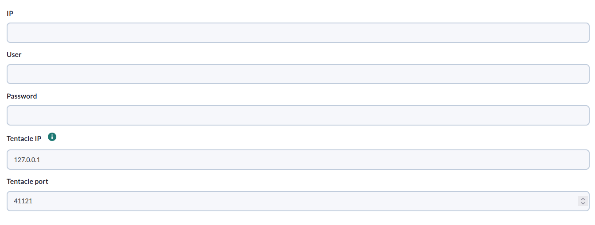
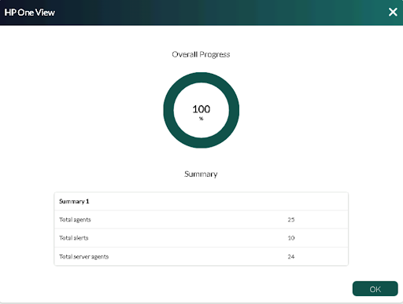

# HP One View Discovery

*Article last updated: 2026-10-26.*

## What it monitors

The HP One View Discovery addon monitors the server hardware and the appliance managed by an HP OneView environment. It connects to the OneView appliance with a user name and password and turns the result into Pandora FMS agents and modules. Optionally, it turns the active alerts of OneView into Pandora FMS events.

A Discovery task can generate:

- **One agent per server** (optional), with its health status, state and power state, plus the latest utilization metrics that OneView reports for it.
- **One appliance agent** (optional) with the capacity, availability and used percentage of each resource reported by the appliance health status.
- **Events** (optional) for the active or locked alerts of OneView, created in the appliance agent.

## Prepare

### Compatibility

| Scope | State | Evidence |
|-------|-------|----------|
| Addon `pandorafms.hp.oneview`, version `1.0` | Documented target | The version this page describes. See [Addon identity](#addon-identity) |
| Network access from the Discovery server to the HP OneView appliance | `Required` | The addon connects to the appliance with the credentials of the task |
| HP OneView user with read access to server hardware and appliance health | `Required` | Prerequisite. The roles needed are not documented for this addon |
| Specific HP OneView versions | `Not validated` | No version matrix has been recorded for this addon |
| Operating system of the Discovery server | `Not validated` | No operating system has been recorded for this version |
| Specific Pandora FMS versions | `Not validated` | No version matrix has been recorded for this addon |

### Prerequisites

1. **Connectivity** from the Discovery server to the HP OneView appliance.
2. **An HP OneView user name and password** that can read servers and the appliance health.
3. **Only to create events from alerts**, all of the following:
    - A Pandora FMS API v2 token and the URL of the Pandora FMS console.
    - The numeric ID of the Pandora FMS group in which events are created.
    - Read access, from the Discovery server, to the Pandora FMS server configuration file (default `/etc/pandora/pandora_server.conf`) and network access to the Pandora FMS database defined in it. The addon reads the database connection settings from that file to find the ID of the appliance agent.
4. **Pandora FMS**: a Discovery server to run the task and the console to define it.

The addon ships its own executable, `bin/pandora_hponeview`, so nothing else has to be installed on the Discovery server to run a task.

### Install the addon

Download the `.disco` package from the Pandora FMS Marketplace entry, which is limited to licensed users:

[https://marketplace.pandorafms.com/entries/pandorafms.hp.oneview](https://marketplace.pandorafms.com/entries/pandorafms.hp.oneview)

Load it into Pandora FMS. Once loaded, **HP One View** is available when creating Discovery tasks, in the application (`app`) section.

## Configure the Discovery task

Create the task from the Discovery applications and choose **HP One View**. The console presents the fields in two steps; every field is documented in [Task parameters](#task-parameters).

1. **HP one view base** — connection and delivery:

    - **IP**: address of the HP OneView appliance.
    - **User** and **Password**: credentials of the OneView user.
    - **Tentacle IP** and **Tentacle port**: where the generated agent data is sent. The defaults are `127.0.0.1` and `41121`.

    

2. **HP one view Detailed** — what to collect:

    - **Use prefix** and **Prefix**: prepend a text to the agent aliases and module names.
    - **Scan appliances** and **Scan servers**: create the appliance agent and the server agents. Both are on by default.
    - **Scan alerts**: create events from OneView alerts. On by default. It reveals **API Url**, **API Token**, **Server conf** and **Events ID group**.

    <!-- SCREENSHOT NEEDED: HP one view Detailed wizard step showing the prefix, scan checkboxes and the alert fields, with no real tokens or addresses. -->

The task's group and interval come from the generic task-definition step and are applied to the agents the task creates.

Alerts are on by default but need **API Url**, **API Token** and **Events ID group** to work. If you do not need events, disable **Scan alerts**; otherwise the task reports an error on every run.

## Verify the first run

Force the task from the Discovery task list and check the result in this order.

1. **The task summary.** A task that completes successfully reports:

    - **Total agents**: all agents generated, servers and appliance.
    - **Total server agents**: server agents generated.
    - **Total alerts**: events created from alerts.

    Errors are recorded in the execution information of the task.

    

2. **The agents.** One per server when **Scan servers** is on, and the appliance agent when **Scan appliances** is on.
3. **The modules.** Each server agent has `status`, `state` and `powerState`; see [Understand the results](#understand-the-results).
4. **The events**, when **Scan alerts** is on. The appliance agent must already exist, so on the very first run the alert step is skipped with an error that asks you to run the task again. Run it a second time to create the events.

## Understand the results

### Agents generated

| Agent | Alias | Operating system | Notes |
|-------|-------|------------------|-------|
| Server agent | `<prefix><server name>` | Operating system and model reported by OneView, as `<operatingSystem> <model>` | One per server of the OneView environment |
| Appliance agent | `<prefix> Appliances` | Not set | One per Pandora FMS installation, see the note below |

The server agent identity is derived from the prefix and the server name. The appliance agent identity is always the same, whatever the prefix or the OneView environment: two tasks, even against different appliances, report to the same appliance agent.

### Modules per agent

**Server agent**

| Module | Type | Description |
|--------|------|-------------|
| `<prefix>status` | `generic_proc` | `1` when the OneView status of the server is `OK`, `0` otherwise |
| `<prefix>state` | `generic_data_string` | Server state reported by OneView |
| `<prefix>powerState` | `generic_data_string` | Power state reported by OneView |
| `<prefix><metric name>` | `generic_data` | One module for each utilization metric returned by OneView for the server, with its latest sample. The metrics available depend on the server |

**Appliance agent**

For each resource listed in the appliance health status, where `<resource_id>` and `<resource_type>` are those reported by OneView:

| Module | Type | Description |
|--------|------|-------------|
| `<prefix><resource_id> <resource_type> available` | `generic_data_string` | Available amount, as reported by OneView |
| `<prefix><resource_id> <resource_type> capacity` | `generic_data_string` | Capacity, as reported by OneView |
| `<prefix><resource_id> <resource_type> used_percent` | `generic_data` | Used percentage in `%`, calculated as `100 - (available × 100 / capacity)` and rounded to two decimals. It is `0` when the capacity is `0` |

The numeric part is read by taking the first run of digits, commas and dots in the value and replacing commas with dots, so a thousands separator is read as a decimal separator. A value with more than one separator, such as `1,234,567`, makes the calculation fail and the appliance produces no modules in that run. The unit text of the values is ignored.

### Events from alerts

When **Scan alerts** is on, the addon reads the first 10 alerts that OneView returns. For every one of them whose state is `Active` or `Locked`, it creates a Pandora FMS event whose text is the description of the alert, assigned to the appliance agent and to the group set in **Events ID group**. The event severity is `critical` for a Critical alert and `warning` for a Warning alert. An alert of any other severity keeps the severity of the previous alert in the same run, so a Critical alert followed by one of another severity also produces a `critical` event. The addon does not check whether the event already exists, so the same alert generates a new event on every run while it stays active.

## Operate

### Manual execution

The addon can run outside a Discovery task. The executable takes a single parameter, the path to a configuration file described in [Configuration file](#configuration-file):

```bash
./pandora_hponeview --conf <PATH_TO_CONFIG>
```

It prints a JSON summary and sends one data file per agent using the configured transfer mode:

```json
{"summary": {"Total agents": 3, "Total server agents": 2, "Total alerts": 0}}
```

When errors occur, the JSON also contains an `info` key with the messages.

The configuration file holds the OneView password and the API token in clear text. Protect the file with restrictive permissions.

### Limitations

- Only the first 10 alerts returned by OneView are evaluated on each run.
- A server whose data cannot be read is skipped without an error message.
- The **Max threads** field is shown in the console, but this version of the addon does not use it.
- If a file named `config.json` exists next to the executable, its content replaces the OneView connection data of the task.

## Troubleshoot

The addon has no verbose or debug flag. Its diagnostic channel is the `info` field of the JSON execution result, which is shown in the task's execution information.

- **`Error connecting: ...`**: the connection to the OneView appliance failed. Check **IP**, **User**, **Password** and network access.
- **`Error alerts: if it is the first execution of the plugin, try again, it will be generated in the second execution`**: the appliance agent does not exist yet in Pandora FMS. Run the task again.
- **`Error alerts: missing same parameter check events_id_group,api_url and token_api`**: **Scan alerts** is on but one of **Events ID group**, **API Url** or **API Token** is empty.
- **`error getting id_agent appliance: ...`**: the addon could not read the Pandora FMS server configuration file or connect to the database it defines. Check **Server conf** and database access from the Discovery server.
- **Events are not created but no error is shown**: the appliance agent could not be found. Enable **Scan appliances** so that it exists.
- **`Error API cant create event: ...`**: the request to the Pandora FMS API failed. Check **API Url**, which must end with `/` (for example `https://<PANDORA_FMS_URL>/pandora_console/`), and the token.
- **Fewer server agents than expected**: a server whose data could not be read is skipped without a message.
- **`error with server: ...`, `Error appliances: ...`, `Error servers: ...`**: the data of the server or the appliance could not be processed; the message includes the cause.

## Reference

### Task parameters

#### HP one view base

| Field | Macro | Type | Default | Notes |
|-------|-------|------|---------|-------|
| IP | `_ip_` | string | — | Mandatory. Address of the HP OneView appliance |
| User | `_user_` | string | — | Mandatory |
| Password | `_password_` | password | — | Mandatory |
| Tentacle IP | `_tentacleIP_` | string | `127.0.0.1` | Server that receives the agent data |
| Tentacle port | `_tentaclePort_` | number | `41121` | Tentacle port |

#### HP one view Detailed

| Field | Macro | Type | Default | Notes |
|-------|-------|------|---------|-------|
| Max threads | `_threads_` | number | `1` | Optional. Not used by this version |
| Use prefix | `_usePrefix_` | checkbox | off | Enables **Prefix** |
| Prefix | `_prefix_` | string | — | Optional. Shown when **Use prefix** is on |
| Scan appliances | `_scanAppliances_` | checkbox | on | Appliance agent |
| Scan servers | `_scanServers_` | checkbox | on | Server agents |
| Scan alerts | `_scanAlerts_` | checkbox | on | Events from alerts. Reveals the four fields below |
| API Url | `_apiUrl_` | string | — | Optional in the console, required for events. Base URL of the Pandora FMS console, ending with `/` |
| API Token | `_apiToken_` | string | — | Optional in the console, required for events. Pandora FMS API v2 bearer token |
| Server conf | `_serverConf_` | string | `/etc/pandora/pandora_server.conf` | Optional. Pandora FMS server configuration file the database settings are read from |
| Events ID group | `_eventsIdgroup_` | string | — | Optional in the console, required for events. Numeric ID of the group of the events |

The API call that creates events does not validate TLS certificates. The API token is stored in the task configuration; use a token with the minimum permissions needed to create events.

### Configuration file

Used by manual execution. One `key = value` per line, with no section header.

| Key | Default | Description |
|-----|---------|-------------|
| `agents_group_name` | empty | Group of the generated agents |
| `interval` | `300` | Agent interval, in seconds |
| `transfer_mode` | `tentacle` | Transfer mode of the data files |
| `tentacle_client` | `tentacle_client` | Tentacle client executable |
| `tentacle_ip` | `127.0.0.1` | Tentacle server address |
| `tentacle_port` | `41121` | Tentacle server port |
| `data_dir` | `/var/spool/pandora/data_in/` | Destination of the data files in `local` mode |
| `prefix` | empty | Prefix for agent aliases and module names |
| `ip` | empty | Address of the HP OneView appliance |
| `user` | empty | OneView user |
| `password` | empty | OneView password |
| `server_conf` | `/etc/pandora/pandora_server.conf` | Pandora FMS server configuration file |
| `events_id_group` | empty | Group ID of the events |
| `api_url` | empty | Pandora FMS console URL, ending with `/` |
| `token_api` | empty | Pandora FMS API v2 token |
| `scan_alerts` | `1` | `1` creates events from alerts; any other value disables it |
| `scan_appliances` | `1` | `1` creates the appliance agent; any other value disables it |
| `scan_servers` | `1` | `1` creates the server agents; any other value disables it |

Example:

```ini
agents_group_name = <AGENT_GROUP>
interval          = 300
transfer_mode     = tentacle
prefix            = <PREFIX>
ip                = <ONEVIEW_HOST>
user              = <USERNAME>
password          = <PASSWORD>
tentacle_ip       = <TENTACLE_SERVER_IP>
tentacle_port     = 41121
server_conf       = /etc/pandora/pandora_server.conf
events_id_group   = <EVENTS_GROUP_ID>
api_url           = https://<PANDORA_FMS_URL>/pandora_console/
token_api         = <API_TOKEN>
scan_alerts       = 1
scan_appliances   = 1
scan_servers      = 1
```

### Addon identity

| Item | Value |
|------|-------|
| Name | HP One View |
| Identifier | `pandorafms.hp.oneview` |
| Version | `1.0` |
| Type and section | Discovery, `app` |
| Marketplace entry | [pandorafms.hp.oneview](https://marketplace.pandorafms.com/entries/pandorafms.hp.oneview), updated 2026-02-05 |
| Availability | The Marketplace entry states that the download is limited to licensed users |
