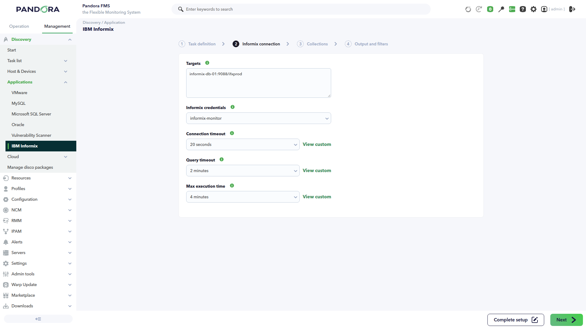
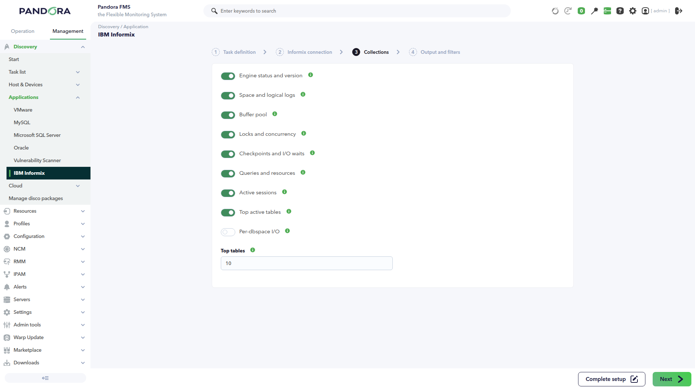
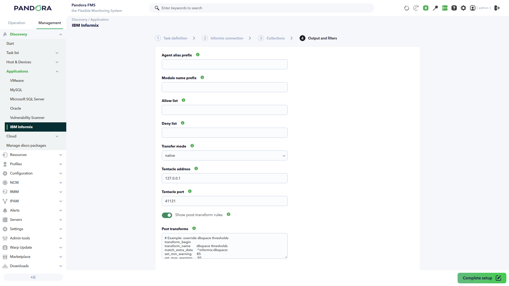
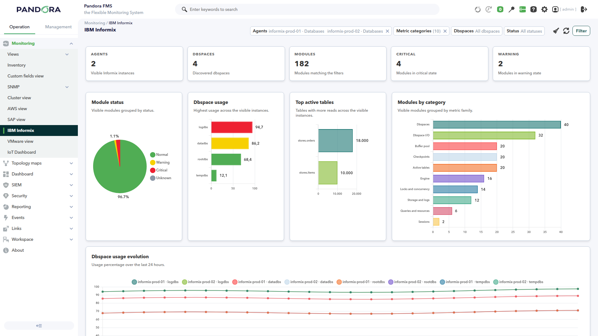
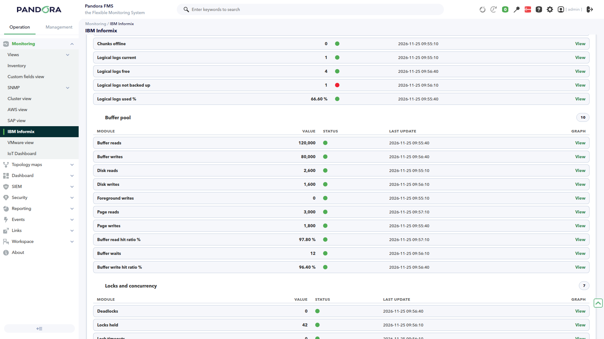
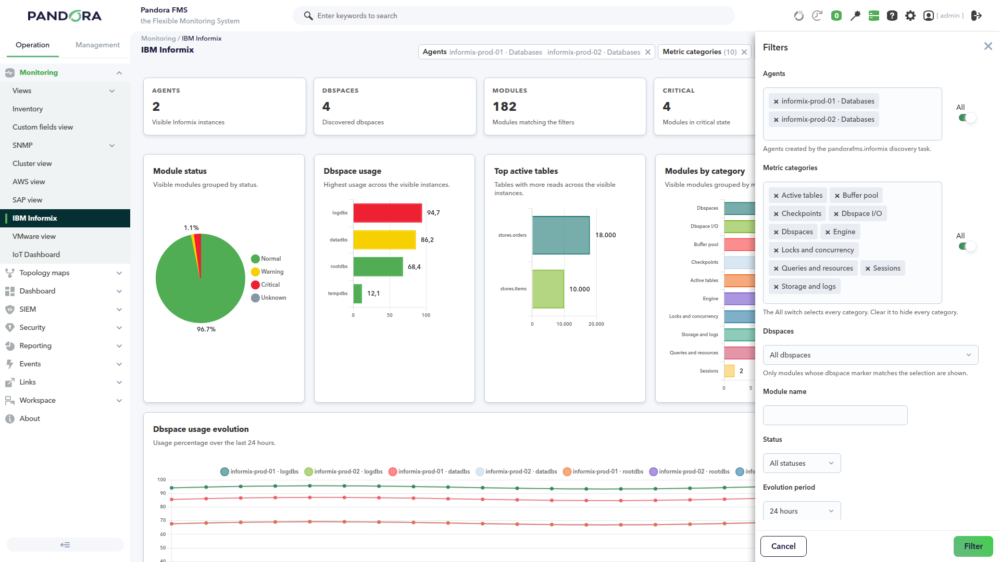

# IBM Informix Discovery

*Article last updated: 2026-11-25.*

## What it monitors

The IBM Informix Discovery addon monitors IBM Informix instances remotely. A Discovery task connects over TCP/IP to the `sysmaster` pseudo-database of each instance listed in the task and turns the result into Pandora FMS agents and modules. Nothing is installed on the database server.

The addon covers:

- **Space and storage:** every dbspace is discovered automatically, with usage percentage, free and used space, chunk health and the status of the logical logs.
- **Shared memory and buffer pool:** read and write hit ratios, buffer waits and the raw read/write counters.
- **Locks and concurrency:** lock waits, deadlocks, lock timeouts, table overflows and the number of active sessions and locks.
- **Checkpoints and I/O:** duration, blocking time and reason of the last checkpoint, foreground writes and optional per-dbspace I/O.
- **Queries and resources:** sequential scans, sorts, the engine mode and the most active tables.

A Discovery task creates **one agent per Informix instance**. Each instance produces one module per discovered dbspace plus the metric families you enable, so a task with two instances and three dbspaces in each one creates two agents with a separate set of dbspace modules.

The addon also provides an optional console view, **Monitoring → IBM Informix**, that groups the generated modules per agent and lets you filter by agent, metric category, dbspace, module name and status.

## Prepare

### Compatibility

| Scope | State | Evidence |
|-------|-------|----------|
| Addon `pandorafms.informix`, version `1.1` | Documented target | The version this page describes |
| Network access from the Discovery server to each Informix listener (TCP, default port `9088`) | `Required` | The addon connects over TCP/IP |
| An Informix user with the grants listed in [Database user](#database-user) | `Required` | Prerequisite, not a compatibility statement |
| Informix 12.10 and 14.10 | `Documented target` | The `sysmaster` views used by the addon are documented for both branches; no live instance matrix is recorded for this version |
| Operating system of the Discovery server | `Not validated` | No operating system matrix has been recorded for this addon |
| Specific Pandora FMS versions | `Not validated` | No version matrix has been recorded for this addon |

### Prerequisites

1. **Connectivity** from the Discovery server to every Informix listener you want to monitor.
2. **An Informix user and password** with `SELECT` access to the `sysmaster` views listed in [Database user](#database-user). The same credentials are used for every target of the task.
3. **The Informix Python driver.** The addon uses `IfxPy` and the IBM Informix Client SDK runtime. The Informix user and password are read from a custom entry of the Pandora FMS credential store. On platforms where the `IfxPy` wheel does not bundle the Client SDK, install the IBM Informix Client SDK on the Discovery server and make `INFORMIXDIR` available to the plugin process.
4. **Pandora FMS**: a Discovery server to run the task and the console to define it.

### Database user

The addon only reads SMI views. Grant `SELECT` on the views of the families you enable:

| Family | Views read |
|--------|------------|
| Engine | `sysshmvals`, `sysmachineinfo`, `sysvpprof`, `systables` (`DBINFO`) |
| Space and logical logs | `sysdbspaces`, `syschunks`, `syslogs` |
| Buffer pool, locks, checkpoints, queries | `sysprofile`, `syscheckpoint`, `syssessions`, `syslocks` |
| Top active tables | `sysptprof` |
| Per-dbspace I/O | `syschkio` |

The password is written to the task's temporary configuration file on the Discovery server while the task runs. Use a dedicated read-only user for Pandora FMS.

### Install the addon

Install the `pandorafms.informix` `.disco` package with **Discovery → Manage disco packages**, or from its Marketplace entry when it is published.

Once loaded, **IBM Informix** is available when creating Discovery tasks of the application type.

<!-- SCREENSHOT NEEDED: Discovery application list showing the IBM Informix entry once the package is loaded. -->

## Configure the Discovery task

Create a task from **Discovery → Applications → IBM Informix**. The console presents the task in four steps; every field is documented in [Task parameters](#task-parameters).

### 1. Task definition

Fill in the task name, the description, the Discovery server, the destination group and the interval. The group and interval are applied to the agents the task creates. The execution timeout must be longer than the addon's **Max execution time**.

<!-- SCREENSHOT NEEDED: Task definition step with the task name, group and interval filled in. -->

### 2. Informix connection



- **Targets**: the instances to monitor, one per entry. See [Target format](#target-format).
- **Informix credentials**: select a custom credential from the Pandora FMS credential store. It must contain the Informix user and password. The user only needs `SELECT` privileges on `sysmaster`.
- **Connection timeout**, **Query timeout** and **Max execution time**: how long the addon may spend connecting, running each query and completing the whole execution. See [Timeouts](#timeouts).

### 3. Collections



Enable or disable each family of metrics. All families are enabled by default except **Per-dbspace I/O**:

- **Engine status and version**
- **Space and logical logs**
- **Buffer pool**
- **Locks and concurrency**
- **Checkpoints and I/O waits**
- **Queries and resources**
- **Active sessions**
- **Top active tables**, with the **Top tables** limit
- **Per-dbspace I/O**

The connection status is always reported, even when a family is disabled, so a down instance is still visible. The engine status is reported when the engine family is enabled.

### 4. Output and filters



- **Agent alias prefix**: text added before the alias of every generated agent.
- **Module name prefix**: text added before every module name.
- **Allow list** and **Deny list**: regular expressions applied to the final module name. The allow list is applied first; when it is empty every module is allowed. The deny list is applied afterwards.
- **Transfer mode**: `native` (default) uses the Discovery JSON flow; `tentacle` writes XML data files and transfers them to a Tentacle server.
- **Tentacle address** and **Tentacle port**: only used when the transfer mode is `tentacle`.
- **Show post-transform rules** and **Post transforms**: optional operator-defined rules that override module thresholds and metadata. See [Custom thresholds and module metadata](#custom-thresholds-and-module-metadata).

### Custom thresholds and module metadata

The addon keeps default thresholds in the plugin, but the task operator can
override them without changing code through **Post transforms**. Rules are
ordered `transform_begin`/`transform_end` blocks, applied to the collected
modules before output, so they work in both `native` and `tentacle` modes.

```text
transform_begin
transform_name       dbspace thresholds
match_extra_data     ^informix:dbspace:
set_min_warning      85
set_max_warning      95
set_min_critical     95
set_max_critical     0
transform_end
```

- `match_module` matches the module name and `match_extra_data` matches the
  semantic `extra_data` marker. If both are present, they are AND-ed.
- `set_*` accepts the whitelisted module fields: thresholds, `str_warning`,
  `str_critical`, `tags`, `module_group`, `alert_template`, FF settings and
  related configuration.
- Rules apply in order; the last matching rule wins per field. The thresholds
  the plugin already emits are the initial values.
- `name`, `type`, `data`, `value`, `extra_data`, `timestamp` and `status` are
  protected and cannot be changed.
- Threshold ranges are half-open `[min, max)`. `max_warning=0` and
  `max_critical=0` mean no upper limit, not the literal value zero.
- Invalid rules are skipped and reported with their block and line in the task
  information; valid rules still apply.

### Target format

Each target identifies a host, an optional port and an optional Informix server name:

| Form | Host | Port | Server |
|------|------|------|--------|
| `<HOST>:<PORT>/<SERVER>` | `<HOST>` | `<PORT>` | `<SERVER>` |
| `<HOST>/<SERVER>` | `<HOST>` | `9088` | `<SERVER>` |
| `<HOST>:<PORT>` | `<HOST>` | `<PORT>` | Resolved by the Client SDK |
| `<HOST>` | `<HOST>` | `9088` | Resolved by the Client SDK |

`SERVER` is the Informix `DBSERVERNAME`. When it is omitted, the Client SDK resolves a matching `SQLHOSTS` alias. Lines starting with `#` are comments.

Example for two instances:

```text
# Production
<INFORMIX_HOST_1>:9088/<SERVER_1>
<INFORMIX_HOST_2>:9088/<SERVER_2>
```

### Timeouts

The three timeout fields are time selectors: choose a predefined period, or — as an administrator — use the edit (pencil) control to enter a custom amount and unit. The addon reads the value in seconds.

| Field | Default | Limits |
|-------|---------|--------|
| **Connection timeout** | `20` seconds | Establishing the connection to each instance |
| **Query timeout** | `120` seconds | Each individual SQL query |
| **Max execution time** | `240` seconds | The whole execution, counting every target |

- **Connection timeout.** A target that does not connect within this time is reported under **Targets down** and its agent is created with `Connection status` at `0`.
- **Query timeout.** A query that does not finish in time is reported in the task information and the addon continues with the next family.
- **Max execution time.** When the budget is exhausted, pending families and remaining targets are skipped and the data collected so far is returned. Set `0` to disable it.

Keep **Max execution time** lower than the timeout of the Discovery task. If the task timeout is reached first, Pandora FMS stops the addon with `SIGTERM` and the run finishes with the partial data collected until that moment.

## Verify

After the first run, the task summary reports:

| Summary field | Meaning |
|---------------|---------|
| **Total agents** | Number of Informix instances that produced an agent |
| **Total modules** | Number of modules created in the run |
| **Targets processed** | Targets parsed and attempted |
| **Targets down** | Targets that could not be connected or produced no modules |
| **Errors** | Query or transfer errors recorded in the task information |

The task information also contains the error detail of each target, without writing the password.

A successful run creates one agent per instance. The agent alias is the target string (or the alias prefix plus the target string) and the agent name is an MD5 hash. The agent stores its instance identifier in `extra_data`:

```text
informix:agent:<instance>
```

The instance identifier is the normalized target, for example `10.0.0.11_9088_ifxprod`.

## Understand the results

### Agent identity and cardinality

- One agent per instance. The same instance listed twice in the same task is not deduplicated by the addon; list each instance once.
- The agent name is stable for the same alias. Changing the **Agent alias prefix** changes the alias and the generated agent name.
- Every module carries a stable `extra_data` marker. The second token is the metric family and the rest identifies the resource:

```text
informix:engine:<metric>
informix:dbspace:<dbspace>
informix:storage:<metric>
informix:buffers:<metric>
informix:locks:<metric>
informix:sessions:<metric>
informix:checkpoints:<metric>
informix:queries:<metric>
informix:tables:<database>.<table>
informix:io:<dbspace>
```

### Module groups

| Group | What it shows | Notes |
|-------|---------------|-------|
| Engine | Connection status, engine status, mode, version, uptime, host name and virtual processors | `Informix engine status` is `1` only when `sh_mode` reports On-Line |
| Dbspaces | One set of modules per discovered dbspace: usage %, free MB, used MB, total MB and chunks | Usage warns at `80%` and is critical at `90%` |
| Storage and logs | Chunks offline or inconsistent, free logical logs, logs not backed up, used percentage and current logs | Fewer than three free logs warn; zero free logs are critical |
| Buffer pool | Read and write hit ratios, buffer waits, read/write counters and foreground writes | Read hit warns below `95%` and is critical below `90%` |
| Locks and concurrency | Lock waits, deadlocks, timeouts, overflows and locks held | Deadlocks and overflows are critical at `1` |
| Sessions | Active sessions | Gauge |
| Checkpoints | Checkpoint count and waits, duration, blocking time, dirty buffers and last reason/type | Last reason and type are string modules |
| Queries and resources | Sequential scans, sorts and disk sorts | Incremental counters |
| Active tables | Top-N tables by reads: reads, disk reads, writes, disk writes and sequential scans | Only when **Top active tables** is enabled |
| Dbspace I/O | Read/write operations and pages for each dbspace | Only when **Per-dbspace I/O** is enabled |

Counters that grow from server start (`sysprofile`, `sysptprof`, `sysvpprof`, I/O) are emitted as **incremental** modules. Percentages, durations, session counts and status modules are emitted as gauges or strings. Pandora FMS calculates the rate from the incremental counters and treats a counter reset as a reset.

### Console view

The IBM Informix view groups the modules per agent, shows a dbspace summary table and a table per metric family. It also includes an analytics section with five charts:

- a pie chart with the distribution of the visible modules by status;
- horizontal bars with the highest dbspace usage across the visible instances;
- horizontal bars with the top active tables by reads;
- horizontal bars with the number of visible modules per metric family;
- a line chart with points that shows the dbspace usage evolution for the selected period.



The dbspace usage bars use the same warning and critical thresholds as the modules, and the evolution line uses the period selected in the side filter.

The detail tables group the modules by metric family:



The side filter uses the standard console filter menu:



- **Agents**: narrows the view to the selected instances.
- **Metric categories**: shows only the selected families.
- **Dbspaces**: shows only the modules whose `extra_data` dbspace marker matches.
- **Module name**: text search on the module name and description.
- **Status**: shows only Normal, Warning, Critical or Unknown modules.
- **Evolution period**: history window used by the dbspace usage evolution chart.

If you clear the **All** switch for agents or metric categories, the view asks you to select at least one agent and one metric category instead of showing empty charts.

The view identifies agents and modules through `extra_data`; it does not rely on translated names, aliases or module name patterns.

## Troubleshoot

| Symptom | Likely cause | Check |
|---------|--------------|-------|
| `Connection status` is `0` for every target | Network, wrong host or port, or the instance is not listening | Test the TCP port from the Discovery server and verify the target format |
| `IfxPy is not installed` in the task information | The Python dependency is missing on the Discovery server | Run the addon's `setup.sh` and check the virtual environment used by the task |
| `post-transforms: transform block N...` in the task information | A rule has an unknown key, an invalid regex or a mistyped value | Fix or remove the rule; the valid rules still apply |
| Connection fails after the driver is installed | The Client SDK runtime is not available to the plugin process | Install the IBM Informix Client SDK and export `INFORMIXDIR` |
| Permission error reading a family | The user lacks `SELECT` on the SMI view | Grant `SELECT` on the view or disable that family |
| `Maximum execution time reached` | The task budget is too small for the number of instances or the latency | Increase **Max execution time** or split the task |
| A family is empty but the instance is up | That family is disabled or the user cannot read its views | Enable the family and review the task information |
| The console view shows no agents | No task has run, or the agents were disabled | Run the task once and check `tagente.extra_data` starts with `informix:agent:` |
| The console view shows no modules for a filter | The filters exclude every module | Clear the agents, categories, dbspace, name and status filters |

## Reference

### Task parameters

| INI key | CLI argument | Default | Description |
|---------|--------------|---------|-------------|
| `credentials` | `--credentials` | — | Base64 credential payload from the Pandora FMS credential store |
| `user` | `--user` | — | Manual fallback for the Informix user |
| `password` | `--password` | — | Manual fallback for the Informix password |
| `connection_timeout` | `--connection_timeout` | `20` | Connection timeout in seconds |
| `query_timeout` | `--query_timeout` | `120` | Timeout for each SQL query in seconds |
| `max_execution_time` | `--max_execution_time` | `240` | Budget for the whole execution in seconds; `0` disables it |
| `monitor_engine` | `--monitor_engine` | `true` | Engine status, version, uptime and virtual processors |
| `monitor_storage` | `--monitor_storage` | `true` | Dbspaces, chunks and logical logs |
| `monitor_buffers` | `--monitor_buffers` | `true` | Buffer pool ratios and counters |
| `monitor_locks` | `--monitor_locks` | `true` | Locks, deadlocks, timeouts and overflows |
| `monitor_checkpoints` | `--monitor_checkpoints` | `true` | Checkpoint metrics and waits |
| `monitor_queries` | `--monitor_queries` | `true` | Sequential scans, sorts and hot tables |
| `monitor_sessions` | `--monitor_sessions` | `true` | Active sessions |
| `monitor_tables` | `--monitor_tables` | `true` | Top-N tables from `sysptprof` |
| `monitor_io` | `--monitor_io` | `false` | Per-dbspace I/O from `syschkio` |
| `top_tables` | `--top_tables` | `10` | Number of hot tables to monitor, `1`–`100` |
| `agent_prefix` | `--agent_prefix` | — | Prefix added to the agent alias |
| `module_prefix` | `--module_prefix` | — | Prefix added to every module name |
| `allow_list` | `--allow_list` | — | Regex allow list for module names |
| `deny_list` | `--deny_list` | — | Regex deny list for module names |
| `transfer_mode` | `--transfer_mode` | `native` | `native` or `tentacle` |
| `tentacle_ip` | `--tentacle_ip` | `127.0.0.1` | Tentacle address |
| `tentacle_port` | `--tentacle_port` | `41121` | Tentacle port |
| `post_transforms` (task field) | `--post_transforms_conf` | — | Ordered post-transform block rules (thresholds, tags, module groups, alert templates) |
| `agents_group` | `--agents_group` | — | Group name used in Tentacle mode |
| `agents_group_id` | `--agents_group_id` | — | Group identifier used in native mode |
| `interval` | `--interval` | `300` | Agent interval in seconds |

### Module inventory

The following table lists every module family the addon can generate. `N` is the dbspace name, `DB.TABLE` is the database and table name.

| Category | Module | Type | Default thresholds | `extra_data` |
|----------|--------|------|--------------------|--------------|
| Engine | Connection status | `generic_proc` | — | `informix:engine:connection` |
| Engine | Informix engine status | `generic_proc` | — | `informix:engine:status` |
| Engine | Informix server mode | `generic_data_string` | — | `informix:engine:mode` |
| Engine | Informix version | `generic_data_string` | — | `informix:engine:version` |
| Engine | Informix uptime | `generic_data` | — | `informix:engine:uptime` |
| Engine | Informix host name | `generic_data_string` | — | `informix:engine:hostname` |
| Engine | Virtual processors | `generic_data` | — | `informix:engine:vp_count` |
| Engine | Virtual processor user CPU | `generic_data_inc` | — | `informix:engine:vp_usercpu` |
| Engine | Virtual processor system CPU | `generic_data_inc` | — | `informix:engine:vp_syscpu` |
| Dbspace | Dbspace `N` usage % | `generic_data` | Warning `80`, critical `90` | `informix:dbspace:N` |
| Dbspace | Dbspace `N` free MB | `generic_data` | — | `informix:dbspace:N` |
| Dbspace | Dbspace `N` used MB | `generic_data` | — | `informix:dbspace:N` |
| Dbspace | Dbspace `N` total MB | `generic_data` | — | `informix:dbspace:N` |
| Dbspace | Dbspace `N` chunks | `generic_data` | — | `informix:dbspace:N` |
| Storage | Chunks offline | `generic_data` | Critical `1` | `informix:storage:chunks_offline` |
| Storage | Chunks inconsistent | `generic_data` | Critical `1` | `informix:storage:chunks_inconsistent` |
| Storage | Logical logs free | `generic_data` | Warning below `3`, critical `0` | `informix:storage:logs_free` |
| Storage | Logical logs not backed up | `generic_data` | Critical `1` | `informix:storage:logs_not_backed_up` |
| Storage | Logical logs used % | `generic_data` | — | `informix:storage:logs_used_pct` |
| Storage | Logical logs current | `generic_data` | — | `informix:storage:logs_current` |
| Buffers | Buffer read hit ratio % | `generic_data` | Warning below `95`, critical below `90` | `informix:buffers:read_hit` |
| Buffers | Buffer write hit ratio % | `generic_data` | Warning below `95`, critical below `90` | `informix:buffers:write_hit` |
| Buffers | Buffer waits | `generic_data_inc` | — | `informix:buffers:waits` |
| Buffers | Buffer reads | `generic_data_inc` | — | `informix:buffers:bufreads` |
| Buffers | Disk reads | `generic_data_inc` | — | `informix:buffers:dskreads` |
| Buffers | Page reads | `generic_data_inc` | — | `informix:buffers:pagreads` |
| Buffers | Buffer writes | `generic_data_inc` | — | `informix:buffers:bufwrites` |
| Buffers | Disk writes | `generic_data_inc` | — | `informix:buffers:dskwrites` |
| Buffers | Page writes | `generic_data_inc` | — | `informix:buffers:pagwrites` |
| Buffers | Foreground writes | `generic_data_inc` | Warning `1` | `informix:buffers:fgwrites` |
| Locks | Lock waits | `generic_data_inc` | — | `informix:locks:lockwts` |
| Locks | Deadlocks | `generic_data_inc` | Critical `1` | `informix:locks:deadlks` |
| Locks | Lock timeouts | `generic_data_inc` | — | `informix:locks:lktouts` |
| Locks | Lock table overflows | `generic_data_inc` | Critical `1` | `informix:locks:ovlock` |
| Locks | Transaction overflows | `generic_data_inc` | Critical `1` | `informix:locks:ovtrans` |
| Locks | User thread overflows | `generic_data_inc` | Critical `1` | `informix:locks:ovuserthread` |
| Locks | Locks held | `generic_data` | — | `informix:locks:held` |
| Sessions | Active sessions | `generic_data` | — | `informix:sessions:active` |
| Checkpoints | Checkpoint waits | `generic_data_inc` | — | `informix:checkpoints:waits` |
| Checkpoints | Checkpoint count | `generic_data_inc` | — | `informix:checkpoints:count` |
| Checkpoints | Last checkpoint duration | `generic_data` | — | `informix:checkpoints:duration` |
| Checkpoints | Last checkpoint blocking time | `generic_data` | — | `informix:checkpoints:blocking_time` |
| Checkpoints | Last checkpoint critical waits | `generic_data` | — | `informix:checkpoints:critical_waits` |
| Checkpoints | Last checkpoint dirty buffers | `generic_data` | — | `informix:checkpoints:dirty_buffers` |
| Checkpoints | Last checkpoint physical log used | `generic_data` | — | `informix:checkpoints:physused` |
| Checkpoints | Last checkpoint logical log used | `generic_data` | — | `informix:checkpoints:logused` |
| Checkpoints | Last checkpoint reason | `generic_data_string` | — | `informix:checkpoints:reason` |
| Checkpoints | Last checkpoint type | `generic_data_string` | — | `informix:checkpoints:type` |
| Queries | Sequential scans | `generic_data_inc` | — | `informix:queries:seqscans` |
| Queries | Sorts | `generic_data_inc` | — | `informix:queries:totalsorts` |
| Queries | Disk sorts | `generic_data_inc` | — | `informix:queries:dsksorts` |
| Tables | Table `DB.TABLE` reads | `generic_data_inc` | — | `informix:tables:DB.TABLE` |
| Tables | Table `DB.TABLE` disk reads | `generic_data_inc` | — | `informix:tables:DB.TABLE` |
| Tables | Table `DB.TABLE` writes | `generic_data_inc` | — | `informix:tables:DB.TABLE` |
| Tables | Table `DB.TABLE` disk writes | `generic_data_inc` | — | `informix:tables:DB.TABLE` |
| Tables | Table `DB.TABLE` sequential scans | `generic_data_inc` | — | `informix:tables:DB.TABLE` |
| I/O | Dbspace `N` I/O reads | `generic_data_inc` | — | `informix:io:N` |
| I/O | Dbspace `N` I/O writes | `generic_data_inc` | — | `informix:io:N` |
| I/O | Dbspace `N` pages read | `generic_data_inc` | — | `informix:io:N` |
| I/O | Dbspace `N` pages written | `generic_data_inc` | — | `informix:io:N` |

### Manual execution

```bash
./setup.sh
venv/bin/python pandora_informix.py \
  --conf /path/to/task.conf \
  --targets_file /path/to/targets.txt
```

The addon also accepts `--targets "host:port/server,host2/server2"` for a quick manual run and `--as_server_plugin true` for the server plugin result code.
