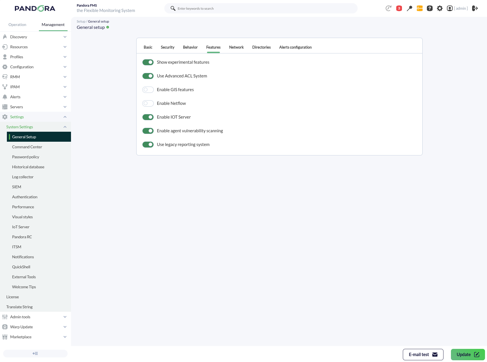
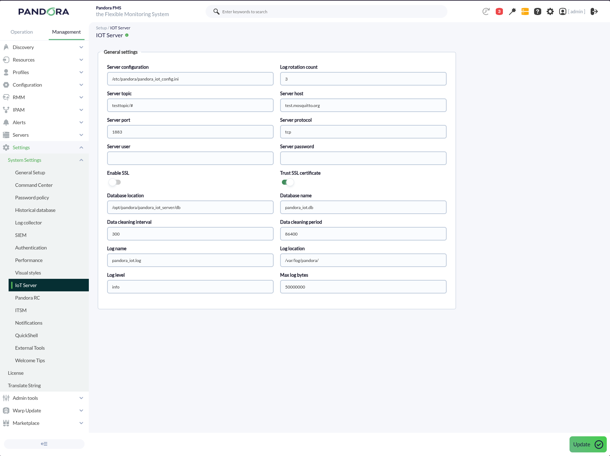
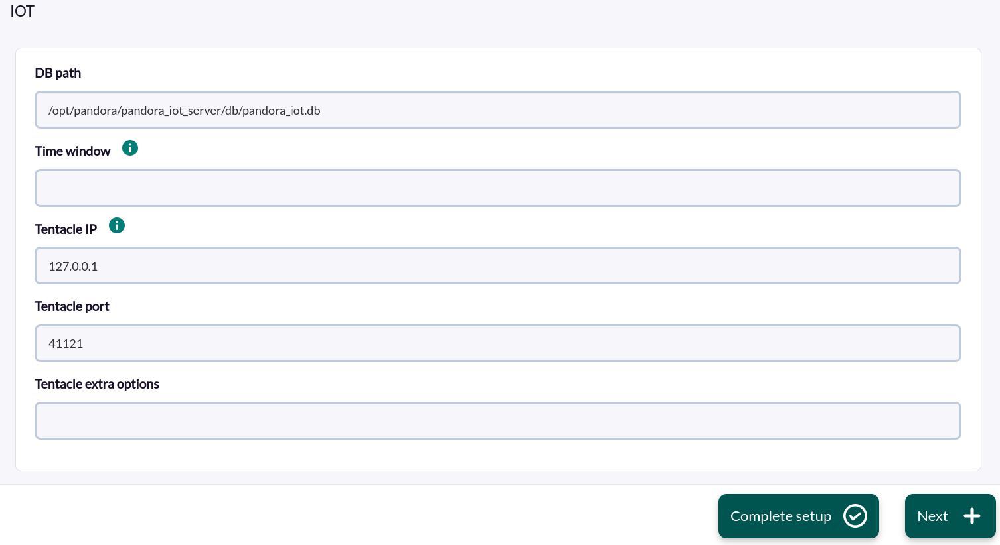
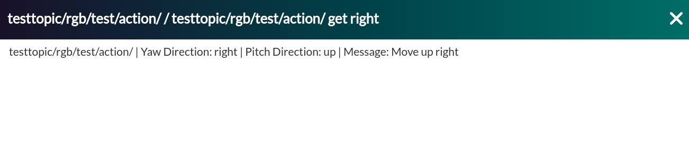

# IoT Discovery

*Article last updated: 2026-10-26.*

## What it monitors

The IoT Discovery addon monitors the messages that devices and sensors publish to an MQTT broker. It subscribes to one or more MQTT topic filters, stores every message it receives, and lets you define filters that turn the matching messages into Pandora FMS agents and modules.

The integration has two cooperating parts:

- **The IoT server** is a service that connects to the MQTT broker, subscribes to the configured topic filters and stores each received message in a local database. It is managed from the Pandora FMS console.
- **The Discovery application** runs as a Discovery task. On every run it reads the messages that have not been processed yet, applies your filters, and sends the result to Pandora FMS as agents and modules.

For example, if temperature sensors publish a reading every minute, a filter can keep only the readings above a threshold and expose them as a module that you can alert on.

The task creates **one agent per distinct `filter_topic` value** defined in your filters, with one module per filter that matched a message. See [Understand the results](#understand-the-results).

## Prepare

### Compatibility

| Scope | State | Evidence |
|-------|-------|----------|
| Addon `pandorafms.iot`, version `1.1` | Documented target | The version this page describes. See [Addon identity](#addon-identity) |
| Pandora FMS NG 784 and later | `Supported` | The Marketplace states that all its integrations are compatible with Pandora FMS NG 784 and later versions |
| An MQTT broker reachable from the IoT server host | `Required` | Prerequisite, not a compatibility statement |
| Network access from the Discovery server to the IoT server database | `Required` | The task reads the database file path you configure |
| MQTT protocol versions and specific broker products | `Not validated` | No broker or protocol version matrix has been recorded |
| Operating system of the Discovery server | `Not validated` | No operating system has been recorded for this version |

### Prerequisites

1. **A reachable MQTT broker**, with the host, port and, if required, user and password.
2. **Permission to subscribe** to the topics you want to monitor. The broker, not the addon, accepts or rejects each topic filter.
3. **The IoT server** installed on the machine that receives the messages. It stores the messages in a local database, so the Discovery task must be able to read that database file at the path you configure. The default location is `/opt/pandora/pandora_iot_server/db/pandora_iot.db`.
4. **Pandora FMS**: a Discovery server to execute the task and an administrator user for the console settings.

### Install the addon

Load the `.disco` package from the Pandora FMS Marketplace:

[https://marketplace.pandorafms.com/entries/pandorafms.iot](https://marketplace.pandorafms.com/entries/pandorafms.iot)

Once loaded, the **IOT** application is available when creating Discovery tasks.

### Enable the IoT server

The Pandora FMS server can start and stop the IoT server for you. To enable it:

1. In the console, open **Management → Settings → System Settings → General Setup**, go to the **Features** tab and turn on **Enable IOT Server**. Click **Update**.
2. A new **IoT Server** page appears under System Settings. Configure the broker connection there. See [Configure the IoT server](#configure-the-iot-server).



When Pandora FMS server starts with the feature enabled, it writes the IoT server configuration file from the console settings (default path `/etc/pandora/pandora_iot_config.ini`) and starts the `pandora_iot_server` service with `systemctl`. If the feature is disabled, the server logs that the IoT daemon is disabled and does not start the service.

The IoT server package installs the executable `/usr/bin/pandora_iot_server`, the configuration file `/etc/pandora/pandora_iot_config.ini` and the `pandora_iot_server.service` systemd unit, which runs as `root`. The package file names for each operating system have not been recorded for this version.

## Configure

### Configure the IoT server

Open **Management → Settings → System Settings → IoT Server** and complete the broker connection. Every field is documented in [IoT Server console settings](#iot-server-console-settings). The minimum is:

- **Server host** and **Server port** of the MQTT broker.
- **Server topic**: the topic filter to subscribe to, for example `factory/+/temperature`.



To subscribe to several topic filters, enter a JSON array on a single line:

```
["factory/+/temperature", "factory/+/humidity", "alerts/#"]
```

The complete value, including brackets and quotes, must fit in the 200 characters the field accepts.

Settings saved in the console reach the IoT server when Pandora FMS server regenerates the configuration file and starts the service, that is, when Pandora FMS server starts. Restart the Pandora FMS server, or the `pandora_iot_server` service when you edit the file by hand, after changing the connection.

> The broker password is stored in the console and written in clear text to the IoT server configuration file. Restrict access to that file and use a broker account that can only subscribe to the topics you need.

> TLS is used only when both **Enable SSL** (`ssl = 1`) and **Trust SSL certificate** (`trust_ssl = 1`) are on, and in that case the broker certificate is **not verified**. With **Enable SSL** on and **Trust SSL certificate** off, the IoT server connects **without** TLS. Certificate verification is not available.

### Create the Discovery task

Create the task from **Management → Discovery → Application → IOT**. The console presents the fields in two steps; every field is documented in [Task parameters](#task-parameters).

1. **Iot base**:

    - **DB path**: path of the IoT server database file.
    - **Time window**: see [Task parameters](#task-parameters). It does not currently restrict the messages that are read.
    - **Tentacle IP**, **Tentacle port** and **Tentacle extra options**: where and how the generated agent data is sent. They rarely need changing.

    

2. **Iot detailed**:

    - **Max threads**: number of processes used to evaluate the messages.
    - **Filter messages modules**: the filter definitions that decide which messages become modules. See [Define the message filters](#define-the-message-filters).

    <!-- SCREENSHOT NEEDED: IOT Iot detailed wizard step showing Max threads and the Filter messages modules text area with one filter defined. -->

The task interval and group are the ones you set on the task; the generated agents use them.

### Define the message filters

The **Filter messages modules** field holds one block per filter. A filter starts with `filter_begin` and ends with `filter_end`, each alone on its line. Inside the block, each line is the option name, whitespace, and its value. Do not add a colon after the option name, quotes around the value or a trailing comment. Lines outside a block, and lines that start with `#`, are ignored.

```
filter_begin
filter_module_name Temperature __regex1__
filter_module_type generic_data
filter_topic ^sensors/.*/livingroom$
filter_topic_exact_match 0
filter_message_capture_regex Temp: (\d+)
filter_module_value __regex1__
filter_end
```

A message passes a filter when it matches **both** `filter_topic` and `filter_message`. One message can pass several filters. See [Filter options](#filter-options) for every option.

#### Match by topic or message

`filter_topic` and `filter_message` are evaluated against the topic and the content of each stored message. Their matching mode is set by `filter_topic_exact_match` and `filter_message_exact_match`:

- `0` (default): the value is a regular expression, searched anywhere in the text. Anchor it with `^` and `$` to match the whole text.
- `1`: the value is plain text, and the filter matches when the text **contains** it. Despite the option name, this is not an equality test: `sensors/temperature/` matches the topic `sensors/temperature/livingroom`.

An empty or omitted value matches any topic or message.

#### Capture values from the message

Use captures to put parts of the message in the module name or value.

With `filter_message_capture_regex`, each capture group of the expression is stored in `__regexN__`, where `N` is the position of the group. For the message `Temp: 85 C` and this filter:

```
filter_message_capture_regex Temp: (\d+) (\w)
filter_module_value __regex1__ __regex2__
```

the module value is `85 C`.

With `filter_message_capture_json`, give one or more JSONPath expressions separated by `|`. Every expression starts with `$`, which is the root of the JSON document, and the result of each is stored in `__jsonN__`, where `N` is the position of the expression. When an expression returns several values, they are joined with `, `. For this message:

```
{"message":"Move up right","data":{"yaw_direction":"right","pitch_direction":"up"}}
```

this filter:

```
filter_begin
filter_module_name __topic__ get right
filter_module_type generic_data_string
filter_topic testtopic/rgb/test/action/
filter_topic_exact_match 1
filter_message Move up right
filter_message_exact_match 1
filter_message_capture_json $.data.yaw_direction|$.data.pitch_direction|$.message
filter_module_value __topic__ | Yaw: __json1__ | Pitch: __json2__ | Message: __json3__
filter_end
```

creates a module named `testtopic/rgb/test/action/ get right` with the value `testtopic/rgb/test/action/ | Yaw: right | Pitch: up | Message: Move up right`.

`__topic__` is replaced with the topic of the message that matched. A macro that has no captured value is replaced with an empty string. If the message is not valid JSON, every `__jsonN__` macro is empty.

## Verify the first run

1. Confirm the IoT server is receiving messages: the service is active and the database file exists and grows. See [Operate](#operate).
2. Publish a test message to a topic your filter matches.
3. Force the task from **Management → Discovery → Task list**.
4. When the task finishes, check its summary:

    - **Total agents**: number of agents generated.
    - **Total messages**: number of modules generated from messages that passed a filter.

    <!-- SCREENSHOT NEEDED: Discovery task execution summary for an IOT task showing Total agents and Total messages. -->

5. Open the generated agent and confirm it has the module and value your filter produces.

    

## Understand the results

### How a run works

Each run reads from the database every message that has not been processed yet and evaluates it against all your filters. Keep these rules in mind:

- **Every message read is marked as processed, even when it matches no filter.** Changing a filter does not make the task reprocess earlier messages.
- **Agents**: one agent is created per distinct `filter_topic` value, and its name is that value exactly as written in the filter, not the MQTT topic of the message. Filters that share the same `filter_topic` text share an agent. Set `filter_topic` in every filter, and prefer plain text or a readable pattern, because a regular expression becomes the agent name.
- **Modules**: within one run and one agent, the first module generated with a given name is kept and later messages that resolve to the same name are discarded. Use `__topic__` or captured values in `filter_module_name` when several topics or messages should produce separate modules.
- **Timestamps**: the task reads messages stored after the time given by the effective time window; see the note in [Task parameters](#task-parameters).
- **Retention**: independently of processing, the IoT server deletes stored messages older than the retention period (default 86400 seconds), checking at the configured cleaning interval.

### Generated agents and modules

| Item | Content |
|------|---------|
| Agent | Named after the `filter_topic` value. Group and interval are the task's. |
| Module name | `filter_module_name` after macro substitution. |
| Module type | `filter_module_type`, for example `generic_data_string` or `generic_data`. |
| Module value | `filter_module_value` after macro substitution. |

## Operate

### Check the IoT server service

```bash
systemctl status pandora_iot_server
journalctl -u pandora_iot_server
```

The IoT server writes its own log to `log_location`/`log_name` (default `/var/log/pandora/pandora_iot.log`) with rotation. To also see the log on the terminal when you run the server manually, start it with `-v`.

### Inspect the stored messages

The messages are stored in the table `pandora_mqtt_data` of a SQLite database, with the columns `topic`, `message`, `unix_timestamp` and `processed` (`0` when not yet processed, `1` when processed).

### Limits and behavior

- Subscriptions use QoS 0. It is not configurable.
- All topic filters share one broker connection. Adding filters does not add connections.
- Subscriptions are submitted again after each reconnection.
- At `debug` log level the IoT server writes all its settings to the log, including the broker password. Do not leave `debug` enabled on a production system with credentials.

## Troubleshoot

| Symptom | Check |
|---------|-------|
| The task reports that the database file cannot be found | The **DB path** does not exist from the Discovery server. Confirm the path and that the file is readable from that machine. |
| The task reports `Failed to connect` | The file exists but does not contain the `pandora_mqtt_data` table. Confirm that the path is the IoT server database. |
| The task reports an error parsing filters | The filter text could not be read. Check that each block has `filter_begin` and `filter_end` and that the file is plain text. |
| `Total agents` is `0` | No unprocessed message passed a filter. Confirm that messages are arriving and that `filter_topic` and `filter_message` match them. Remember that earlier runs mark messages as processed. |
| Modules are missing for some messages | Several messages resolve to the same module name in the same agent. Only the first is kept. Include `__topic__` or captured values in the module name. |
| A module value contains an unreplaced or empty macro | The capture did not match. Test the regular expression or JSONPath against a real message. An invalid capture expression is ignored. |
| The IoT server does not start | Check `journalctl -u pandora_iot_server` and the IoT server log. Confirm that **Enable IOT Server** is on and that the service user can write to the database and log directories. |
| Startup fails with `Invalid topic configuration` | The topic value is a malformed JSON array. Use one line, double quotes and at least one non-empty string. Do not add a trailing comma. |
| Messages are not stored | Check the broker host, port, protocol and credentials, and the broker permissions for each topic filter. A subscription rejected by the broker is written to the IoT server log. |

## Reference

### IoT Server console settings

These fields are in the **IoT Server** page of the System Settings and are written to the IoT server configuration file when the Pandora FMS server starts.

| Console field | Configuration key | Required | Default | Description |
|---------------|-------------------|----------|---------|-------------|
| Server configuration | None | No | `/etc/pandora/pandora_iot_config.ini` | Path where the configuration file is written. |
| Server topic | `topic` | Yes | `testtopic/#` | One topic filter or a one-line JSON array of filters. 200 characters maximum. |
| Server host | `host` | Yes | `test.mosquitto.org` | MQTT broker host. Replace the default with your own broker. |
| Server port | `port` | Yes | `1883` | MQTT broker port. |
| Server protocol | `protocol` | No | `tcp` | Transport: `tcp`, `websockets` or `unix`. |
| Server user | `user` | No | Empty | Broker user name. |
| Server password | `password` | No | Empty | Broker password. |
| Enable SSL | `ssl` | No | `0` | `1` enables TLS only together with `trust_ssl = 1`. |
| Trust SSL certificate | `trust_ssl` | No | `1` | With `ssl = 1`, skips certificate verification. |
| Database location | `dblocation` | No | `/opt/pandora/pandora_iot_server/db` | Directory of the database. |
| Database name | `dbname` | No | `pandora_iot.db` | Database file name. |
| Data cleaning interval | `data_cleaning_interval` | No | `300` | Minimum seconds between retention checks. |
| Data cleaning period | `data_cleaning_period` | No | `86400` | Messages older than this many seconds are deleted. |
| Log name | `log_name` | No | `pandora_iot.log` | Log file name. |
| Log location | `log_location` | No | `/var/log/pandora/` | Log directory. |
| Log level | `log_level` | No | `info` | Log level name. An unknown value falls back to `INFO`. |
| Max log bytes | `max_log_bytes` | No | `50000000` | Size at which the log rotates. |
| Log rotation count | `log_rotation_count` | No | `3` | Rotated log files kept. |

### IoT server command line

The `pandora_iot_server` executable accepts:

| Option | Required | Default | Description |
|--------|----------|---------|-------------|
| `-c`, `--conf_file <PATH_TO_CONFIG>` | No | `pandora_iot_config.ini` next to the executable | Configuration file. |
| `-v`, `--verbosity` | No | Disabled | Also write the log to the terminal. |

The configuration file uses a `[DEFAULT]` section with the keys listed above. Example:

```ini
[DEFAULT]
topic = ["factory/+/temperature", "factory/+/humidity", "alerts/#"]
host = <MQTT_BROKER_HOST>
port = 1883
dblocation = /opt/pandora/pandora_iot_server/db
dbname = pandora_iot.db
log_name = pandora_iot.log
log_location = /var/log/pandora/
```

### Task parameters

#### Iot base

| Field | Required | Default | Description |
|-------|----------|---------|-------------|
| DB path | Yes | `/opt/pandora/pandora_iot_server/db/pandora_iot.db` | Full path of the IoT server database file. |
| Time window | No | Empty | Intended to limit the messages by age. In version `1.1` the value is not passed to the processor, so it has no effect: every unprocessed message is read. Leave it empty. |
| Tentacle IP | Yes | `127.0.0.1` | Tentacle server that receives the agent data. |
| Tentacle port | Yes | `41121` | Tentacle port. |
| Tentacle extra options | No | Empty | Extra options for Tentacle. |

#### Iot detailed

| Field | Required | Default | Description |
|-------|----------|---------|-------------|
| Max threads | No | `1` | Number of processes that evaluate the messages. It is capped at the number of messages read. |
| Filter messages modules | Yes | Commented template | Filter definitions. See [Filter options](#filter-options). |

### Filter options

| Option | Required | Default | Description |
|--------|----------|---------|-------------|
| `filter_begin` | Yes | None | Starts a filter. Alone on its line. |
| `filter_module_name` | Yes | None | Module name. Accepts `__topic__`, `__regexN__` and `__jsonN__`. |
| `filter_module_type` | Yes | None | Pandora FMS module type, for example `generic_data_string`. |
| `filter_module_value` | Yes | None | Module value. Accepts the same macros. A filter without it is not valid. |
| `filter_topic` | No | Any topic | Text or regular expression for the topic. Also names the agent. |
| `filter_topic_exact_match` | No | `0` | `1`: the topic must contain the text. Otherwise, regular expression. |
| `filter_message` | No | Any message | Text or regular expression for the message content. |
| `filter_message_exact_match` | No | `0` | `1`: the message must contain the text. Otherwise, regular expression. |
| `filter_message_capture_regex` | No | None | Regular expression whose capture groups fill `__regexN__`. |
| `filter_message_capture_json` | No | None | JSONPath expressions starting with `$`, separated by `\|`, that fill `__jsonN__`. |
| `filter_end` | Yes | None | Ends a filter. Alone on its line. |

### Processor options

The Discovery application runs its processor with the task configuration (`--conf`) and the filter definitions (`--filter_conf`), both generated from the wizard. It also supports `--verbosity` to write debug output, which the task does not pass.

### Addon identity

| Item | Value |
|------|-------|
| Name | IOT |
| Identifier | `pandorafms.iot` |
| Version | `1.1` |
| Type and section | Discovery, `app` |
| Marketplace entry | [pandorafms.iot](https://marketplace.pandorafms.com/entries/pandorafms.iot), updated 2025-11-14 |
| Availability | The Marketplace entry states that the download is limited to licensed users |
