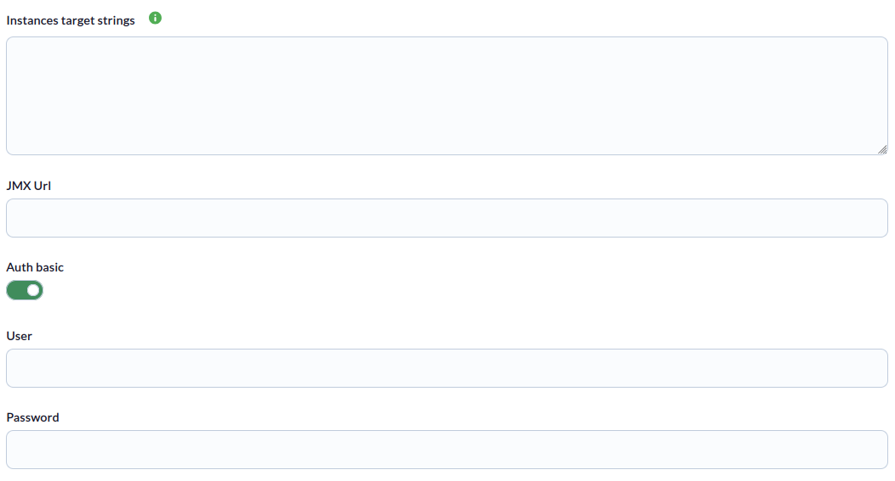
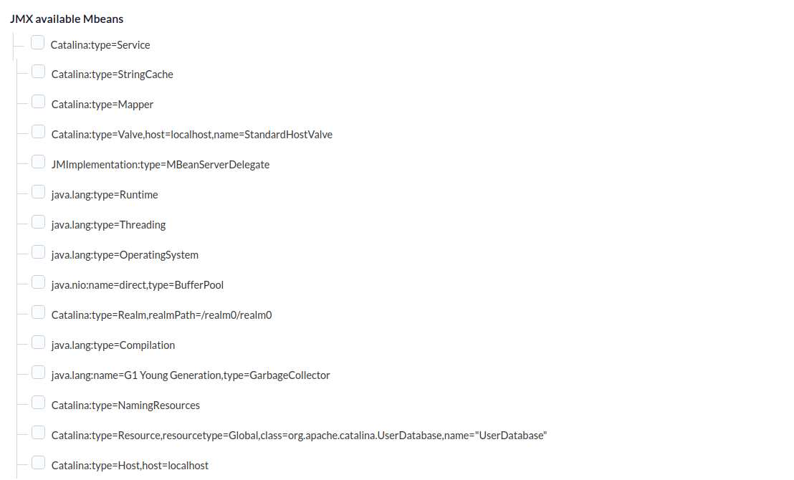
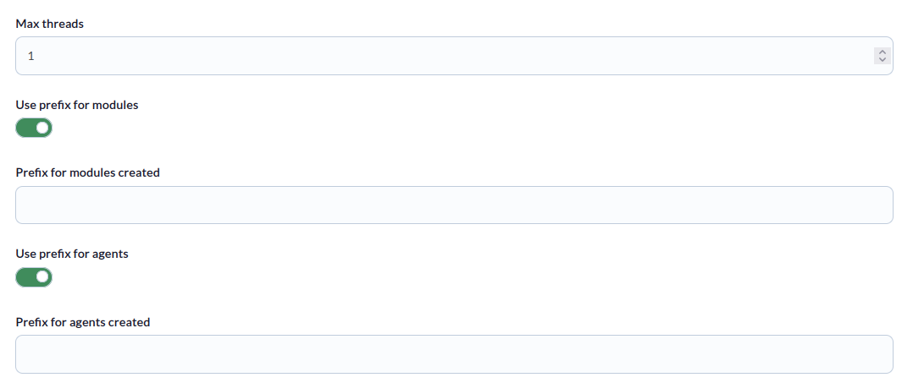
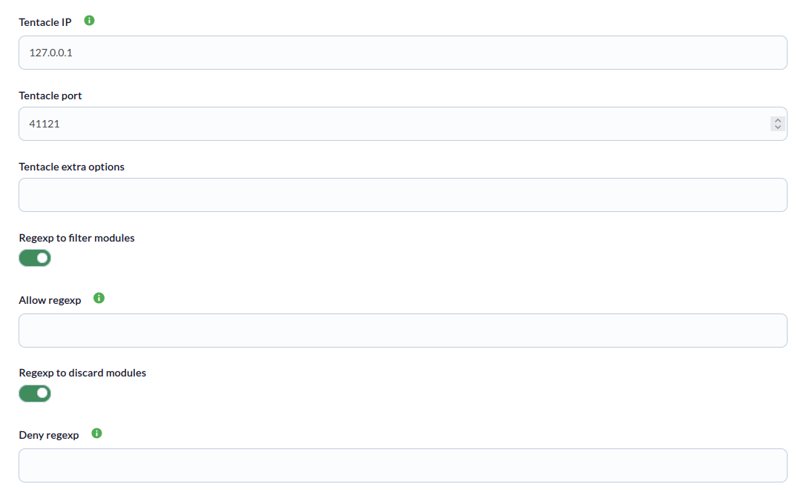
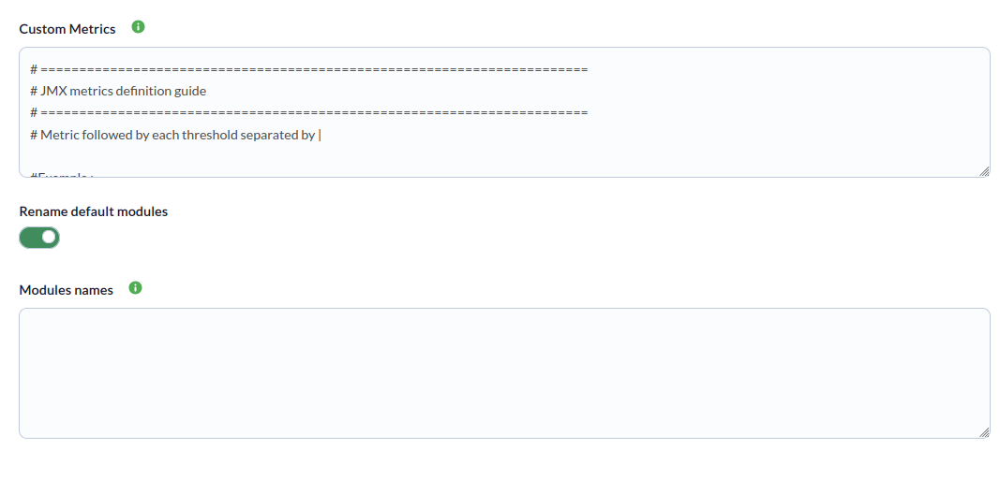
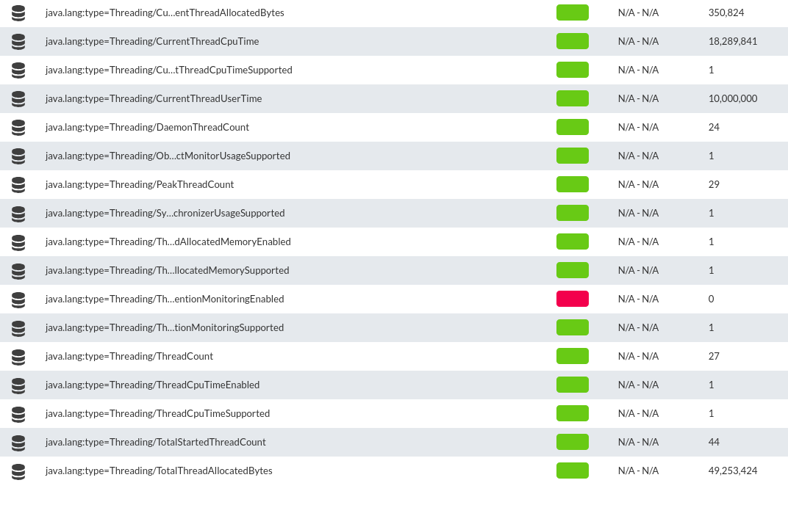

# JMX Discovery

*Article last updated: 2026-10-26.*

## What it monitors

The JMX Discovery addon monitors Java applications through Java Management Extensions (JMX). It connects to the JMX endpoint of each target you configure, reads the attributes of the MBeans you choose and turns them into Pandora FMS agents and modules.

A Discovery task generates **one agent per JMX target**. Each agent contains one module per MBean attribute collected. You choose what is collected in two ways, which can be combined:

- **MBeans selected in the console.** The console connects to a reference JMX endpoint and shows the MBeans it exposes. Every attribute of each selected MBean is collected, on every target of the task.
- **Custom metrics.** An explicit list of `MBean/attribute` entries, optionally with thresholds.

The same selection is applied to all the targets of a task, so group in one task only targets that expose the same MBeans.

## Prepare

### Compatibility

| Scope | State | Evidence |
|-------|-------|----------|
| Addon `pandorafms.jmx`, version `1.2` | Documented target | The version this page describes. See [Addon identity](#addon-identity) |
| A Java runtime available on the Pandora FMS server that runs the task | `Required` | The addon starts a Java virtual machine to open the JMX connections |
| Network access from the Discovery server to each JMX endpoint | `Required` | The addon opens one JMX connection per target |
| Java runtime versions, Java vendors and application servers | `Not validated` | No version matrix has been recorded for this addon |
| Operating system of the Discovery server | `Not validated` | No operating system has been recorded for this version |
| Specific Pandora FMS versions | `Not validated` | No version matrix has been recorded for this addon |

### Prerequisites

1. **A Java runtime** installed on the Pandora FMS server that runs the Discovery task, available to the user that runs it.
2. **Remote JMX enabled on every monitored Java application**, reachable from the Discovery server. See [Enable remote JMX](#enable-remote-jmx).
3. **The JMX service URL of every target**, for example `service:jmx:rmi:///jndi/rmi://<TARGET_HOST>:<JMX_PORT>/jmxrmi`.
4. **JMX credentials**, only when the target requires authentication.

### Enable remote JMX

The monitored application does not need extra software, but it must be started with the JVM options that enable remote JMX. The following set enables it on the local host without authentication or TLS and is meant only for a test environment:

```text
-Dcom.sun.management.jmxremote
-Dcom.sun.management.jmxremote.authenticate=false
-Dcom.sun.management.jmxremote.ssl=false
-Dcom.sun.management.jmxremote.port=<JMX_PORT>
-Dcom.sun.management.jmxremote.rmi.port=<JMX_PORT>
-Djava.rmi.server.hostname=localhost
```

To require authentication, set `-Dcom.sun.management.jmxremote.authenticate=true` and add the password and access files:

```text
-Dcom.sun.management.jmxremote.password.file=<PATH_TO_PASSWORD_FILE>
-Dcom.sun.management.jmxremote.access.file=<PATH_TO_ACCESS_FILE>
```

To connect from another host, `java.rmi.server.hostname` must be an address the Discovery server can reach. The exact options for your application and the protection of the password file are defined by the Java application, not by this addon.

### Credential handling

- The user and password entered in the task are stored with the task definition and sent to the JMX server as the JMX credentials.
- While the console loads the list of MBeans, it passes the user and password as arguments to the helper executable, so they can be visible in the process list of the Pandora FMS server during that operation.
- A configuration file used in [manual execution](#manual-execution) contains the password in clear text. Protect it with restrictive permissions.

### Install the addon

Download the `.disco` package from the Pandora FMS Marketplace entry, which is limited to licensed users:

[https://marketplace.pandorafms.com/entries/pandorafms.jmx](https://marketplace.pandorafms.com/entries/pandorafms.jmx)

Load it into Pandora FMS. Once loaded, **JMX** is available in the **Applications** section when creating Discovery tasks.

The addon ships its own executables, `bin/pandora_jmx` and `bin/get_jmx_tree`.

## Configure the Discovery task

Create the task from the Discovery applications and choose **JMX**. The console presents the fields in three steps; every field is documented in [Task parameters](#task-parameters).

1. **JMX Basic** — targets and credentials:

    - **Instances target strings**: the targets to monitor, one or several per line, separated by commas. Each target is a JMX service URL, optionally followed by `|` and the agent name to use. Lines that start with `#` are ignored.
    - **JMX Url**: the reference endpoint used only to list the available MBeans in the next step. It does not define a target.
    - **Auth basic**, **User** and **Password**: credentials for the JMX connections. User and password are shown when **Auth basic** is enabled.

    

2. **JMX Mbeans** — a tree of the MBeans exposed by the **JMX Url** endpoint, read with the credentials of the previous step. Select the MBeans to collect. Every attribute of each selected MBean is collected on all the targets.

    

3. **JMX detailed** — execution, naming and filtering options:

    - **Max threads**: number of targets processed in parallel.
    - **Use prefix for modules** and **Use prefix for agents**: prefixes added to the generated module names and agent names.
    - **Tentacle IP**, **Tentacle port** and **Tentacle extra options**: where the generated agent data is sent. They rarely need changing.
    - **Regexp to filter modules** and **Regexp to discard modules**: keep or discard metrics by regular expression.
    - **Custom Metrics**: explicit `MBean/attribute` entries with optional thresholds.
    - **Rename default modules** and **Modules names**: assign your own module names.

    

    

    

The task's group and interval come from the generic task-definition step and are applied to the agents the task creates.

### Custom metrics

Write one metric per line using the format `<MBean>/<attribute>`, optionally followed by thresholds separated by `|`. Each threshold is a keyword and a value separated by a space. Lines that start with `#` and empty lines are ignored.

```text
java.lang:type=Threading/ThreadCount
java.lang:type=Threading/TotalStartedThreadCount|min_warning 30|min_critical 45
java.lang:type=Memory/HeapMemoryUsage/used
```

- The thresholds supported by the addon are `min_warning`, `max_warning`, `min_critical` and `max_critical`.
- To read one field of a composite attribute, append its name after the attribute, as in `java.lang:type=Memory/HeapMemoryUsage/used`.
- If you reference a composite attribute without a field, a module is created for each of its fields; thresholds are not applied to those modules.

### Rename modules

Module names default to `<MBean>/<attribute>`, for example `java.lang:type=Threading/ThreadCount`. To replace a name, enter one line in **Modules names** with the original name, a `|` and the new name:

```text
java.lang:type=Threading/ThreadCount | Threads.count
```

The original name must match the default name exactly, without the module prefix. When **Use prefix for modules** is enabled, the prefix is added after the renaming.

## Verify the first run

Force the task from the Discovery task list and check the result in this order.

1. **The task summary.** A task that completes reports **Total agents**, the number of agents generated. Errors and warnings are recorded in the task's execution information.

    

2. **The agents.** One per target, in the group of the task. The agent alias is the agent name given after `|` in the target, or the JMX service URL when none is given, with the agent prefix when one is configured.

3. **The modules.** One per collected attribute. Check that the attributes you selected or listed as custom metrics appear and have values.

    

## Understand the results

### Agents generated

| Item | Value |
|------|-------|
| Agents | One per target in **Instances target strings** |
| Alias | The text after `|` in the target, or the target itself when there is none; preceded by the agent prefix when configured |
| Agent name | An identifier derived from the alias, including the prefix. The same alias reports to the same agent across runs and tasks |
| Description | `Created by JMX plugin` |
| Group and interval | The group and interval of the Discovery task |

Changing the agent name or the agent prefix of a target creates a different agent, so keep them stable to preserve the history.

### Modules generated

Each collected attribute produces one module. Its type depends on the value read:

| Value read | Module type | Value |
|------------|-------------|-------|
| Integer, long, float or double number | `generic_data` | The number |
| Boolean | `generic_proc` | `1` for true and `0` for false |
| Any other value | `generic_data_string` | The value as text |

A module whose text value is `True` or `False` is not created. Attributes that cannot be read, because they do not exist on a target or are unavailable, produce a warning in the execution information and no module.

The attributes of the selected MBeans are filtered by the regular expressions of the task; the custom metrics are also filtered by them. Thresholds in custom metrics are set on the generated module.

## Operate

### Manual execution

The addon can run outside a Discovery task with three files:

```bash
./pandora_jmx --conf <PATH_TO_CONFIG> --target_instances <PATH_TO_TARGETS> [--target_metrics <PATH_TO_METRICS>]
```

- `--conf`: configuration file described in [Configuration file](#configuration-file). Mandatory.
- `--target_instances`: the targets, in the same format as **Instances target strings**. Mandatory.
- `--target_metrics`: the custom metrics, in the same format as **Custom Metrics**. Optional.

It prints a JSON document with the summary (`Total agents`) and, when there are messages, an `info` field, and sends one data file per agent with Tentacle. The exit code is `1` when the configuration or targets file cannot be read.

### Execution tuning

**Max threads** (`threads`) is the number of worker processes. Each worker takes targets from a shared queue, so more workers than targets add no benefit. Each worker starts its own Java virtual machine, which consumes memory on the Pandora FMS server.

## Troubleshoot

The addon has no verbose or debug flag. Its diagnostic channel is the execution information of the task (the `info` field in manual execution).

- **`Failed to connect: <error>`**: the connection to a target failed. Check the JMX service URL, the network path, the JMX port and the credentials, and that the application was started with remote JMX enabled.
- **`Failed processing <url>: <error>`**: an error occurred while collecting a target.
- **`[WARNING] Failed to read attributes from <MBean>: <error>`**: a selected MBean could not be read on a target, for example because it does not exist there.
- **`[WARNING] Could not read '<attribute>' from MBean '<MBean>'`**: the attribute does not exist, is transient or cannot be read. The module is not created.
- **`Database targets not defined`**: **Instances target strings** is empty or contains only comments. The task generates no agents.
- **`Error while parsing configuration zones or instances: <error>`**: the `jmx_mbeans` value is not a valid JSON list (manual execution).
- **`Failed to read custom attributes: <error>`** and **`Failed to parsing module names: <error>`**: the custom metrics or the module names could not be read.
- **No MBeans appear in the second step**: check the **JMX Url**, the credentials and the network path from the Pandora FMS server to that endpoint.
- **Fewer modules than expected**: review the regular expressions; a metric that does not match **Allow regexp**, or that matches **Deny regexp**, is not created.

## Reference

### Task parameters

#### JMX Basic

| Field | Macro | Type | Default | Notes |
|-------|-------|------|---------|-------|
| Instances target strings | `_targetstrings_` | text area | — | One or several targets per line, separated by commas. Each target is a JMX service URL, optionally followed by `\|<agent name>`. Lines that start with `#` are ignored |
| JMX Url | `_jmxUrl_` | string | — | Reference endpoint used to list the MBeans in the next step |
| Auth basic | `_authBasic_` | checkbox | off | Shows **User** and **Password** |
| User | `_user_` | string | — | Optional. Shown when **Auth basic** is on |
| Password | `_password_` | password | — | Optional. Shown when **Auth basic** is on |

#### JMX Mbeans

| Field | Macro | Type | Default | Notes |
|-------|-------|------|---------|-------|
| JMX available Mbeans | `_jmxMbeans_` | tree | none | MBeans exposed by **JMX Url**. Optional. Names with double quotes are shown with single quotes |

#### JMX detailed

| Field | Macro | Type | Default | Notes |
|-------|-------|------|---------|-------|
| Max threads | `_threads_` | number | `1` | Optional. Worker processes |
| Use prefix for modules | `_usePrefixModules_` | checkbox | off | Shows **Prefix for modules created** |
| Prefix for modules created | `_prefixModules_` | string | empty | Optional. Added to each module name |
| Use prefix for agents | `_usePrefixAgents_` | checkbox | off | Shows **Prefix for agents created** |
| Prefix for agents created | `_prefixAgents_` | string | empty | Optional. Added to each agent alias and used in its identity |
| Tentacle IP | `_tentacleIP_` | string | `127.0.0.1` | Server that receives the agent data |
| Tentacle port | `_tentaclePort_` | number | `41121` | Tentacle port |
| Tentacle extra options | `_tentacleExtraOpt_` | string | empty | Optional. Accepted by the task, but this version does not pass it to the Tentacle client |
| Regexp to filter modules | `_regexpFilter_` | checkbox | off | Shows **Allow regexp** |
| Allow regexp | `_allowRegexp_` | string | empty | Optional. Only metrics that match the expression are created |
| Regexp to discard modules | `_regexpDiscard_` | checkbox | off | Shows **Deny regexp** |
| Deny regexp | `_denyRegexp_` | string | empty | Optional. Metrics that match the expression are not created |
| Custom Metrics | `_customMetrics_` | text area | A commented guide with one example | Optional. See [Custom metrics](#custom-metrics) |
| Rename default modules | `_renameModules_` | checkbox | on | Shows **Modules names** |
| Modules names | `_ModulesNames_` | text area | empty | Optional. One `original name\|new name` per line |

The regular expressions are searched anywhere in the text (they are not anchored). They are applied to the `<MBean>/<attribute>` name of each attribute of the selected MBeans and to each whole line of the custom metrics, thresholds included.

### Configuration file

Used by manual execution. It has a `[CONF]` section and an optional `[MODULE_NAMES]` section. Values are `key = value` pairs.

| Key | Default | Description |
|-----|---------|-------------|
| `jmx_url` | empty | Reference endpoint. Read for compatibility with the task; targets come from `--target_instances` |
| `user` | empty | JMX user |
| `password` | empty | JMX password |
| `jmx_mbeans` | `[]` | JSON list of MBean names whose attributes are all collected, for example `["java.lang:type=Threading","java.lang:type=ClassLoading"]` |
| `module_prefix` | empty | Prefix for module names |
| `agent_prefix` | empty | Prefix for agent aliases |
| `agents_group_name` | `jmx` | Group of the generated agents |
| `interval` | `300` | Agent interval, in seconds. A value that is not a number is read as `0` |
| `threads` | `4` | Worker processes. A value that is not a number is read as `0` |
| `transfer_mode` | `tentacle` | `local` writes the data files locally; any other value sends them with Tentacle |
| `tentacle_client` | `tentacle_client` | Tentacle client executable |
| `tentacle_ip` | `127.0.0.1` | Tentacle server address |
| `tentacle_port` | `41121` | Tentacle server port |
| `tentacle_opts` | empty | Accepted, not passed to the Tentacle client in this version |
| `data_dir` | `/var/spool/pandora/data_in/` | Accepted for compatibility with the other Discovery addons |
| `temporal` | `/tmp` | Accepted for compatibility with the other Discovery addons |
| `allow_regexp` | empty | Only metrics that match are created |
| `deny_regexp` | empty | Metrics that match are not created |

The `[MODULE_NAMES]` section holds one `original name | new name` per line.

Example:

```ini
[CONF]
user = <USERNAME>
password = <PASSWORD>
jmx_url = service:jmx:rmi:///jndi/rmi://<TARGET_HOST>:<JMX_PORT>/jmxrmi
module_prefix = app.
agent_prefix = app.
agents_group_name = jmx
interval = 300
threads = 2
transfer_mode = tentacle
tentacle_ip = <TENTACLE_SERVER_IP>
tentacle_port = 41121
allow_regexp =
deny_regexp =
jmx_mbeans = ["java.lang:type=Threading","java.lang:type=ClassLoading"]

[MODULE_NAMES]
java.lang:type=Threading/ThreadCount | Threads.count
```

### Addon identity

| Item | Value |
|------|-------|
| Name | JMX |
| Identifier | `pandorafms.jmx` |
| Version | `1.2` |
| Type and section | Discovery, `app` |
| Marketplace entry | [pandorafms.jmx](https://marketplace.pandorafms.com/entries/pandorafms.jmx), current package updated 2026-06-22 |
| Availability | The Marketplace entry states that the download is limited to licensed users |
