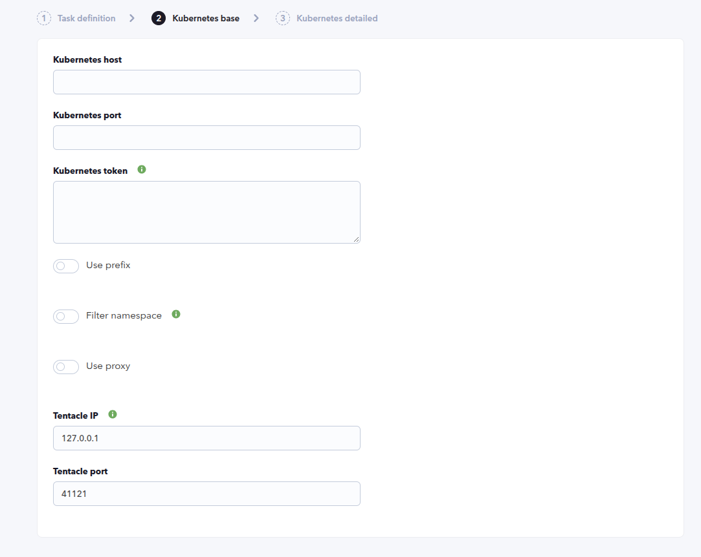
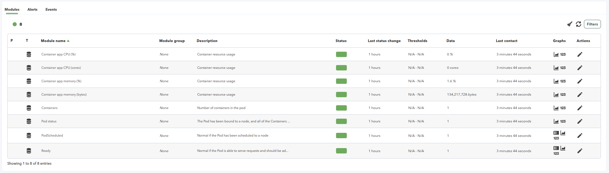

# Kubernetes Discovery

*Article last updated: 2026-10-23.*

<!-- DRAFT: Source-verified for package 1.2; distributed-package installation and live collection remain unvalidated. -->

## What it monitors

The Kubernetes Discovery plugin connects to the Kubernetes API server of a cluster and discovers its workloads and infrastructure: nodes, pods, deployments, namespaces, services, component statuses and the API health endpoints. It generates one Pandora FMS agent per discovered resource and fills it with availability, capacity and performance modules read from the API.

The plugin generates agents for:

- the cluster itself, through a global **Kubernetes** agent;
- every node, when **Scan Nodes** is enabled;
- every deployment, when **Scan Deployments** is enabled;
- pods with available metrics and complete node/IP data, when **Scan Pods** is enabled.

The global agent also carries the cluster-wide API status, health endpoints, service count, namespace count and component statuses.

The plugin runs as a Discovery task: the console creates the task, the Discovery server runs the plugin, and the generated agents and modules are created automatically. The task delivers the generated agent data through Tentacle.

## Prepare

### Compatibility

| Scope | State | Evidence |
| --- | --- | --- |
| Plugin version `1.2` (`pandorafms.kubernetes`) | Documented target | Package identity; see [Plugin identity](#plugin-identity) |
| A Kubernetes cluster exposing the API server over HTTPS | `Required` | The plugin connects to `https://<host>:<port>` and reads the API resources. Prerequisite, not a compatibility statement |
| A Bearer token that can read the queried API resources | `Required` | The plugin authenticates with `Authorization: Bearer <token>` to list nodes, pods, deployments, services, namespaces and component statuses. Prerequisite, not a compatibility statement |
| Kubernetes Metrics API (`metrics.k8s.io`) | `Required` for node/pod discovery | Node and pod data originate in `/apis/metrics.k8s.io/v1beta1`; missing metrics can prevent agents from being generated, not just omit CPU/memory modules |
| A specific Kubernetes version | `Not validated` | No published test record establishes compatibility with a concrete Kubernetes release |
| Host operating system running the plugin | `Not validated` | No published test record establishes operating-system compatibility |

### Requirements

1. **A Pandora FMS server with Discovery enabled** to run the task, and the console to define it.
2. **A Kubernetes API server reachable from the Discovery server**, addressed by host and port. The plugin always uses HTTPS; enter the host without a scheme.
3. **A Bearer token** with read access to the queried resources: nodes, pods, deployments, namespaces, services, component statuses, node/pod metrics and the health endpoints listed in [API requests](#api-requests). The task does not define a specific role. Health and component requests are always attempted; there are no switches for them in this version.
4. **A target agent group and a monitoring interval** for the generated agents. Both come from the Discovery task and are inherited by every generated agent.
5. **Network reachability to the Tentacle destination**, because the task transfers the generated agent data through Tentacle.
6. The plugin is distributed as a Pandora FMS Discovery application (`.disco` package) that the Discovery server executes on the Pandora FMS server.

Direct API connections use HTTPS without certificate verification: the server identity is not authenticated. Restrict network access accordingly. Proxy mode uses the supplied proxy URL and omits the Bearer header. The token is entered in the task and written to its configuration; restrict access to both. For manual runs, keep the token in a protected configuration file, not in shell commands.

### Check target access

Before creating the task, verify the Metrics API and the node/pod metrics with an account authorized for the target cluster:

```bash
kubectl get --raw /apis/metrics.k8s.io/v1beta1/
kubectl top node
kubectl top pod --all-namespaces
```

If the cluster does not expose the Metrics API, its administrator must configure it before node/pod discovery can be verified. These diagnostic commands do not grant the plugin token any permissions.

### Install the plugin

Obtain the `.disco` package from the [Kubernetes Marketplace entry](https://marketplace.pandorafms.com/entries/pandorafms.kubernetes) and load it in Discovery. Select **Kubernetes** when creating an application task. This page covers package `1.2`, not a `1.3` interface.

## Configure the Discovery task

Create the task from **Management → Discovery → Applications → Kubernetes**. The wizard walks through the generic task definition and two plugin steps: **Kubernetes base** and **Kubernetes detailed**. Every field is documented in [Task parameters](#task-parameters).

### Step 1 — Task definition

The generic step asks for the task **name**, the **agent group** and **server** on which the task runs, and the **interval**. The group and the interval are passed to the plugin and inherited by every generated agent.

### Step 2 — Kubernetes base

Connection details and the Tentacle destination:

- **Kubernetes host** is the address or hostname of the API server.
- **Kubernetes port** is the API server port.
- **Kubernetes token** is the Bearer token used to authenticate against the API.
- **Use prefix** shows **Prefix**, the text prepended to generated agent identities. Clear **Prefix** when disabling this option: a populated prefix is still applied in this version.
- **Filter namespace** restricts discovery to a set of namespaces, and **Namespace** is the list of namespaces to monitor.
- **Use proxy** routes the API requests through a proxy; **Proxy url** is that proxy.
- **Tentacle IP** and **Tentacle port** set the Tentacle destination for the generated data. Leave the defaults unless your environment needs another Tentacle target.



### Step 3 — Kubernetes detailed

What to scan:

- **Scan Deployments**, **Scan Nodes** and **Scan Pods** enable or disable agent generation for each resource category. Collection requests still run when these options are disabled.
- Health endpoints and component statuses have no scan switches in package `1.2`.

<!-- SCREENSHOT NEEDED: Kubernetes 1.2 detailed step showing only the three resource scan switches; the inherited 1.3 image is not applicable. -->

## Verify the first run

Run the task from **Management → Discovery → Task list** and check the result in this order.

1. **The task summary** shows the overall progress and a summary with the number of node agents, pod agents and deployment agents generated, and the total number of agents.
2. **The agents.** Check the global **Kubernetes** agent and the enabled resource categories. Node and pod agents depend on metrics; deployment agents require returned condition data.
3. **The modules.** Confirm representative CPU/memory values and pod conditions against the cluster. Do not treat the summary counters as proof of successful data ingestion.
4. **The execution information.** A successful run reports no errors; any per-request failure is recorded there.

If the task fails before generating anything, the host, the port, the network reachability and the token are the first things to check.

## Understand the results

### Agents and identity

The plugin creates one agent per discovered resource. Agent names are built from the original resource name plus the optional prefix.

| Agent | Name | Parent agent |
| --- | --- | --- |
| Global | `[Prefix]Kubernetes` | — |
| Node | `[Prefix]<node>` | The global agent |
| Deployment | `[Prefix]<deployment>` | `Kubernetes` (without the prefix) |
| Pod | `[Prefix]<pod>` | The node agent that runs the pod |

Node agents refer to the prefixed global agent; deployment agents refer to the unprefixed `Kubernetes` parent even when a prefix is set. Each pod agent refers to its prefixed node and uses the pod IP as its address. The global agent is described as `Kubernetes global agent`, node agents as `Kubernetes node`, deployment agents as `Kubernetes deployment` and pod agents as `Kubernetes pod`.

Node and pod discovery starts from Metrics API results. Incomplete metrics, a missing assigned node or missing pod IP can interrupt processing and leave a partial result. Pod and deployment identities do not contain the namespace: equal names in different namespaces can collide. Use separate prefixes for different clusters; namespace filtering does not add a namespace to the identity.

Changing **Prefix** later changes the identity of every generated agent. The **Filter namespace** option applies only to deployments and pods, because nodes are cluster-scoped. Namespace matching is exact and case-sensitive, and the list is entered as a JSON array, for example `["default","kube-system"]`. When **Filter namespace** is enabled, list at least one namespace: an empty list matches no workload and no deployment or pod agent is generated.

### Modules by agent

Every agent receives the modules of its resource. The values are read from the API during every task run; the exact name, type and unit of each module are listed in [Generated modules](#generated-modules).

| Agent | Modules it carries |
| --- | --- |
| Global | API status, API health endpoints, service count, namespace count, component statuses, deployment count |
| Node | Pod usage against node allocatable capacity, node conditions, CPU and memory; depends on Metrics API data |
| Deployment | Replica counts, readiness and availability of the deployment |
| Pod | Pod phase and conditions, container count and per-container CPU/memory; depends on Metrics API data |



## Operate

### Manual execution

The plugin can also be run outside the Discovery wizard with a configuration file. This is useful for testing connectivity or for a one-off run. Write a configuration file with the `key=value` pairs listed in [Configuration file keys](#configuration-file-keys), then run the plugin entry point with the file as argument:

```bash
pandora_kubernetes --conf <PATH_TO_CONFIG>
```

For example, this direct-mode configuration enables all three resource categories. Replace every placeholder before use; the example has not been executed:

```ini
ip=<TARGET_HOST>
port=<API_PORT>
token=<API_TOKEN>
agents_group_name=<AGENT_GROUP>
interval=300
transfer_mode=tentacle
tentacle_ip=<TENTACLE_HOST>
tentacle_port=41121
prefix=<CLUSTER_PREFIX>
use_prefix=1
use_namespace=1
filter_namespace=["default","kube-system"]
use_proxy=0
deployments=1
nodes=1
pods=1
```

Execution returns a Discovery JSON summary and generates XML for each agent. An illustrative summary is `{"summary":{"Total agents":4,"Nodes agents":1,"Pods agents":1,"Deployments agents":1}}`; these counters describe generation, not confirmed delivery.

The operational CLI input is `--conf` (`-h`/`--help` displays help). When the plugin runs as a Discovery task, the server builds that file from the task fields. Manual examples have not been executed against a live target.

## Troubleshoot

| Symptom | Check |
| --- | --- |
| The execution reports a request error | Confirm **Kubernetes host** and **Kubernetes port**, that the API server is reachable from the Discovery server, and that the host does not include a scheme. |
| Requests fail with `401` or `403` | The token is missing, invalid or lacks read access to the queried resources. Check access to the exact paths in the API reference; no validated role definition is provided here. |
| No deployments or pods are generated but nodes are | Review **Filter namespace**: when it is enabled, names must match exactly and in the same case, and an empty list matches nothing. |
| Expected pods are missing | Check that each pod has metrics, an assigned node and a pod IP. Incomplete entries can interrupt pod generation; do not assume all pending pods are safely skipped. |
| Node or pod agents/modules are missing | Check the Metrics API, node allocation data and pod node/IP fields. Inspect `Can't get metrics`, `Error: Nodes` and `Error: Pods`; processing may stop after incomplete data. |
| Global, health or component modules are missing | Inspect request errors, including `401`, `403` and `404`. Health endpoint failures omit those modules; failures fetching services, namespaces or component statuses can prevent the global agent from being sent. There is no switch to skip these requests. |
| `Could not connect to the API` or **API status** is `0` | `/healthz` did not return exactly `ok`. Check endpoint access and API health; this is also the initial connection check. |
| A deployment has no agent | Check **Scan Deployments**, namespace filtering and returned deployment conditions. |
| Deployment **Available** looks healthy despite a failing condition | It reflects the first condition's type, not its Boolean status. Check replica counts and cluster conditions directly. |
| API requests time out | Requests use a fixed 5-second timeout and it is not configurable. Confirm the latency between the Discovery server and the API server. |
| Tentacle transfer fails | Confirm the Discovery server can reach **Tentacle IP** on **Tentacle port**. |
| The global agent uses proxy mode but is not authenticated | When **Use proxy** is enabled the plugin sends requests to **Proxy url** and does not add the Bearer token. |

## Reference

### Task parameters

The console presents these fields after the generic task definition. The macro column is the identifier used in the generated task configuration.

#### Kubernetes base

| Field | Macro | Required | Default | Description |
| --- | --- | --- | --- | --- |
| Kubernetes host | `_ip_` | Direct mode | Empty | API server address or hostname, without a scheme |
| Kubernetes port | `_port_` | Direct mode | Empty | Numeric API server port |
| Kubernetes token | `_token_` | Protected direct endpoints | Empty | Bearer token; the wizard permits an empty value |
| Use prefix | `_usePrefix_` | No | off | Shows the prefix field |
| Prefix | `_prefix_` | No | Empty | Shown with **Use prefix**; clear it to stop applying a prefix |
| Filter namespace | `_filterNamespace_` | No | off | Restricts deployment and pod agents to listed namespaces |
| Namespace | `_namespace_` | When filtering | `[]` | JSON array, for example `["default","kube-system"]`; exact, case-sensitive matching |
| Use proxy | `_useProxy_` | No | off | Uses **Proxy url** instead of the direct API address; omits Bearer authentication |
| Proxy url | `_proxyUrl_` | Proxy mode | Empty | Base URL, including scheme; shown with **Use proxy** |
| Tentacle IP | `_tentacleIP_` | Yes | `127.0.0.1` | Transfer destination |
| Tentacle port | `_tentaclePort_` | Yes | `41121` | Numeric transfer destination port |

#### Kubernetes detailed

| Field | Macro | Required | Default | Description |
| --- | --- | --- | --- | --- |
| Scan Deployments | `_scanDeployments_` | No | on | Generates deployment agents when condition data is present |
| Scan Nodes | `_scanNodes_` | No | on | Generates node agents from available metrics |
| Scan Pods | `_scanPods_` | No | on | Generates pod agents from complete metric/node/IP data |

### Configuration file keys

The Discovery task builds this file from its own fields; a manual run supplies it with `--conf`. It is a plain text file of `key=value` lines.

Required manual inputs are `ip`, `port` and, for protected endpoints, `token` in direct mode; `proxy_url` in proxy mode; and `transfer_mode=tentacle` with `tentacle_ip` for delivery. Other keys are optional and use the defaults below. Protect the file because it contains the token.

| Name | Required | Default | Description |
| --- | --- | --- | --- |
| `ip` | Direct mode | Empty | API server host, without a scheme |
| `port` | Direct mode | Empty | API server port |
| `token` | Protected direct endpoints | Empty | Bearer token |
| `agents_group_name` | No | Empty manually; task group | Target agent group |
| `interval` | No | `300` | Agent interval in seconds; task interval in Discovery |
| `transfer_mode` | For delivery | Empty manually; `tentacle` in task | Use `tentacle` for the documented transfer path |
| `tentacle_ip` | For Tentacle | Empty manually; `127.0.0.1` in task | Transfer destination |
| `tentacle_port` | No | `41121` | Transfer port |
| `use_prefix` | No | `0` | Shows the task prefix field; does not suppress a populated `prefix` |
| `prefix` | No | Empty | Prefix applied to agent identities |
| `use_namespace` | No | `0` | `1` enables workload namespace filtering |
| `filter_namespace` | When filtering | `[]` | JSON array; exact namespace matches |
| `use_proxy` | No | `0` | `1` uses `proxy_url` without the Bearer header |
| `proxy_url` | Proxy mode | Empty | Base URL including scheme |
| `deployments` | No | `1` | `1` generates deployment agents |
| `nodes` | No | `1` | `1` generates node agents |
| `pods` | No | `1` | `1` generates pod agents |
| `data_dir` | No | Empty | Accepted but does not select an output directory |

### Command line

| Command | Description |
| --- | --- |
| `pandora_kubernetes --conf <PATH_TO_CONFIG>` | Runs the plugin with a configuration file |

### Generated modules

#### Global agent

| Module name | Type | What it reports |
| --- | --- | --- |
| `API status` | generic_proc | `1` when `/healthz` returns `ok`, `0` otherwise |
| One module per health endpoint | generic_proc | `1` when the response is `ok`, `0` otherwise; omitted if the request fails |
| `Services` | generic_data | Number of services |
| `Namespaces` | generic_data | Number of namespaces |
| `Components` | generic_data | Number of component statuses |
| `<component>.<condition>` | generic_data | `1` when the component condition status is `TRUE`, `0` otherwise |
| `Deployments` | generic_data | Number of deployments |

Health module names and their exact paths are listed in [API requests](#api-requests). The global agent is transferred only if its collection stage completes.

#### Node agents

| Module name | Type | Unit | What it reports |
| --- | --- | --- | --- |
| `Pods` | generic_data | — | Pods counted during collection on the node |
| `Pods (%)` | generic_data | % | Collected pod count against the node's allocatable pod capacity; missing capacity can stop node generation |
| `CPU (cores)` | generic_data | cores | CPU used by the node. Requires the Metrics API |
| `CPU (%)` | generic_data | % | CPU used against the allocatable CPU. Requires the Metrics API |
| `Memory (bytes)` | generic_data | bytes | Memory used by the node. Requires the Metrics API |
| `Memory (%)` | generic_data | % | Memory used against the allocatable memory. Requires the Metrics API |
| `NetworkUnavailable`, `MemoryPressure`, `DiskPressure`, `PIDPressure` | generic_proc | — | `1` when the corresponding condition is `False`, `0` otherwise |
| `Ready` | generic_proc | — | `1` when the condition is `True`, `0` otherwise |

Node generation requires complete metric and allocation data, including allocatable pods. Missing fields can stop the node-processing stage rather than produce an agent with fewer modules. `Pods` counts pods processed from the returned data, not an independently validated count of every pod on the node.

#### Deployment agents

| Module name | Type | Unit | What it reports |
| --- | --- | --- | --- |
| `Ready` | generic_proc | — | `1` when the ready replicas equal the desired replicas, `0` otherwise |
| `Age` | generic_data | `_timeticks_` | Creation timestamp in centiseconds since 1970, not elapsed age |
| `Replicas` | generic_data | — | Desired replicas |
| `Updated replicas` | generic_data | — | Replicas updated to the desired template |
| `Ready replicas` | generic_data | — | Ready replicas |
| `Available replicas` | generic_data | — | Available replicas |
| `Unavailable replicas` | generic_data | — | Replicas still required for the deployment to reach full availability |
| `Available` | generic_data | — | `1` if the first condition type is `Available` or `Progressing`, otherwise `0`; ignores the condition status. Warning threshold at `2`, critical at `0` |

#### Pod agents

| Module name | Type | Unit | What it reports |
| --- | --- | --- | --- |
| `Pod status` | generic_data | — | Pod phase: `0` Failed, `1` Running, `2` Succeeded, `3` Pending, `4` Unknown or other |
| `PodScheduled`, `Ready`, `Initialized`, `ContainersReady` | generic_proc | — | `1` for condition `True`, otherwise `0` |
| `Unschedulable` | generic_proc | — | `1` for condition `False`, otherwise `0` |
| `Containers` | generic_data | — | Number of containers in the pod |
| `Container <name> CPU (cores)` | generic_data | cores | CPU used by the container. Requires the Metrics API |
| `Container <name> CPU (%)` | generic_data | % | CPU used by the container against the allocatable CPU of its node. Requires the Metrics API |
| `Container <name> memory (bytes)` | generic_data | bytes | Memory used by the container. Requires the Metrics API |
| `Container <name> memory (%)` | generic_data | % | Memory used by the container against the allocatable memory of its node. Requires the Metrics API |

Incomplete per-container metrics can interrupt pod-agent generation. The percentages use the node's allocatable resources, not container requests or limits.

### API requests

The token needs access to the requests below. Scan switches control agent generation, not collection. This is the queried surface, not a validated least-privilege role definition.

| Resource | GET path |
| --- | --- |
| Nodes and node details | `/api/v1/nodes`, `/api/v1/nodes/<NODE_NAME>` |
| Pods | `/api/v1/pods` |
| Metrics | `/apis/metrics.k8s.io/v1beta1/nodes`, `/apis/metrics.k8s.io/v1beta1/pods` |
| Deployments | `/apis/apps/v1/deployments` |
| Services | `/api/v1/services` |
| Namespaces | `/api/v1/namespaces` |
| Component statuses | `/api/v1/componentstatuses` |

| Health module name | GET path |
| --- | --- |
| `healthz` | `/healthz` |
| `healthzPing` | `/healthz/ping` |
| `healthzLog` | `/healthz/log` |
| `healthzEtcd` | `/healthz/etcd` |
| `healthzPoststarthook crd informer synced` | `/healthz/poststarthook/crd-informer-synced` |
| `healthzPoststarthook generic apiserver start informers` | `/healthz/poststarthook/generic-apiserver-start-informers` |
| `healthzPoststarthook start apiextensions controllers` | `/healthz/poststarthook/start-apiextensions-controllers` |
| `healthzPoststarthook start apiextensions informers` | `/healthz/poststarthook/start-apiextensions-informers` |

### Plugin identity

| Field | Value |
| --- | --- |
| App short name | `pandorafms.kubernetes` |
| Plugin version | `1.2` |
| Type | Discovery application (`.disco`) |
| Section | Discovery → Applications |
