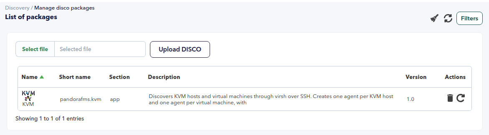
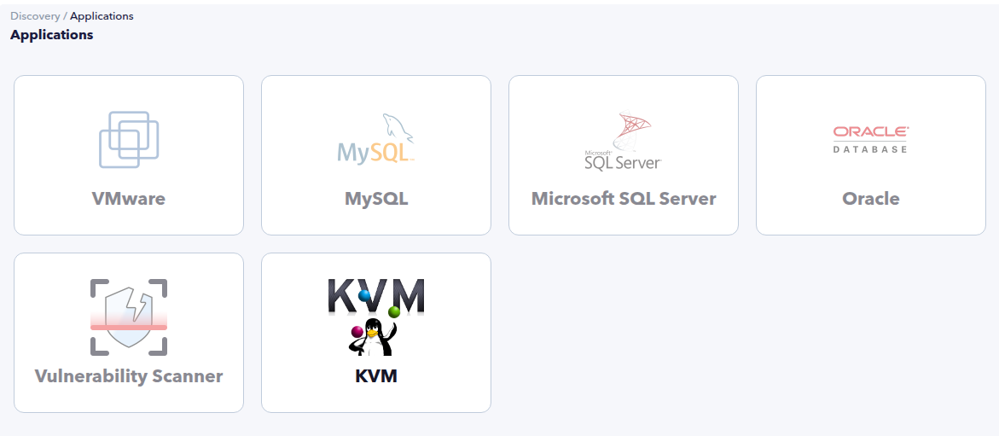
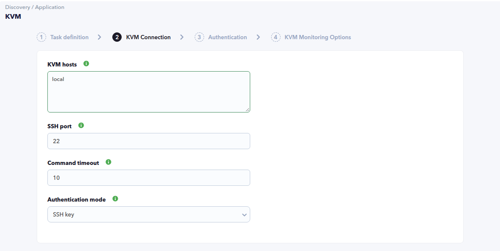
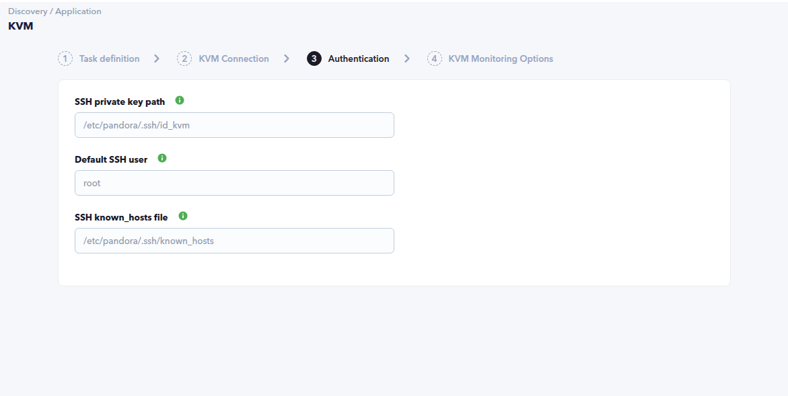
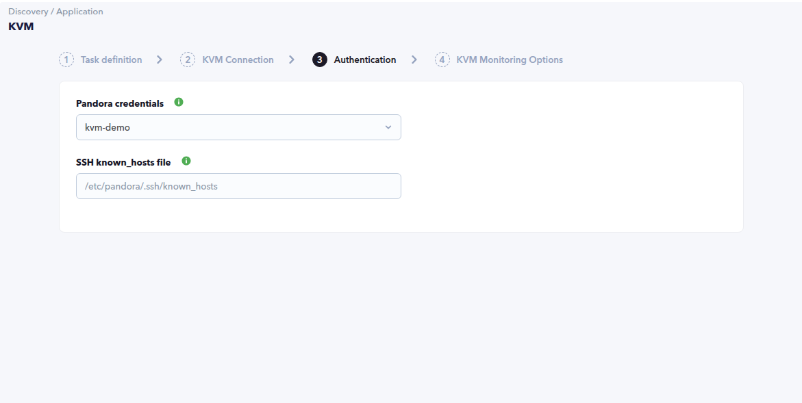
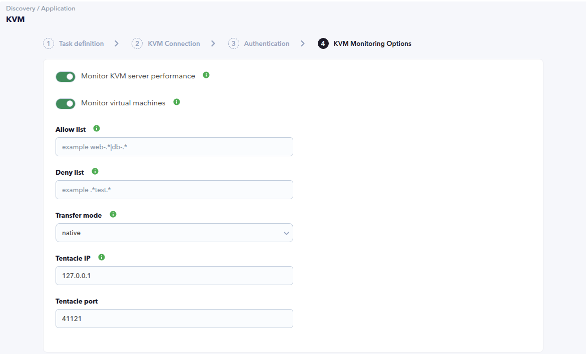
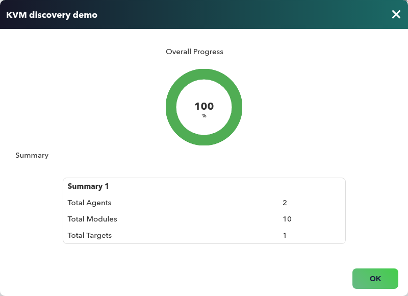
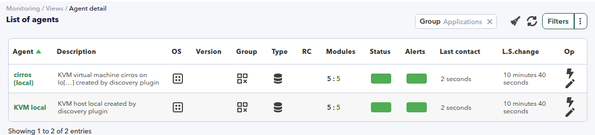
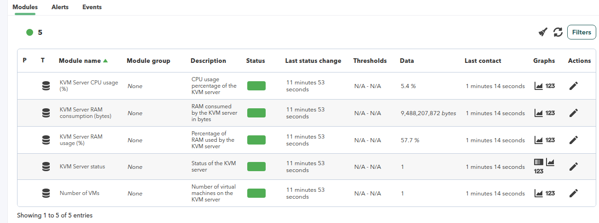
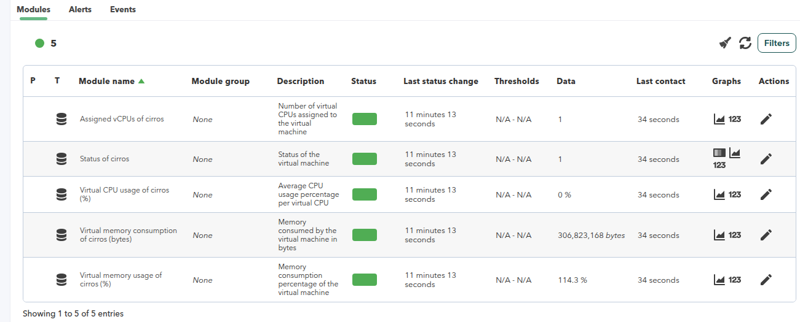

# KVM Discovery

*Article last updated: 2026-10-19.*

## What it monitors

The KVM Discovery plugin connects to KVM hypervisors and reads their inventory and state through `virsh` and `ps`, either over SSH or locally on the machine that runs the task. It creates a two-level agent hierarchy in Pandora FMS:

- one agent per KVM host, named `KVM <host>`;
- one agent per virtual machine, named `<vm> (<host>)` and created as a child of its host agent.

Host agents carry the libvirtd status and, when **Monitor KVM server performance** is enabled, the RAM and CPU usage of the KVM server, including its RAM consumption in bytes. Virtual machine agents carry the VM power state and, for running VMs, the number of assigned vCPUs, the CPU usage per vCPU, the memory usage in percent and the memory consumption in bytes. CPU usage is a gauge: the plugin samples `virsh domstats --vcpu` twice around a one-second window and translates the vCPU time delta into a per-vCPU percentage. For running VMs, the plugin also resolves the VM IPv4 address with `virsh domifaddr` and uses it as the agent address when one is available. The plugin only generates Discovery data; the task re-executes on its configured interval to refresh the inventory and the module values.

The plugin runs as a Discovery task: the console creates the task, the Discovery server runs the plugin, and the generated agents and modules are created automatically.

## Prepare

### Compatibility

| Scope | State | Evidence |
| --- | --- | --- |
| Plugin version `1.0` (`pandorafms.kvm`) | Documented target | The version this page describes, as identified by the package definition. |
| A Pandora FMS server with Discovery enabled | `Required` | The integration runs as a Discovery task created from the console. |
| libvirt with `virsh` on every monitored host | `Required` | Every metric is read through `virsh`, and the libvirtd process check decides whether a host is up. |
| SSH access to every remote target | `Required` | Remote targets are monitored over SSH on the configured port; only `local` targets run without it. |
| A Linux distribution, KVM or libvirt version of the monitored hosts | `Not validated` | No published test record establishes compatibility with a concrete distribution or libvirt release. |
| Operating system of the server that runs the task | `Not validated` | No published test record establishes operating-system compatibility. |

### Requirements

- A Pandora FMS server with Discovery enabled to run the task, and a console to define it.
- On every monitored KVM host: libvirt installed with the `virsh` command available, and the **libvirtd** daemon running. A host without libvirtd is still generated, with `KVM Server status = 0` and without performance or VM modules.
- An SSH account on every remote host allowed to run `ps` and `virsh`. Reading libvirt usually requires membership in the `libvirt` group or `root`.
- For **SSH key** authentication: a private key readable by the user that runs the discovery task, with its public key installed on every monitored host. Optionally, a `known_hosts` file with the host keys of those hosts to enable host key verification.
- For **Pandora credentials** authentication: a custom credential in the Pandora credential manager that stores the SSH username and password.
- A target agent group and a monitoring interval for the generated agents. Both come from the Discovery task and are inherited by every generated agent.
- A `local` target runs `ps` and `virsh` on the machine that executes the task, so use it only when the task runs on the KVM host itself.
- Network reachability from the Discovery server to every remote host on the SSH port. With **Transfer mode** set to `tentacle`, the configured Tentacle destination must also be reachable.
- The plugin is distributed as a Pandora FMS Discovery application (`.disco` package) that the Discovery server executes on the Pandora FMS server.

### Install the plugin

**From the Marketplace.** Open **Marketplace → Search** in the console, find the KVM Discovery entry and click **Install**. Installation requires an administrator account. The package is installed directly and **KVM** appears under the **Applications** section of the Discovery wizard.

<!-- SCREENSHOT NEEDED: the KVM Discovery entry in the console Marketplace (Search view and Install button), to be captured when the plugin is published in the Marketplace -->

**Manual installation.** Load the `.disco` package from **Management → Discovery → Manage disco packages**: choose **Select a file**, pick the package, and click **Upload DISCO**. After loading, **KVM** appears in the package list and under the **Applications** section of the Discovery wizard.





## Configure the Discovery task

Create the task from **Management → Discovery → Applications → KVM**. The wizard walks through the generic task definition and three plugin steps: **KVM Connection**, **Authentication** and **KVM Monitoring Options**. Every field is documented in [Task parameters](#task-parameters).

### Step 1 — Task definition

The generic step asks for the task **name**, the **agent group** and **server** on which the task runs, and the **interval**. The group and the interval are passed to the plugin and inherited by every generated agent.

### Step 2 — KVM Connection

The target list and the connection settings:

- **KVM hosts** is the target list, one entry per line; comma-separated values are also accepted inside a line. At least one entry is required. Each entry is `user@host`, `host` or `local`:
  - `user@host` connects to `host` over SSH as `user`, which overrides the configured authentication user;
  - `host` connects to `host` over SSH with the default SSH user (key mode) or the credential user (credentials mode);
  - `local` runs `ps` and `virsh` on the machine that executes the task and uses no authentication.
- **SSH port** is the SSH port used to connect to the remote hosts. Default `22`.
- **Command timeout** is the SSH connection and command timeout in seconds. Default `10`.
- **Authentication mode** selects how the plugin authenticates: **SSH key** or **Pandora credentials**. The next step renders the fields of the selected mode.



### Step 3 — Authentication

The fields of this step depend on the **Authentication mode** selected in the previous step.

In **SSH key** mode:

- **SSH private key path** is the path to the SSH private key on the Pandora server, readable by the user that runs the discovery task. Required in this mode.
- **Default SSH user** is the user used for targets without an explicit `user@` prefix. The `user@` part of a target overrides it.
- **SSH known_hosts file**: when set, the host key of every target is verified against this file and unknown hosts are rejected. When empty, unknown host keys are accepted.



In **Pandora credentials** mode:

- **Pandora credentials** is the custom credential selected from the Pandora credential manager. Required in this mode.
- **SSH known_hosts file** behaves as in key mode.



### Step 4 — KVM Monitoring Options

What the task monitors and how the data is delivered:

- **Monitor KVM server performance**, when enabled, adds the `KVM Server RAM usage (%)`, `KVM Server RAM consumption (bytes)` and `KVM Server CPU usage (%)` modules to the host agent. The `KVM Server status` module is always created.
- **Monitor virtual machines**, when enabled, creates one agent per virtual machine and the `Number of VMs` module on the host agent.
- **Allow list** is a regular expression applied to VM names: only matching VMs get an agent. Empty allows every VM.
- **Deny list** is a regular expression applied to VM names after the allow list: matching VMs are excluded. Empty denies no VM.
- **Transfer mode** selects how the generated data reaches Pandora FMS. `native` lets the Discovery server read the agent data directly; `tentacle` sends the generated agent files to `Tentacle IP` on `Tentacle port` with the Tentacle client.
- **Tentacle IP** and **Tentacle port** are the Tentacle destination used in `tentacle` mode. Defaults `127.0.0.1` and `41121`.



## Verify the first run

Run the task from **Management → Discovery → Task list** and check the result in this order.

1. **The task summary** shows the overall progress and a summary with `Total Targets`, `Total Agents` and `Total Modules`.
2. **The agents.** Expect one host agent (`KVM <host>`) per reachable target, plus one agent per monitored virtual machine, created as a child of its host agent.
3. **The modules.** A host with libvirtd running carries `KVM Server status` and, depending on the enabled options, the server performance modules and `Number of VMs`. Every VM agent carries `Status of <vm>`; a running VM also carries its vCPU and memory modules.
4. **The execution information.** A successful run reports no errors; connection or command failures, and the reason why a module was omitted, are recorded there.



The example above reports one target, two agents and ten modules: the KVM host agent with five modules and one of its virtual machines with the other five. If the task fails before generating anything, the target list, the SSH connectivity and the selected credentials are the first things to check.

## Understand the results

### Agents and identity

The plugin creates one agent per KVM host and one agent per virtual machine, with the host agent as the parent of each of its VM agents. Every generated agent belongs to the task's agent group, inherits its interval and carries one of the following aliases. With **Transfer mode** `native`, generated agents also report `KVM` as their operating system.

| Element | Agent alias | Parent agent |
| --- | --- | --- |
| KVM host | `KVM <host>` | — |
| Virtual machine | `<vm> (<host>)` | The host agent |

`<host>` is the host part of the target as written in **KVM hosts**. The host agent reports that host as its address (no address for `local` targets), and a running VM agent uses the VM IPv4 address when it can be resolved.

Generated data also carries stable `extra_data` markers that identify the origin of each element. Names are normalized to lowercase and characters other than letters, digits, dots, hyphens and underscores are replaced with underscores:

| Element | Marker |
| --- | --- |
| Host agent | `kvm:host:<host>` |
| VM agent | `kvm:vm:<host>:<vm>` |
| Host module | `kvm:metric:<host>:<metric>` |
| VM module | `kvm:metric:<host>:<vm>:<metric>` |



### Modules by agent

The module values are read from each target during every task run; the exact name and creation condition of each module are listed in [Generated modules](#generated-modules).

| Agent | Modules it carries |
| --- | --- |
| KVM host | libvirtd status; with **Monitor KVM server performance**: RAM usage, RAM consumption and CPU usage of the KVM server; with **Monitor virtual machines**: the number of defined virtual machines |
| Virtual machine | VM power state; for running VMs: assigned vCPUs, CPU usage per vCPU, memory usage in percent and memory consumption in bytes |

A host without libvirtd keeps its agent with `KVM Server status = 0` and no other modules, and generates no VM agents.

The virtual memory usage of a running VM is measured on the host as the resident memory of the domain against its current memory allocation, so it reports what the VM consumes on the host rather than the memory assigned to it, and it can exceed 100%.





## Operate

### Manual execution

The plugin can also be run outside the Discovery wizard with a configuration file and a targets file. This is useful for testing connectivity, for a one-off run, or for a custom schedule.

Write a `[CONF]` configuration file with at least the authentication mode and its values, and a targets file with one entry per line in the same formats as **KVM hosts**. Then run `pandora_kvm --conf <config_file> --targets_file <targets_file>`. All parameters are documented in [Configuration file](#configuration-file).

```ini
[CONF]
auth_mode = key
ssh_key_path = <PATH_TO_SSH_KEY>
ssh_user = <USER>
ssh_port = 22
timeout = 10
transfer_mode = native
interval = 300
agents_group_id = <GROUP_ID>
monitor_host = 1
monitor_vms = 1
```

In credentials mode use `auth_mode = credentials` and `credentials = <BASE64_CREDENTIAL>` instead of `ssh_key_path`. The credential value is an encoded username and password, not an encrypted one, so protect the configuration file as a secret.

### Execution behavior

- Targets are processed sequentially, in the order they are listed. A connection or command error on one target is recorded in the execution information and the remaining targets are still processed.
- VM CPU usage is sampled per host, not per VM: when at least one VM is running, the plugin reads `virsh domstats --vcpu` twice, one second apart, and uses the measured window for the percentage. A run takes about one extra second per host with running VMs, and the sampling window is not configurable.
- When the default `virsh list --all` returns no virtual machines, the plugin retries the listing with `/usr/bin/virsh -r -c qemu:///system` and uses that connection for the VM metrics of the host.
- When the console leaves an unresolved macro placeholder in the generated configuration, for example `credentials` in SSH key mode, the plugin treats the value as empty.
- A non-running virtual machine still gets its agent with its status module; its performance modules are not created.

## Troubleshoot

| Symptom | Check |
| --- | --- |
| The task reports `Error connecting to <host>` | Confirm SSH reachability and the port. In key mode check **SSH private key path** and **Default SSH user**; in credentials mode check the selected credential. |
| The task reports `SSH key authentication requires a key path` | The task runs in **SSH key** mode but **SSH private key path** is empty. Set the path or switch to **Pandora credentials**. |
| The task reports `Invalid Pandora credentials` | The credential is missing, is not a valid custom credential or has an empty password. Select a custom credential in the Authentication step. |
| The connection is rejected and **SSH known_hosts file** is set | The host key of the target is missing or has changed. Update the file (`ssh-keyscan -p <port> <host>`) or clear the field. |
| The task reports `No agents were created for any target` | Every target failed. Review the per-target errors in the execution information, starting with connectivity and credentials. |
| The task reports `Error listing VMs on <host>` | Run `virsh list --all` on the host with the same user and confirm the libvirt permissions. |
| The host agent has `KVM Server status = 0` | libvirtd is not running on that host, or the SSH user cannot see its processes. |
| No VM agents although the host is up | Confirm **Monitor virtual machines** is enabled and review the **Allow list** and **Deny list** expressions. An invalid regex is ignored: it neither allows nor denies anything. |
| The `Number of VMs` module is not created | **Monitor virtual machines** is disabled. |
| `Assigned vCPUs of <vm>` or `Virtual CPU usage of <vm> (%)` is missing | A `virsh domstats --vcpu` sample was missing in either read, the vCPU time delta was negative (the VM restarted between samples) or the command failed. The reason is recorded in the execution information. |
| `Virtual memory consumption of <vm> (bytes)` is missing | `virsh dommemstat` failed and the `virsh dominfo` fallback could not read the used memory. `Virtual memory usage of <vm> (%)` is still created and reports `0`. The reason is recorded in the execution information. |
| The `KVM Server RAM` or `KVM Server CPU` modules are not created | **Monitor KVM server performance** is disabled, libvirtd is not running, or `virsh nodememstats` / `virsh nodecpustats --percent` failed. Both RAM modules are omitted together. |
| A VM agent has no address | `virsh domifaddr` returned no usable IPv4 address (no NIC, no DHCP lease yet or IPv6 only). This is best effort and not an error. |

## Reference

### Task parameters

The console presents these fields after the generic task definition. The macro column is the identifier used in the generated task configuration.

#### KVM Connection

| Field | Macro | Type | Default | Notes |
| --- | --- | --- | --- | --- |
| KVM hosts | `_pluginTargets_` | textarea | — | Targets, one per line: `user@host`, `host` or `local`. Comma-separated values are also accepted. Required |
| SSH port | `_sshPort_` | number | `22` | SSH port used to connect to the KVM hosts |
| Command timeout | `_timeout_` | number | `10` | SSH connection and command timeout in seconds |
| Authentication mode | `_authMode_` | select | `SSH key` | `SSH key` or `Pandora credentials`. Required |

#### Authentication

| Field | Macro | Type | Default | Notes |
| --- | --- | --- | --- | --- |
| SSH private key path | `_sshKeyPath_` | string | — | Key mode only. Path to the SSH private key on the Pandora server. Required in key mode |
| Default SSH user | `_sshUser_` | string | — | Key mode only. Used for targets without an explicit `user@` prefix |
| Pandora credentials | `_credentials_` | select | — | Credentials mode only. Custom credential from the Pandora credential manager. Required in credentials mode |
| SSH known_hosts file | `_knownHosts_` | string | — | Both modes. When set, host keys are verified against this file and unknown hosts are rejected |

The step renders the fields of the selected **Authentication mode** only.

#### KVM Monitoring Options

| Field | Macro | Type | Default | Notes |
| --- | --- | --- | --- | --- |
| Monitor KVM server performance | `_monitorHost_` | checkbox | on | Adds the KVM server RAM and CPU modules to the host agent |
| Monitor virtual machines | `_monitorVms_` | checkbox | on | Creates one agent per virtual machine and the `Number of VMs` module on the host agent |
| Allow list | `_allowList_` | string | — | Regex for VM names. Empty allows all |
| Deny list | `_denyList_` | string | — | Regex for VM names, applied after the allow list. Empty denies none |
| Transfer mode | `_transferMode_` | select | `native` | `native` or `tentacle` |
| Tentacle IP | `_tentacleIp_` | string | `127.0.0.1` | Tentacle destination used in `tentacle` mode |
| Tentacle port | `_tentaclePort_` | number | `41121` | Tentacle destination port used in `tentacle` mode |

### Configuration file

The Discovery task builds a configuration file for the plugin, and a manual execution uses the same format. It is a plain text file with a `[CONF]` section of `key = value` lines.

| Parameter | Default | Description |
| --- | --- | --- |
| `auth_mode` | `key` | `key` or `credentials`. An empty value falls back to `credentials` when `credentials` has a value, and to `key` otherwise |
| `ssh_key_path` | — | Path to the SSH private key. Required in `key` mode |
| `ssh_user` | — | Default SSH user for targets without an explicit `user@` prefix |
| `known_hosts` | — | SSH known_hosts file. When set, host keys are verified and unknown hosts are rejected |
| `credentials` | — | Credential produced by the Pandora credential manager: a base64 JSON value with `user` and `password` |
| `ssh_port` | `22` | SSH port used to connect to the KVM hosts |
| `timeout` | `10` | SSH connection and command timeout in seconds |
| `transfer_mode` | `native` | `native` or `tentacle` |
| `tentacle_ip` | `127.0.0.1` | Tentacle destination |
| `tentacle_port` | `41121` | Tentacle destination port |
| `interval` | Task interval (`300` from the command line) | Interval assigned to the generated agents |
| `agents_group` | Task group | Agent group name used in `tentacle` mode |
| `agents_group_id` | Task group ID | Numeric agent group used in `native` mode |
| `allow_list` | — | Regex allow list for VM names |
| `deny_list` | — | Regex deny list for VM names |
| `monitor_host` | `1` | Set to `0` to disable the KVM server performance modules |
| `monitor_vms` | `1` | Set to `0` to disable virtual machine discovery |
| `prefix` | — | Prefix added to the generated agent aliases and module names. The Discovery task never sets it |

Command-line values act as defaults for this file; a parameter present in the configuration file overrides its command-line counterpart.

In `credentials` mode the selected credential is stored as the base64 JSON value in the task configuration, or in `credentials` in a manual configuration file. This is an encoding, not encryption: protect the Pandora FMS console, the configuration file and the file permissions of anything that stores it. The SSH private key stays on the server and is referenced by path.

### Generated modules

The plugin generates the following modules per agent. **Created when** is the condition under which the module appears.

#### KVM host agent

| Module | Type | Unit | Created when |
| --- | --- | --- | --- |
| `KVM Server status` | generic_proc | — | Always. `1` when at least one libvirtd process runs on the host, `0` otherwise |
| `KVM Server RAM usage (%)` | generic_data | % | **Monitor KVM server performance** enabled and libvirtd running |
| `KVM Server RAM consumption (bytes)` | generic_data | bytes | Same condition as the RAM usage module |
| `KVM Server CPU usage (%)` | generic_data | % | **Monitor KVM server performance** enabled and libvirtd running |
| `Number of VMs` | generic_data | — | **Monitor virtual machines** enabled and libvirtd running. Counts the entries returned by `virsh list --all` |

#### Virtual machine agent

| Module | Type | Unit | Created when |
| --- | --- | --- | --- |
| `Status of <vm>` | generic_proc | — | Always. `1` when the VM is running, `0` otherwise |
| `Assigned vCPUs of <vm>` | generic_data | — | Running VM with a complete CPU sample |
| `Virtual CPU usage of <vm> (%)` | generic_data | % | Running VM with a complete CPU sample |
| `Virtual memory usage of <vm> (%)` | generic_data | % | Running VM |
| `Virtual memory consumption of <vm> (bytes)` | generic_data | bytes | Running VM whose used memory can be determined |

A module that depends on a measurement that could not be read is omitted and the reason is recorded in the task execution information; the rest of the agent modules are still created. `Virtual memory usage of <vm> (%)` is always created for a running VM and reports `0` when its measurement fails.

### Commands run on the target

| Metric | Command |
| --- | --- |
| libvirtd status | `ps aux \| grep libvirtd \| grep -v grep \| wc -l` |
| VM list | `virsh list --all` (fallback: `/usr/bin/virsh -r -c qemu:///system list --all`) |
| KVM server RAM | `virsh nodememstats` |
| KVM server CPU | `virsh nodecpustats --percent` |
| VM vCPUs and CPU usage | `virsh domstats --vcpu`, twice around a one-second window |
| VM memory | `virsh dommemstat <vm>` (fallback: `virsh dominfo <vm>`) |
| VM IP address | `virsh domifaddr <vm>` (running VMs, best effort) |

The `virsh` binary is resolved with `whereis virsh | cut -f2 -d' '` and falls back to `/usr/bin/virsh`.

### Command line

| Command | Description |
| --- | --- |
| `pandora_kvm --conf <config_file> --targets_file <targets_file>` | Runs the plugin with a configuration file and a targets file |
| `pandora_kvm --conf <config_file> --targets_file <targets_file> --as_server_plugin true` | Server plugin mode: returns `1` when at least one agent was created and `0` otherwise |

Every configuration parameter has an equivalent command-line flag with the same meaning (`--auth_mode`, `--ssh_key_path`, `--monitor_vms`, and so on), except `agents_group`, `agents_group_id` and `prefix`, which are configuration-file only. `--as_server_plugin` is command-line only.
