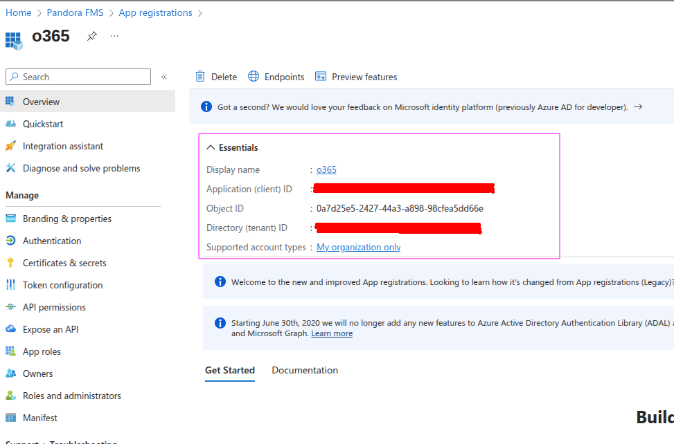
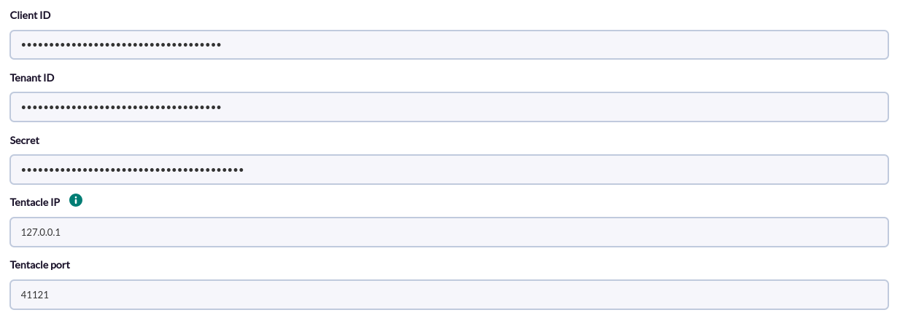
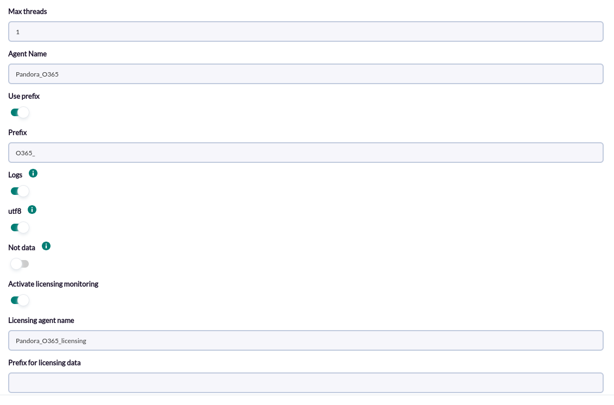
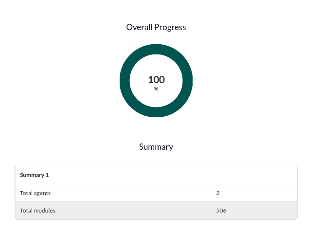

# Office 365 Discovery

*Article last updated: 2026-10-26.*

## What it monitors

The Office 365 Discovery addon monitors the health and the licensing of a Microsoft 365 tenant. It queries the Microsoft Graph API and turns the result into Pandora FMS agents and modules: the status of every Microsoft 365 service, the unresolved incidents of each service, the service announcements as log entries, and the usage of every subscribed license.

A Discovery task generates up to two agents:

- **A service health agent** with, for each Microsoft 365 service, a status module and a module listing its unresolved incidents. The service announcements (maintenance and incident messages) are sent to the Pandora FMS log collector associated with this agent.
- **A licensing agent** (optional) with, for each license subscribed by the tenant, modules for its status and for the units enabled, consumed and available.

## Prepare

### Compatibility

| Scope | State | Evidence |
|-------|-------|----------|
| Addon `pandorafms.office365`, version `1.1` | Documented target | The version this page describes. See [Addon identity](#addon-identity) |
| Network access from the Discovery server to `login.microsoftonline.com` and `graph.microsoft.com` | `Required` | The addon authenticates and queries data through these hosts |
| Microsoft Entra ID application with the permissions listed in [Microsoft Graph permissions](#microsoft-graph-permissions) | `Required` | Prerequisite, not a compatibility statement |
| Specific Pandora FMS versions | `Not validated` | The Marketplace shows a general notice for all its integrations; no version matrix has been recorded for this addon |
| Operating system of the Discovery server | `Not validated` | No operating system has been recorded for this version |

### Prerequisites

1. **Connectivity** from the Discovery server to the Microsoft endpoints above.
2. **A Microsoft Entra ID application** registered in the tenant to monitor, with a client secret and the application permissions described below.
3. **The tenant ID, the client ID and the client secret** of that application.
4. **Pandora FMS**: a Discovery server to run the task and the console to define it.

The addon ships its own executable, `bin/pandora_o365`, so nothing else has to be installed on the Discovery server to run a task.

### Register the application in Microsoft Entra ID

The addon authenticates with the OAuth 2.0 client credentials flow, with no signed-in user. Prepare the application in the Azure portal:

1. Open Microsoft Entra ID and register a new application in **App registrations**. Register it in the tenant you want to monitor.
2. In **Certificates & secrets**, create a client secret and copy its value immediately: Azure shows it only once.
3. From the application overview, copy the **Application (client) ID** and the **Directory (tenant) ID**.
4. In **API permissions**, add the Microsoft Graph application permissions listed below and grant administrator consent.



<!-- SCREENSHOT NEEDED: API permissions page of the application showing the Microsoft Graph application permissions below with administrator consent granted. -->

### Microsoft Graph permissions

The addon requests an application token with the `https://graph.microsoft.com/.default` scope, so it receives the application permissions granted to the registered application. Each data set it reads is covered by the following Microsoft Graph application permissions, according to the Microsoft Graph documentation of each endpoint:

| Microsoft Graph request | Used for | Application permission |
|-------------------------|----------|------------------------|
| `/admin/serviceAnnouncement/healthOverviews` | Service status and unresolved incidents | `ServiceHealth.Read.All` |
| `/admin/serviceAnnouncement/messages` | Service announcements sent as logs | `ServiceMessage.Read.All` |
| `/subscribedSkus` | Licensing agent | `LicenseAssignment.Read.All` (the least privileged option listed by Microsoft; `Organization.Read.All` and `Directory.Read.All` also work) |

Grant only the permissions of the features you enable: omit `ServiceMessage.Read.All` when **Logs** is disabled and `LicenseAssignment.Read.All` when licensing monitoring is disabled. Do not grant the `ReadWrite` variants.

The client secret is a credential: store it only in the task and revoke it in Microsoft Entra ID when it is no longer needed.

### Install the addon

Download the `.disco` package from the Pandora FMS Marketplace entry, which is limited to licensed users:

[https://marketplace.pandorafms.com/entries/pandorafms.office365](https://marketplace.pandorafms.com/entries/pandorafms.office365)

Load it into Pandora FMS. Once loaded, **Office 365** is available when creating Discovery tasks.

## Configure the Discovery task

Create a Discovery task and choose **Office 365**. The console presents the fields in two steps; every field is documented in [Task parameters](#task-parameters).

1. **Office365 base** — access to the tenant and data destination:

    - **Client ID**, **Tenant ID** and **Secret**: the values of the Microsoft Entra ID application. The console treats the three of them as password fields.
    - **Tentacle IP** and **Tentacle port**: where the generated agent data is sent. The defaults are `127.0.0.1` and `41121`; they rarely need changing.

    

2. **Office365 Detailed** — agents and data to collect:

    - **Agent Name**: name of the service health agent.
    - **Use prefix** and **Prefix**: prefix added to the agent name and to its modules. **Prefix** is shown only when **Use prefix** is enabled.
    - **Logs**: send the service announcements to the Pandora FMS log collector.
    - **utf8**: encode the value of the incident modules as UTF-8 text.
    - **Not data**: do not create the status and incident modules.
    - **Activate licensing monitoring**, **Licensing agent name** and **Prefix for licensing data**: create the licensing agent. The last two are shown only when licensing monitoring is enabled.
    - **Max threads**: shown for compatibility; this version of the addon does not use it.

    

The task's group and interval come from the generic task-definition step and are applied to the agents the task creates.

## Verify the first run

Force the task from the Discovery task list and check the result in this order.

1. **The task summary.** A task that completes reports **Total agents** and **Total modules**. **Total agents** is `2` with licensing monitoring enabled and `1` otherwise. **Total modules** adds the status, incident, log and licensing modules generated.

    

2. **The agents.** The service health agent, named after **Agent Name** (default `Pandora_O365`), and, when licensing monitoring is enabled, the licensing agent (default `Pandora_O365_licensing`).
3. **The modules.** The service health agent has a `<service>_status` and a `<service>_active_issues` module for every Microsoft 365 service; the licensing agent has the license modules described in [Understand the results](#understand-the-results). Log entries appear in the log collector under the service name.

When a step fails, the task records the error in its execution information instead; see [Troubleshoot](#troubleshoot).

## Understand the results

### Agents generated

| Agent | Name and alias | Group | Created when |
|-------|----------------|-------|--------------|
| Service health agent | `<Prefix><Agent Name>` | Task group | Always |
| Licensing agent | `<Prefix for licensing data><Licensing agent name>` | Task group | **Activate licensing monitoring** is enabled |

Both agents are refreshed at the task interval and report the description `Agent generated by pandora_o365 plugin`. The two prefixes are independent: **Prefix** does not apply to the licensing agent.

### Modules per agent

**Service health agent**

| Module | Type | Condition | Description |
|--------|------|-----------|-------------|
| `<Prefix><service id>_status` | `generic_data_string` | **Not data** disabled | Status of the Microsoft 365 service as reported by Microsoft Graph. The module is `warning` when the status matches `investigating`, `restoringService` or `extendedRecovery`, and `critical` when it matches `serviceDegradation` or `serviceInterruption` |
| `<Prefix><service id>_active_issues` | `generic_data_string` | **Not data** disabled | Identifier and title of each unresolved incident of the service; `None` when the service has no unresolved incident. Description: `<service> Issues Ids` |
| Log entries | Log collector | **Logs** enabled | One entry per service announcement, with the source `<Prefix>_<service>`. The content is the announcement, converted to plain text |

`<service id>` is the service identifier returned by Microsoft Graph, for example the identifier of Exchange Online or Microsoft Teams.

**Licensing agent**

For every license (SKU) subscribed by the tenant, the agent has the following modules. `<name>` is the license part number returned by Microsoft Graph and each module description is the identifier of the license.

| Module | Type | Description |
|--------|------|-------------|
| `<Prefix><name>` | `generic_data_string` | Capability status of the license |
| `<Prefix><name> consumedUnits` | `generic_data` | Units consumed |
| `<Prefix><name> Units enabled` | `generic_data` | Units enabled |
| `<Prefix><name> Units lockedOut` | `generic_data` | Units locked out |
| `<Prefix><name> Units suspended` | `generic_data` | Units suspended |
| `<Prefix><name> Units warning` | `generic_data` | Units in warning state |
| `<Prefix><name> Consumed Units %` | `generic_data` | Percentage of enabled units consumed, rounded to two decimals, in `%`. It is `0` when no unit is enabled |
| `<Prefix><name> Units Available` | `generic_data` | Enabled units minus consumed units |

Here `<Prefix>` is **Prefix for licensing data**.

## Operate

### Manual execution

The addon can run outside a Discovery task. The executable takes a single parameter, the path to a configuration file described in [Configuration file](#configuration-file):

```bash
./pandora_o365 --conf <PATH_TO_CONFIG>
```

It sends one data file per agent using the configured transfer mode and prints a JSON summary with the **Total agents** and **Total modules** counts. When errors occur, the JSON also contains an `info` key with the messages.

The configuration file contains the client secret. Protect it with restrictive permissions and do not keep it after the test.

## Troubleshoot

The addon has no verbose or debug flag. Its diagnostic channel is the information recorded in the execution result of the task.

- **`HTTP error: ... on https://login.microsoftonline.com/...`**: Microsoft Entra ID rejected the authentication. Check the tenant ID, the client ID and the client secret, and that the secret has not expired.
- **`Request error: ...`**: the Discovery server cannot reach `login.microsoftonline.com`. Check outbound connectivity, DNS and any proxy or firewall.
- **`Error requesting url: ... (<status>) on https://graph.microsoft.com/...`**: Microsoft Graph rejected a data request. A `403` status can indicate that the application lacks the permission of that endpoint or that administrator consent was not granted; see [Microsoft Graph permissions](#microsoft-graph-permissions). The message names the endpoint.
- **`error with status data: ...`, `error logs data: ...` or `error with licensing data: ...`**: reading or processing that data set failed. The error text is appended to the message.
- **`error with accounts data: ...`**: the configuration file cannot be read. It appears only in manual execution.
- **No `_status` or `_active_issues` modules**: **Not data** is enabled.
- **No licensing agent**: **Activate licensing monitoring** is disabled.
- **No log entries**: **Logs** is disabled, or Microsoft Graph returned no announcements.
- **Incident values show a byte string**: **utf8** is disabled. Enable it unless the environment requires raw bytes.

## Reference

### Task parameters

#### Office365 base

| Field | Macro | Type | Default | Notes |
|-------|-------|------|---------|-------|
| Client ID | `_clientid_` | password | empty | Mandatory. Application (client) ID |
| Tenant ID | `_tenantid_` | password | empty | Mandatory. Directory (tenant) ID |
| Secret | `_secret_` | password | empty | Mandatory. Client secret value |
| Tentacle IP | `_tentacleIP_` | string | `127.0.0.1` | Server that receives the agent data |
| Tentacle port | `_tentaclePort_` | number | `41121` | Tentacle port |

#### Office365 Detailed

| Field | Macro | Type | Default | Notes |
|-------|-------|------|---------|-------|
| Max threads | `_threads_` | number | `1` | Optional. Not used by this version of the addon |
| Agent Name | `_agentname_` | string | `Pandora_O365` | Name and alias of the service health agent |
| Use prefix | `_usePrefix_` | checkbox | off | Shows **Prefix** |
| Prefix | `_prefix_` | string | empty | Optional. Shown when **Use prefix** is on. Prepended to the agent name, the module names and the log source |
| Logs | `_logs_` | checkbox | on | Send service announcements to the log collector |
| utf8 | `_utf_` | checkbox | on | Encode the incident value as UTF-8 text; when off, the value is written as raw bytes |
| Not data | `_activemonitoring_` | checkbox | off | When on, the status and incident modules are not created |
| Activate licensing monitoring | `_licensing_` | checkbox | on | Create the licensing agent |
| Licensing agent name | `_agentnameLicensing_` | string | `Pandora_O365_licensing` | Optional. Shown when licensing monitoring is on |
| Prefix for licensing data | `_prefixLicensing_` | string | empty | Optional. Shown when licensing monitoring is on |

### Configuration file

Used by manual execution. One `key = value` per line; keys that are not present take the default listed here. A numeric option that is not a number is read as `0`; `1` enables and `0` disables.

| Key | Default | Description |
|-----|---------|-------------|
| `agents_group_name` | empty | Group of the generated agents |
| `interval` | `300` | Agent interval, in seconds |
| `transfer_mode` | `tentacle` | Data transfer mode. The Discovery task always uses `tentacle` |
| `tentacle_ip` | `127.0.0.1` | Tentacle server address |
| `tentacle_port` | `41121` | Tentacle server port |
| `client_id` | empty | Application (client) ID |
| `tenant_id` | empty | Directory (tenant) ID |
| `secret` | empty | Client secret value |
| `agent_name` | `Pandora_O365_` | Name and alias of the service health agent |
| `prefix` | empty | Prefix for the agent name, module names and log source |
| `logs` | `1` | Create the log entries |
| `utf8` | `1` | Encode the incident value as UTF-8 text |
| `no_data` | `1` | When `1`, the status and incident modules are not created. Set it to `0` to create them |
| `licensing` | `1` | Create the licensing agent |
| `agent_name_licensing` | `Pandora_O365_licensing` | Name and alias of the licensing agent |
| `prefix_licensing` | empty | Prefix for the licensing agent name and its modules |

The default of `agent_name` and `no_data` differs between the Discovery task and manual execution: the task defaults to `Pandora_O365` and `no_data = 0`, while a configuration file without the keys uses the values above.

Example:

```ini
agents_group_name    = <GROUP_NAME>
interval             = 300
transfer_mode        = tentacle
tentacle_ip          = <TENTACLE_SERVER_IP>
tentacle_port        = 41121
client_id            = <CLIENT_ID>
tenant_id            = <TENANT_ID>
secret               = <CLIENT_SECRET>
agent_name           = Pandora_O365
prefix               =
logs                 = 1
utf8                 = 1
no_data              = 0
licensing            = 1
agent_name_licensing = Pandora_O365_licensing
prefix_licensing     =
```

### Addon identity

| Item | Value |
|------|-------|
| Name | Office 365 |
| Identifier | `pandorafms.office365` |
| Version | `1.1` |
| Type and section | Discovery, `app` |
| Marketplace entry | [pandorafms.office365](https://marketplace.pandorafms.com/entries/pandorafms.office365), last update 2026-02-05 |
| Availability | The Marketplace entry states that the download is limited to licensed users |
