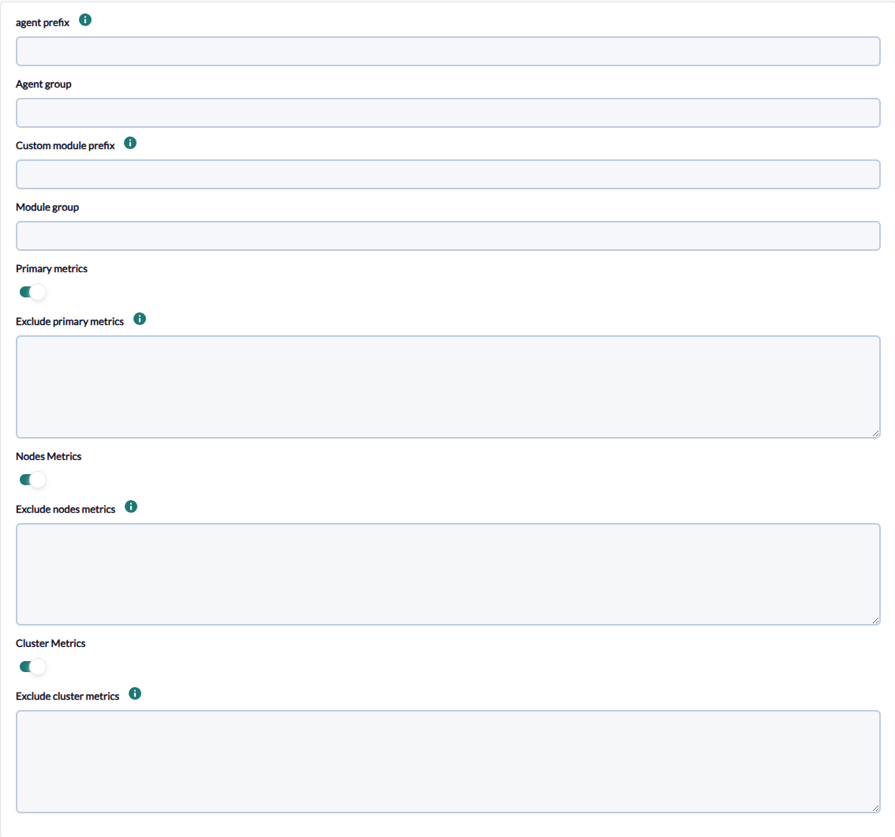
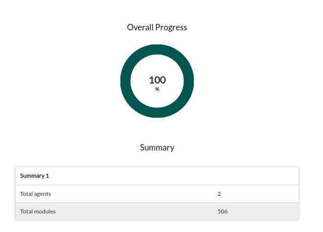

# OpenSearch Discovery

*Article last updated: 2026-10-26.*

## What it monitors

The OpenSearch Discovery addon monitors an OpenSearch cluster through its REST API. It reads the cluster health, the statistics of every node and the aggregated index statistics of the cluster, and turns them into Pandora FMS agents and modules.

A Discovery task generates agents by functional role instead of a single agent per cluster:

- **One cluster agent** with the health of the cluster: status, nodes and shard allocation.
- **One agent per node** with the operating system, process, JVM, thread pool, transport, circuit breaker, cache and disk statistics of that node.
- **One primary metrics agent** with the aggregated index statistics (documents, indexing, search, merges, segments, translog and more) of the primary shards and of all shards.

Each group of agents is optional: you choose which of the three metric groups the task collects, and you can exclude individual modules from each group.

## Prepare

### Compatibility

| Scope | State | Evidence |
|-------|-------|----------|
| Addon `pandorafms.opensearch`, version `1.2` | Documented target | The version this page describes. See [Addon identity](#addon-identity) |
| Network access from the Discovery server to the OpenSearch REST endpoint | `Required` | The addon connects to the IP address and port configured in the task |
| Access to the Nodes stats, Cluster health and Indices stats APIs | `Required` | The addon calls these three APIs; each one is needed only for its metric group |
| OpenSearch versions | `Not validated` | No version matrix has been recorded for this addon |
| Operating system of the Discovery server | `Not validated` | No operating system has been recorded for this version |
| Specific Pandora FMS versions | `Not validated` | No version matrix has been recorded for this addon |

### Prerequisites

1. **Connectivity** from the Discovery server to the OpenSearch HTTP(S) port, usually `9200`.
2. **Access to the cluster APIs**. When the cluster requires authentication, a user and password that can read the cluster health, the node statistics and the index statistics. Credentials are optional: the addon authenticates only when both the user and the password are set.
3. **Pandora FMS**: a Discovery server to run the task, the console to define it and a Tentacle server that receives the generated agent data.

The addon is distributed ready to run, so nothing else has to be installed on the Discovery server to run a task.

### Install the addon

Download the `.disco` package from the Pandora FMS Marketplace entry, which is limited to licensed users:

[https://marketplace.pandorafms.com/entries/pandorafms.opensearch](https://marketplace.pandorafms.com/entries/pandorafms.opensearch)

Load it into Pandora FMS. Once loaded, **OpenSearch** is available in the applications section when creating Discovery tasks.

## Configure the Discovery task

Create the task from the Discovery applications and choose **OpenSearch**. The console presents the fields in two steps; every field is documented in [Task parameters](#task-parameters).

1. **OpenSearch Basic** — connection and data transfer:

    - **OpenSearch IP** and **OpenSearch Port**: address and port of the OpenSearch REST endpoint. Both are mandatory.
    - **User** and **Password**: credentials, both optional.
    - **Verify SSL**: connect over HTTPS. See [Connection security](#connection-security).
    - **Verify Certs**: validate the server certificate.
    - **transfer mode**, **tentacle ip** and **tentacle port**: how and where the generated agent data is sent. They rarely need changing.

    

2. **OpenSearch Detailed** — naming and metric groups:

    - **agent prefix**, **Agent group**, **Custom module prefix** and **Module group**: naming and grouping of the generated agents and modules.
    - **Primary metrics**, **Nodes Metrics** and **Cluster Metrics**: the metric groups to collect. Enabled by default.
    - **Exclude primary metrics**, **Exclude nodes metrics** and **Exclude cluster metrics**: modules to leave out of each group. Each one is shown only when its metric group is enabled.

    

The execution interval comes from the generic task-definition step and is applied as the interval of the generated agents.

### Connection security

- **Verify SSL** controls the protocol: enabled, the addon connects over HTTPS; disabled, it connects over plain HTTP. It is enabled by default.
- **Verify Certs** controls the certificate: enabled, the addon validates the server certificate; disabled (default), it accepts any certificate. Certificate hostname verification is always disabled, even when **Verify Certs** is enabled.
- With **Verify SSL** enabled and **Verify Certs** disabled the traffic is encrypted but the server is not authenticated. Use a network you trust or enable **Verify Certs**.

## Verify the first run

Force the task from the Discovery task list and check the result in this order.

1. **The task summary.** A task that completes reports:

    - **Total Agents**: agents generated.
    - **Total Modules**: modules generated across all agents.

    Errors found while collecting a metric group are recorded in the task's execution information.

    

2. **The agents.** One cluster agent, one primary metrics agent and one agent per node, according to the metric groups you enabled.
3. **The modules.** The cluster agent has `cluster_status`, `number_of_nodes` and `unassigned_shards`, among others; see [Modules per agent](#modules-per-agent).

## Understand the results

### Agents generated

| Agent | Alias | Created when | Cardinality |
|-------|-------|--------------|-------------|
| Primary metrics | `<agent prefix>_primary_metrics` | **Primary metrics** enabled and the statistics could be read | One per task |
| Node | `<agent prefix>_node_metrics_<node name>` | **Nodes Metrics** enabled and the statistics could be read | One per node of the cluster |
| Cluster | `<agent prefix>_cluster_metrics` | **Cluster Metrics** enabled and the statistics could be read | One per task |

Agent identity is derived from the alias, which includes the **agent prefix**. Changing the prefix of a task creates new agents instead of updating the existing ones, and the history of the previous agents is not carried over. Use a different prefix for each cluster, so two tasks never write to the same agents.

The agents are placed in the **Agent group** when one is set, and have no address, operating system or parent.

### Modules per agent

Module names are the metric name, preceded by `<Custom module prefix>_` when a prefix is set.

| Agent | Modules |
|-------|---------|
| Cluster | Cluster name and status (`green`, `yellow` or `red`), number of nodes and data nodes, active, relocating, initializing, unassigned and delayed unassigned shards, active primary shards, pending tasks, unfinished fetches and the percentage of active shards |
| Node | Operating system CPU, load average and memory and swap usage; process CPU, file descriptors and virtual memory; JVM heap, non-heap, memory pools, threads and garbage collection; thread pool statistics; transport and HTTP connections and traffic; circuit breakers; indexing pressure; request cache; disk space; and the index statistics of the node |
| Primary metrics | Index statistics, prefixed `primaries_` for primary shards and `total_` for all shards: documents, store size, indexing, get, search, merges, refresh, flush, warmer, query cache, fielddata, completion, segments, translog, request cache and recovery |

The full list is in [Module reference](#module-reference).

## Operate

### Manual execution

The addon can run outside a Discovery task. The package contains the `pandora_opensearch` executable, which takes the path to a configuration file described in [Configuration file](#configuration-file):

```bash
./pandora_opensearch --conf <PATH_TO_CONFIG>
```

It sends one data file per agent with the configured transfer mode and prints a summary with the total agents and modules created. Errors are listed in the same output.

With `--as_server_plugin 1` the addon is run as a server plugin: it prints no summary, and prints `1` when it created at least one agent without errors and `0` otherwise, including when the configuration file does not exist.

```bash
./pandora_opensearch --as_server_plugin 1 --conf <PATH_TO_CONFIG>
```

The configuration file contains the OpenSearch password in plain text. Protect it with restrictive permissions.

## Troubleshoot

The addon has no verbose or debug flag. Its diagnostic channel is the task's execution information, or the output of the manual execution.

- **`Error: Could not connect to OpenSearch cluster with <host>:<port>`**: also reported as `node` or `primary` instead of `cluster`, depending on the metric group that failed. The endpoint is unreachable, the protocol does not match (see **Verify SSL**) or the credentials are rejected. Check the address, the port and the protocol from the Discovery server.
- **`Error: when attempting to obtain cluster statistics`** and **`Error: when attempting to obtain node data`**: the request reached the cluster but failed. The message includes the error returned by OpenSearch, for example a missing permission.
- **`Unable to obtain OpenSearch metrics.`**: no metric group produced data. Either the three metric groups are disabled or all of them failed; check the other messages.
- **`Error create agent <name>: <error>`**: the agent could not be created or sent.
- **A group of agents is missing**: the metric group is disabled, or its request failed and the cause is in the execution information. The other groups are still generated.
- **A node agent fails after adding an exclusion**: an exclusion that matches the text `node_name` removes the node name the addon needs to create the agent. Use more specific exclusion text.
- **More modules disappeared than expected**: exclusions are case-insensitive regular expressions applied to the metric name without the module prefix, so a short text can match several modules. See [Excluding modules](#excluding-modules).
- **Error reading the configuration file** (`Error file: <path> does not exist`, `Error while reading configuration file`): in manual execution, the path passed to `--conf` is wrong or the file is not readable or well-formed.

## Reference

### Task parameters

#### OpenSearch Basic

| Field | Macro | Type | Required | Default | Description |
|-------|-------|------|----------|---------|-------------|
| OpenSearch IP | `_opensearchIp_` | string | Yes | — | Address of the OpenSearch endpoint |
| OpenSearch Port | `_opensearchPort_` | number | Yes | — | Port of the endpoint, for example `9200`. Must be a number |
| User | `_opensearchUser_` | string | No | empty | Authentication is used only when both **User** and **Password** are set |
| Password | `_opensearchPassword_` | password | No | empty | Password of the user |
| Verify SSL | `_verifySSL_` | checkbox | No | on | Connect over HTTPS when on, over plain HTTP when off |
| Verify Certs | `_verifyCerts_` | checkbox | No | off | Validate the server certificate. Hostname verification stays disabled |
| transfer mode | `_transferMode_` | string | No | `tentacle` | How the agent data is delivered. The default sends it with Tentacle |
| tentacle ip | `_tentacleIp_` | string | No | `127.0.0.1` | Tentacle server that receives the agent data |
| tentacle port | `_tentaclePort_` | number | No | `41121` | Tentacle port |

#### OpenSearch Detailed

| Field | Macro | Type | Required | Default | Description |
|-------|-------|------|----------|---------|-------------|
| agent prefix | `_prefixAgent_` | string | No | empty | Text placed before the alias of every generated agent |
| Agent group | `_agentGroup_` | string | No | empty | Group of the generated agents |
| Custom module prefix | `_prefixModuleName_` | string | No | empty | Text placed before every module name, joined with `_` |
| Module group | `_moduleGroup_` | string | No | empty | Group of the generated modules |
| Primary metrics | `_tokenPrimaryMetrics_` | checkbox | No | on | Collect the aggregated index statistics |
| Exclude primary metrics | `_excludePrimaryMetrics_` | textarea | No | empty | Modules to exclude. Shown when **Primary metrics** is on |
| Nodes Metrics | `_tokenNodesMetrics_` | checkbox | No | on | Collect the statistics of every node |
| Exclude nodes metrics | `_excludeNodesMetrics_` | textarea | No | empty | Modules to exclude. Shown when **Nodes Metrics** is on |
| Cluster Metrics | `_tokenClusterMetrics_` | checkbox | No | on | Collect the cluster health |
| Exclude cluster metrics | `_excludeClusterMetrics_` | textarea | No | empty | Modules to exclude. Shown when **Cluster Metrics** is on |

#### Excluding modules

Each exclusion box accepts a list of entries separated by commas. An entry removes every module of that group whose metric name matches it. Matching is case-insensitive and finds the entry anywhere in the name; entries are interpreted as regular expressions, so an invalid expression makes the metric group fail. For example, `unassigned, active` in **Exclude cluster metrics** removes every cluster module whose name contains `unassigned` or `active`, including `unassigned_shards`, `active_shards` and `active_primary_shards`.

### Configuration file

Used by manual execution. One `key = value` per line. Boolean options accept `1`, `true`, `t`, `yes` or `y` to enable; any other value disables them.

| Key | Required | Default | Description |
|-----|----------|---------|-------------|
| `open_search_ip` | Yes | — | OpenSearch address |
| `open_search_port` | Yes | — | OpenSearch port. Must be a number |
| `user` | No | empty | User. Authentication is used only when `user` and `password` are both set |
| `password` | No | empty | Password |
| `verify_ssl` | No | disabled | Connect over HTTPS |
| `verify_certs` | No | disabled | Validate the server certificate |
| `transfer_mode` | Yes | — | `tentacle` sends the data with Tentacle |
| `tentacle_ip` | Yes | — | Tentacle server address |
| `tentacle_port` | Yes | — | Tentacle server port |
| `agent_prefix` | No | empty | Prefix of the agent aliases |
| `agents_group` | No | empty | Group of the agents |
| `module_prefix` | No | empty | Prefix of the module names |
| `module_group` | No | empty | Group of the modules |
| `token_primary_metrics` | No | disabled | Collect the primary metrics group |
| `exclude_primary_metrics` | No | empty | Modules to exclude from the primary metrics group |
| `token_nodes_metrics` | No | disabled | Collect the nodes group |
| `exclude_nodes_metrics` | No | empty | Modules to exclude from the nodes group |
| `token_cluster_metrics` | No | disabled | Collect the cluster group |
| `exclude_cluster_metrics` | No | empty | Modules to exclude from the cluster group |
| `interval` | No | `0` | Interval of the agents, in seconds. Set it explicitly: a missing value is read as `0` |

Unlike the Discovery task, the metric groups are disabled when their key is missing.

Example:

```ini
open_search_ip          = <OPENSEARCH_HOST>
open_search_port        = 9200
user                    = <USERNAME>
password                = <PASSWORD>
verify_ssl              = true
verify_certs            = false
transfer_mode           = tentacle
tentacle_ip             = <TENTACLE_SERVER_IP>
tentacle_port           = 41121
agent_prefix            = <AGENT_PREFIX>
module_prefix           = opensearch
module_group            = <MODULE_GROUP>
token_primary_metrics   = 0
token_nodes_metrics     = 0
token_cluster_metrics   = 1
exclude_cluster_metrics = unassigned, active
interval                = 300
```

### Module reference

Names are shown without the **Custom module prefix**. A module is created only if it is not excluded.

**Cluster agent**

`cluster_name`, `cluster_status`, `number_of_nodes`, `number_of_data_nodes`, `active_primary_shards`, `active_shards`, `relocating_shards`, `initializing_shards`, `unassigned_shards`, `delayed_unassigned_shards`, `number_of_pending_tasks`, `number_of_in_flight_fetch`, `active_shards_percent_as_number`.

**Node agent**

| Group | Module names |
|-------|--------------|
| Operating system | `os_timestamp`, `os_cpu_percent`, `os_cpu_load_average_1m`, `os_cpu_load_average_5m`, `os_cpu_load_average_15m`, `os_mem_total_in_bytes`, `os_mem_free_in_bytes`, `os_mem_used_in_bytes`, `os_mem_free_percent`, `os_mem_used_percent`, `os_swap_total_in_bytes`, `os_swap_free_in_bytes`, `os_swap_used_in_bytes` |
| Process | `process_timestamp`, `process_open_file_descriptors`, `process_max_file_descriptors`, `process_cpu_percent`, `process_cpu_total_time`, `process_mem_total_virtual_in_bytes` |
| JVM | `jvm_timestamp`, `jvm_uptime_time`, `jvm_mem_heap_*` (used, used percent, committed, max), `jvm_mem_non_heap_*` (used, committed), `jvm_mem_pools_<young\|old\|survivor>_*` (used, max, peak used, peak max), `jvm_threads_count`, `jvm_threads_peak_count`, `jvm_gc_collectors_<young\|old\|G1_Concurrent_GC>_collection_count` and `_collection_time` |
| Thread pools | `thread_pool_<pool>_threads`, `_queue`, `_active`, `_rejected`, `_largest` and `_completed` for the pools `fetch_shard_started`, `fetch_shard_store`, `flush`, `force_merge`, `generic`, `get`, `index_searcher`, `listener`, `management`, `refresh`, `search`, `snapshot`, `warmer` and `write`; plus `thread_pool_index_searcher_total_wait_time_in_nanos` and `thread_pool_search_total_wait_time_in_nanos` |
| Transport and HTTP | `transport_server_open`, `transport_total_outbound_connections`, `transport_rx_count`, `transport_rx_size_in_bytes`, `transport_tx_count`, `transport_tx_size_in_bytes`, `http_current_open`, `http_total_opened` |
| Circuit breakers | `breakers_<fielddata\|request\|in_flight_requests\|parent>_` followed by `limit_size`, `limit_size_in_bytes`, `estimated_size`, `estimated_size_in_bytes`, `overhead` and `tripped` |
| Indexing pressure | `indexing_pressure_memory_current_*`, `indexing_pressure_memory_total_*` and `indexing_pressure_memory_limit_in_bytes` |
| Request cache | `caches_request_cache_size_in_bytes`, `_evictions`, `_hit_count`, `_miss_count`, `_item_count` and `_store_name` |
| Disk | `fs_disk_total`, `fs_disk_avail`, `fs_disk_used`, `fs_disk_percent` |
| Index statistics | The names listed for the primary metrics agent, with a leading `_` instead of the `primaries_` or `total_` prefix |

`fs_disk_total` is created without a value in this version.

**Primary metrics agent**

Every name below appears twice, once with the prefix `primaries_` and once with `total_`.

| Group | Module names (after the prefix) |
|-------|--------------------------------|
| Documents and store | `docs_count`, `docs_deleted`, `store_size_in_bytes`, `store_reserved_in_bytes` |
| Indexing | `indexing_index_total`, `indexing_time`, `indexing_current`, `indexing_failed`, `indexing_delete_total`, `indexing_delete_time`, `indexing_delete_current`, `indexing_noop_update_total`, `indexing_throttle_time` |
| Get | `get_total`, `get_time`, `get_exists_total`, `get_exists_time`, `get_missing_total`, `get_missing_time`, `get_current` |
| Search | `search_open_contexts`, `search_query_*`, `search_concurrent_query_*`, `search_concurrent_avg_slice_count`, `search_fetch_*`, `search_scroll_total`, `search_scroll.time`, `search_scroll_current`, `search_point_time_*`, `search_suggest_*`, `search_search_idle_reactivate_count_total` |
| Merges | `merges_current`, `merges_current_docs`, `merges_current_size_in_bytes`, `merges_total`, `merges_total_time`, `merges_total_docs`, `merges_total_size_in_bytes`, `merges_total_stopped_time`, `merges_total_throttled_time`, `merges_total_auto_throttle_in_bytes` |
| Refresh, flush and warmer | `refresh_total`, `refresh_total_time`, `refresh_external_total`, `refresh_external_total_time`, `refresh_listeners`, `flush_total`, `flush_periodic`, `flush_total_time`, `warmer_current`, `warmer_total`, `warmer_total_time` |
| Caches | `query_cache_*` (memory size, total count, hit count, miss count, cache size, cache count, evictions), `fielddata_memory_size_in_bytes`, `fielddata_evictions`, `completion_size_in_bytes`, `request_cache_*` (memory size, evictions, hit count, miss count) |
| Segments | `segments_count`, `segments_memory_in_bytes` and the per-structure memory modules (`segments_terms_memory_in_bytes`, `segments_stored_fields_memory_in_bytes`, `segments_term_vectors_memory_in_bytes`, `segments_norms_memory_in_bytes`, `segments_points_memory_in_bytes`, `segments_doc_values_memory_in_bytes`, `segments_index_writer_memory_in_bytes`, `segments_version_map_memory_in_bytes`, `segments_fixed_bit_set_memory_in_bytes`), `segments_max_unsafe_auto_id_timestamp` |
| Translog and recovery | `translog_operations`, `translog_size_in_bytes`, `translog_uncommitted_operations`, `translog_uncommitted_size_in_bytes`, `translog_earliest_last_modified_age`, `recovery_current_as_source`, `recovery_current_as_target`, `recovery_throttle_time` |

### Addon identity

| Item | Value |
|------|-------|
| Name | OpenSearch |
| Identifier | `pandorafms.opensearch` |
| Version | `1.2` |
| Type and section | Discovery, `app` |
| Marketplace entry | [pandorafms.opensearch](https://marketplace.pandorafms.com/entries/pandorafms.opensearch), updated 2026-02-26 |
| Availability | The Marketplace entry states that the download is limited to licensed users |
