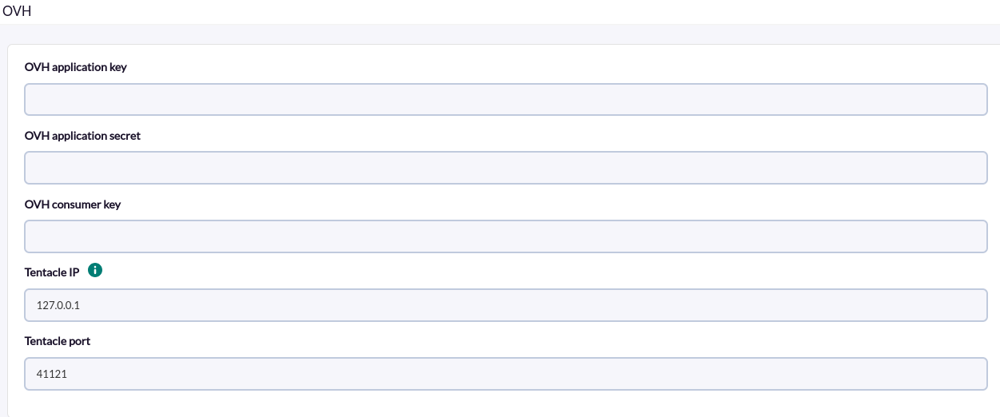
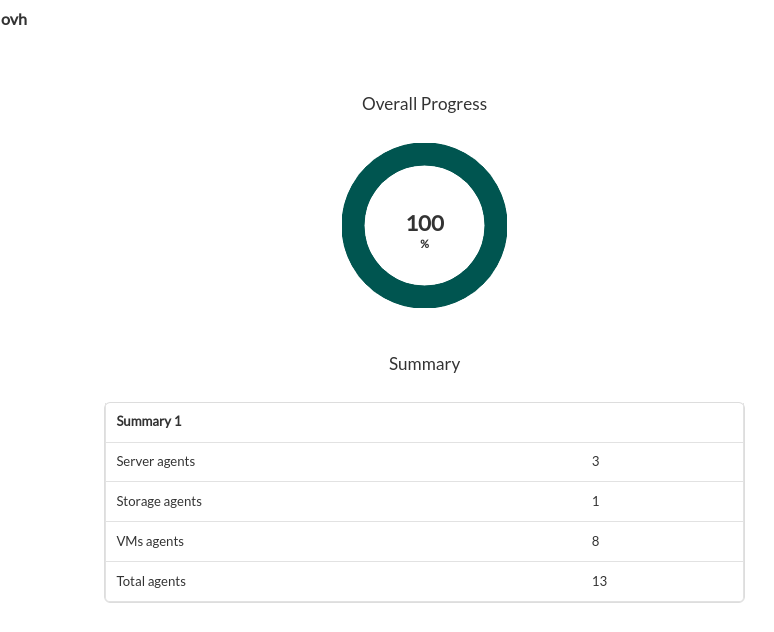

# OVH Discovery

*Article last updated: 2026-10-26.*

## What it monitors

The OVH Discovery addon monitors OVHcloud environments through the OVHcloud API. It turns the result into Pandora FMS agents and modules: the state of Public Cloud instances, optional per-instance CPU, memory and network statistics, Public Cloud volumes, dedicated servers and, optionally, the monthly and overall costs.

A Discovery task generates four kinds of agents:

- **A global agent** named `OVH`, with the number of instances found and, optionally, the cost modules. It is created on every run, except in January when **Get monthly and overall costs** is enabled: the cost calculation for the previous month fails in that month and the global agent is not generated.
- **One agent per virtual machine** (Public Cloud instance), with its state and, optionally, its performance statistics.
- **One agent per volume** (Public Cloud volume), with its status, size and attachment.
- **One agent per dedicated server**, with its status and hardware and location attributes.

## Prepare

### Compatibility

| Scope | State | Evidence |
|-------|-------|----------|
| Addon `pandorafms.ovh`, version `1.1` | Documented target | The version this page describes. See [Addon identity](#addon-identity) |
| Network access from the Discovery server to the OVHcloud API | `Required` | The addon queries the OVHcloud API of the `ovh-eu` endpoint |
| OVHcloud API credentials (application key, application secret and consumer key) | `Required` | Prerequisite, not a compatibility statement |
| Operating system of the Discovery server | `Not validated` | No operating system has been recorded for this version |
| Specific Pandora FMS versions | `Not validated` | No version matrix has been recorded for this addon |

The addon always connects to the `ovh-eu` OVHcloud API endpoint. Accounts that belong to a different OVHcloud API region are not covered by this version.

### Prerequisites

1. **Connectivity** from the Discovery server to the OVHcloud API.
2. **An OVHcloud application key, application secret and consumer key.** The process is described in the OVHcloud guide on getting started with its API: [OVHcloud API getting started](https://help.ovhcloud.com/csm/es-es-api-getting-started-ovhcloud-api?id=kb_article_view&sysparm_article=KB0042785).
3. **Pandora FMS**: a Discovery server to run the task and the console to define it.

### OVHcloud API access

The addon only issues read requests (`GET`). The consumer key must be authorized for the paths that correspond to the options you enable:

| Path | Used for |
|------|----------|
| `/cloud/project` and `/cloud/project/{project}` | Listing Public Cloud projects (always) |
| `/cloud/project/{project}/instance` | Listing virtual machines (always) |
| `/cloud/project/{project}/instance/{instance}/monitoring` | CPU, memory and network statistics (when **Advanced statistics** is enabled) |
| `/cloud/project/{project}/volume` | Volumes (when **Scan Volumes** is enabled) |
| `/dedicated/server` and `/dedicated/server/{server}` | Dedicated servers (when **Scan Servers** is enabled) |
| `/me/bill` and `/me/bill/{bill}` | Costs (when **Get monthly and overall costs** is enabled) |

The application secret and consumer key are credentials: do not share them and do not paste them in tickets or screenshots.

### Install the addon

Download the `.disco` package from the Pandora FMS Marketplace entry, which is limited to licensed users:

[https://marketplace.pandorafms.com/entries/pandorafms.ovh](https://marketplace.pandorafms.com/entries/pandorafms.ovh)

Load it into Pandora FMS. Once loaded, **OVH** is available in the **Cloud** section when creating Discovery tasks.

## Configure the Discovery task

Create the task from **Management > Discovery > Cloud** and choose **OVH**. The console presents the fields in two steps; every field is documented in [Task parameters](#task-parameters).

1. **OVH base** — credentials and where the generated agent data is sent:

    - **OVH application key**, **OVH application secret** and **OVH consumer key**: the OVHcloud API credentials.
    - **Tentacle IP** and **Tentacle port**: where the generated agent data is sent. They rarely need changing.

    

2. **OVH detailed** — the resources to monitor:

    - **Scan Volumes**, **Scan Servers** and **Monitor virtual machines**: which resource types get agents.
    - **Get monthly and overall costs**: adds the cost modules to the global agent.
    - **Advanced statistics**: shown only when **Monitor virtual machines** is enabled; adds the performance modules to the virtual machine agents.
    - **Autodisabled agents**: creates the agents in disabled mode.

    <!-- SCREENSHOT NEEDED: OVH detailed wizard step showing all six options, including Autodisabled agents (the available legacy capture omits it). -->

The task's group and interval come from the generic task-definition step and are applied to the agents the task creates.

Enabling **Advanced statistics** and **Get monthly and overall costs** can lengthen the task execution, because each requires additional OVHcloud API requests.

## Verify the first run

Force the task from the Discovery task list and check the result in this order.

1. **The task summary.** A task that completes successfully reports:

    - **Total agents**: all agents generated, including the global agent.
    - **VMs agents**: virtual machine agents.
    - **Storage agents**: volume agents.
    - **Server agents**: dedicated server agents.

    A task that does not complete successfully records the errors in its execution information instead.

    

2. **The agents.** The global agent plus one agent per virtual machine, volume and dedicated server found, according to the options enabled.
3. **The modules.** The global agent has `OVH VMs count`; every virtual machine agent has `<VM name>.status`. See [Understand the results](#understand-the-results).

## Understand the results

### Agents generated

| Agent | Alias | Address | Notes |
|-------|-------|---------|-------|
| Global agent | `OVH` | None | Created on every run, except in January when **Get monthly and overall costs** is enabled |
| Virtual machine agent | The instance name | The instance IPv4 address; empty when it has none | One per instance name of every Public Cloud project: instances with the same name in different projects share one agent. Created only when **Monitor virtual machines** is enabled. The description includes the instance region |
| Volume agent | The volume name | None | Created only when **Scan Volumes** is enabled |
| Dedicated server agent | The server name | The server IP address | Created only when **Scan Servers** is enabled |

All agents are created in the task group. When **Autodisabled agents** is enabled they are created in disabled mode.

### Modules per agent

**Global agent**

| Module | Type | Condition | Description |
|--------|------|-----------|-------------|
| `OVH VMs count` | `generic_data` | Always | Instances found across all Public Cloud projects, regardless of **Monitor virtual machines** |
| `OVH total costs` | `generic_data` | **Get monthly and overall costs** | Sum of the invoices of the account, with taxes |
| `OVH month costs` | `generic_data` | **Get monthly and overall costs** | Sum, with taxes, of the invoices dated from the first day of the previous month up to the moment of the run |

**Virtual machine agent**

| Module | Type | Condition | Description |
|--------|------|-----------|-------------|
| `<VM name>.status` | `generic_proc` | Always | `1` when the instance status is `ACTIVE`, `0` otherwise |
| `<VM name>cpu:max`, `<VM name>cpu:used` | `generic_data` | **Advanced statistics** | CPU statistics reported by OVHcloud |
| `<VM name>mem:max`, `<VM name>mem:used` | `generic_data` | **Advanced statistics** | Memory statistics reported by OVHcloud |
| `<VM name>net:rx`, `<VM name>net:tx` | `generic_data` | **Advanced statistics** | Network received and sent, as reported by OVHcloud |

The statistics module names are the instance name immediately followed by the metric, with no separator before `cpu`, `mem` or `net`. Each value is the latest data point that OVHcloud returns for the last week.

**Volume agent**

| Module | Type | Description |
|--------|------|-------------|
| `<volume name>.status` | `generic_data_string` | Volume status |
| `<volume name>.size` | `generic_data` | Volume size |
| `<volume name>.type` | `generic_data_string` | Volume type |
| `<volume name>.bootable` | `generic_data_string` | Whether the volume is bootable |
| `<volume name>.region` | `generic_data_string` | Region of the volume |
| `<volume name>.creationDate` | `generic_data_string` | Creation date |
| `<volume name>.attachedTo` | `generic_data_string` | Identifiers of the instances the volume is attached to, separated by spaces |

**Dedicated server agent**

| Module | Type | Description |
|--------|------|-------------|
| `<server name>.status` | `generic_proc` | `1` when the server state is `ok`, `0` otherwise |
| `<server name>.powerState` | `generic_data_string` | Power state |
| `<server name>.datacenter` | `generic_data_string` | Data center |
| `<server name>.region` | `generic_data_string` | Region |
| `<server name>.linkSpeed` | `generic_data` | Link speed |
| `<server name>.availabilityZone` | `generic_data_string` | Availability zone |
| `<server name>.os` | `generic_data_string` | Operating system |
| `<server name>.rack` | `generic_data_string` | Rack |
| `<server name>.reverse` | `generic_data_string` | Reverse DNS |
| `<server name>.supportLevel` | `generic_data_string` | Support level |
| `<server name>.commercialRange` | `generic_data_string` | Commercial range |

### How agent identity works

Each agent is identified by a hash of its prefix and name; volume and dedicated server agents also include the OVHcloud identifier of the resource. Agents with the same identity keep reporting to the same Pandora FMS agent between runs, so renaming a virtual machine in OVHcloud produces a new agent.

## Operate

### Manual execution

The addon can run outside a Discovery task. The executable takes a single parameter, the path to a configuration file described in [Configuration file](#configuration-file):

```bash
./pandora_ovh --conf <PATH_TO_CONFIG>
```

It prints a JSON summary and sends one data file per agent using the configured transfer mode:

```json
{"summary": {"Total agents": 13, "VMs agents": 8, "Storage agents": 1, "Server agents": 3}}
```

When errors occur, the JSON also contains an `info` key with the messages and the exit code is `1`. In `tentacle` mode the `tentacle_client` executable must be available in the `PATH` of the user running the addon.

A configuration file contains the OVHcloud credentials. Protect it with restrictive permissions.

## Troubleshoot

The addon has no verbose or debug flag. Its diagnostic channel is the `info` field of the JSON execution result, which is shown in the task's execution information.

- **`Error: Connector Cannot create client to OVH API`**: the OVHcloud API client could not be created with the credentials provided.
- **`Error getting instances: Unexpected error`**: the Public Cloud projects or instances could not be listed. Check connectivity, the three credentials and that the consumer key is authorized for `/cloud/project`.
- **`Error: Getting volumes`, `Error: Getting servers` or `Error: Getting costs`**: the corresponding request failed; the message includes the error returned by OVHcloud. Check the matching path in [OVHcloud API access](#ovhcloud-api-access).
- **`Error: Getting metrics ... for instance: <id>`**: statistics could not be obtained for that instance. Its other modules are still generated.
- **`Error while reading configuration file`**: the configuration file given to `--conf` cannot be read (manual execution).
- **No virtual machine agents**: **Monitor virtual machines** is disabled. The global agent still reports the number of instances found.
- **No statistics modules**: **Advanced statistics** is disabled, or **Monitor virtual machines** is.
- **Fewer agents than expected**: only the resource types enabled in the task are created, and only the Public Cloud projects, volumes and dedicated servers visible to the credentials are scanned.

## Reference

### Task parameters

#### OVH base

| Field | Macro | Type | Default | Notes |
|-------|-------|------|---------|-------|
| OVH application key | `_applicationKey_` | password | — | Mandatory. OVHcloud application key |
| OVH application secret | `_applicationSecret_` | password | — | Mandatory. OVHcloud application secret |
| OVH consumer key | `_consumerKey_` | password | — | Mandatory. OVHcloud consumer key |
| Tentacle IP | `_tentacleIP_` | string | `127.0.0.1` | Server that receives the agent data |
| Tentacle port | `_tentaclePort_` | number | `41121` | Tentacle port |

#### OVH detailed

| Field | Macro | Type | Default | Notes |
|-------|-------|------|---------|-------|
| Scan Volumes | `_getStorage_` | checkbox | on | Volume agents |
| Scan Servers | `_getServers_` | checkbox | on | Dedicated server agents |
| Get monthly and overall costs | `_getCost_` | checkbox | off | Cost modules in the global agent |
| Monitor virtual machines | `_scanVms_` | checkbox | on | Virtual machine agents |
| Advanced statistics | `_advanceMonitoring_` | checkbox | off | Shown when **Monitor virtual machines** is on. Performance modules |
| Autodisabled agents | `_autodisabledAgents_` | checkbox | off | Creates agents in disabled mode |

### Configuration file

Used by manual execution. One `key = value` per line. Numeric options accept `1` to enable and `0` to disable; a value that is not a number is read as `0`.

| Key | Default | Description |
|-----|---------|-------------|
| `application_key` | — | Mandatory. OVHcloud application key |
| `application_secret` | — | Mandatory. OVHcloud application secret |
| `consumer_key` | — | Mandatory. OVHcloud consumer key |
| `agents_group_name` | `ovh` | Group of the generated agents |
| `interval` | `300` | Agent interval, in seconds |
| `prefix` | empty | Prefix added to every agent alias |
| `transfer_mode` | `local` | `local` or `tentacle` |
| `data_dir` | `/var/spool/pandora/data_in/` | Folder for the data files in `local` mode |
| `tentacle_ip` | `127.0.0.1` | Tentacle server address |
| `tentacle_port` | `41121` | Tentacle server port |
| `scan_vms` | `0` | Virtual machine agents |
| `storage` | `0` | Volume agents |
| `servers` | `0` | Dedicated server agents |
| `cost` | `0` | Cost modules |
| `advance_monitoring` | `0` | Performance modules of virtual machines |
| `autodisabled_agents` | `0` | Create agents in disabled mode |

Unlike the Discovery task, where **Scan Volumes**, **Scan Servers** and **Monitor virtual machines** are on by default, every resource option is `0` in a configuration file unless you set it.

Example:

```ini
application_key     = <APPLICATION_KEY>
application_secret  = <APPLICATION_SECRET>
consumer_key        = <CONSUMER_KEY>

agents_group_name   = OVH
interval            = 300
prefix              = ovh.
transfer_mode       = tentacle
tentacle_ip         = <TENTACLE_SERVER_IP>
tentacle_port       = 41121

scan_vms            = 1
storage             = 1
servers             = 1
cost                = 0
advance_monitoring  = 0
```

### Addon identity

| Item | Value |
|------|-------|
| Name | OVH |
| Identifier | `pandorafms.ovh` |
| Version | `1.1` |
| Type and section | Discovery, `cloud` |
| Marketplace entry | [pandorafms.ovh](https://marketplace.pandorafms.com/entries/pandorafms.ovh), updated 2026-09-09 |
| Availability | The Marketplace entry states that the download is limited to licensed users |
