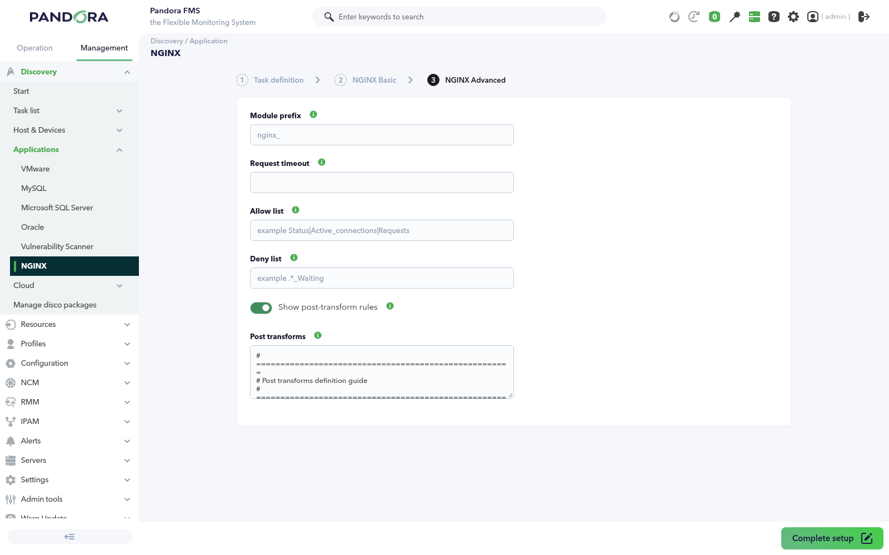

# Post transforms

*Article last updated: 2026-11-23.*

## Overview

Post transforms let the **task operator** enrich the modules a Discovery task
creates — thresholds, string thresholds, tags, module group, alert templates
and flip-flop settings — through ordered regex rules written as plain-text
blocks in the task form. No plugin code changes: the rules travel with the
task and the plugin applies them on every run, over the complete collected
structure, right before the data is sent. A single bad rule is skipped and
reported instead of stopping the monitoring run.

Rules apply before serialization, so the same rules work for a task using
`native` transfer (Discovery JSON) and one using `tentacle` (agent XML).

Plugins opt in by exposing the **Post transforms** field in the wizard.
NGINX is the first plugin that implements it.

## Prepare

### Compatibility

| Scope | State | Evidence |
|-------|-------|----------|
| `pandoraPlugintools-basic` `1.2.0` (Python engine) | `Tested` | Released on PyPI (2026-11-23). Block parser, typed whitelist, both output paths and the report-and-continue error behavior, exercised end-to-end against a Pandora FMS stack; the NGINX package compiled from the requirement against the released artifact passes the same checks |
| `pandoraplugintools-go` (Go engine) | `Tested` | Cross-checked against the Python engine through the shared parity harness (15/15 scenarios, including a partially invalid rules file) |
| Plugin exposing the Post transforms field | `Required` | NGINX `1.2` (pending release) is the first implementation |
| RE2-compatible patterns | `Required` | The Go engine uses RE2: rules must avoid backreferences and lookaround to behave identically in both engines |

### Prerequisites in the console

1. **Module groups must exist.** `set_module_group` resolves the group by
   name at ingestion: a group that does not exist in module group management
   is not applied. Verified against a live stack.
2. **Tags must exist before the run.** `set_tags` carries a
   comma-separated list of tag names; tags are related on module creation
   only when each tag already exists in tag management. Verified: a run
   with non-existent tags created no tag relations; after creating the
   tags and re-running, both tags were related.
3. **Tags and alert templates are applied only when the module is
   created.** The ingestion — common to the native JSON and tentacle XML
   paths, both handled by the same server function — relates tags and
   alert templates in the module-creation branch only. If the module
   already exists from an earlier run, later runs update thresholds,
   module group and the other configuration fields, but never add tag
   relations or alert templates retroactively. Verified in the server
   source (`DataServer::process_module_data`: the tags/alert-template
   block sits in the creation branch only) and against a live stack. To
   get tags or alert templates onto modules created before the rule
   existed, delete the modules — or the agents, letting the task
   recreate them — and run the task again.
4. **Alert templates:** `set_alert_template` references a template by name;
   the server resolves the name in the same creation-only branch
   (code-verified in `DataServer::process_module_data`; not yet exercised
   end-to-end).

## Configure the Discovery task

Every supporting plugin exposes a **Show post-transform rules** switch in
the wizard's advanced step. The switch is purely visual — rules saved in
the task apply on every run regardless of it; clear the rules (or keep
them commented) to disable them. Checking it reveals the rules textarea,
which comes pre-filled with a commented definition guide: remove the
leading `#` of the example lines to apply them, and write one rule per
block; blocks apply in order.



Example — warn when active connections pass one hundred, unbounded above:

```text
transform_begin
transform_name       active connections thresholds
match_module         .*Active_connections.*
set_min_warning      100
set_max_critical     0
set_module_group     Application
set_tags             critical
transform_end
```

Semantics:

- `match_module` (module name) and `match_extra_data` (the plugin's stable
  semantic key) are regexes, substring matching; anchor with `^...$` for a
  full match. Inside a block they are AND-ed, and a rule needs at least
  one.
- Rules apply in order; for each field the last matching rule wins. A
  block that assigns the module group does not stop a later block from
  adding thresholds.
- `name`, `type`, `data`, `value`, `extra_data`, `timestamp` and `status`
  are protected: a rule never rewrites module identity or the collected
  value.
- Threshold ranges are half-open `[min, max)`: the max value itself belongs
  to the next tier. `max_warning=0` / `max_critical=0` mean "no upper
  limit", not the literal zero.
- `set_tags` holds a comma-separated list in one string — the same
  convention as the agent's `module_tags`.

## Verify

1. Run the task with the example rule above (adjusted to the plugin's
   module names).
2. Open the created module: the thresholds, module group and tags from the
   matching rule are applied; modules the rule does not match are
   untouched.
3. Introduce a typo in one rule (`set_min_warnig`) and run again. The task
   finishes, every agent and module is delivered as usual, the task info
   reports the rule with its block and line, the manual run prints the
   same error on stderr, and the run exits non-zero.

## Understand the results

The wizard delivers the textarea as its own rules file to the plugin. A
missing, empty or comments-only file is the not-configured case: the
feature stays off, silently, with a clean run. The plugin loads and
validates every rule once, before collecting anything. Invalid rules are
skipped and reported — never fatal: the monitoring run continues with the
valid rules.

Valid rules are applied over the **complete** collected structure, once it
is finished and before it is serialized: over the whole monitoring payload
in `native` mode, and over each agent's module list right before the XML is
generated in `tentacle` mode. That is why one rule file covers both
transfer modes, and why cross-module information (everything collected in
the run) is available to every rule.

## Troubleshoot

| Symptom | Cause | Fix |
|---------|-------|-----|
| Task info reports `unknown set field ... (not in the whitelist); rule skipped` | Typo in a `set_` key | Use an exact field name from the [whitelist](#set-whitelist) |
| Task info reports `invalid regex in match key ...; rule skipped` | Malformed pattern, or a Python-only construct (backreferences, lookaround) | Fix the pattern; keep it RE2-compatible |
| Task info reports `rule has no match_module or match_extra_data key; rule skipped` | A rule without a selector | Add at least one `match_*` key |
| Thresholds do not appear on a module | The regex does not match that module's name (or its `extra_data` when both keys are used) | Test the pattern against the module name; check AND semantics |
| Numeric thresholds on a text module | Numeric thresholds belong to numeric module types | Set `str_warning`/`str_critical` for string modules |
| Tags are not related to the module | The tags did not exist at run time | Create the tags in tag management and re-run; verified behavior |
| Module group not applied | The group does not exist | Create the group in module group management |

## Reference

### Block grammar

| Key | Type | Meaning |
|-----|------|---------|
| `transform_begin` | delimiter | Opens a rule block. Required |
| `transform_end` | delimiter | Closes a rule block. Required |
| `transform_name` | text | Optional label for logs and error messages |
| `match_module` | regex | Matches the module name (substring; anchor with `^...$`) |
| `match_extra_data` | regex | Matches the module's stable semantic key |
| `set_<field>` | typed value | Writes one whitelisted module field |

Comments (`#`) and blank lines are ignored everywhere. Rule granularity:
one bad key invalidates its whole rule, because applying half of an
intended configuration is worse than skipping it.

### `set_` whitelist

<a id="set-whitelist"></a>

Exactly the module fields the Discovery ingestion already accepts. Unknown
fields are rejected with the block and key that caused it.

Thresholds (numeric):

| Field | Meaning |
|-------|---------|
| `set_min_warning` / `set_max_warning` | Warning range, half-open `[min, max)` |
| `set_min_critical` / `set_max_critical` | Critical range, half-open `[min, max)` |
| `set_min_warning_forced` / `set_max_warning_forced` | Forced warning range |
| `set_min_critical_forced` / `set_max_critical_forced` | Forced critical range |
| `set_min` / `set_max` | Plain module bounds |
| `set_post_process` | Post-process value |

String thresholds:

| Field | Meaning |
|-------|---------|
| `set_str_warning` / `set_str_critical` | String match for warning / critical |
| `set_str_warning_forced` / `set_str_critical_forced` | Forced string variants |

Threshold direction:

| Field | Meaning |
|-------|---------|
| `set_critical_inverse` / `set_warning_inverse` | `0` or `1`: invert the threshold comparison |

Flip-flop and scheduling:

| Field | Meaning |
|-------|---------|
| `set_min_ff_event` | Flip-flop threshold |
| `set_min_ff_event_normal` / `set_min_ff_event_warning` / `set_min_ff_event_critical` | Per-state flip-flop thresholds |
| `set_ff_type` / `set_ff_timeout` / `set_each_ff` | Flip-flop type, timeout and keep-last behavior (`0`/`1` where applicable) |
| `set_module_ff_interval` | Flip-flop interval in seconds |
| `set_interval` | Module interval in seconds |
| `set_crontab` | Module cron schedule |
| `set_quiet` / `set_disabled` | `0` or `1`: silence or disable the module |

Grouping, identification and instructions:

| Field | Meaning |
|-------|---------|
| `set_tags` | Comma-separated tag names, one string; tags must pre-exist |
| `set_module_group` | Module group by name; the group must pre-exist |
| `set_module_parent` / `set_module_parent_unlink` | Parent module relation |
| `set_custom_id` | Custom identifier |
| `set_description` | Module description |
| `set_critical_instructions` / `set_warning_instructions` / `set_unknown_instructions` | Per-state operator instructions |

Alerts:

| Field | Meaning |
|-------|---------|
| `set_alert_template` | Alert template name; repeatable across blocks — each match appends one template |

### Protected fields

`name`, `type`, `data`, `value`, `extra_data`, `timestamp` and `status`
define module identity and the collected value; no rule can write them.

### Error catalog

Every error names its block (and line when known) and ends with
`; rule skipped`:

- `unknown set field '<field>' (not in the whitelist)` — key not in the
  whitelist, or a protected field.
- `field '<field>' is protected and cannot be set`.
- `set_<field> expects a number/an integer/0 or 1` — mistyped value.
- `invalid regex in match key '<key>'` — malformed or non-RE2 pattern.
- `rule has no match_module or match_extra_data key` — selector-less rule.
- `cannot parse line` — a line that is not `key value`.
- `missing transform_end` — rule not closed.
- `content outside a transform block` — stray text between rules.

A missing, empty or comments-only rules file is the **not-configured
case**: silently ignored, exit 0, monitoring as usual. Errors — and a
non-zero error level — come only from malformed rule content.
