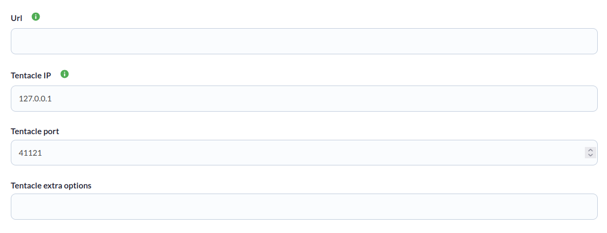
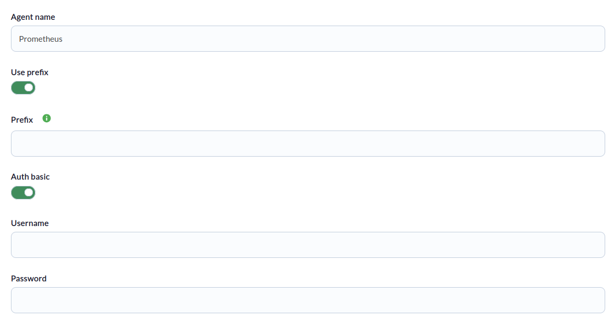
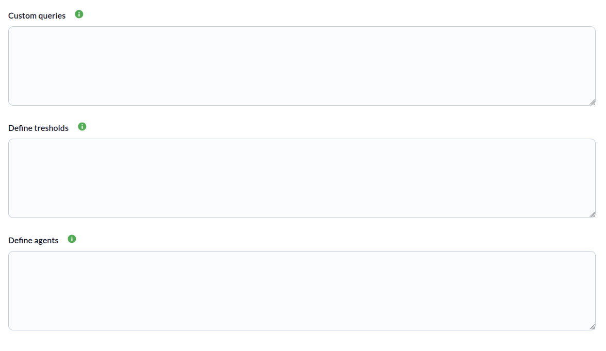

# Prometheus Discovery

*Article last updated: 2026-10-26.*

## What it monitors

The Prometheus Discovery addon turns the results of your own PromQL queries into Pandora FMS modules. A Discovery task connects to the HTTP API of a Prometheus server, runs every query you define and creates agents and modules with the values returned. You decide which metrics are collected, which thresholds the modules carry and which agent each metric belongs to.

A Discovery task generates:

- **A main agent**, named **Agent name** (`Prometheus` by default), which receives every metric that is not assigned to another agent.
- **Additional agents** (optional), one for each distinct agent name you assign to a query.

The addon collects only what your queries return. It defines no queries of its own, so a task without queries generates no modules and reports an error.

## Prepare

### Compatibility

| Scope | State | Evidence |
|-------|-------|----------|
| Addon `pandorafms.prometheus`, version `1.0` | Documented target | The version this page describes. The Marketplace entry offers the package `pandorafms.prometheus.1.0.disco` |
| Network access from the Discovery server to the Prometheus HTTP API | `Required` | The addon calls `<URL>/api/v1/query` |
| Prometheus server versions | `Not validated` | No version matrix has been recorded for this addon |
| Operating system of the Discovery server | `Not validated` | No operating system has been recorded for this version |
| Specific Pandora FMS versions | `Not validated` | The Marketplace states only a general compatibility with Pandora FMS NG 784 and later versions for its entries; no matrix has been recorded for this addon |

### Prerequisites

1. **Connectivity** from the Discovery server to the Prometheus server, for example `http://<PROMETHEUS_HOST>:9090`.
2. **Valid TLS certificate** when the URL uses `https`. The addon always verifies the certificate of the Prometheus server and has no option to disable the verification.
3. **Credentials** only when the Prometheus server is protected with HTTP basic authentication.
4. **Pandora FMS**: a Discovery server to run the task and the console to define it.

Nothing else has to be installed on the Discovery server to run a task.

### Install the addon

Download the `.disco` package from the Pandora FMS Marketplace entry, which is limited to licensed users:

[https://marketplace.pandorafms.com/entries/pandorafms.prometheus](https://marketplace.pandorafms.com/entries/pandorafms.prometheus)

Load it into Pandora FMS. Once loaded, **Prometheus** is available in the application section of the Discovery task wizard.

<!-- SCREENSHOT NEEDED: Discovery application section of the console showing the Prometheus entry, with no real data. -->

## Configure the Discovery task

Create a Discovery task and choose **Prometheus**. The console presents the fields in three steps; every field is documented in [Task parameters](#task-parameters).

1. **prometheus base** — connection:

    - **Url**: address of the Prometheus server, for example `http://<PROMETHEUS_HOST>:9090`. Mandatory. Do not end it with a slash.
    - **Tentacle IP**, **Tentacle port** and **Tentacle extra options**: where the generated agent data is sent. They rarely need changing.

    

2. **prometheus detailed** — agent and authentication options:

    - **Agent name**: name of the main agent.
    - **Use prefix** and **Prefix**: text prepended to the name of every agent created.
    - **Auth basic**, **Username** and **Password**: HTTP basic authentication.

    

3. **prometheus custom** — the queries, three free-text boxes with one definition per line:

    - **Custom queries**: `<METRIC_NAME> = <PROMQL_QUERY>`.
    - **Define tresholds**: `<METRIC_NAME> = <THRESHOLD> <VALUE>|<THRESHOLD> <VALUE>`.
    - **Define agents**: `<METRIC_NAME> = <AGENT_NAME>`.

    

The task's group and interval come from the generic task-definition step and are applied to the agents the task creates.

### Define queries, thresholds and agents

The name before the `=` is the **key** of the metric. It prefixes the name of the modules the query generates and links the query to its threshold and agent lines. Keys are case-insensitive (they are converted to lowercase) and cannot contain `=` or `:`.

```ini
node_cpu_avg = avg_over_time(node_cpu_seconds_total[15m])
up_status = up
cpu_idle_avg = node_cpu_seconds_total{mode="idle",cpu="0"}
disk_free_last = node_filesystem_avail_bytes{mountpoint="/"}
node_cpu_seconds = node_cpu_seconds_total{mode="idle",cpu="0"}[15m]
```

Thresholds, one line per key, with several thresholds separated by `|`:

```ini
cpu_idle_avg = min_critical 75|min_warning 60
```

Agents, one line per key. Keys without a line go to the main agent:

```ini
node_cpu_seconds = Prometheus cpu
```

Rules:

- Lines that start with `#` are comments.
- A threshold or agent line is applied only when a query with the same key exists; otherwise it is ignored.
- Each threshold is a name and a value separated by a space. Items that do not have exactly two words are ignored. The name is passed to the module as is; the addon does not validate it.
- The percent sign (`%`) cannot be used in the three text boxes. It makes the task fail with `Error while reading specification configuration file`.

The query examples above are written for a Prometheus server that exports the `node_exporter` metrics. Adapt the metric names to your own server.

## Verify the first run

Force the task from the Discovery task list and check the result in this order.

1. **The task summary.** A task that completes successfully reports:

    - **Total agents**: agents generated.
    - **Total modules**: modules generated.

    When the task generates no modules, the execution information shows `Error: The task has not generated modules. Please check your access to the environment, permissions, or queries.`

    

2. **The agents.** The main agent and one agent for each name assigned in **Define agents**.

3. **The modules.** One or more modules per query; see [Understand the results](#understand-the-results).

## Understand the results

### Agents generated

| Agent | Alias | Notes |
|-------|-------|-------|
| Main agent | **Prefix** + **Agent name** | Contains every metric without an agent assignment |
| Additional agent | **Prefix** + the name given in **Define agents** | One per distinct name. Several keys can share it |

An agent is created only when it receives at least one module. All agents belong to the task's group and report at the task's interval.

Agent identity is derived from the alias, that is, **Prefix** + agent name, and not from the task or the Prometheus URL. Two tasks that use the same prefix and agent name report to the same agent, even if they point to different Prometheus servers. Use a different **Prefix** per Prometheus server to keep their agents apart.

### Modules generated

Each series returned by a query becomes one module. Its name is the query key followed by the labels of the series, in the form `<KEY> {'label': 'value', ...}`, for example `up_status {'__name__': 'up', 'instance': '<HOST>:9100', 'job': 'node'}`. A query that returns several series therefore creates several modules with the same key.

| Query result | Module type | Value |
|--------------|-------------|-------|
| Instant query, one value per series | `generic_data` | The value returned, as a number |
| Range selector, such as `metric[15m]` | `generic_data_string` | The list of values returned, each one with its timestamp |

Queries with no results are skipped. The thresholds defined for a key are applied to every module of that key.

## Operate

### Manual execution

The addon can run outside a Discovery task. The executable takes a single parameter, the path to the configuration file described in [Configuration file](#configuration-file):

```bash
./pandora_prometheus --conf <PATH_TO_CONFIG>
```

It prints a JSON execution result and sends one data file per agent using the configured transfer mode. The Discovery task uses the same executable with a temporary configuration file built from the task fields.

When a configuration file contains `password`, protect it with restrictive permissions.

### Limitations

- Queries must return instant or range vectors. A query that returns a scalar, such as `scalar(up)`, makes the task fail.
- The addon always verifies TLS certificates.
- Basic authentication is applied only when both **Username** and **Password** are set.
- Every query is an instant query evaluated by Prometheus at the time of the run.

## Troubleshoot

The addon has no verbose or debug mode. Its diagnostic channel is the information field of the execution result, which is shown in the task's execution information.

- **`HTTP Error querying Prometheus: <CODE> ...`**: the server answered with an HTTP status other than 200. The message includes the response body and the failing query. A `401` means the basic authentication is missing or wrong; a `404` usually means an incorrect **Url**. The remaining queries still run.
- **`Prometheus query error: ...`**: Prometheus rejected the query, for example because of a syntax error. The message includes the failing query. The remaining queries still run.
- **`[Error] Please, check and change your configuration ...`**: the task could not complete, followed by the error text. Typical causes are a server that cannot be reached, a TLS certificate that cannot be verified, or a query that returns a scalar.
- **`Error while reading specification configuration file`**: one of the three text boxes is not valid. Check for `%` characters and for lines without `=`.
- **`Error: The task has not generated modules ...`**: no query returned data. Run the same query in the Prometheus expression browser and check **Url**, credentials and query keys.
- **Fewer modules than expected**: queries that return no series produce no modules, and two series that give the same module name are collapsed into one module.
- **Thresholds or agent assignment not applied**: the key in the threshold or agent line does not match a query key. Keys are case-insensitive.
- **Tentacle extra options have no effect**: the addon does not read this value, so it cannot change how the data is sent.

## Reference

### Task parameters

#### prometheus base

| Field | Macro | Type | Required | Default | Description |
|-------|-------|------|----------|---------|-------------|
| Url | `_url_` | string | Yes | — | Prometheus URL, for example `http://localhost:9090` |
| Tentacle IP | `_tentacleIP_` | string | Yes | `127.0.0.1` | Server that receives the agent data |
| Tentacle port | `_tentaclePort_` | number | Yes | `41121` | Tentacle port |
| Tentacle extra options | `_tentacleExtraOpt_` | string | No | — | Not used by the addon |

#### prometheus detailed

| Field | Macro | Type | Required | Default | Description |
|-------|-------|------|----------|---------|-------------|
| Agent name | `_agentName_` | string | Yes | `Prometheus` | Name of the main agent |
| Use prefix | `_usePrefix_` | checkbox | No | off | Shows **Prefix** |
| Prefix | `_prefix_` | string | No | — | Shown when **Use prefix** is on. Prepended to every agent name |
| Auth basic | `_authBasic_` | checkbox | No | off | Shows **Username** and **Password** |
| Username | `_userName_` | string | No | — | Shown when **Auth basic** is on |
| Password | `_password_` | string | No | — | Shown when **Auth basic** is on |

#### prometheus custom

| Field | Macro | Type | Required | Default | Description |
|-------|-------|------|----------|---------|-------------|
| Custom queries | `_configQueries_` | text area | Yes, in practice | Commented example | One `<KEY> = <QUERY>` per line |
| Define tresholds | `_configTresholds_` | text area | No | Commented example | One `<KEY> = <THRESHOLD> <VALUE>\|...` per line |
| Define agents | `_configAgents_` | text area | No | Commented example | One `<KEY> = <AGENT_NAME>` per line |

### Configuration file

The configuration file passed with `--conf` is an INI file. Sections `[QUERIES]`, `[THRESHOLDS]` and `[AGENTS]` take the same lines as the text boxes of the third wizard step. Keys of the `[CONF]` section that are not listed below are ignored.

| Key | Required | Default | Description |
|-----|----------|---------|-------------|
| `url` | Yes | `http://localhost:9090` | Prometheus URL |
| `agents_group` | No | `0` | Numeric group ID for the agents |
| `interval` | No | `300` | Agent interval, in seconds |
| `prefix` | No | empty | Prefix for the agent names. Write it without quotes: quotes become part of the prefix |
| `agent_name` | No | `Prometheus` | Name of the main agent |
| `username` | No | empty | Username for basic authentication |
| `password` | No | empty | Password for basic authentication |
| `transfer_mode` | No | `tentacle` | How the data files are delivered |
| `tentacle_ip` | No | `127.0.0.1` | Tentacle server address |
| `tentacle_port` | No | `41121` | Tentacle port |

```ini
[CONF]
agents_group = <GROUP_ID>
interval = 300
prefix = <PREFIX>
agent_name = Prometheus
url = http://<PROMETHEUS_HOST>:9090
username = <USERNAME>
password = <PASSWORD>
tentacle_ip = <TENTACLE_IP>
tentacle_port = 41121

[QUERIES]
up_status = up
cpu_idle_avg = node_cpu_seconds_total{mode="idle",cpu="0"}
node_cpu_seconds = node_cpu_seconds_total{mode="idle",cpu="0"}[15m]

[THRESHOLDS]
cpu_idle_avg = min_critical 75|min_warning 60

[AGENTS]
node_cpu_seconds = Prometheus cpu
```

### Command line

| Parameter | Required | Default | Description |
|-----------|----------|---------|-------------|
| `-c`, `--conf` | Yes | — | Path to the configuration file. If the file does not exist, the execution ends with `Configuration file not found: <PATH>` |
