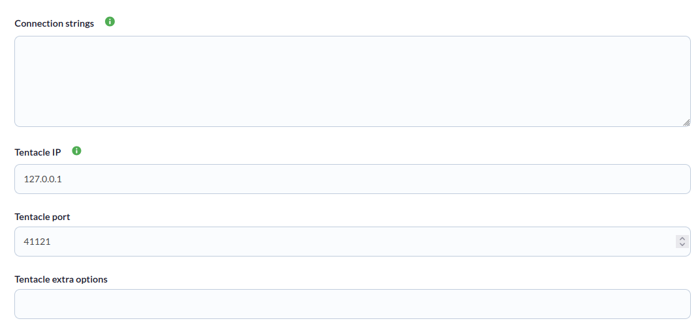
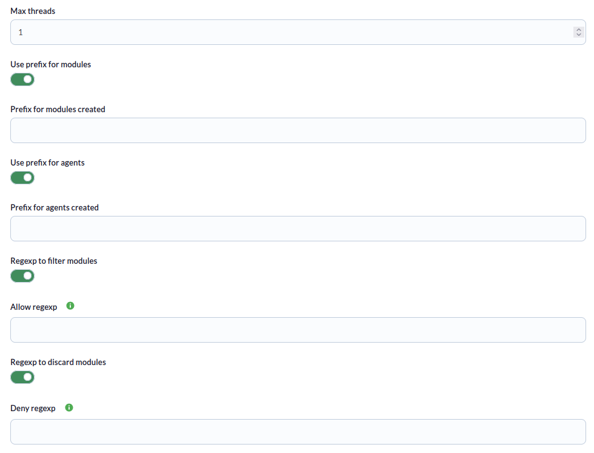
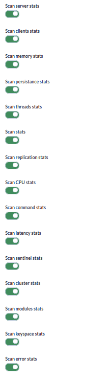
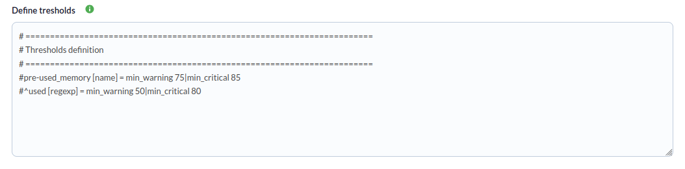
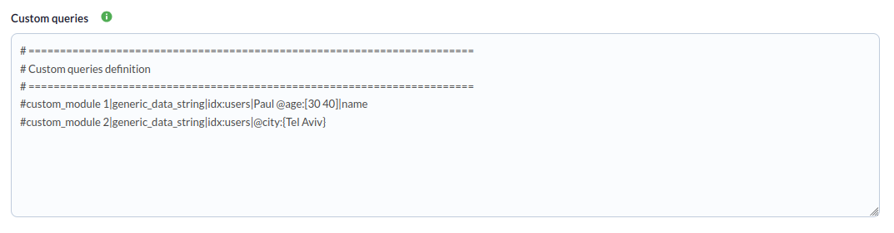
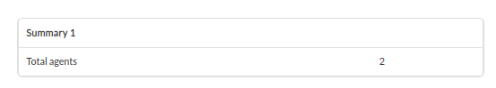

# Redis Discovery

*Article last updated: 2026-10-26.*

## What it monitors

The Redis Discovery addon monitors Redis instances. It connects to each instance you declare, reads its statistics and turns them into Pandora FMS modules: memory usage, connected clients, executed commands, persistence, replication, CPU, latency, keyspace and more. It can also run your own search queries against a Redis search index and publish each result as a module.

The addon creates **one agent per Redis instance**, so a single Discovery task can cover as many instances as you list in its connection strings.

## Prepare

### Compatibility

| Scope | State | Evidence |
|-------|-------|----------|
| Addon version `1.0` (`pandorafms.redis`) | Documented target | The version this page describes. See [Addon identity](#addon-identity) |
| Pandora FMS versions | `Not validated` | The Marketplace carries a general banner for all its integrations, not a statement specific to this addon |
| Network reachability from the Discovery server to every Redis instance | `Required` | The addon opens one connection per instance |
| Redis search capability (`FT.SEARCH`) on the instance | `Required` for custom queries only | Prerequisite of the **Custom queries** feature, not a compatibility statement |
| Any specific Redis release, edition or deployment mode | `Not validated` | No test record is available for a version matrix |
| Host operating system of the Discovery server | `Not validated` | No host operating system has been recorded |

### Prerequisites

1. **Network access** from the Discovery server to each Redis host and port.
2. **A Redis account that can connect and read server information.** When the instance uses ACLs, the user must be allowed to run at least `PING` and `INFO`. Custom queries additionally need permission to run the search command they use (`FT.SEARCH`).
3. **A Redis search index**, only when you define custom queries. The index must already exist on the instance.
4. **Pandora FMS**: a Discovery server to run the task and the console to define it.

Example of an ACL user that can run the base collection:

```
ACL SETUSER <USERNAME> on ><PASSWORD> ~* +info +ping
```

Typing a password in a command exposes it in the shell history. Prefer setting it from a protected configuration file or an interactive client session.

### Availability and license

The Marketplace entry states that the download of this addon is limited to licensed users. The Marketplace lists version `1.0`, last updated on 2026-01-12.

### Install the addon

Load the `.disco` package from the Pandora FMS Marketplace:

[https://marketplace.pandorafms.com/](https://marketplace.pandorafms.com/)

Once loaded, the **Redis** application is available when creating Discovery tasks.

## Configure the Discovery task

Create the task from **Management → Discovery → Applications → Redis**. The console presents the fields in three steps. Every field is documented in [Task parameters](#task-parameters).

1. **Redis base** — which instances to read and where to send the data:

    - **Connection strings**: one Redis connection per line. See [Connection strings](#connection-strings).
    - **Tentacle IP**, **Tentacle port** and **Tentacle extra options**: where the generated agent data is sent. They normally keep their default values.

    

2. **redis detailed** — shape the result:

    - **Max threads**, module and agent prefixes, and the allow and deny regular expressions.
    - One switch per group of Redis statistics. All of them are enabled by default.

    

    

3. **redis custom** — optional **thresholds** for the created modules and **custom queries**.

    

    

The task's own group and interval come from the generic task-definition step. They become the group and the interval of the created agents.

### Connection strings

Write one connection per line, as comma-separated `key=value` pairs. Add `|` followed by a name to choose the agent name:

```
host='<REDIS_HOST_1>', port=6379|<AGENT_NAME>
host='<REDIS_HOST_2>', port=6379
```

- Quotes around text values are optional and removed. `true` and `false` are read as booleans and whole numbers as numbers.
- The pairs are passed to the connection as they are and are not validated by the addon. The shipped examples use `host` and `port` only.
- Do not use a comma inside a value, because the comma separates the pairs.
- **Agent name**: when the line has no `| <name>` suffix, the agent is named `redis_<host>`, where `<host>` is the value of `host` (or `unknown` when the line has no `host`). Two instances on the same host without an explicit name would produce the same agent. **Always give an explicit name when several instances share a host, and keep every name unique.**
- Lines that are empty or start with `#` or `;` are ignored.

Connection strings may contain credentials. They are stored in the task definition; restrict who can edit Discovery tasks accordingly.

### Thresholds

Each line defines the thresholds of one module, or of every module whose name matches a regular expression:

```
<MODULE_NAME_OR_REGEXP> [<TYPE>] = <TAG> <VALUE>|<TAG> <VALUE>
```

- `<TYPE>` is `name` (exact module name) or `regexp` (regular expression searched in the module name). Without a type, `name` is assumed.
- Each `<TAG> <VALUE>` pair is two words separated by a space; pairs are separated by `|`. The shipped examples use `min_warning` and `min_critical`.
- The match is made against the **final module name, including the module prefix**. With the prefix `pre-`, the line must read `pre-used_memory [name] = ...`.
- Only the first matching line applies to a module.
- Lines starting with `#` or `;` are comments. Every other line must contain `=`, otherwise the whole task fails with `Error while reading configuration file`.

```
pre-used_memory [name] = min_warning 75|min_critical 85
pre-used_cpu [regexp] = min_warning 50|min_critical 80
```

### Custom queries

Each line defines one module whose value comes from a Redis search query:

```
<MODULE_NAME>|<MODULE_TYPE>|<INDEX>|<QUERY>|<FIELD>
```

| Part | Required | Description |
|------|----------|-------------|
| `<MODULE_NAME>` | Yes | Name of the module. The module prefix is prepended |
| `<MODULE_TYPE>` | Yes | Pandora FMS module type, for example `generic_data_string`. With `generic_data`, a value that is not a whole number falls back to `generic_data_string` |
| `<INDEX>` | Yes | Name of an existing search index |
| `<QUERY>` | Yes | Search query for that index |
| `<FIELD>` | No | Key to extract from the result document. Applied only when the query returns exactly one document |

```
custom_module 1|generic_data_string|idx:users|Paul @age:[30 40]|name
custom_module 2|generic_data_string|idx:users|@city:{Tel Aviv}
```

- A line with fewer than four parts is skipped silently, and a line cannot contain `|` inside the query.
- When the query returns several documents, the value is the documents as text, one per line, and `<FIELD>` is ignored. When it returns none, the value is empty.
- Custom queries create one module per query in **every** agent of the task, and are not affected by the allow and deny expressions.
- A failing query is reported in the execution information as `[ERROR] Query '<MODULE_NAME>' failed`.

## Verify the first run

Force the task from **Management → Discovery → Task list** and check the result in this order.

1. **The task summary.** A completed task reports **Total agents**, the number of agents it created.

    

2. **The execution information.** Failed connections and failed queries are listed here, for example `[<AGENT_NAME>] Connection failed.` A connection failure does not stop the other instances.
3. **The agents.** One per connection string, named as described in [Connection strings](#connection-strings).
4. **The modules.** Check for `uptime_in_seconds` (server), `connected_clients` (clients) and `used_memory` (memory), according to the enabled switches.

## Understand the results

### Agents and modules generated

- **Agent**: one per connection string. The alias is the agent prefix plus the agent name; the internal agent name is derived from that alias, so changing the prefix or the name creates a new agent.
- **Modules**: one per statistic returned by Redis, named `<module prefix><statistic>`, plus one per custom query. A numeric statistic becomes a `generic_data` module and any other becomes `generic_data_string`.
- **Not created**: a statistic whose value is `0`, empty, or a list does not produce a module. A counter that is `0` at the first run appears when it first has a value.
- **Filters**: the allow and deny expressions are applied to the statistic name **without** the module prefix. The allow expression is evaluated first, then the deny expression.
- A group of statistics is only read when its **Scan** switch is on, and the set of statistics inside a group depends on the Redis version and on the modules loaded in it.

### Statistics groups

| Switch | What it reads |
|--------|---------------|
| Scan server stats | Server identity, process and uptime |
| Scan clients stats | Connected, blocked and tracking clients and client limits |
| Scan memory stats | Memory use, peaks, fragmentation, allocator and eviction policy |
| Scan persistance stats | Snapshot and append-only file state |
| Scan threads stats | Thread information |
| Scan stats | Connections, commands, network traffic, expirations, evictions and hit/miss counters |
| Scan replication stats | Role, replicas and replication backlog |
| Scan CPU stats | CPU time used by the server and its children |
| Scan command stats | Calls and time for each executed command (`cmdstat_<command>`) |
| Scan latency stats | Latency percentiles for each executed command |
| Scan sentinel stats | Sentinel information |
| Scan cluster stats | Whether cluster mode is enabled |
| Scan modules stats | Loaded modules and, with the search module, index statistics (`search_*`) |
| Scan keyspace stats | One entry per database (`db0`, `db1`, ...) |
| Scan error stats | Error counters (`errorstat_<error>`) |

The Marketplace entry lists the statistic names produced by each group in a reference run. A group may hold fewer or more statistics on your Redis version. Command, latency, keyspace and error statistics carry the command, database or error name in the module name, and their value is a composite of several figures.

<!-- SCREENSHOT NEEDED: Agent view of a Redis agent created by the task showing representative modules such as used_memory, connected_clients and uptime_in_seconds, with lab hostnames only. -->

## Operate

The addon can be run by hand with the configuration file the Discovery task builds. This is the fastest way to test connections, queries and thresholds without a Discovery task.

```bash
./pandora_redis --conf <PATH_TO_CONFIG>
```

`--conf` is the only parameter and is required. The run prints the Discovery summary (including **Total agents**) and sends the agent data with Tentacle.

```ini
[CONF]
threads = 1
prefix = pre-
prefix_agents =
agents_group = <GROUP_ID>
interval = 300
tentacle_ip = <TENTACLE_SERVER_IP>
tentacle_port = 41121
allow_regexp =
deny_regexp =
scan_server = 1
scan_clients = 1
scan_memory = 1

[CONNECTION_STRINGS]
host='<REDIS_HOST_1>', port=6379
host='<REDIS_HOST_2>', port=6379|<AGENT_NAME>

[THRESHOLDS]
pre-used_memory [name] = min_warning 75|min_critical 85

[QUERIES]
custom_module 1|generic_data_string|idx:users|Paul @age:[30 40]|name
```

- The section is `[THRESHOLDS]`. A section named `[UMBRALS]` is ignored.
- A `scan_*` key that is omitted is enabled. Set it to `0` to disable it.
- Credentials in a configuration file need the same protection as the task definition. Restrict the file permissions.

**Parallelism**: **Max threads** limits how many Redis instances are processed at the same time. A higher value shortens the run and increases CPU use on the Discovery server.

## Troubleshoot

The addon has no verbose or debug flag. Its diagnostic channel is the execution information of the task.

| Symptom or message | Cause and action |
|--------------------|------------------|
| `[<AGENT_NAME>] Connection failed.` | The instance did not answer `PING`. Check host, port, network path and credentials from the Discovery server. A failed instance creates no agent |
| `[ERROR] Can't create client` / `[ERROR] Can't obtain data` | The connection string could not be used or the information could not be read. Check the syntax and that the user may run `INFO` |
| `Error while reading configuration file` | A thresholds line lacks `=`, or another line of the generated file is malformed. Correct the thresholds |
| `[WARNING] The defined thresholds could not be parsed. Please check your syntax.` | The thresholds block was ignored. Review the format |
| `[WARNING] The defined queries could not be parsed. Please check your syntax.` | The queries block was ignored. Review the format |
| `[ERROR] Query '<MODULE_NAME>' failed: ...` | The index does not exist, the query is invalid, or the user cannot run the search command |
| A query line produces no module | It has fewer than four parts, or it is commented out |
| `Can't aplicate defined thresholds in modules. Check syntax` | Thresholds could not be applied. Review the syntax |
| Thresholds are not applied | The line does not match the final module name, which includes the module prefix |
| Two instances produce one agent | They share a name. Give each connection string a unique `| <name>` |
| An expected module is missing | Its statistic is `0` or empty, its group is disabled, or an allow/deny expression removed it |
| `Tokens_dict must be a non-empty dictionary` | Every **Scan** switch is disabled. Enable at least one |

## Reference

### Task parameters

#### Redis base

| Field | Macro | Type | Required | Default | Description |
|-------|-------|------|----------|---------|-------------|
| Connection strings | `_configConnections_` | textarea | Yes | Empty | One connection per line. See [Connection strings](#connection-strings) |
| Tentacle IP | `_tentacleIP_` | string | Yes | `127.0.0.1` | Tentacle server that receives the agent data |
| Tentacle port | `_tentaclePort_` | number | Yes | `41121` | Tentacle server port |
| Tentacle extra options | `_tentacleExtraOpt_` | string | No | Empty | Present in the console. This version of the addon does not apply it |

#### redis detailed

| Field | Macro | Type | Required | Default | Description |
|-------|-------|------|----------|---------|-------------|
| Max threads | `_threads_` | number | No | `1` | Maximum number of instances processed at the same time. Use a positive whole number |
| Use prefix for modules | `_usePrefixModules_` | checkbox | No | Off | Shows **Prefix for modules created** |
| Prefix for modules created | `_prefixModules_` | string | No | Empty | Prepended to every module name, custom queries included |
| Use prefix for agents | `_usePrefixAgents_` | checkbox | No | Off | Shows **Prefix for agents created** |
| Prefix for agents created | `_prefixAgents_` | string | No | Empty | Prepended to every agent name |
| Regexp to filter modules | `_regexpFilter_` | checkbox | No | Off | Shows **Allow regexp** |
| Allow regexp | `_allowRegexp_` | string | No | Empty | Only statistics whose name matches are created |
| Regexp to discard modules | `_regexpDiscard_` | checkbox | No | Off | Shows **Deny regexp** |
| Deny regexp | `_denyRegexp_` | string | No | Empty | Statistics whose name matches are not created |
| Scan server stats | `_checkServer_` | checkbox | No | On | Configuration key `scan_server` |
| Scan clients stats | `_checkClients_` | checkbox | No | On | `scan_clients` |
| Scan memory stats | `_checkMemory_` | checkbox | No | On | `scan_memory` |
| Scan persistance stats | `_checkPersistance_` | checkbox | No | On | `scan_persistence` |
| Scan threads stats | `_checkThreads_` | checkbox | No | On | `scan_threads` |
| Scan stats | `_checkStats_` | checkbox | No | On | `scan_stats` |
| Scan replication stats | `_checkReplication_` | checkbox | No | On | `scan_replication` |
| Scan CPU stats | `_checkCpu_` | checkbox | No | On | `scan_cpu` |
| Scan command stats | `_checkCommandStats_` | checkbox | No | On | `scan_commandstats` |
| Scan latency stats | `_checkLatencyStats_` | checkbox | No | On | `scan_latencystats` |
| Scan sentinel stats | `_checkSentinel_` | checkbox | No | On | `scan_sentinel` |
| Scan cluster stats | `_checkCluster_` | checkbox | No | On | `scan_cluster` |
| Scan modules stats | `_checkModules_` | checkbox | No | On | `scan_modules` |
| Scan keyspace stats | `_checkKeyspace_` | checkbox | No | On | `scan_keyspace` |
| Scan error stats | `_checkErrorStats_` | checkbox | No | On | `scan_errorstats` |

#### redis custom

| Field | Macro | Type | Required | Default | Description |
|-------|-------|------|----------|---------|-------------|
| Define tresholds | `_configTresholds_` | textarea | No | Commented examples | See [Thresholds](#thresholds) |
| Custom queries | `_configQueries_` | textarea | No | Commented examples | See [Custom queries](#custom-queries) |

### Command-line parameters

| Parameter | Required | Description |
|-----------|----------|-------------|
| `--conf` | Yes | Path to the configuration file |

### Configuration file

| Section | Key | Default if omitted | Description |
|---------|-----|--------------------|-------------|
| `[CONF]` | `threads` | `4` | Instances processed at the same time |
| `[CONF]` | `prefix` | Empty | Module name prefix |
| `[CONF]` | `prefix_agents` | Empty | Agent name prefix |
| `[CONF]` | `agents_group` | Empty | Id of the group of the created agents |
| `[CONF]` | `interval` | `300` | Interval of the created agents, in seconds |
| `[CONF]` | `transfer_mode` | `tentacle` | Data transfer mode. The Discovery task always uses `tentacle` |
| `[CONF]` | `tentacle_ip` | `127.0.0.1` | Tentacle server address |
| `[CONF]` | `tentacle_port` | `41121` | Tentacle server port |
| `[CONF]` | `allow_regexp` | Empty | Allow expression |
| `[CONF]` | `deny_regexp` | Empty | Deny expression |
| `[CONF]` | `scan_server`, `scan_clients`, `scan_memory`, `scan_persistence`, `scan_threads`, `scan_stats`, `scan_replication`, `scan_cpu`, `scan_commandstats`, `scan_latencystats`, `scan_sentinel`, `scan_cluster`, `scan_modules`, `scan_keyspace`, `scan_errorstats` | `1` | `1` reads the group, `0` skips it |
| `[CONNECTION_STRINGS]` | — | — | One connection per line |
| `[THRESHOLDS]` | — | — | One threshold definition per line |
| `[QUERIES]` | — | — | One custom query per line |

### Addon identity

| Field | Value |
|-------|-------|
| App short name | `pandorafms.redis` |
| Addon version | `1.0` |
| Type | Discovery application (`.disco`) |
| Section | Discovery → Applications |
| Marketplace | Download limited to licensed users |
