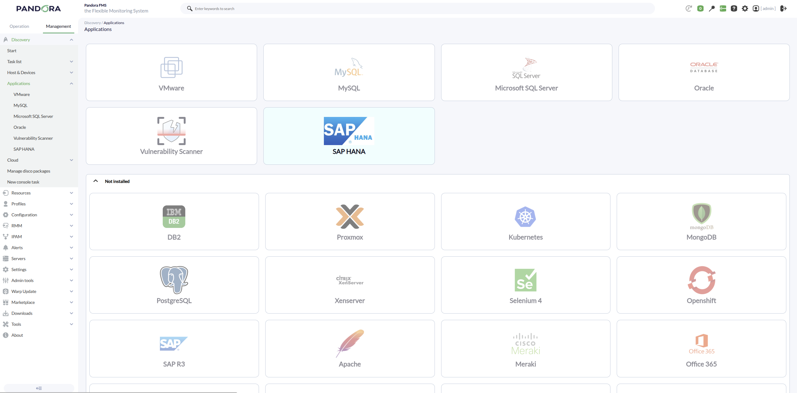
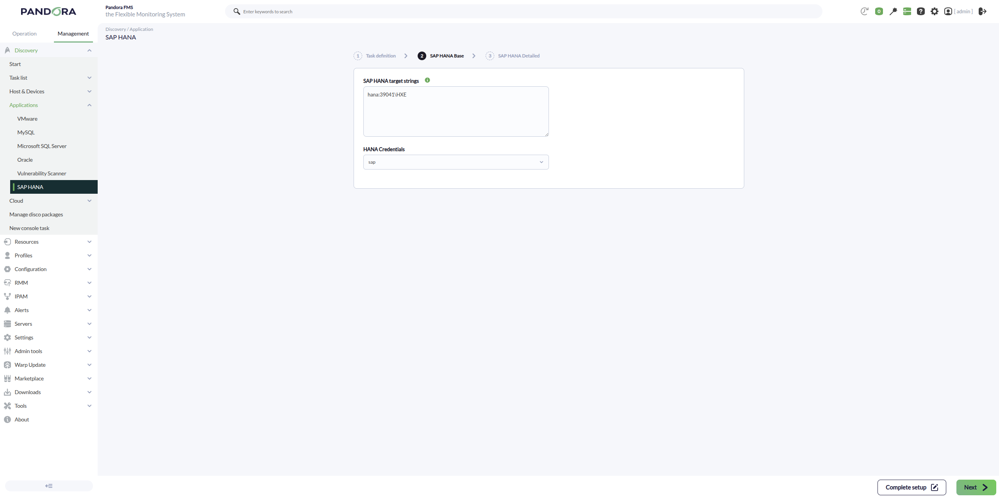
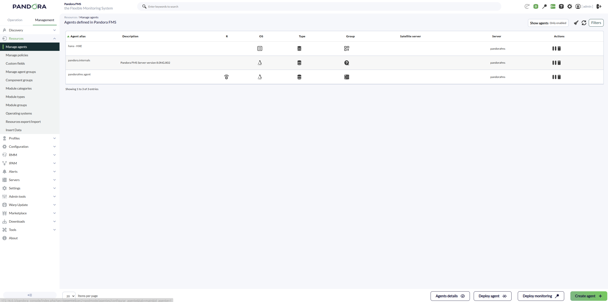

# SAP HANA Discovery

*Article last updated: 2026-10-26.*

## What it monitors

The SAP HANA Discovery plugin connects to one or more SAP HANA databases, runs a set of SQL queries against the system views, and turns the results into Pandora FMS monitoring modules. Out of the box it covers availability, version, memory, connections, transactions, backup size estimation, I/O, CPU, license, row store fragmentation, volumes and per-service statistics. Each group is switched on or off from the task. You can add your own SQL-based modules on top.

The plugin creates **one agent per SAP HANA target**, with an availability module plus one module per enabled metric. A single Discovery task can list several targets, so one task covers a whole set of databases.

## Prepare

### Compatibility

| Scope | State | Evidence |
|-------|-------|----------|
| Add-on version `1.0` (`pandorafms.sap.hana`) | Documented target | Version published in the Marketplace entry, last updated 2026-06-11. See [Plugin identity](#plugin-identity) |
| Pandora FMS NG 784 and later | `Supported` | Statement shown on the Marketplace for all its integrations |
| SAP HANA SQL port reachable from the Discovery server | `Required` | The plugin opens one database connection per target |
| A database user able to read the `SYS` monitoring views | `Required` | Prerequisite, not a compatibility statement. See [Prerequisites](#prerequisites) |
| Any specific SAP HANA release | `Not validated` | No release or edition matrix has been recorded |

The add-on download is limited to licensed users, according to its Marketplace entry. This page does not describe any further license terms.

### Prerequisites

1. **Network access** from the machine that runs the Discovery task to the SQL port of every SAP HANA target.
2. **A database user and password** for SAP HANA. The plugin runs only `SELECT` statements in its built-in checks, against these system views: `SYS.M_DATABASE`, `SYS.M_HOST_RESOURCE_UTILIZATION`, `SYS.M_SERVICE_STATISTICS`, `SYS.M_CONNECTIONS`, `SYS.M_BLOCKED_TRANSACTIONS`, `SYS.M_TRANSACTIONS`, `SYS.M_VOLUMES`, `SYS.M_VOLUME_IO_TOTAL_STATISTICS`, `SYS.M_RS_MEMORY`, `SYS.M_CONVERTER_STATISTICS` and `SYS.M_LICENSE`. It also reads the catalog views `SYS.OBJECTS`, `SYS.VIEWS`, `SYS.TABLES`, `SYS.VIEW_COLUMNS` and `SYS.TABLE_COLUMNS` to check which views and columns exist, and queries `DUMMY` for the timestamp and connection probes. The user must be able to read the views behind the groups you enable; no narrower privilege set is documented. A view the user cannot read produces a module with an empty value rather than a failure of the whole task.
3. **A Pandora FMS credential of type Custom** in the credential store, holding that user and password. Both are required.
4. **Pandora FMS**: a Discovery server to execute the task, and the console to define it.

The plugin is distributed as a self-contained package, so nothing else has to be installed on the Discovery server.

### Install the plugin

Load the `.disco` package from the Pandora FMS Marketplace:

[https://marketplace.pandorafms.com/entries/pandorafms.sap.hana](https://marketplace.pandorafms.com/entries/pandorafms.sap.hana)

Once loaded, the **SAP HANA** application is available when creating Discovery tasks.

### Create the credential

1. In the Pandora FMS console, open the credential store and create a new credential of type **Custom**.
2. Enter the SAP HANA **user** and **password**.
3. Give it an identifier you will recognize when choosing it in the task.

<!-- SCREENSHOT NEEDED: Credential store form for a Custom credential with placeholder user and password and no real secrets, showing how the SAP HANA credential is created. -->

The credential is stored in the console and referenced by the task, so the password is not written in the task fields.

## Configure the Discovery task

Create the task from **Management → Discovery → Application → SAP HANA**. The console presents the fields in two steps, and every field is documented in [Task parameters](#task-parameters).



1. **SAP HANA Base** — the targets and how to authenticate:

    - **SAP HANA target strings**: one target per line, or several separated by commas, in the form `HOST:PORT\DATABASE`. Lines starting with `#` are comments. **Each valid target generates one agent.**
    - **HANA Credentials**: the Custom credential created above.

    

2. **SAP HANA Detailed** — optional shaping of the result:

    - **Max threads** and **Target agent**.
    - **Regexp to filter modules** with **Allow regexp**, and **Regexp to discard modules** with **Deny regexp**.
    - One checkbox per built-in metric group. The defaults are listed in [Task parameters](#task-parameters).
    - **Execute custom queries** and **Custom queries**.
    - **Custom module prefix**.
    - **Custom modules (legacy)**.

    <!-- SCREENSHOT NEEDED: SAP HANA Detailed wizard step showing the metric group checkboxes, the regular expression filters and the custom queries textarea. -->

The task's own agent group and interval come from the generic task-definition step and are applied to the agents and modules the plugin creates.

### Target string format

A target is written as `HOST:PORT\DATABASE`, for example:

```
<HANA_HOST_1>:<SQL_PORT>\<DATABASE_NAME>
<HANA_HOST_2>:<SQL_PORT>\<DATABASE_NAME>
# <HANA_HOST_3>:<SQL_PORT>\<DATABASE_NAME>
```

- `HOST` may be a name or an IP address. A name must resolve from the Discovery server.
- `PORT` is the numeric SQL port of the instance or database. It is required.
- `DATABASE` is passed to SAP HANA as the database name to connect to.
- A `:` is also accepted in place of `\` before the database name.

A line that does not match this format is not monitored and is counted in **Targets down**. See [Troubleshoot](#troubleshoot).

### Map targets to agent names

By default each agent is named `HOST - DATABASE`. To choose the names yourself, fill **Target agent** with one agent name per line, **in the same order** as the target strings. Empty lines and lines starting with `#` are discarded from both lists, so names are assigned by position among the valid targets: a blank line does not leave that target with its default name, it shifts every name after it to the previous target. The name is used both as agent name and alias.

## Verify the first run

Force the task from **Management → Discovery → Task list** and check the result in this order.

1. **The task summary.** The execution reports:

    - **Total agents**: agents generated by the task.
    - **Targets up**: targets the plugin connected to.
    - **Targets down**: targets that could not be monitored.

    Expect one agent per valid, reachable target. Each failed target adds a line to the execution information with its host, port, database and the reason.

    <!-- SCREENSHOT NEEDED: Discovery task execution summary for a SAP HANA task showing Total agents, Targets up and Targets down. -->

2. **The agents.** One per target, with the address set to the target host and the operating system field set to `SAP HANA`.

    

3. **The modules on each agent.** With the default options a reachable target produces:

    | Module | Expected value |
    |--------|----------------|
    | `hana_availability` | `1` — the plugin connected to the database |
    | `version` | SAP HANA version string |
    | `backups_estimated_size_bytes` | Estimated size in bytes |
    | `connections_total`, `connections_running`, `connections_idle` | Connection counts |
    | `memory_used_bytes`, `memory_allocation_limit_bytes` | Memory in bytes |
    | `blocked_transactions`, `open_transactions` | Transaction counts |

    Module names carry the **Custom module prefix** when one was set, and the regular expression filters can remove any module except `hana_availability`.

If the task reports no agents, check **Targets down** and the execution information, and work through [Troubleshoot](#troubleshoot).

## Understand the results

### Agents and modules generated

The plugin creates **one agent per target string**. The agent name and alias are `HOST - DATABASE`, or the name you supplied in **Target agent**. Two targets that resolve to the same name report to the same agent.

`hana_availability` is a `generic_proc` module with value `1` whenever the plugin connected to the target. It is always created for a reachable target and is not affected by the allow or deny expressions. A target that cannot be reached creates no agent and no `0` value: it is reported only in the execution information and in **Targets down**.

When a query fails or the view does not exist in that SAP HANA environment, the module is still created with an empty value. Metric modules otherwise are `generic_data` (numbers) or `generic_data_string` (text).

### Module groups

The groups below are switched by the task checkboxes. The exact modules of each group are listed in [Agents and modules](#agents-and-modules).

| Group (checkbox) | Default | What it provides |
|------------------|---------|------------------|
| Enable Backups Size | On | Estimated backup size in bytes |
| Enable Timestamp | Off | Current UTC timestamp of the database |
| Enable Hana Version | On | SAP HANA version |
| Enable Data Disk Information | Off | Number of volumes and of volume I/O entries |
| Enable Hana Service Statistics | Off | Status, memory, CPU, requests and threads of each service |
| Enable Hana CPU Time | Off | Aggregated CPU time of the services |
| Enable Hana RS Fragmentation | Off | Row store fragmentation percentage |
| Enable Hana License | Off | License records, expiration date and usage |
| Enable Hana IO Stats | Off | Accumulated bytes read and written, and I/O time |
| Enable Hana Get Stated Connections | On | Total, running and idle connections |
| Enable Hana Memory | On | Memory used and allocation limit |
| Enable Hana Transactions | On | Blocked and open transactions |

## Operate

### Custom queries

With **Execute custom queries** enabled, you can define extra modules as SQL queries in **Custom queries**. The task is delivered with a commented template of the format. Each module is a `check_begin` / `check_end` block, with one `key value` pair per line:

```
check_begin
name custom_running_connections
description Connections in RUNNING state
operation value
target SELECT COUNT(*) FROM SYS.M_CONNECTIONS WHERE CONNECTION_STATUS = 'RUNNING'
datatype generic_data
unit conns
check_end

check_begin
name custom_service_status
description Status of every service
operation full
target SELECT HOST, SERVICE_NAME, ACTIVE_STATUS FROM SYS.M_SERVICE_STATISTICS
datatype generic_data_string
check_end
```

These examples were checked against the plugin's parser; they were not executed against a live SAP HANA system.

Rules:

- `name`, `target` and `datatype` are required in every block. A block without them is ignored.
- `target` must be on a single line. Blank lines and lines starting with `#` are skipped.
- `operation value` (default) takes the first column of the first row. If the query returns no rows or a null, the value is `0`. `operation full` returns every row, columns joined by `;` and rows by line breaks, as text: a `datatype` of `generic_data` is converted to `generic_data_string`.
- `$__self_dbname` in the query is replaced by the database name of the target being queried.
- By default a block runs on every target. Limit it with `target_instances` (comma-separated `HOST:PORT` values, written exactly as in the target string), `target_databases`, and `ignore_databases`. `target_scope` selects which of these filters apply: `instances` applies only the instance filter, `databases` applies only the database filters, and `all` (default) applies both.
- A failed query still creates the module, with an empty value.
- Custom modules are subject to **Custom module prefix** and to the allow and deny expressions.

The template also lists the keys `min_warning`, `max_warning`, `min_critical`, `max_critical`, `inverse_warning`, `inverse_critical`, `str_warning`, `str_critical`, `interval` and `parent`. The current version reads them but does not apply them to the created modules, so configure thresholds and intervals on the modules afterwards from the console.

### Legacy custom modules

**Custom modules (legacy)** accepts one module per line in the format:

```
module_name:SQL_query:datatype:description
```

`datatype` must be `generic_data`, `generic_data_string` or `generic_proc`; `description` is optional. The query may itself contain `:` characters. These modules are created even when **Execute custom queries** is disabled. Use custom queries for new definitions.

### Limitations

- The `Max threads` value is accepted by the task but does not change how the targets are processed in this version: targets are queried one after another.
- The connection uses the database user and password from the credential. The plugin has no field to select encryption options.

## Troubleshoot

The plugin has no debug option in the task. Its diagnostic channel is the execution summary and the execution information of the Discovery task.

- **`Missing required parameters`** — the credential has no user or no password, or the target list is empty after removing comments. The summary shows which of them is missing.
- **`No agents generated`** — no target could be monitored. Read the `Target down` lines in the execution information.
- **`Target down HOST:PORT\DATABASE - Cannot resolve hostname`** — the Discovery server cannot resolve the name. Use an IP address or fix the DNS resolution.
- **`Target down ... - SAP HANA connection failed: ...`** — the database refused the connection or the credentials. Check the port, the database name, the user and the password, and that the Discovery server reaches the SQL port.
- **Targets down is greater than the failures listed** — a line that does not follow `HOST:PORT\DATABASE` is counted as down without a message. Check the format of every target string.
- **A module exists with an empty value** — the query behind it failed or the view is not available in that SAP HANA environment, for example because the user cannot read it. Run the same `SELECT` with that user to see the database error.
- **Expected modules are missing** — a **Allow regexp** or **Deny regexp** removed them. The expressions are matched anywhere in the module name (including the prefix), and an invalid expression is ignored silently.
- **Metrics from another group do not appear** — only the groups with their checkbox enabled create modules. See [Module groups](#module-groups).

## Reference

### Task parameters

#### SAP HANA Base

| Field | Required | Default | Description |
|-------|----------|---------|-------------|
| SAP HANA target strings (`_dbstrings_`) | Yes | — | Targets as `HOST:PORT\DATABASE`, one per line or comma-separated. `#` starts a comment line. |
| HANA Credentials (`_credentials_`) | Yes | — | Custom credential holding the user and password. |

#### SAP HANA Detailed

| Field | Required | Default | Description |
|-------|----------|---------|-------------|
| Max threads (`_threads_`) | No | `1` | Accepted by the task; no effect on processing in this version. |
| Target agent (`_targetAgent_`) | No | empty | One agent name per target, in the same order. Empty: `HOST - DATABASE`. |
| Regexp to filter modules (`_regexpFilter_`) | No | Off | Shows **Allow regexp**. |
| Allow regexp (`_allowRegexp_`) | No | empty | Only modules whose name matches are created. |
| Regexp to discard modules (`_regexpDiscard_`) | No | Off | Shows **Deny regexp**. |
| Deny regexp (`_denyRegexp_`) | No | empty | Modules whose name matches are not created. |
| Enable Backups Size | No | On | See [Agents and modules](#agents-and-modules). |
| Enable Timestamp | No | Off | |
| Enable Hana Version | No | On | |
| Enable Data Disk Information | No | Off | |
| Enable Hana Service Statistics | No | Off | |
| Enable Hana CPU Time | No | Off | |
| Enable Hana RS Fragmentation | No | Off | |
| Enable Hana License | No | Off | |
| Enable Hana IO Stats | No | Off | |
| Enable Hana Get Stated Connections | No | On | |
| Enable Hana Memory | No | On | |
| Enable Hana Transactions | No | On | |
| Execute custom queries (`_executeCustomQueries_`) | No | On | Shows **Custom queries**. |
| Custom queries (`_customQueries_`) | No | Commented template | `check_begin` / `check_end` blocks. See [Custom queries](#custom-queries). |
| Custom module prefix (`_prefixModuleName_`) | No | empty | Text prepended to the name of every module the task creates. |
| Custom modules (legacy) | No | empty | `module_name:SQL_query:datatype:description` lines. |

The agent group and the module interval come from the generic task definition.

### Agents and modules

The prefix is shown as `<prefix>` and is empty unless **Custom module prefix** is set. Units are those reported by the plugin.

| Module | Type | Condition |
|--------|------|-----------|
| `<prefix>hana_availability` | `generic_proc` | Always, for a reachable target |
| `<prefix>backups_estimated_size_bytes` | `generic_data` (bytes) | Backups Size. Sum of the allocated page size of the converter statistics, a best-effort estimate and not the size of the backup files |
| `<prefix>timestamp` | `generic_data_string` | Timestamp. Current UTC timestamp of the database |
| `<prefix>version` | `generic_data_string` | Hana Version |
| `<prefix>volumes_count` | `generic_data` | Data Disk Information. Number of volumes |
| `<prefix>volumes_io_entries` | `generic_data` | Data Disk Information. Number of volume I/O entries |
| `<prefix>rowstore_fragmentation_pct` | `generic_data` (%) | RS Fragmentation. Free over allocated row store size |
| `<prefix>io_total_read_bytes` | `generic_data` (bytes) | IO Stats. Accumulated read |
| `<prefix>io_total_write_bytes` | `generic_data` (bytes) | IO Stats. Accumulated write |
| `<prefix>io_total_time_ms` | `generic_data` (ms) | IO Stats. Total I/O time |
| `<prefix>memory_used_bytes` | `generic_data` (bytes) | Memory |
| `<prefix>memory_allocation_limit_bytes` | `generic_data` (bytes) | Memory |
| `<prefix>cpu_total_time_ms` | `generic_data` (ms) | CPU Time. Aggregated total CPU time of the services |
| `<prefix>cpu_process_time_ms` | `generic_data` (ms) | CPU Time. Aggregated process CPU time of the services |
| `<prefix>license_count` | `generic_data` | License, when the license view exists |
| `<prefix>license_expiration_date` | `generic_data_string` | License, when the license view exists |
| `<prefix>license_usage_memory_gb` | `generic_data` (GB) | License, when the license view exists. Best-effort value of the license usage |
| `<prefix>license_status` | `generic_data_string` | License, only when the license view does not exist; empty value |
| `<prefix>connections_total` | `generic_data` (conns) | Get Stated Connections |
| `<prefix>connections_running` | `generic_data` (conns) | Get Stated Connections. Status `RUNNING` |
| `<prefix>connections_idle` | `generic_data` (conns) | Get Stated Connections. Status `IDLE` |
| `<prefix>blocked_transactions` | `generic_data` | Transactions |
| `<prefix>blocked_transactions_distinct_users` | `generic_data` | Transactions, only when the blocked transactions view exposes a user column |
| `<prefix>open_transactions` | `generic_data` | Transactions, only when the transactions view exists |

#### Service statistics

With **Enable Hana Service Statistics**, one set of modules is created per host and service, named `<prefix><host>.<service>-<COLUMN>`. Only the columns that exist in that SAP HANA environment are created.

| Column | Type | Notes |
|--------|------|-------|
| `ACTIVE_STATUS` | `generic_proc` | `1` for `YES`, `TRUE`, `1`, `ACTIVE` or `RUNNING`; otherwise `0` |
| `PROCESS_CPU_TIME`, `TOTAL_CPU_TIME` | `generic_data` | |
| `PROCESS_MEMORY`, `TOTAL_MEMORY`, `AVAILABLE_MEMORY` | `generic_data` | |
| `ACTIVE_REQUEST_COUNT`, `PENDING_REQUEST_COUNT` | `generic_data` | |
| `ACTIVE_THREAD_COUNT`, `THREAD_COUNT`, `OPEN_FILE_COUNT` | `generic_data` | |
| `REQUESTS_PER_SEC`, `RESPONSE_TIME` | `generic_data` | |
| `START_TIME`, `SYS_TIMESTAMP` | `generic_data` (`_timeticks_`) | Elapsed time since that timestamp, in timeticks |

If the service statistics view lacks the host or service name columns, a single empty `service_statistics` module is created instead.

### Agent properties

| Property | Value |
|----------|-------|
| Agent name and alias | `HOST - DATABASE`, or the value from **Target agent** |
| Address | Target host |
| Operating system | `SAP HANA` |
| Group and interval | From the Discovery task |

### Execution output

The execution reports `Total agents`, `Targets up` and `Targets down`. The run ends with an error state when required parameters are missing, when a configuration read fails, or when no agent was generated.

### Plugin identity

| Field | Value |
|-------|-------|
| App short name | `pandorafms.sap.hana` |
| Add-on version | `1.0` |
| Marketplace package | `pandorafms.sap.hana.1.0.disco` |
| Type | Discovery application (`.disco`) |
| Section | Discovery → Applications |
