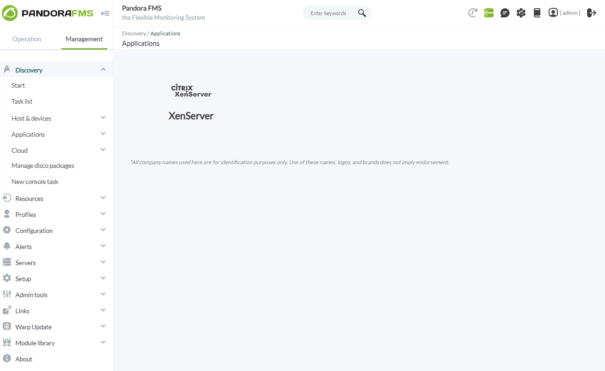
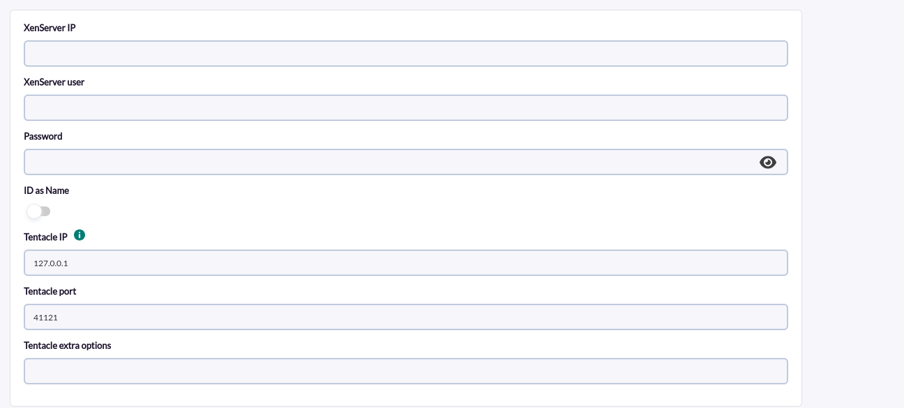

# XenServer Discovery

*Article last updated: 2026-10-26.*

## What it monitors

The XenServer Discovery addon monitors the hosts, storage repositories and virtual machines of a XenServer environment. A Discovery task connects to one XenServer, reads its inventory and performance data through the XenAPI and the server RRD data, and creates Pandora FMS agents and modules from the result.

A Discovery task generates three kinds of agents:

- **One agent per host**, with the number of running and installed virtual machines, memory usage and average CPU load.
- **One agent per virtual machine**, with its power state, memory usage, per-CPU load, guest tools status and per-disk size and throughput. The virtual machine agent is a child of the agent of the host that runs it.
- **One agent per storage repository (SR)**, with its physical size, used space, free space and used percentage.

The task decides which of the three kinds are scanned, and hosts, virtual machines and storage repositories can be excluded or renamed by name.

## Prepare

### Compatibility

| Scope | State | Evidence |
|-------|-------|----------|
| Addon `pandorafms.xenserver`, version `1.3` | Documented target | The version this page describes. See [Addon identity](#addon-identity) |
| XenServer `6.2` or later | `Required` | Prerequisite stated by the Marketplace entry; no test record is available for this version |
| Pandora FMS NG `784` and later | Stated by the Marketplace | General notice shown on the Marketplace for all entries, not specific to this addon |
| Operating system of the Discovery server | `Not validated` | No operating system has been recorded for this version |
| Specific XenServer releases | `Not validated` | No test matrix has been recorded for this version |

### Prerequisites

1. **A XenServer host** reachable from the Discovery server, with TCP port `80` open for the RRD queries and the connection to the XenAPI. The Marketplace entry also lists TCP port `443` for the XenAPI queries.
2. **XenServer credentials** (user and password) able to query the XenAPI. No narrower set of roles or permissions is documented for this addon.
3. **Pandora FMS**: the Discovery server to run the task and the console to define it. Generated agents are sent with Tentacle.
4. **Guest tools** installed on the virtual machines. Without them the guest information is limited: the virtual machine agent does not get the IP address of the guest and the `XenServer tools` module reports `0`.

!!! warning
    The addon connects to the XenServer with HTTP URLs and sends the user and password in the HTTP basic authentication of the RRD requests. Run it only from a network you trust and use credentials dedicated to monitoring.

The addon ships its own executable, `bin/pandora_xenserver`, so nothing else has to be installed on the Discovery server to run a task.

### Install the addon

Download the `.disco` package from the Pandora FMS Marketplace entry, which is limited to licensed users:

[https://marketplace.pandorafms.com/entries/pandorafms.xenserver](https://marketplace.pandorafms.com/entries/pandorafms.xenserver)

Load it into Pandora FMS. Once loaded, **XenServer** is available in the **Applications** section when creating Discovery tasks.

## Configure the Discovery task

Create the task from the Discovery applications and choose **XenServer**. The console presents the fields in two steps; every field is documented in [Task parameters](#task-parameters).



1. **XenServer base** — connection and data delivery:

    - **XenServer IP**, **XenServer user** and **Password**: address and credentials of the XenServer to monitor.
    - **ID as Name**: use the SR identifier (UUID) as the name of the storage repository agents. The alias remains the SR name.
    - **Tentacle IP**, **Tentacle port** and **Tentacle extra options**: where and how the generated agent data is sent. They rarely need changing.

    

2. **XenServer detailed** — scope and tuning:

    - **Autodisabled agents**: create the agents in autodisabled mode.
    - **Time adjustment**: seconds subtracted from the current time to set the start of the RRD query window.
    - **Scan VM IP**, **Scan all Hosts**, **Scan all VM** and **Scan all SR**: which data the task collects.
    - **Extra settings**: optional block added as is to the end of the plugin configuration. Use it for the `REJECT` and `RENAME` sections described in [Exclude and rename elements](#exclude-and-rename-elements).

    <!-- SCREENSHOT NEEDED: XenServer detailed wizard step showing the scan options and the Extra settings text area. -->

The task's group and interval come from the generic task-definition step and are applied to the agents the task creates.

## Verify the first run

Force the task from the Discovery task list and check the result in this order.

1. **The task summary.** A task that completes successfully reports:

    - **Hosts**: hosts monitored.
    - **Storage**: storage repositories monitored.
    - **VMs**: virtual machines monitored, excluding templates, snapshots and control domains. A control domain is the special virtual machine that manages each host.
    - **Hosts VMs running**: running virtual machines on the monitored hosts, excluding control domains. It is counted while scanning hosts, so it is `0` when **Scan all Hosts** is disabled.

    A task that does not complete successfully records the errors in its execution information instead.

    <!-- SCREENSHOT NEEDED: Discovery task execution summary for a XenServer task showing Hosts, Storage, VMs and Hosts VMs running. -->

2. **The agents.** One per host, one per virtual machine and one per storage repository, according to the enabled scan options.
3. **The modules.** Every virtual machine agent has `Status`, `Memory used` and `XenServer tools`. CPU and disk throughput modules appear only on running virtual machines; see [Understand the results](#understand-the-results).

## Understand the results

### Agents generated

| Agent | Name and alias | Parent | Notes |
|-------|----------------|--------|-------|
| Host | The host name | None | Address is the host address. Operating system `Xen Server`, version is the product brand and version reported by the host |
| Virtual machine | The virtual machine name | The host that runs it, empty when the machine is not resident on a host | Address is the list of guest IP addresses, comma separated, when **Scan VM IP** is enabled and the guest reports them |
| Storage repository | Name: the SR UUID when **ID as Name** is enabled, otherwise the SR name. Alias: always the SR name | None | The description lists the hosts and the device or location of the repository |

In every agent name the character `/` is replaced with `_`. Templates, snapshots and control domains are never monitored as virtual machines. Storage repositories whose name contains `XenServer Tools` or whose physical size is `0` produce no agent.

### Modules per agent

**Host agent**

| Module | Type | Unit | Description |
|--------|------|------|-------------|
| `VMs running` | `generic_data` | | Running virtual machines, excluding the control domain |
| `VMs installed` | `generic_data` | | Virtual machines resident on the host, including the control domain |
| `Memory used` | `generic_data` | `%` | Percentage of RAM in use |
| `Load CPU avg` | `generic_data` | `%` | Average CPU load |

**Virtual machine agent**

| Module | Type | Unit | Condition | Description |
|--------|------|------|-----------|-------------|
| `Status` | `generic_proc` | | Always | `1` when the machine is `Running`, `0` otherwise. The description carries the power state |
| `Memory used` | `generic_data` | `%` | Always | Percentage of RAM in use; `0.0` when the machine is not running |
| `cpu<N>` | `generic_data` | `%` | Running | Load of each virtual CPU |
| `XenServer tools` | `generic_proc` | | Always | `1` when the guest reports installed tools, `0` otherwise |
| `VDI_<disk name>_size` | `generic_data` | `GB` | One per attached disk | Size of the disk as presented to the guest |
| `VDI_<disk name>_used` | `generic_data` | `%` | One per attached disk | Percentage of the disk size that the image occupies in the storage repository, capped at `100`. Thick-provisioned disks always report `100` |
| `vbd_<device>_write`, `vbd_<device>_read` | `generic_data` | `bytes/sec` | Running | Disk write and read rate of each virtual block device |

**Storage repository agent**

| Module | Type | Unit | Description |
|--------|------|------|-------------|
| `physical_size` | `generic_data` | `GB` | Physical size of the repository |
| `physical_utilisation` | `generic_data` | `GB` | Physical space in use |
| `free space` | `generic_data` | `GB` | Free space, as a whole number of GB |
| `used percent` | `generic_data` | `%` | Percentage of the repository in use |

### How the values are obtained

- Inventory data comes from the XenAPI. Memory, CPU and disk throughput come from the RRD data of the XenServer, queried from the moment set by **Time adjustment** (default `10` seconds before the execution).
- Each execution creates the data of every selected element again; newly added hosts, virtual machines and storage repositories are included on the next run without changing the task.

## Exclude and rename elements

Put these sections in **Extra settings** (or in the configuration file for manual execution). Names are the host, virtual machine or storage repository names; a name that contains `/` is written with `_` instead.

```ini
[REJECT]
<ELEMENT_NAME> = 1
regexp_host = <REGEX>
regexp_vm = <REGEX>
regexp_sr = <REGEX>

[RENAME]
<ELEMENT_NAME> = <NEW_NAME>
```

- `<ELEMENT_NAME> = 1` excludes that host, virtual machine or storage repository. For a storage repository the name is its SR name, not its UUID.
- `regexp_host`, `regexp_vm` and `regexp_sr` exclude every element whose name matches the regular expression from the start of the name. For storage repositories the expression is matched against the agent name, so against the UUID when **ID as Name** is enabled.
- `RENAME` changes the agent name. For hosts and virtual machines it changes the alias too; storage repositories keep their SR name as alias.

## Operate

### Manual execution

The addon can run outside a Discovery task. The executable takes the path to a configuration file described in [Configuration file](#configuration-file):

```bash
./pandora_xenserver --conf <PATH_TO_CONFIG>
```

Add `--as_discovery_plugin 1` to print the execution summary as JSON instead of a status module:

```bash
./pandora_xenserver --conf <PATH_TO_CONFIG> --as_discovery_plugin 1
```

```json
{"summary": {"Hosts": 1, "Storage": 7, "VMs": 23, "Hosts VMs running": 10}}
```

When errors occur, the JSON also contains an `info` key with the messages and the exit code is `1`. Without `--as_discovery_plugin 1`, a successful run prints a status module:

```xml
<module>
<name><![CDATA[XenServer Plugin]]></name>
<type><![CDATA[async_string]]></type>
<description><![CDATA[Result of XenServer Plugin execution]]></description>
<data><![CDATA[OK]]></data>
</module>
```

In `local` transfer mode the data files are moved to `data_dir`. In `tentacle` mode the `tentacle_client` executable must be available in the `PATH` of the user running the addon.

The `interval` of the configuration file is the interval of the generated agents. It must match the execution interval of the plugin; otherwise the modules turn `unknown` when an agent expects data before the next execution.

The configuration file contains the XenServer password in plain text. Protect it with restrictive permissions.

## Troubleshoot

The addon has no verbose or debug flag. Its diagnostic channel is the `info` field of the JSON execution result, which is shown in the task's execution information, and the log file set by `logfile` in manual execution.

- **`CRITICAL: Cant get XenServer session`** or **`CRITICAL: Cant login to XenServer`**: the connection or the login failed. The message includes the error returned. Check **XenServer IP**, the credentials and that port `80` is reachable from the Discovery server.
- **`ERROR - Could not write file`**: the directory for the temporary data files is not writable.
- **`Tentacle error`**: the data file could not be sent. The message includes the error of the Tentacle client; check **Tentacle IP** and **Tentacle port**.
- **A virtual machine agent has no IP address**: **Scan VM IP** is disabled, or the guest does not report addresses because the guest tools are not installed.
- **No `cpu<N>` or `vbd_` modules on a virtual machine**: the machine is not running.
- **A storage repository has no agent**: its physical size is `0`, its name contains `XenServer Tools`, **Scan all SR** is disabled or it matches a `REJECT` rule.
- **Fewer agents than expected**: check which of **Scan all Hosts**, **Scan all VM** and **Scan all SR** are enabled, and the `REJECT` rules.

## Reference

### Task parameters

#### XenServer base

| Field | Macro | Type | Default | Notes |
|-------|-------|------|---------|-------|
| XenServer IP | `_serverIP_` | string | — | Address of the XenServer |
| XenServer user | `_user_` | string | — | User of the XenServer |
| Password | `_password_` | password | — | Password of the user |
| ID as Name | `_idAsName_` | checkbox | on | SR UUID as the storage repository agent name |
| Tentacle IP | `_tentacleIP_` | string | `127.0.0.1` | Server that receives the agent data |
| Tentacle port | `_tentaclePort_` | number | `41121` | Tentacle port |
| Tentacle extra options | `_tentacleExtraOpt_` | string | — | Optional. Extra Tentacle client options |

#### XenServer detailed

| Field | Macro | Type | Default | Notes |
|-------|-------|------|---------|-------|
| Autodisabled agents | `_autodisabledAgents_` | checkbox | off | Creates the agents in autodisabled mode |
| Time adjustment | `_timeAdjustment_` | number | `10` | Optional. Seconds subtracted from the current time to set the start of the RRD query window |
| Scan VM IP | `_scanVMIP_` | checkbox | on | Read the IP addresses of the virtual machines |
| Scan all Hosts | `_scanAllHosts_` | checkbox | on | Create host agents |
| Scan all VM | `_scanAllVM_` | checkbox | on | Create virtual machine agents |
| Scan all SR | `_scanAllSR_` | checkbox | on | Create storage repository agents |
| Extra settings | `_extraSettings_` | text area | — | Optional. Raw block added to the end of the plugin configuration |

### Configuration file

Used by manual execution. The Discovery task generates the same file from its fields, with `transfer_mode = tentacle`, the task group and interval, and `data_dir` set by the Discovery server. All keys of `CONF` and `PANDORA` except `id_as_name` and `autodisabled_agents` are required; the keys of `TUNNING` and `REJECT` are optional. Numeric options accept `1` to enable and `0` to disable.

| Section | Key | Default | Description |
|---------|-----|---------|-------------|
| `CONF` | `xen_server_ip` | — | Address of the XenServer |
| `CONF` | `user` | — | XenServer user |
| `CONF` | `password` | — | XenServer password |
| `CONF` | `temporal` | — | Directory for temporary files |
| `PANDORA` | `group` | — | Group of the generated agents |
| `PANDORA` | `logfile` | — | Log file. It is overwritten on every execution |
| `PANDORA` | `interval` | — | Agent interval, in seconds. Must match the execution interval |
| `PANDORA` | `transfer_mode` | — | `local` moves the data files to `data_dir`; any other value sends them with Tentacle |
| `PANDORA` | `tentacle_client` | — | Tentacle client executable |
| `PANDORA` | `tentacle_ip` | — | Tentacle server address |
| `PANDORA` | `tentacle_port` | — | Tentacle server port |
| `PANDORA` | `tentacle_opts` | — | Extra Tentacle client options; may be empty |
| `PANDORA` | `data_dir` | — | Destination of the data files in `local` mode |
| `PANDORA` | `id_as_name` | `1` | SR UUID as storage repository agent name |
| `PANDORA` | `autodisabled_agents` | `0` | Autodisabled mode |
| `TUNNING` | `time_adjustment` | `10` | Seconds subtracted from the current time to set the start of the RRD query window |
| `TUNNING` | `scan_vm_ip` | `1` | Read virtual machine IP addresses |
| `TUNNING` | `scan_all_host` | `1` | Create host agents |
| `TUNNING` | `scan_all_vm` | `1` | Create virtual machine agents |
| `TUNNING` | `scan_all_sr` | `1` | Create storage repository agents |
| `REJECT`, `RENAME` | | | See [Exclude and rename elements](#exclude-and-rename-elements) |

Example:

```ini
[CONF]
xen_server_ip = <XENSERVER_IP>
user = <USERNAME>
password = <PASSWORD>
temporal = /tmp

[PANDORA]
group = Unknown
logfile = /tmp/pandora_xenserver.log
interval = 300
transfer_mode = tentacle
tentacle_client = tentacle_client
tentacle_ip = <TENTACLE_SERVER_IP>
tentacle_port = 41121
tentacle_opts =
data_dir = /tmp/data_in
id_as_name = 1

[TUNNING]
time_adjustment = 10
scan_vm_ip = 1
scan_all_vm = 1
scan_all_sr = 1
scan_all_host = 1

[REJECT]
<VM_NAME> = 1

[RENAME]
<VM_NAME_2> = <NEW_NAME>
```

### Addon identity

| Item | Value |
|------|-------|
| Name | XenServer |
| Identifier | `pandorafms.xenserver` |
| Version | `1.3` |
| Type and section | Discovery, `app` |
| Marketplace entry | [pandorafms.xenserver](https://marketplace.pandorafms.com/entries/pandorafms.xenserver), updated 2026-09-16 |
| Availability | The Marketplace entry states that the download is limited to licensed users |
