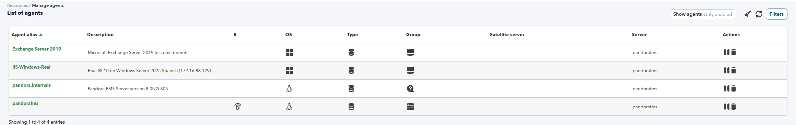
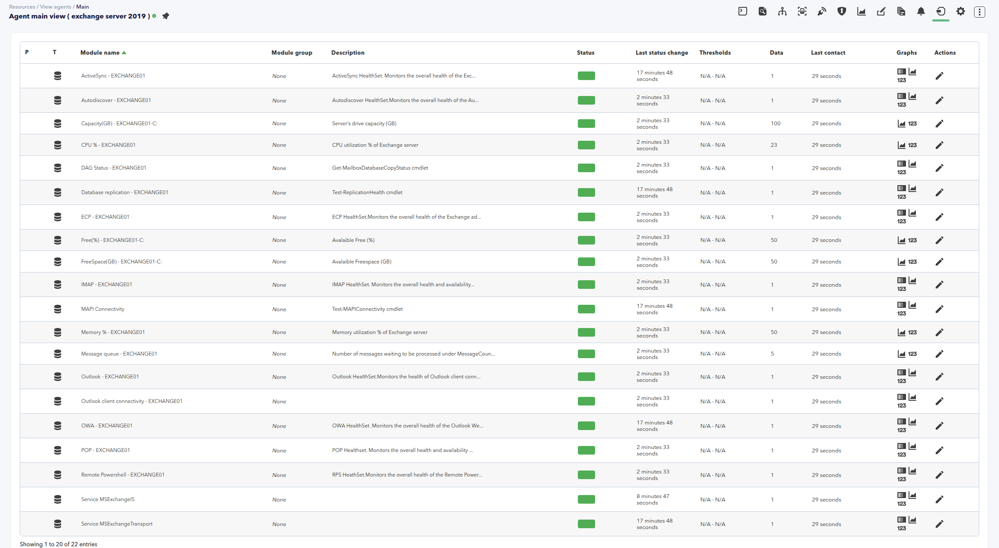

# Exchange

*Article last updated: 2026-11-12.*

## What it does

The Exchange addon monitors the health of a Microsoft Exchange Server from
Pandora FMS. It runs on the Exchange server itself, under the Pandora FMS
agent, as an agent plugin: a run executes the selected Exchange health checks
and prints one XML `<module>` block per result, and the agent turns those blocks
into modules of its own agent.

The checks are grouped in independent blocks, each enabled by its own switch:

- **Mailbox** (`-mailbox`) — database replication health, MAPI connectivity and
  the state of the local database copies of the DAG.
- **Client access** (`-cas`) — OWA, ActiveSync, web services (EWS), remote
  PowerShell, POP, IMAP, ECP, Autodiscover, Outlook client connectivity and
  SMTP connectivity.
- **Load** — the submission queue (`-queue`), processor load (`-cpu`) and
  memory usage (`-memory`).
- **Storage** (`-storage`) — one module triple per volume.
- **Exchange services** (`-services`) — one module per installed Exchange
  service.

A run with no switch enables every block except the services block. `-all`
enables the same set; the services block is always opt-in with `-services`. The
switches combine, so a run can collect only the blocks you select.

One run covers one server. The addon takes no parameter that names a remote
Exchange server: it inspects the server where the agent runs it, so install it
in the agent of every Exchange server you want to monitor.

The package contains a single entry point. The blocks are selected with
command-line switches (see [Choose what to check](#choose-what-to-check)), not
with one script per block.

## Prepare

### Compatibility

| Scope | State | Evidence |
|-------|-------|----------|
| Pandora FMS NG 784 and later | `Supported` | The Marketplace states that all its integrations are compatible with Pandora FMS NG 784 and later versions |
| Microsoft Exchange Server 2013, 2016 and 2019 | `Supported` | The Marketplace entry states that the plugin is designed to monitor Exchange Server 2013, 2016 and 2019 |
| Microsoft Exchange Server 2016 | `Tested` | The addon's official guide names Exchange 2016 as the version it was tested on |
| Microsoft Exchange Server 2010 and earlier | `Not validated` | The Marketplace entry scopes the plugin to Exchange 2013 and later |
| Windows Server release that hosts Exchange | `Not validated` | No Windows release is recorded for this addon |
| Pandora FMS Windows agent on the Exchange server | `Required` | The plugin is an agent plugin: it prints module XML for the agent that runs it |
| `powershell.exe` available to the account that runs the agent | `Required` | The documented invocation calls `powershell.exe` |
| The Exchange management cmdlets loaded in the session that runs the plugin | `Required` | The checks call Exchange management cmdlets and the addon loads none of them itself |

The Exchange version is an operational requirement of the addon, not a statement
about the Windows release that hosts it.

### Requirements

1. **Microsoft Exchange Server 2013, 2016 or 2019** installed on the monitored
   server.
2. **The Pandora FMS agent installed on that server**, and running.
3. **An account for the agent that can run the Exchange management cmdlets**
   used by the checks: `Test-ReplicationHealth`, `Test-MAPIConnectivity`,
   `Get-MailboxDatabaseCopyStatus`, `Get-HealthReport` and
   `Test-SmtpConnectivity` for the health checks, plus `Get-Queue` and
   `Get-Service` for the load and service modules. The processor, memory and
   volume blocks also read local WMI data. No official source names a narrower
   role group for this addon; grant only the permissions those cmdlets and WMI
   queries require.
4. **Those cmdlets loaded in the PowerShell session** that runs the plugin. See
   [Load the Exchange management cmdlets](#load-the-exchange-management-cmdlets).
5. **`powershell.exe` in the search path** of the account that runs the agent.

The addon stores no credentials and asks for none: every check runs with the
identity of the account that runs the agent, so that account needs the access,
not a separate monitoring user. Keep it as narrow as the cmdlets allow, and do
not run the agent as a domain administrator to make the checks work.

### Install the plugin

Download the addon from its Marketplace entry:

[pandorafms.exchange](https://marketplace.pandorafms.com/entries/pandorafms.exchange)

The package contains the plugin script. It has no configuration file: every
setting is a command-line switch. Extract the package and copy the script to a
folder that the account that runs the agent can read, for example
`C:\Program Files\pandora_agent\plugins`. The commands in this page write that
folder as `<PATH_TO_PLUGIN>` and the script file as `<PLUGIN_SCRIPT>`, after the
name the file has inside the downloaded package.

## Configure

### Add the plugin to the agent

The plugin is configured in the agent configuration file (`pandora_agent.conf`)
as one `module_plugin` line. This line runs every block except the service
modules on the server that hosts the agent:

```apache
module_plugin powershell.exe -PSConsoleFile "<PATH_TO_EXCHANGE_SHELL>\<EXCHANGE_CONSOLE_FILE>" -command "& '<PATH_TO_PLUGIN>\<PLUGIN_SCRIPT>' -all 3> $NULL"
```

- `<PATH_TO_EXCHANGE_SHELL>\<EXCHANGE_CONSOLE_FILE>` is the Exchange shell
  console file of the installed Exchange version, which loads the management
  cmdlets in the session (see
  [Load the Exchange management cmdlets](#load-the-exchange-management-cmdlets)).
- `-command "& '...' -all"` runs the script with the `-all` switch. Single
  quotes protect the path, so a folder name with spaces works unchanged.
- `3> $NULL` discards the warning stream of the session, so only the module XML
  reaches the agent.
- The line runs once per agent interval. Restart or reload the agent after
  editing the file.

When the agent reads its configuration from the console (remote configuration),
the `module_plugin` line belongs to the agent configuration stored there, and a
local edit of `pandora_agent.conf` is overwritten by the agent.

The addon has no timeout of its own. To bound a run, use the block form with a
module timeout, in seconds:

```apache
module_begin
module_plugin powershell.exe -PSConsoleFile "<PATH_TO_EXCHANGE_SHELL>\<EXCHANGE_CONSOLE_FILE>" -command "& '<PATH_TO_PLUGIN>\<PLUGIN_SCRIPT>' -all 3> $NULL"
module_timeout 300
module_end
```

A run cut short by the timeout produces fewer modules than a complete one.

### Choose what to check

The switches are independent flags and can be combined. A run with no switch
behaves like `-all`:

| Command line | What the run covers |
|--------------|---------------------|
| No switch | Every block except services |
| `-all` | Every block except services |
| `-mailbox` | Mailbox checks |
| `-cas` | Client access checks |
| `-queue` | Message queue module |
| `-cpu` | Processor module |
| `-memory` | Memory module |
| `-storage` | Volume modules |
| `-services` | Exchange service modules |
| `-all -services` | Every block, services included |
| `-queue -storage` | Message queue and volume modules |

Blocks add their modules to the run: a switch never removes a block selected by
another one. The services block is not part of `-all` or of the default run;
enable it explicitly with `-services`.

The client access checks use the local server name when the run does not include
the mailbox checks, so `-cas` on its own produces the full client access set.
When the mailbox checks run, the health report requests reuse the server
identity reported by `Test-ReplicationHealth`.

The load and storage blocks are optional like any other block: `-all` and the
default run include them, and `-queue`, `-cpu`, `-memory` and `-storage` select
them one by one.

### Load the Exchange management cmdlets

The checks call Exchange management cmdlets and the addon imports nothing
itself. The invocation therefore has to load them in the same PowerShell
session before the script runs. Pass the console file of the installed Exchange
version with `-PSConsoleFile`, or load the same module at the beginning of the
`-command` string — shown below as `<EXCHANGE_SHELL_LOADER>` — and then call the
script:

```apache
module_plugin powershell.exe -PSConsoleFile "<PATH_TO_EXCHANGE_SHELL>\<EXCHANGE_CONSOLE_FILE>" -command "<EXCHANGE_SHELL_LOADER>; & '<PATH_TO_PLUGIN>\<PLUGIN_SCRIPT>' -all 3> $NULL"
```

Without those cmdlets every check fails and the run prints only the modules
that do not need them — typically nothing at all. See
[Troubleshoot](#troubleshoot).

## Verify

Run the plugin by hand before wiring it into the agent. Open an Exchange
Management Shell on the server, or any PowerShell session where the management
cmdlets are loaded, and run:

```powershell
& '<PATH_TO_PLUGIN>\<PLUGIN_SCRIPT>' -all
```

A successful run prints one `<module>` block per result on standard output and
nothing else. This is an excerpt of a run against a single server; the values
are illustrative and `EXCHANGE01` stands for the name of the server:

```xml
<module>
<name>Message queue - EXCHANGE01</name>
<type>generic_data</type>
<data><![CDATA[0]]></data>
<description><![CDATA[Number of messages waiting to be processed under MessageCount column.]]></description>
</module>
<module>
<name>Database replication - EXCHANGE01</name>
<type>generic_proc</type>
<data><![CDATA[1]]></data>
<description><![CDATA[Test-ReplicationHealth cmdlet]]></description>
</module>
<module>
<name>DAG Status - EXCHANGE01</name>
<type>generic_proc</type>
<data><![CDATA[1]]></data>
<description><![CDATA[Get-MailboxDatabaseCopyStatus cmdlet]]></description>
</module>
<module>
<name>OWA - EXCHANGE01</name>
<type>generic_proc</type>
<data><![CDATA[1]]></data>
<description><![CDATA[OWA HealthSet .Monitors the overall health of the Outlook Web App service.]]></description>
</module>
```

Once the `module_plugin` line is in place and the agent has run it, the agent
appears in the console in Resources > Manage agents:



The modules appear under the agent of the Exchange server:



Check in this order:

1. **The agent modules.** The agent that runs the plugin holds a module for
   every block of the last run.
2. **The values.** The `generic_proc` modules report `1` when the whole check
   passed. A `0` is an actual failed check, not a missing one.
3. **The coverage.** The number of modules of a run depends on the switches and
   on what the server answered; see
   [Role coverage](#role-coverage).

## Understand the results

### Role coverage

Which checks a run performs depends on the switches, and which modules appear
depends also on whether each check produced a result:

| Module group | Switch |
|--------------|--------|
| Mailbox (replication, MAPI, DAG) | `-mailbox` |
| Client access, health report checks | `-cas` |
| `SMTP Connectivity` | `-cas` |
| Message queue | `-queue` |
| Processor | `-cpu` |
| Memory | `-memory` |
| Volumes | `-storage` |
| Exchange services | `-services` |

The default run and `-all` enable every group in the table except Exchange
services. A switch adds only its group and changes no other value; combine the
switches you need.

### How a check reports its result

Every health check follows the same pattern, which is what makes a missing
module meaningful:

- **`1`** — the cmdlet returned at least one row and every row passed.
- **`0`** — the cmdlet returned rows and at least one of them did not pass.
- **No module** — the cmdlet returned nothing, or could not run. The run sends
  no value for that module at all.

A `generic_proc` module with the value `0` is reported as not normal by the
console, so an alert configured on it fires on a check that ran and failed. A
check that never runs, or that the server cannot answer, produces silence
instead, and the module either does not exist yet or keeps the last value it
received.

The value that counts as a pass is part of the addon: `Passed` or `Correcto`
for the replication check, `Success` or `Correcto` for MAPI, and `Healthy` for
the health report checks. See [Known limitations](#known-limitations).

### Load and storage modules

These modules describe the server and need no Exchange role:

| Module name | Type | Value |
|-------------|------|-------|
| `Message queue - <host>` | `generic_data` | Messages waiting in the `Submission` queue |
| `CPU % - <host>` | `generic_data` | Average processor load percentage |
| `Memory % - <host>` | `generic_data` | Percentage of physical memory in use, rounded to two decimals |
| `Capacity(GB) - <host>-<volume>` | `generic_data` | Total size of the volume, in GB, rounded to two decimals |
| `FreeSpace(GB) - <host>-<volume>` | `generic_data` | Free space of the volume, in GB, rounded to two decimals |
| `Free(%) - <host>-<volume>` | `generic_data` | Free space of the volume, as a percentage rounded to no decimals |

`<host>` is the name of the server that runs the plugin. `<volume>` is the name
of the volume as the operating system reports it, without its trailing
backslash: a volume `C:\` produces `Capacity(GB) - EXCHANGE01-C:`. One triple is
printed for every volume the server reports, including volumes that have no
capacity, such as an optical drive.

When its block is selected, each of these modules is printed only when the
corresponding query returns data; the memory module is always printed when its
block is selected. The processor and the memory queries have no error fallback,
so a failure in either of them stops the run: the blocks that follow it, such as
the volume triple and the service modules, are not printed in that run.

### Mailbox checks

| Module name | Type | `1` when |
|-------------|------|----------|
| `Database replication - <server>` | `generic_proc` | Every row of `Test-ReplicationHealth` reports a pass |
| `MAPI Connectivity` | `generic_proc` | Every row of `Test-MAPIConnectivity` reports a pass |
| `DAG Status - <host>` | `generic_proc` | Every local database copy reports a copy queue length below 7 |

`<server>` in the replication module is the server reported by the last row of
the result, and this module has no fixed suffix: its name depends on that
value. `MAPI Connectivity` carries no server suffix.

The DAG check reads the copies hosted by the server that runs the plugin, and it
treats a queue of seven logs or more as a failure. A server with no local
database copy prints no DAG module.

### Client access checks

Each of these modules is the health of one Exchange health set, plus the SMTP
probe:

| Module name | Health set or probe |
|-------------|---------------------|
| `OWA - <host>` | `OWA` |
| `ActiveSync - <host>` | `ActiveSync` |
| `Web Services - <host>` | `EWS` |
| `Remote Powershell - <host>` | `RPS` |
| `POP - <host>` | `POP` |
| `IMAP - <host>` | `IMAP` |
| `ECP - <host>` | `ECP` |
| `Autodiscover - <host>` | `Autodiscover` |
| `Outlook - <host>` | `Outlook` |
| `Outlook client connectivity - <host>` | `Outlook`, requested a second time by the same run |
| `SMTP Connectivity - <host>` | `Test-SmtpConnectivity` |

A health set reports `1` when every monitor of the set reports `Healthy`. The
two Outlook modules come from two separate checks that query the same health
set, so they normally carry the same value.

### Service modules

With `-services`, every installed service whose name contains `MSExchange`
produces one module:

| Module name | Type | Value |
|-------------|------|-------|
| `Service <service name>` | `generic_proc` | `1` while the service is running, `0` otherwise |

The set of modules therefore follows the services installed on the server, and
a service that is removed from the server stops producing its module. A service
in any state other than running — stopped, starting, stopping — reports `0`.

## Operate and troubleshoot

### Everyday operation

- The addon keeps no state. Each run executes the checks again, so a manual run
  reproduces exactly what the agent does.
- A run that includes the mailbox and client access blocks makes the Exchange
  server perform live probes: a replication health test, a MAPI logon test, a
  mailbox database copy query and ten health report requests. Give the module an
  interval that suits that cost, avoid running it every minute on a busy server,
  and leave out the blocks you do not need.
- The modules are created by the agent from the script output, so a check that
  starts reporting a new module does not require a console change.
- To change what a run covers, edit the switches of the `module_plugin` line and
  restart the agent. Nothing else is stored, so there is no state to migrate.

### Known limitations

These are the behaviors of this version, not setup errors:

- **`Outlook - <host>` and `Outlook client connectivity - <host>` are the same
  probe twice.** Both read the `Outlook` health set; the second module has no
  description.
- **The pass values are matched in English and Spanish only.** An Exchange
  server localized to another language reports its results with other words,
  and the affected module reports `0` even though the check passed.
- **A volume without capacity still produces a `Free(%)` module.** The addon
  prints the triple for every volume, so an optical drive or any other volume
  with no capacity appears with a percentage that has no meaning. Ignore it or
  filter it in the console.

### Troubleshoot

- **The run prints no health module.** Either the Exchange management cmdlets
  are not loaded in the session, the console file path is wrong or the account
  cannot use them, or the cmdlets run and return nothing because the account is
  authenticated against a different organization or the server has no role that
  answers that check. If the run includes the load or storage blocks, those
  modules still appear, because they do not depend on Exchange cmdlets. Run the
  script by hand in an Exchange Management Shell to see the error the session
  produced, and then check the account.
- **A module reports `0` for every check.** Confirm the language of the server
  before looking for a real failure: the pass values are matched in English
  and Spanish only.
- **A module is missing after a change.** The check returned no result. The
  console keeps the last value it received for that module, which can hide the
  gap.
- **The load modules appear but the volume triples and the service modules do
  not.** A processor or memory query failed and ended the run at that point. The
  error goes to the error stream of the session, so run the script by hand to
  read it.
- **The agent log shows a timeout.** A complete run with `-all` performs a dozen
  live probes. Raise the module timeout, or split the blocks you need into
  separate `module_plugin` lines, each with its own timeout and its own switch.

## Reference

### Switches

| Switch | Type | Default | Effect |
|--------|------|---------|--------|
| `-all` | flag | On when no switch is given | Mailbox, client access, queue, processor, memory and volume blocks |
| `-mailbox` | flag | Off | Mailbox checks |
| `-cas` | flag | Off | Client access checks |
| `-queue` | flag | Off | Message queue module |
| `-cpu` | flag | Off | Processor module |
| `-memory` | flag | Off | Memory module |
| `-storage` | flag | Off | Volume modules |
| `-services` | flag | Off | One module per installed Exchange service |

The addon declares these eight switches and no other parameter. It has no
verbosity, timeout, destination or credential parameter, and it prints to
standard output only.

### Generated modules

| Module name | Type | Group |
|-------------|------|-------|
| `Message queue - <host>` | `generic_data` | Load |
| `CPU % - <host>` | `generic_data` | Load |
| `Memory % - <host>` | `generic_data` | Load |
| `Capacity(GB) - <host>-<volume>` | `generic_data` | Storage |
| `FreeSpace(GB) - <host>-<volume>` | `generic_data` | Storage |
| `Free(%) - <host>-<volume>` | `generic_data` | Storage |
| `Database replication - <server>` | `generic_proc` | Mailbox |
| `MAPI Connectivity` | `generic_proc` | Mailbox |
| `DAG Status - <host>` | `generic_proc` | Mailbox |
| `OWA - <host>` | `generic_proc` | Client access |
| `ActiveSync - <host>` | `generic_proc` | Client access |
| `Web Services - <host>` | `generic_proc` | Client access |
| `Remote Powershell - <host>` | `generic_proc` | Client access |
| `POP - <host>` | `generic_proc` | Client access |
| `IMAP - <host>` | `generic_proc` | Client access |
| `ECP - <host>` | `generic_proc` | Client access |
| `Autodiscover - <host>` | `generic_proc` | Client access |
| `Outlook - <host>` | `generic_proc` | Client access |
| `Outlook client connectivity - <host>` | `generic_proc` | Client access |
| `SMTP Connectivity - <host>` | `generic_proc` | Client access |
| `Service <service name>` | `generic_proc` | Services |

Module names keep the spelling of the addon: `Remote Powershell` is written with
a lower-case `s`, and `MAPI Connectivity` carries no server suffix.

### Output

- Every result is one `<module>` block on standard output, with `name`, `type`,
  `data` and `description`. The agent reads them and creates the modules.
- The errors of the health checks are discarded by the addon: a health check
  that fails leaves no module and no message. To see the error, run the script
  by hand in a session that does not redirect the error stream.
- The addon defines no exit status of its own. A run that stops because of an
  error prints the modules it produced until that point.

### Addon identity

| Property | Value |
|----------|-------|
| Marketplace identifier | `pandorafms.exchange` |
| Name | Exchange |
| Version | `1.1` — the version of the Marketplace package `pandorafms.exchange.1.1.zip` |
| Category | Miscelaneus |
| Tags | applications |
| License | Free |
| Marketplace last update | 2026-11-12 |
| Availability | Free download |
| Marketplace entry | [pandorafms.exchange](https://marketplace.pandorafms.com/entries/pandorafms.exchange) |
| Execution model | Pandora FMS agent plugin (`module_plugin`) on the Exchange server |
