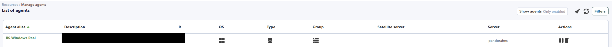
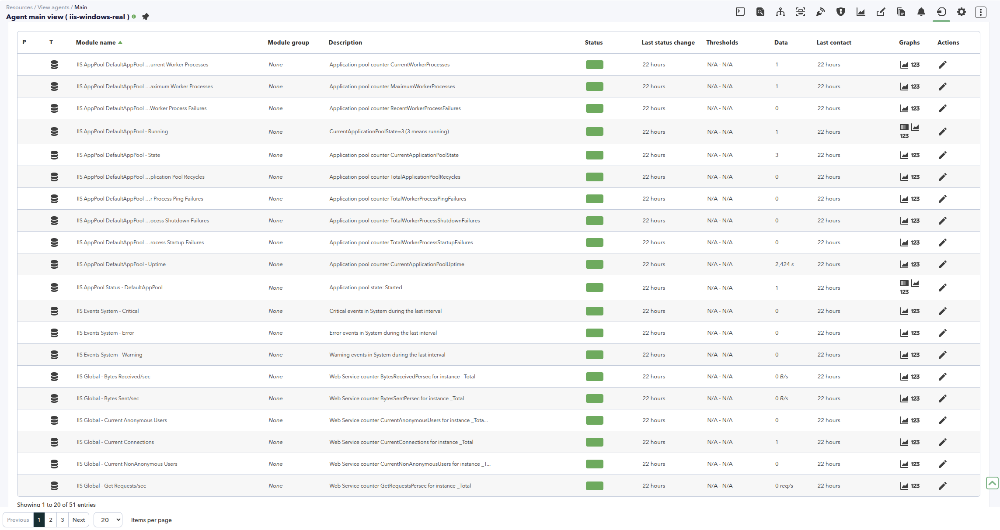
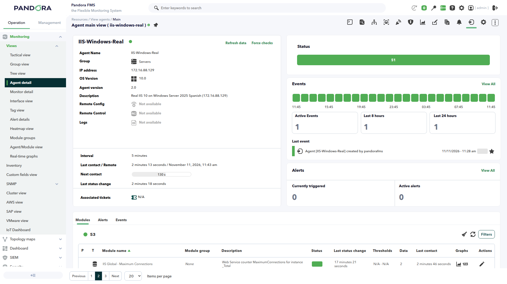
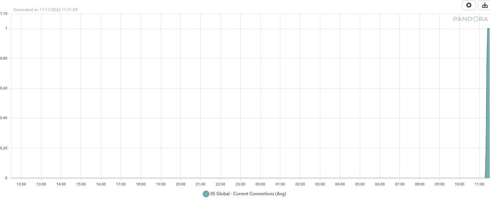
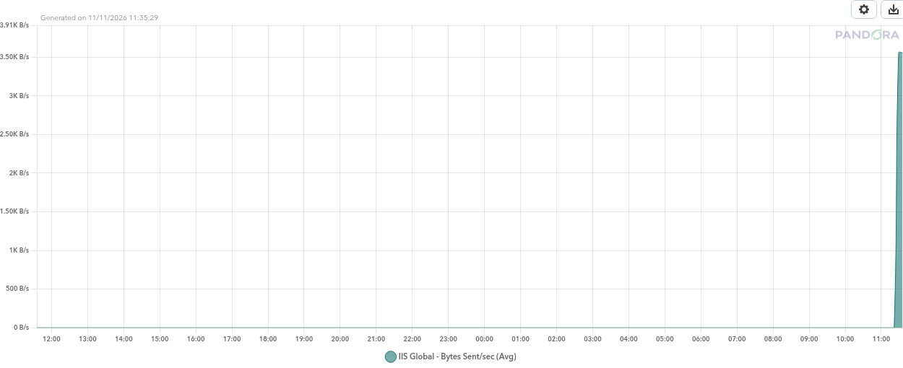

# IIS

*Article last updated: 2026-11-12.*

## What it does

The IIS addon monitors Microsoft Internet Information Services (IIS) from Pandora FMS.
Each run inspects the IIS services, the sites and the application pools, reads the
performance counters, optionally checks a list of URLs, reads Windows events and parses
the IIS logs, and writes the result as Pandora FMS modules on standard output. The Pandora
FMS Windows agent that executes the addon ingests that output, so every run updates the
modules of the agent installed on the IIS host.

The addon is an agent plugin: it runs once, prints one `<module>` block per result and
exits. It creates no agent of its own — the modules belong to the agent that runs it — and
it keeps a JSON state file for the event log and the IIS logs, so consecutive runs do not
repeat data.

A single run replaces the former separate IIS status, log and event scripts, so the agent
executes one plugin instead of three.

## Prepare

### Compatibility

| Scope | State | Evidence |
| --- | --- | --- |
| Windows Server 2025 with IIS 10 | `Tested` | A real run on Windows Server 2025 build 26100 with IIS 10 and a Spanish installation produced 51 modules on two consecutive runs |
| Windows PowerShell 5.1 | `Required` | The addon runs under Windows PowerShell 5.1; the real test executed on Windows PowerShell 5.1.26100 |
| IIS installed with the `WebAdministration` module | `Required` | The status section reads services, sites and application pools through `Get-Website`, `Get-IISAppPool` and `Get-WebAppPoolState` |
| A Pandora FMS Windows agent on the IIS host | `Required` | The agent executes the addon and ingests its `<module>` output |
| Other Windows Server versions, IIS 7/7.5/8/8.5 and Windows PowerShell 7 | `Not validated` | No test records have been produced for those combinations |
| Pandora FMS NG versions | `Not validated` | No official compatibility statement has been recorded for this addon |

### Requirements

1. **A Windows host with IIS installed.** The status section needs the IIS
   `WebAdministration` module. Install the IIS web server role together with its
   management tools; a web server installed without the management tools does not provide
   the module.

2. **Windows PowerShell 5.1.** The agent starts the addon with `powershell.exe`, and the
   addon uses syntax and cmdlets available in Windows PowerShell 5.1.

3. **A Pandora FMS Windows agent on the same host.** The agent executes the addon and
   ingests the modules it prints. Nothing is installed on other hosts.

4. **An account that can read the monitored data and write the state file.** The addon has
   no credentials of its own: it runs under the account of the Pandora FMS agent service.
   That account needs to read the IIS configuration, the Windows event log and the IIS log
   directory, and to write the JSON state file.

5. **Pandora FMS** to receive the modules, reachable from the agent over its normal
   Tentacle connection.

### Install the addon

Place the plugin file in a folder the agent account can read. The examples below use the
agent's `util` folder:

```text
%PANDORA_HOME%\util\Pandora_Plugin_IIS.ps1
```

The optional configuration and list files can live in the same folder:

```text
%PANDORA_HOME%\util\Pandora_Plugin_IIS.json
%PANDORA_HOME%\util\iis_urls.txt
%PANDORA_HOME%\util\iis_counters.txt
```

## Configure

### The configuration file

The addon accepts command-line parameters and, optionally, a JSON configuration file
passed with `-Config`. Every configuration key has the same name as its command-line
parameter, and a parameter written on the command line takes precedence over the value in
the file.

A configuration file that enables the status, performance, URL, event and log sections and
leaves the list files in the agent's `util` folder:

```json
{
  "Sections": "status,performance,urls,events,logs",
  "UrlList": "C:\\Program Files\\pandora_agent\\util\\iis_urls.txt",
  "LogPath": "C:\\inetpub\\logs\\LogFiles",
  "LogFormat": "auto",
  "EventLogs": "System",
  "EventProviders": "W3SVC,WAS,APPHOSTSVC,IISReset,WMSVC,Microsoft-Windows-IIS-W3SVC,Microsoft-Windows-IIS-APPHOSTSVC,Microsoft-Windows-HttpService",
  "PerfPreset": "basic",
  "PerfCounters": "C:\\Program Files\\pandora_agent\\util\\iis_counters.txt",
  "StateFile": "C:\\Program Files\\pandora_agent\\util\\Pandora_Plugin_IIS.state.json",
  "Services": "W3SVC,WAS,WMSVC",
  "MaxSeconds": 55,
  "RequestTimeout": 10,
  "MaxLinesPerLog": 5000,
  "MaxBytesPerLog": 8388608
}
```

Without `-Config`, the addon runs the `status` and `performance` sections with their
defaults.

### Auxiliary files

The `urls` section reads a plain text file with one entry per line. An entry is a URL, or
a name and a URL separated by `|`. Lines that start with `#` and empty lines are ignored:

```text
Default Web Site|http://localhost/
API health|https://localhost/api/health
```

The `performance` section reads a custom counter file with one performance counter path
per line, in the canonical English form. Lines that start with `#` and empty lines are
ignored:

```text
\Web Service(_Total)\Current Connections
\Web Service(_Total)\Get Requests/sec
\Web Service(_Total)\Not Found Errors/sec
\Web Service(_Total)\Service Uptime
```

Counter and URL list files may be saved as UTF-8 (with or without BOM), UTF-16 or the
system ANSI encoding.

### Register the execution

Pandora FMS runs the addon as an agent plugin: the agent executes the command on its
interval and parses the `<module>` blocks the command prints. Register the execution in the
agent's plugin list, or add the equivalent `module_plugin` line to `pandora_agent.conf`:

```apache
module_plugin powershell.exe -NoProfile -ExecutionPolicy Bypass -File "%PANDORA_HOME%\util\Pandora_Plugin_IIS.ps1" -Config "%PANDORA_HOME%\util\Pandora_Plugin_IIS.json"
```

Use `-All` instead of `-Config` to enable every section with the built-in defaults:

```apache
module_plugin powershell.exe -NoProfile -ExecutionPolicy Bypass -File "%PANDORA_HOME%\util\Pandora_Plugin_IIS.ps1" -All
```

The addon limits its own execution time with `-MaxSeconds` (55 seconds by default) and
processes logs and events in bounded batches. Set the agent interval above that budget so
that one run finishes before the next one starts.

## Verify

Run the addon manually on the IIS host, from a PowerShell console:

```powershell
powershell.exe -NoProfile -ExecutionPolicy Bypass -File "%PANDORA_HOME%\util\Pandora_Plugin_IIS.ps1" -Sections status,performance
```

A successful run prints the module blocks and exits. An excerpt of the output, reduced to
the version, one service, one site and one global counter:

```xml
<module>
<name><![CDATA[IIS Version]]></name>
<type><![CDATA[generic_data_string]]></type>
<data><![CDATA[10.0]]></data>
<description><![CDATA[IIS registry version: Version 10.0]]></description>
</module>
<module>
<name><![CDATA[IIS Service - W3SVC]]></name>
<type><![CDATA[generic_proc]]></type>
<data><![CDATA[1]]></data>
<description><![CDATA[Windows service W3SVC status: Running]]></description>
</module>
<module>
<name><![CDATA[IIS Site Status - Default Web Site]]></name>
<type><![CDATA[generic_proc]]></type>
<data><![CDATA[1]]></data>
<description><![CDATA[Site ID: 1; State: Started; Physical path: %SystemDrive%\inetpub\wwwroot]]></description>
</module>
<module>
<name><![CDATA[IIS Global - Current Connections]]></name>
<type><![CDATA[generic_data]]></type>
<data><![CDATA[1]]></data>
<description><![CDATA[Web Service counter CurrentConnections for instance _Total]]></description>
</module>
```

Warnings and debug information are written to the error stream and do not prevent the
modules from being printed. Then check the agent: after the next run, its module list
includes the generated modules.







## Understand the results

The addon groups its modules by what they describe. Site and application pool modules are
created automatically: one module per site and per application pool found on the host, with
the site or pool name in the module name. The `_Total` counter instance is reported as
`Global`.

- **Status.** `IIS Version` reports the IIS major and minor version. One
  `IIS Service - <service>` module per configured service reports `1` while the service is
  running and `0` otherwise. One `IIS Site Status - <site>` module per site reports `1`
  while the site is started. One `IIS AppPool Status - <pool>` module per application pool
  reports `1` while the pool is started.
- **Performance.** `IIS Global - <metric>` and `IIS Site <site> - <metric>` report the Web
  Service counters for the `_Total` instance and for each site. `IIS AppPool <pool> -
  <metric>` reports the application pool counters, and `IIS AppPool <pool> - Running`
  reports `1` while the pool state is `Running`. When the ASP.NET performance classes are
  installed, `IIS ASP.NET <pool> - <metric>` and `IIS ASP.NET Global - <metric>` report the
  ASP.NET counters.
- **Custom counters.** `IIS PerfCounter - <path>` reports each counter from the custom
  counter file. The module name keeps the canonical English path even when the counter is
  read through its localized name.
- **URLs.** `IIS URL <name> - Status` reports `1` when the request succeeds and `0` when it
  fails, `IIS URL <name> - HTTP Code` reports the HTTP status code and `IIS URL <name> -
  Response Time` reports the request time in milliseconds.
- **Events.** `IIS Events <log> - Critical`, `- Error` and `- Warning` count the new events
  in the configured log since the previous run, and `IIS Last Event - <log>` keeps the
  latest event as a string.
- **Logs.** `IIS HTTP Requests - <site>` counts the log entries processed in the interval,
  and `IIS HTTP 4xx - <site>` and `IIS HTTP 5xx - <site>` count the client and server error
  responses.

The built-in performance metrics are read through Windows performance classes whose names
do not depend on the operating system language, so they work on Windows installations in
any language. Custom counters are written in their canonical English form and translated to
the current Windows language at run time.





## Operate and troubleshoot

### Execution cost and scheduling

The default sections (`status,performance`) are the lightest. The `urls`, `events` and
`logs` sections add work: each URL is requested with a timeout, the event log is queried
for the events since the previous run, and the log files are read from the position stored
in the state file.

The addon bounds that work with `-MaxSeconds` (55 seconds by default), `-MaxBytesPerLog`
(8 MiB by default) and `-MaxLinesPerLog` (5000 lines by default). When a log file exceeds
a limit, the remaining content is processed on the next run. When the time budget is
exhausted, the remaining sections are skipped and the modules already collected are still
printed.

The state file stores the last processed position of each log file, the sites seen in those
files, the last event record identifier per event log and the last run timestamp. It is safe
to delete: the next run starts from the current end of the logs and events. If `StateFile`
is not set, the addon uses `%PANDORA_HOME%\util\Pandora_Plugin_IIS.state.json` when that
folder exists, and the system temporary folder otherwise.

### Manual execution and debug mode

Run the addon manually to check the configuration before registering it. Add `-Debug` to
write debug information to the error stream, including the number of modules collected and
the counter candidates that were tried.

```powershell
powershell.exe -NoProfile -ExecutionPolicy Bypass -File "%PANDORA_HOME%\util\Pandora_Plugin_IIS.ps1" -All -Debug
```

### No modules appear in the console

- **The execution is not registered on the agent.** The addon prints nothing until the
  agent runs it. Run the command manually first, then check the agent log for the
  execution.
- **The path in `module_plugin` is wrong.** Use the full path to the plugin file and quote
  it; the examples use `%PANDORA_HOME%\util\`.
- **The agent account cannot read the plugin or the list files.** Copy them to a folder the
  account can read, or adjust the permissions.
- **IIS is not installed or the `WebAdministration` module is missing.** The status section
  reports an error and the site and application pool modules are omitted. Install the IIS
  web server role with its management tools and run the addon again.
- **The time budget is too small.** Increase `-MaxSeconds` or reduce `Sections`.

### A service module is missing

The addon creates a service module only for a service that exists on the host. When a
service is not installed, it writes a warning and omits the module — no `0` value is
reported. For example, a host without the IIS Management Service has no `WMSVC` module.
Run `Get-Service <service>` to confirm whether the service exists.

### Custom counters do not appear

The addon translates each canonical English counter path to the current Windows language
and tries the candidates it finds in the performance registry. A counter that does not
exist in the current language, or that is not registered on the host, is skipped with a
warning. Run the addon with `-Debug` to see which candidates were tried, and check the
counter with `Get-Counter` on the host. The built-in `status` and `performance` metrics
already cover the most common IIS values, so the custom counter file is optional.

### No log modules appear

- **The `logs` section is disabled.** Add `logs` to `Sections`, or use `-All`.
- **`LogPath` does not point at the IIS logs.** The default IIS log folder is
  `C:\inetpub\logs\LogFiles`.
- **There are no new log lines.** The addon only counts the lines written since the
  previous run. A second run without new traffic reports `0`.
- **The log files exceed the per-run limits.** The remaining lines are processed on the
  next run; raise `-MaxLinesPerLog` or `-MaxBytesPerLog` if you need to catch up faster.

### No event modules appear

- **The `events` section is disabled.** Add `events` to `Sections`, or use `-All`.
- **No events match the filter.** When there are no events in the interval, the count
  modules report `0` and `IIS Last Event` keeps the latest known event.
- **The provider names do not match the host.** Adjust `EventProviders`; the addon falls
  back to a query without the provider filter when the filtered query fails.

## Reference

### Parameters

| Name | Required | Default | Description |
| --- | --- | --- | --- |
| `-Config` | No | Empty | Path to a JSON configuration file. Command-line parameters take precedence over the file. |
| `-Sections` | No | `status,performance` | Comma-separated sections: `status`, `performance`, `urls`, `events`, `logs`. |
| `-UrlList` | No | Empty | File with URLs, one per line or `name|url`. Used by `urls`. |
| `-LogPath` | No | Empty | IIS log file or directory. Used by `logs`. |
| `-LogFormat` | No | `auto` | Log format: `auto`, `W3C`, `IIS` or `NCSA`. |
| `-EventLogs` | No | `System` | Comma-separated event logs to read. |
| `-EventProviders` | No | `W3SVC,WAS,APPHOSTSVC,IISReset,WMSVC,Microsoft-Windows-IIS-W3SVC,Microsoft-Windows-IIS-APPHOSTSVC,Microsoft-Windows-HttpService` | Comma-separated event providers to filter. |
| `-PerfPreset` | No | `basic` | Performance preset: `none`, `basic` or `full`. `basic` and `full` read the built-in metrics; custom counters are added when `-PerfCounters` is set and the preset is not `none`. |
| `-PerfCounters` | No | Empty | File with custom performance counter paths, one per line. |
| `-StateFile` | No | `%PANDORA_HOME%\util\Pandora_Plugin_IIS.state.json` when available, otherwise `%TEMP%\Pandora_Plugin_IIS.state.json` | JSON state file for incremental logs and events. |
| `-Services` | No | `W3SVC,WAS,WMSVC` | Comma-separated Windows services to check. |
| `-MaxSeconds` | No | `55` | Execution time budget in seconds. |
| `-RequestTimeout` | No | `10` | URL request timeout in seconds. |
| `-MaxLinesPerLog` | No | `5000` | Maximum log lines processed per file and run. |
| `-MaxBytesPerLog` | No | `8388608` | Maximum log bytes processed per file and run. |
| `-All` | No | Off | Enables all sections. |
| `-Debug` | No | Off | Writes debug information to the error stream. |
| `-Help` | No | Off | Prints the help text and exits. |

### Configuration file

The JSON file accepts the same names as the command-line parameters, without the leading
`-`. Every key is optional. The addon reads the file first and then applies the parameters
written on the command line, so a parameter given on the command line overrides the file.

### Generated modules

| Module name | Type | Value |
| --- | --- | --- |
| `IIS Version` | `generic_data_string` | IIS major and minor version |
| `IIS Service - <service>` | `generic_proc` | `1` while the service is running, `0` otherwise; omitted when the service is not installed |
| `IIS Site Status - <site>` | `generic_proc` | `1` while the site is started, `0` otherwise |
| `IIS AppPool Status - <pool>` | `generic_proc` | `1` while the application pool is started, `0` otherwise |
| `IIS Global - <metric>` | `generic_data` | Web Service counter for the `_Total` instance |
| `IIS Site <site> - <metric>` | `generic_data` | Web Service counter for one site |
| `IIS AppPool <pool> - <metric>` | `generic_data` | Application pool counter |
| `IIS AppPool <pool> - Running` | `generic_proc` | `1` while the application pool state is `Running` |
| `IIS ASP.NET <scope> - <metric>` | `generic_data` | ASP.NET counter, when the ASP.NET performance classes are installed |
| `IIS PerfCounter - <path>` | `generic_data` | Value of a custom counter, named after its canonical English path |
| `IIS URL <name> - Status` | `generic_proc` | `1` when the request succeeds, `0` otherwise |
| `IIS URL <name> - HTTP Code` | `generic_data` | HTTP status code of the request |
| `IIS URL <name> - Response Time` | `generic_data` | Request time in milliseconds |
| `IIS Events <log> - Critical` | `generic_data` | Critical events in the log during the interval |
| `IIS Events <log> - Error` | `generic_data` | Error events in the log during the interval |
| `IIS Events <log> - Warning` | `generic_data` | Warning events in the log during the interval |
| `IIS Last Event - <log>` | `async_string` | Latest event in the log |
| `IIS HTTP Requests - <site>` | `generic_data` | Log entries processed during the interval |
| `IIS HTTP 4xx - <site>` | `generic_data` | Client error responses during the interval |
| `IIS HTTP 5xx - <site>` | `generic_data` | Server error responses during the interval |

### Web Service metrics

`Current Connections`, `Bytes Sent/sec`, `Bytes Received/sec`, `Get Requests/sec`,
`Post Requests/sec`, `Not Found Errors/sec`, `Total Method Requests/sec`,
`Current Anonymous Users`, `Current NonAnonymous Users`, `Maximum Connections`,
`Service Uptime`.

### Application pool metrics

`State`, `Uptime`, `Current Worker Processes`, `Maximum Worker Processes`,
`Recent Worker Process Failures`, `Total Application Pool Recycles`,
`Total Worker Process Ping Failures`, `Total Worker Process Startup Failures`,
`Total Worker Process Shutdown Failures`.

### ASP.NET metrics

`Application Restarts`, `Requests Queued`, `Request Wait Time`, `Requests Current`,
`Requests Total`, `Worker Processes Running`, `Worker Process Restarts`. These modules
appear only when the corresponding ASP.NET performance classes are installed on the host.

### Plugin identity

| Property | Value |
| --- | --- |
| Name | IIS |
| Plugin file | `Pandora_Plugin_IIS.ps1` |
| Version | 2.0.0 |
| Execution model | Windows software agent plugin (`module_plugin`) |
| Default sections | `status,performance` |
| State file | `Pandora_Plugin_IIS.state.json` |
| License and availability | Not documented in this repository |
