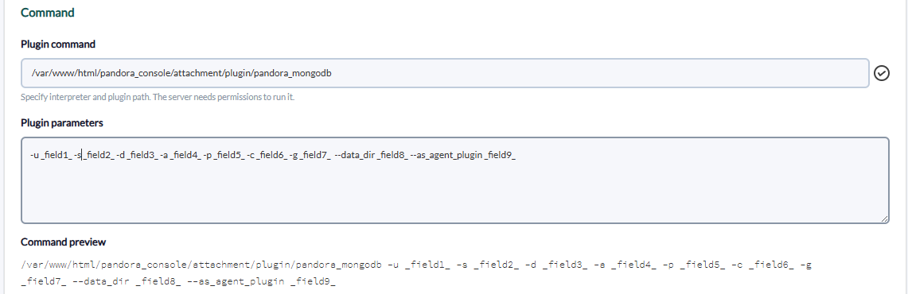

# Pandora MongoDB remote / Atlas plugin

*Article last updated: 2026-10-26.*

## What it does

The `pandorafms.mongodb_remote_atlas` addon monitors MongoDB databases from
Pandora FMS over the network. Each run connects to a MongoDB deployment with a
standard MongoDB connection string and turns the result into Pandora FMS agents
and modules: database size and object counters, the statistics of every
collection, and, when enabled, the connection, network, operation and latency
counters of the server.

A deployment hosted on MongoDB Atlas is monitored the same way, with the
`mongodb+srv://` connection string that Atlas provides. Nothing is installed on
the database host and no Atlas API key is used: the connection string is the
only input.

The addon supports two execution models:

- **Server plugin mode** (default): each run writes an `agent_data` XML file
  into the Pandora FMS data directory, and the Pandora FMS server ingests it.
- **Agent plugin mode** (`--as_agent_plugin 1`): each run prints the generated
  modules as XML on standard output, for the Pandora FMS agent to ingest. This
  mode collects a single database.

The addon keeps no state between runs: every execution reads the metrics at
that moment.

This page documents the remote monitoring plugin. The MongoDB Discovery addon
([MongoDB Discovery](../discovery/mongodb-discovery.md)) is a different
product: it runs Discovery tasks and creates its agents from them, while this
plugin creates its agents from its own runs.

## Prepare

### Compatibility

| Scope | State | Evidence |
|-------|-------|----------|
| Network access from the host that runs the plugin to the MongoDB listener | `Required` | The addon connects over the network; nothing is installed on the database host |
| A MongoDB user allowed to run `dbStats` and `collStats` on the monitored databases | `Required` | Prerequisite for the database and collection modules, not a compatibility statement |
| A MongoDB user with the `clusterMonitor` role when the server-status group is enabled | `Required` | Prerequisite for the `serverStatus` command, not a compatibility statement |
| MongoDB server versions | `Not validated` | No test record establishes compatibility with a concrete MongoDB release |
| MongoDB Atlas cluster tiers | `Not validated` | No test record establishes compatibility with a concrete Atlas tier |
| Pandora FMS versions | `Not validated` | No test record establishes console or server version compatibility |
| Operating system of the host that runs the plugin | `Not validated` | No test record establishes operating-system compatibility |

### Requirements

1. **A MongoDB deployment** — a self-managed server, a replica set, a sharded
   cluster or an Atlas cluster — reachable from the host that runs the plugin.
2. **A MongoDB user** with the roles described in
   [MongoDB access](#mongodb-access).
3. **Python 3 and the addon dependencies** on the host that runs the plugin.
   The addon ships a `requirements.txt`; install it with
   `pip3 install -r requirements.txt` from the addon directory. The MongoDB
   driver it lists is required in every case, and the DNS library it lists is
   what resolves the seed list of a `mongodb+srv://` URI.
4. **Pandora FMS**: the plugin server, when the addon runs in server plugin
   mode, or a Pandora FMS agent, when it runs in agent plugin mode.

### MongoDB access

The addon uses no Atlas administration interface, so an Atlas deployment is
granted access like any other MongoDB deployment:

- **Monitoring the databases** needs the `dbStats` and `collStats` actions on
  each monitored database. MongoDB's built-in `read` role includes both.
- **Collecting all databases** (`-a 1`) also lists the databases of the
  deployment, which needs the `listDatabases` action. The built-in
  `readAnyDatabase` and `clusterMonitor` roles include it.
- **The server-status group** (`-s`) reads the `serverStatus` command, which
  needs the `clusterMonitor` role. On Atlas, `clusterMonitor` is a built-in
  role that can be assigned to the database user.

No official source identifies a narrower set of privileges than these actions;
grant only what the options you enable need.

For Atlas, also add the address of the host that runs the plugin to the
deployment's access list, and use the connection string that the Atlas
interface returns for the cluster.

### Install the addon

Download the addon package from its Marketplace entry, which is limited to
licensed users:

[https://marketplace.pandorafms.com/entries/pandorafms.mongodb_remote_atlas](https://marketplace.pandorafms.com/entries/pandorafms.mongodb_remote_atlas)

Register it in the console as a server plugin, or copy the addon script and
its `requirements.txt` to the host that will run it and register the plugin by
hand. Either way the plugin is executed by the Pandora FMS plugin server, on
the server you select for each module. The plugin command is the path to the
addon script on that server; the parameters are the options documented in
[Command line](#command-line) and in [Register the plugin in the console](#register-the-plugin-in-the-console).

The Marketplace entry states that this addon is no longer actively maintained
or updated.

The commands in this page use `pandora_mongodb` as the script name, which is
how the console registers it. If the copy on your server keeps the `.py`
extension, use that name in the commands instead.

## Configure

### Execution models

Server plugin mode is the default: the addon writes one XML file per agent into
the Pandora FMS data directory, and the server ingests them. Select it by
omitting `--as_agent_plugin`, or by giving it a value other than `1`.

Agent plugin mode requires `--as_agent_plugin 1` and a single database in
`-d`. In this mode the addon prints the modules of the run as `<module>`
blocks on standard output, without an `agent_data` wrapper, and writes no
file. The agent that runs the plugin owns the modules, so the agent name,
group and prefix have no effect in this mode.

### Collect one database or all of them

Exactly one of the two collection scopes must be selected, and the addon stops
without collecting anything when neither is:

| Scope | Option | Agents created |
|-------|--------|----------------|
| A single database | `-d appdb` | One agent per run |
| All databases the user can list | `-a 1` | One agent per database |

When both options are given, `-a 1` wins and `-d` is ignored. All-databases
mode skips every database whose name contains `local`, and processes every
other database the user can list, including `admin` and `config` when the user
can see them.

### Server plugin mode

This is the minimum command for one database, writing the agent file into the
default data directory:

```bash
./pandora_mongodb -u '<MONGODB_URI>' -d appdb
```

Add the group, the agent prefix and the collection statistics of every
collection in that database:

```bash
./pandora_mongodb -u '<MONGODB_URI>' -d appdb \
    -c 1 -p atlas_ -g mongodb --data_dir /var/spool/pandora/data_in
```

Collect every database instead, with the server-status counters:

```bash
./pandora_mongodb -u '<MONGODB_URI>' -a 1 -s 1 -p atlas_
```

`appdb` is an example database name. `<MONGODB_URI>` is the complete connection
string: for a self-managed deployment the `mongodb://` form with the host, the
port, the user and the password, and for Atlas the `mongodb+srv://` string the
Atlas interface returns. Connection options such as the authentication
database, a replica set name, TLS and a CA file belong to the URI; the addon
has no separate option for them and passes the string to the MongoDB driver
unchanged.

The prefix is prepended to the name of every agent the run creates; it does
not change module names. Use the name of an existing console group: the addon
writes the group name it is given and does not create groups. The user that
runs the addon must be able to write into `--data_dir`.

### Agent plugin mode

```bash
./pandora_mongodb -u '<MONGODB_URI>' -d appdb -c 1 --as_agent_plugin 1
```

The modules of the run are printed on standard output. This mode supports one
database: with `-a 1` the addon writes the agent files as usual and the flag
has no effect.

### Register the plugin in the console

Open **Servers → Plugins → Register Plugin**, or upload the addon package,
which registers the plugin with its command and parameter string. The
parameter string holds one macro per option:

```text
-u _field1_ -s _field2_ -d _field3_ -a _field4_ -p _field5_ -c _field6_ -g _field7_ --data_dir _field8_ --as_agent_plugin _field9_
```



Each macro is filled when the plugin is used in a module:

| Field | Description | Example value |
|-------|-------------|---------------|
| `_field1_` | Connection URI, credentials included. Enable **Hide value** | `<MONGODB_URI>` |
| `_field2_` | Server-status group | `1` |
| `_field3_` | Database to monitor | `appdb` |
| `_field4_` | All databases | `1` |
| `_field5_` | Agent name prefix | `atlas_` |
| `_field6_` | Collection statistics | `1` |
| `_field7_` | Destination group | `mongodb` |
| `_field8_` | Pandora FMS data directory | `/var/spool/pandora/data_in` |
| `_field9_` | `1` for agent plugin mode, `0` for server plugin mode | `0` |

That string runs as it is only when every macro has a value: an option whose
macro is left empty is followed by the next option instead of a value, and the
addon stops with `error: argument -X/--X: expected one argument`. It also
cannot express a single-database run, because `-a` has no value that disables
it. Edit the parameter string for the run you need instead:

| Run | Parameter string |
|-----|------------------|
| One database | `-u _field1_ -d _field2_ -p _field3_ -g _field4_ --data_dir _field5_` |
| One database, with collection statistics | `-u _field1_ -d _field2_ -c _field3_ -p _field4_ -g _field5_ --data_dir _field6_` |
| All databases | `-u _field1_ -a 1 -p _field2_ -g _field3_ --data_dir _field4_` |
| Agent plugin mode | `-u _field1_ -d _field2_ -p _field3_ -g _field4_ --as_agent_plugin 1` |

Omit an optional option to disable it: `-s 0` still enables the server-status
group, and `-c 0` still enables the collection statistics.

The plugin is then available when creating plugin modules, and each module
fills the macros individually. The module runs on the Pandora FMS server
selected for it, so one registered plugin serves several deployments.

### Credentials and transport

- The connection string carries the database user and password. The addon
  accepts it only as a command-line argument, so it is visible in the process
  list of the host while the run lasts and stays in the shell history when you
  type it. Store it in a module field with **Hide value** enabled, restrict who
  can read the module configuration in the console, and avoid passing it in a
  shared shell.
- A plain `mongodb://` connection without TLS sends the credentials and the
  collected metrics unencrypted. Use the `tls` options of the URI, which the
  addon passes to the driver, or restrict the deployment to a trusted network.
- The addon stores no credential of its own: it holds no configuration file
  and keeps no state between runs.

## Verify

Run the addon from a terminal on the host that will execute it, with the same
options the plugin will use:

```bash
./pandora_mongodb -u '<MONGODB_URI>' -d appdb
```

A successful single-database run prints `1` and then the number of agents it
created, so a run without the server-status group prints `1` twice, and writes
one file per agent into the data directory:

```text
/var/spool/pandora/data_in/mongo_appdb.1761483000.data
```

An all-databases run prints the number of agents it created: one per database,
plus one when the server-status group is enabled.

```bash
./pandora_mongodb -u '<MONGODB_URI>' -a 1 -p atlas_
```

In agent plugin mode, a successful run prints one `<module>` block per
generated module. This is an excerpt of a run over one database with collection
statistics:

```xml
<module>
	<name><![CDATA[collections]]></name>
	<type>generic_data</type>
	<data><![CDATA[12]]></data>
	<description><![CDATA[database collections]]></description>
	<unit><![CDATA[]]></unit>
</module>
<module>
	<name><![CDATA[dataSize]]></name>
	<type>generic_data</type>
	<data><![CDATA[5242880]]></data>
	<description><![CDATA[database dataSize]]></description>
	<unit><![CDATA[b]]></unit>
</module>
<module>
	<name><![CDATA[size appdb.orders]]></name>
	<type>generic_data</type>
	<data><![CDATA[1048576]]></data>
	<description><![CDATA[size of appdb.orders]]></description>
	<unit><![CDATA[b]]></unit>
</module>
<module>
	<name><![CDATA[status]]></name>
	<type>generic_data</type>
	<data><![CDATA[1]]></data>
	<description><![CDATA[database status]]></description>
	<unit><![CDATA[]]></unit>
</module>
```

In the console, the agent appears with the name `<prefix><database>` and its
modules after the server has processed the data file. The agent and module
inventory is described in [Understand the results](#understand-the-results).

## Understand the results

### Agents created

| Property | Value |
|----------|-------|
| Agent name and alias | The `-p` prefix followed by the database name, for example `mongo_appdb` |
| Description | `database stats` for a database agent, `server status stats` for the server-status agent |
| Group | The `-g` value, `mongodb` by default |
| Address | `127.0.0.1` |
| Operating system and version | Empty: the addon does not report them |
| Interval | Empty: the console default applies |
| Timestamp | The local time of the run |

The number of agents depends on the collection scope and on the server-status
group:

| Run | Agents |
|-----|--------|
| `-d` | One agent, named after the database |
| `-d -s` | Two agents: the database agent, which also holds the server-status modules, and a second agent named `<prefix><host>`, with the `:` of the host replaced by `.` |
| `-a 1` | One agent per database, named after the database |
| `-a 1 -s` | The database agents, plus a separate agent named `<prefix><host>` with the server-status modules |

The server-status modules are therefore part of the database agent only in a
single-database run.

### Module groups

- **Database group.** Always collected for every agent of the run. It reports
  the counters and sizes of the database and ends with `status`, which carries
  the `ok` value of the statistics command.
- **Collection group.** Collected when `-c` is present. Each collection of the
  database contributes one module per statistic, named after the collection
  namespace `<database>.<collection>`.
- **Server-status group.** Collected when `-s` is present. It reports the
  `connections`, `network`, `opcounters` and `opLatencies` counters of the
  MongoDB server as one module per key returned by the deployment.

Every module of the database and collection groups is created only when the
deployment reports the corresponding field, so the list an agent receives
depends on its server version and storage engine. The counters of the
server-status group follow the keys present in the `serverStatus` output of
that deployment.

The full inventory is in [Generated modules](#generated-modules).

## Operate and troubleshoot

### Scheduling and manual execution

- The addon has no daemon mode and no internal scheduler: it runs once and
  exits. When registered as a server plugin, Pandora FMS executes it with the
  interval of the module; outside Pandora FMS, schedule it with `cron`.
- Every run opens its own connection and closes it at exit, so the addon can
  be executed manually at any time without disturbing the deployment.
- A run that collects all databases of a large deployment reads the statistics
  of every collection and every database in one process. Keep the collection
  group disabled, or reduce the scope to single databases, when the run does
  not finish within the module timeout.

### Known limitations

- **The optional groups cannot be disabled by value.** `-s 0` and `-c 0` still
  enable the server-status and collection groups, because the addon only checks
  whether the option was given. Omit the option to disable the group.
- **`-a` accepts one enabling value.** Use `-a 1`. Any other value leaves both
  collection scopes disabled and the run stops with an error.
- **The addon needs either `-d` or `-a 1`.** Without either of them it prints a
  Python `NameError` traceback instead of a usage message.
- **Agent plugin mode ignores `-a`.** With `-a 1` the agent files are written
  even when `--as_agent_plugin 1` is present; the flag only works with `-d`.
- **The prefix applies to agent names only**, not to module names.
- **Per-collection `avgObjSize` is collected only in single-database mode.** An
  all-databases run omits it from the collection group.
- **Collection statistics have no collection filter.** Every collection of the
  database is read.
- **There is no timeout, retry or debug option.** The plugin server timeout
  applies to the whole run, and diagnostics are limited to the printed error.

### Diagnostics

- **`Error: <message>` followed by exit status 1** — the run stopped. The
  message is the exception the MongoDB driver or the statistics command
  returned. For a connection or authentication failure, check the URI, the
  credentials it carries, the network path and, on Atlas, the access list of
  the deployment.
- **`Error: not authorized on <database> to execute command ...`** — the user
  cannot run `dbStats` or `collStats` on that database. Grant the actions
  listed in [MongoDB access](#mongodb-access).
- **`error: argument -s/--server_status: expected one argument`** (exit status
  2) — an option in the command line or in the console parameter string is
  followed by another option instead of a value. Give it a value or remove the
  option.
- **`NameError: name 'count' is not defined`** — neither `-d` nor a valid
  `-a 1` was given, or `-a` received a value other than `1`.
- **`NameError: name 'db' is not defined`** — the server-status group was
  enabled in a run that collected no database.
- **`KeyError: 'freeStorageSize'`, `KeyError: 'scaleFactor'` or another
  `KeyError`** — the deployment does not report that field in the collection
  statistics, so the collection group cannot be built. Disable `-c` for that
  deployment.
- **`KeyError: 'opLatencies'` or another `KeyError` in the server-status
  group** — the `serverStatus` output of the deployment does not include that
  section. Disable `-s`.
- **`Error: [Errno 13] Permission denied`** — the user that runs the addon
  cannot write into `--data_dir`. Fix the permissions or point the option at a
  writable directory.
- **`Error: [Errno 17] File exists`** — a data file for the same agent and the
  same second already exists. Repeat the run.
- **The agent appears with fewer modules than expected** — the deployment does
  not report those fields. Compare the agent with the conditions in
  [Generated modules](#generated-modules).
- **No agent appears in the console** — check that the data directory of the
  run is the one the Pandora FMS server reads, that the file was created, and
  that the `-g` group exists in the console.

## Reference

### Command line

```text
./pandora_mongodb -u <MONGODB_URI> [options]
```

| Name | Required | Default | Description |
|------|----------|---------|-------------|
| `-u`, `--uri` | Yes | — | MongoDB connection string. It carries the hosts, the credentials and the connection options, including the TLS options |
| `-d`, `--database` | One of `-d` or `-a 1` | — | Database to monitor |
| `-a`, `--alldatabases` | One of `-d` or `-a 1` | `0` | `1` monitors every database the user can list, except those whose name contains `local` |
| `-s`, `--server_status` | No | Disabled | Any value, including `0`, enables the server-status group. Omit the option to disable it |
| `-c`, `--collectionstats` | No | Disabled | Any value, including `0`, enables the collection statistics. Omit the option to disable it |
| `-p`, `--prefix` | No | `mongo_` | Prefix of the name of every agent the run creates |
| `-g`, `--group` | No | `mongodb` | Group of the agent in the console; the addon does not create groups |
| `--data_dir` | No | `/var/spool/pandora/data_in/` | Directory where the agent files are written in server plugin mode |
| `--as_agent_plugin` | No | `0` | `1` prints the modules on standard output instead of writing agent files. Only with `-d` |
| `--as_discovery_plugin` | No | `0` | `1` replaces the trailing count with a JSON summary of the agents created. It does not change what is collected or written |

`-h` and `--help` print the option list. The help header reports the plugin
version as `250821`.

### Command output

| Run | Standard output |
|-----|-----------------|
| `-d`, server plugin mode | `1`, and the number of agents created on the next line |
| `-a 1`, server plugin mode | The number of agents created: one per database, plus one when the server-status group is enabled |
| `-d --as_agent_plugin 1` | One `<module>` block per module, then the number of agents created |
| Any run with `--as_discovery_plugin 1` | A JSON summary with `Agents (databases) created by the plugin` and the list of databases, instead of the trailing count |

### Generated modules

#### Database modules

Collected for every agent of the run. The **Field** column is the field of the
`dbStats` output that each module reads; the module is created only when the
deployment returns it.

| Module | Type | Field | Unit |
|--------|------|-------|------|
| `collections` | `generic_data` | `collections` | — |
| `views` | `generic_data` | `views` | — |
| `objects` | `generic_data` | `objects` | — |
| `avgObjSize` | `generic_data` | `avgObjSize` | `b` |
| `dataSize` | `generic_data` | `dataSize` | `b` |
| `storageSize` | `generic_data` | `storageSize` | `b` |
| `totalFreeStorageSize` | `generic_data` | `totalFreeStorageSize` | `b` |
| `numExtents` | `generic_data` | `numExtents` | — |
| `indexes` | `generic_data` | `indexes` | — |
| `indexSize` | `generic_data` | `indexSize` | — |
| `fileSize` | `generic_data` | `fileSize` | `b` |
| `nsSizeMB` | `generic_data` | `nsSizeMB` | `mb` |
| `status` | `generic_data` | `ok` | — |

#### Collection modules

Collected when `-c` is present, one set per collection. `<ns>` is the
namespace of the collection, for example `appdb.orders`.

| Module | Type | Field | Unit |
|--------|------|-------|------|
| `size <ns>` | `generic_data` | `size` | `b` |
| `count <ns>` | `generic_data` | `count` | `b` |
| `avgObjSize <ns>` | `generic_data` | `avgObjSize` | `b` |
| `storageSize <ns>` | `generic_data` | `storageSize` | `b` |
| `freeStorageSize <ns>` | `generic_data` | `freeStorageSize` | `b` |
| `capped<ns>` | `generic_data` | `capped`, as `1` or `0` | — |
| `nindexes <ns>` | `generic_data` | `nindexes` | — |
| `totalIndexSize <ns>` | `generic_data` | `totalIndexSize` | — |
| `totalSize <ns>` | `generic_data` | `totalSize` | `b` |
| `scaleFactor <ns>` | `generic_data` | `scaleFactor` | — |
| `status <ns>` | `generic_data` | `ok` | — |

`avgObjSize <ns>` is generated in single-database mode only, and `capped<ns>`
has no space between the name and the namespace.

#### Server-status modules

Collected when `-s` is present, one module per key the deployment returns. All
of them are `generic_data` without a unit.

| Module | Section of `serverStatus` |
|--------|--------------------------|
| `server_status.connections <key>` | `connections` |
| `server_status.network <key>` | `network` |
| `server_status.operations <key>` | `opcounters` |
| `server_status.opetationlatencies.reads <key>` | `opLatencies.reads` |
| `server_status.opetationlatencies.writes <key>` | `opLatencies.writes` |
| `server_status.opetationlatencies.commands <key>` | `opLatencies.commands` |

The `opetationlatencies` segment of the name is spelled that way in the module
names the addon generates.

### Output files

In server plugin mode the addon writes one file per agent:

```text
<data_dir>/<agent_name>.<epoch>.data
```

The file contains an `agent_data` document with the attributes of
[Agents created](#agents-created) and one `<module>` block per module. The
addon creates the file exclusively, so a second run for the same agent within
the same second fails instead of overwriting the first file.

### Addon identity

| Property | Value |
|----------|-------|
| Marketplace identifier | `pandorafms.mongodb_remote_atlas` |
| Name | Pandora MongoDB remote/ Atlas |
| Version | `1.0` |
| Version reported by the plugin help | `250821` |
| License | One |
| Availability | Download limited to licensed users |
| Marketplace last update | 2025-07-01 |
| Maintenance | The Marketplace entry states that the addon is no longer actively maintained or updated |
