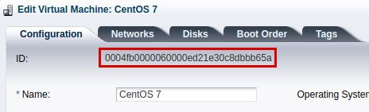
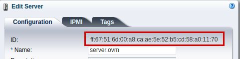

# Oracle VM monitoring plugin

*Article last updated: 2026-10-26.*

## What it does

The Oracle VM monitoring plugin monitors an Oracle VM environment from Pandora FMS
through the REST API of its Oracle VM Manager. Each run reads the manager and
what it manages, and turns the result into Pandora FMS agents and modules: the
manager state and its job counters, server pool capacity, the OVM Servers with
their network ports, the virtual machines with their memory and disks, and the
file servers with their file systems. Nothing is installed on the Oracle VM
hosts: the plugin runs from a host that can reach the OVM Manager API.

Every execution is one-shot: it authenticates against the API, collects the
whole environment and delivers one agent data document per element. Delivery is
either through Tentacle or by copying the documents into a Pandora FMS data
folder. The plugin has no agent plugin mode and does not print module XML on
standard output.

Oracle VM monitoring is a different addon from Oracle Discovery
(`pandorafms.oracle`), which monitors Oracle Database instances and is documented
in [Oracle Discovery](../discovery/oracle.md). This page covers the Oracle VM
virtualization manager only.

## Prepare

### Compatibility and availability

| Scope | State | Evidence |
|-------|-------|----------|
| Oracle VM Manager 3.4.5 | `Known compatible` | The addon guide linked from the Marketplace entry states the plugin was developed against Oracle VM Manager 3.4.5 |
| Oracle VM Manager versions other than 3.4.5 | `Not validated` | No version matrix has been recorded for this addon |
| Reachability from the host that runs the plugin to the OVM Manager REST API | `Required` | Every run queries the API |
| An OVM Manager user allowed to read the API resources | `Required` | Each request is authenticated with HTTP Basic credentials |
| The Pandora FMS plugin library (`PandoraFMS::PluginTools`) | `Required` | The addon guide lists it as a prerequisite |
| A Tentacle server reachable at `tentacle_ip` and `tentacle_port` | `Required` when `transfer_mode=tentacle` | Every generated document is sent to that address and port |
| A writable data folder | `Required` when `transfer_mode` is not `tentacle` | Every generated document is copied into `local_folder` |
| Oracle VM guest additions on the monitored virtual machines | `Required` for VM IP addresses | The addon guide states that IP collection needs guest additions |
| A specific Pandora FMS release | `Not validated` | No version matrix is recorded for this addon. The Marketplace states that its integrations are compatible with Pandora FMS NG 784 and later |
| A specific host operating system | `Not validated` | No operating system has been recorded for this version |

The addon is distributed through the Pandora FMS Marketplace and its download is
limited to licensed users.

### Requirements

1. **Network access** from the host that runs the plugin to the OVM Manager REST
   API. The example configuration uses HTTPS on port `7002`.
2. **An OVM Manager user and its password.** The plugin only reads: it requests
   the manager, the job list, the server pools, the servers, the virtual
   machines, the virtual NICs, the disks, the file servers and the file systems.
   Use an account with read access to those resources.
3. **A host to run the plugin** with the Pandora FMS plugin library
   (`PandoraFMS::PluginTools`), which is part of a Pandora FMS installation. The
   Pandora FMS server that runs the plugin is the usual choice.
4. **A delivery target** that Pandora FMS can read: a Tentacle server, or a data
   folder read by the Pandora FMS data server.
5. **Oracle VM guest additions** inside the monitored virtual machines, only
   when you want their IP addresses in the agent data.

### Install the plugin

The addon guide documents the plugin as the `ovm-plugin.64` executable plus the
`ovm-plugin.conf` configuration file. Copy both to the host that will run the
plugin; for a console server plugin the recommended folder is
`/usr/share/pandora_server/util/plugin/`.

Download the package from the Pandora FMS Marketplace entry, which is limited to
licensed users:

[https://marketplace.pandorafms.com/entries/pandorafms.oracle_vm_monitoring](https://marketplace.pandorafms.com/entries/pandorafms.oracle_vm_monitoring)

The shipped configuration file contains sample values. Replace the API URL, the
user and the password before the first run, and restrict the file permissions to
the user that runs the plugin. If your package names the executable differently,
use that name in place of `ovm-plugin.64` in the examples.

## Configure

### Configuration file

The plugin takes its settings from three sources, in increasing precedence:

```text
defaults < configuration file < command-line options
```

The configuration file is a plain-text file of `key=value` lines. Blank lines and
lines that start with `#` are skipped, keys and values are trimmed, and a
repeated key keeps its last value. To use a file, pass its path as the first and
only positional argument. Any option can also be passed on the command line as a
`-key value` pair, and the command-line value replaces the file value:

```bash
./ovm-plugin.64 -interval 600 -debug 1 <PATH_TO_CONFIG>
```

There is no help option. A run without a readable configuration and without the
required options fails with the error that names the missing settings, followed
by a usage line that shows the configuration file as the only argument.

This is the minimum configuration for a Tentacle delivery:

```ini
ovmm_api_url=https://<OVM_MANAGER_URL>:7002/ovm/core/wsapi/rest/
user=<USERNAME>
password=<PASSWORD>
transfer_mode=tentacle
tentacle_ip=<PANDORA_FMS_URL>
tentacle_port=41121
```

### Connection settings

`ovmm_api_url` is the base URL of the OVM Manager REST API, up to and including
the REST root. The plugin appends the resource names (`Manager`, `Job`,
`ServerPool`, `Server`, `FileServer`) and follows the resource URIs the API
returns. A trailing slash is optional: the plugin adds one when it is missing.

The user and the password are sent with HTTP Basic authentication on every
request. Requests ask for `application/xml`, and the plugin reads the XML
responses.

### Credentials and transport

- Use an `https` URL. With `http` the credentials and the collected data travel
  unencrypted; restrict the API to a trusted network if you cannot use HTTPS.
- **The plugin does not verify the OVM Manager certificate.** It accepts any
  certificate, including a self-signed one, so HTTPS protects the credentials in
  transit but does not authenticate the server. Keep the API on a management
  network you control.
- The password is stored in plain text in the configuration file. Keep the file
  owned by the plugin user and readable by nobody else, for example with
  `chmod 600`.
- Avoid `-password` on the command line: the command is kept in the shell history
  and is visible in the process list while the plugin runs. The plugin has no
  separate credentials-file option, so prefer the configuration file and pass
  only non-secret overrides as options.
- The `include` key reads another key file at that point in the configuration,
  so a shared file can hold the connection settings while the main file holds the
  rest. Keys read after the `include` line override the included ones.

### Agent names and renaming

Every generated agent has a default name taken from the OVM API:

| Resource | Default agent name |
|----------|--------------------|
| OVM Manager | The manager UUID |
| Server pool | The pool ID |
| OVM Server | The MD5 hash of the server ID, because the MAC-style server ID is not a valid agent name |
| Virtual machine | The VM ID |
| File server | The file server ID |

The alias is the element name reported by the API (the manager name, the pool
name, the server name, the VM name or the file server name). Set
`alias_as_name=1` to leave the alias empty so Pandora FMS uses the agent name as
the alias instead.

The IDs come from the OVM Manager interface: open the element and read its
**ID** field.





To rename an agent, add a configuration key whose name is exactly the default
agent name. Any number of renaming keys can be added:

```ini
# A virtual machine, renamed by its VM ID.
0004fb0000060000ed21e30c8dbbbb65a=app-vm-01
# An OVM Server, renamed by the MD5 hash of its ID.
a62454d287e230c773f56d618b78500f=ovm-server-01
```

The renaming keys are ordinary configuration keys, so they follow the same
precedence as the rest: a `-key value` option overrides the file. For a server,
the key must be the MD5 hash, not the MAC-style ID, because the hash is the
default agent name. The commented `default_agent_name1` sample in the shipped
file does not rename anything: the key is the ID value, not a field name. Renaming
the manager, a pool or a server leaves its children pointing to the default name;
see [Known limitations](#known-limitations).

### Delivery

| `transfer_mode` | Behavior |
|-----------------|----------|
| `tentacle` | The plugin writes each document to `tmp` and sends it with the Tentacle client to `tentacle_ip`:`tentacle_port` |
| Any other value, including empty | The plugin writes each document to `tmp` and copies it into `local_folder` |

Tentacle delivery requires `tentacle_ip`. A delivery mode other than `tentacle`
requires `local_folder`. The plugin validates both conditions before contacting
the OVM Manager, and stops with an error when the required value is missing.

The generated document is removed from `tmp` after a successful delivery and
kept there when the delivery fails. Delivery errors are reported on standard
error only when `debug=1`; by default a failed delivery is silent and the run
continues with the next agent.

### Register the plugin in the console

The plugin can be registered in the Pandora FMS console as a server plugin, so
the Pandora FMS server runs it periodically instead of a manual or `cron`
execution. Every execution collects the whole environment and delivers all its
agents.

1. Open **Servers → Plugins** and click **Register Plugin**.
2. Set the name, the plugin type **Standard**, a maximum timeout and a
   description. Raise the maximum timeout when a run over a large environment
   takes longer than the default.
3. In **Plugin command**, enter the path to the `ovm-plugin.64` executable on the
   Pandora FMS server, for example
   `/usr/share/pandora_server/util/plugin/ovm-plugin.64`.
4. In **Plugin parameters**, pass the path to the configuration file as the only
   argument:

```text
/etc/pandora/plugins/ovm-plugin.conf
```

5. Keep the API user and password in that file rather than in console fields.

<!-- SCREENSHOT NEEDED: Servers → Plugins registration form for the Oracle VM monitoring addon, showing the executable path and a configuration file path as the only parameter. -->

The same registration can pass individual settings with the plugin macros
`_field1_`, `_field2_`, ... instead of a file, for example
`-ovmm_api_url _field1_ -user _field2_ -password _field3_ -transfer_mode tentacle -tentacle_ip 127.0.0.1`.
In that case mark the password field as hidden.

The value printed by the execution is not the monitoring data: the plugin
delivers the agents itself, and the data appears in the generated agents. All the
agents of the environment are created or updated by the same execution.

## Verify

Run the plugin manually with the configuration file as its only argument:

```bash
./ovm-plugin.64 <PATH_TO_CONFIG>
```

A successful run ends with the line `Complete!` and exits with status `0`. It
prints nothing else unless `debug=1` is set. With `debug=1` the run also prints
its progress, for example:

```text
> Connecting to OVM Manager REST API...
 >> Collecting OVM Manager information...
 >> Creating XML structure for OVM Manager agent...
 >> Transferring OVM Manager agent XML...
> Scanning OVM servers pools...
```

Then check the console after the first execution:

1. The OVM Manager agent, named after the manager UUID.
2. One agent per server pool, one per OVM Server, one per virtual machine and one
   per file server, under the parent described in
   [Generated agents](#generated-agents).
3. The modules of each agent, listed in
   [Generated modules](#generated-modules).

<!-- SCREENSHOT NEEDED: Agent tree in the Pandora FMS console showing the OVM Manager agent with its pool, server, VM and file server children after a successful run. -->

If the manager cannot be reached, the run prints
`ERROR: Unable to connect to '<URL>' with user '<USER>'.` and exits with status
`1` without creating or updating any agent. The message repeats the configured
URL and user, so avoid running it in a shared terminal.

## Understand the results

A run produces up to five agent groups. Each group answers a different question:

- **Manager.** Whether the OVM Manager is running, and how many of its jobs ended
  in `SUCCESS` or in `FAILURE`.
- **Server pools.** How many virtual machines the pool holds, how many of its
  servers are running, and what share of the pool memory is still usable.
- **OVM Servers.** Whether each server is running, its usable memory share, the
  state of each network port, and how many of its virtual machines are running.
- **Virtual machines.** Whether each VM is running, the share of the server
  memory it uses and how much of each virtual disk is occupied.
- **File servers.** The free space share of each file system, with its path.

The state modules are binary: `1` when the resource is in its healthy state
(`RUNNING` for the manager, the servers and the VMs; `PORT_UP` for a port) and
`0` otherwise. The description of each state module repeats the raw state
reported by the API, so a stopped resource shows why in the module description.

The percentage modules are computed from the capacities the API reports:

- `Usable memory (%)` is the memory still available for virtual machines, not
  the memory in use. It is `usableMemory` divided by `memory`, for a server or
  summed over the servers of a pool.
- `Used memory on server (%)` is the current memory of the VM as a share of the
  **server** total memory, not of the memory assigned to the VM. The module
  description states the current, the server total and the assigned memory.
- `<disk name> on disk size (%)` is the space the virtual disk occupies on
  storage as a share of its nominal size, which shows thin provisioning.
- `<file system> free size (%)` is the free space as a share of the file system
  size.

A zero denominator produces `0` instead of an error. The plugin sets no warning
or critical thresholds on the generated modules; add thresholds on the modules
you want to alert on.

The agent aliases make the console readable: the alias is the element name,
while the agent name is the API identifier. For OVM Servers the agent name is the
MD5 hash of the server ID, so the server name only appears as the alias and in
the description.

## Operate and troubleshoot

### Run-time behavior

- The plugin keeps no state between runs. Every execution collects the whole
  environment, so it can be run manually at any time.
- Resources are collected in a fixed order: manager, job list, server pools,
  servers, the VMs of each server, and file servers. Each resource costs at least
  one API request, and the requests are sequential, so a large environment takes
  proportionally longer.
- Every API request uses a three-second timeout. The configuration file has no
  key to change it; a manager that answers more slowly produces missing agents
  or missing modules.
- `debug=1` prints the progress of the run and the delivery errors. `debug=0`, the
  default, hides both.
- The run ends with `Complete!` and status `0` even when one or more deliveries
  failed. Check the console, or run with `debug=1`, to confirm that every agent
  arrived.
- The plugin collects the whole environment on every run: there is no option to
  limit it to one pool, server, VM or file server.

### Known limitations

These are behaviors of version `1.0`, documented as they are.

- **A manager with fewer than two jobs stops the run.** The job counter expects a
  list of jobs. With zero jobs or exactly one job the run stops with an
  unhandled error right after the Manager agent has been delivered, so no pool,
  server, VM or file server agent is produced. This affects a new or quiet OVM
  Manager.
- **`scan_vm_ip=0` does not disable VM IP collection.** The setting is enabled
  unless its value is something other than `0` or `1`. To stop collecting
  addresses, set `scan_vm_ip=2` or another value outside that pair.
- **A VM address is collected only from a virtual NIC with more than one IP
  address.** A VM whose NIC reports a single address gets an empty agent
  address, even with guest additions installed.
- **The shipped rename sample does not work.** The commented
  `default_agent_name1=new_agent_name1` lines do not rename anything; the key
  must be the default agent name, as described in
  [Agent names and renaming](#agent-names-and-renaming).
- **Renaming a parent agent breaks the hierarchy.** Every parent reference is
  written with the default name of the parent (the manager UUID, the pool ID or the
  MD5 hash of the server), not with the renamed name. If you rename the manager, a
  pool or a server, its children (pools, file servers, servers and VMs) keep
  pointing to the old name. Rename only leaf agents, or keep the default names of
  the agents that have children.
- **Delivery failures are hidden by default.** A failed Tentacle transfer or a
  failed copy leaves the document in `tmp`, is reported only with `debug=1`, and
  does not change the exit status.

### Diagnostics

| Symptom | Cause and action |
|---------|------------------|
| `ERROR: No OVM API URL, user or password provided.` and a usage line, status `1` | `ovmm_api_url`, `user` or `password` is missing, or the configuration file path does not exist and was therefore not read |
| `ERROR: transfer_mode set to tentacle, but no tentacle_ip provided.`, status `1` | Tentacle delivery is selected without a Tentacle server address |
| `ERROR: transfer_mode set to local, but no local_folder provided.`, status `1` | `transfer_mode` is not `tentacle` and `local_folder` is empty |
| `ERROR: Unable to connect to '<URL>' with user '<USER>'.`, status `1` | The manager URL, the credentials or the network path is wrong. Check that the URL is the REST base and that the user can read the API. The certificate is not verified, so TLS is not the cause |
| Only the Manager agent appears | The job list broke the run (see [Known limitations](#known-limitations)), or a later request failed. Run with `debug=1` to see where the run stops |
| The Manager agent and the pool agents appear, but no server agent | The server list request failed, or the servers were not returned by the API. Run with `debug=1` |
| A VM agent has no address | Guest additions are missing, or the NIC reports a single IP address (see [Known limitations](#known-limitations)) |
| No delivery error and no new data in the console | Delivery failed silently, or the destination is not read by Pandora FMS. Run with `debug=1` and check `tentacle_ip`/`tentacle_port` or `local_folder` |
| The agents appear in a group other than `group` | The Pandora FMS server is configured with `autocreate_group_force 1`, which gives the server autocreate group precedence over the group in the agent data |
| The console shows an unexpected agent name | The agent is named after the API ID by default; rename it with a key equal to that name, or check the MD5 hash for OVM Servers |

## Reference

### Configuration file parameters

The file uses `key=value` lines. Blank lines and lines that start with `#` are
skipped.

| Name | Required | Default | Description |
|------|----------|---------|-------------|
| `ovmm_api_url` | Yes | — | Base URL of the OVM Manager REST API, up to the REST root, for example `https://<OVM_MANAGER_URL>:7002/ovm/core/wsapi/rest/`. The trailing slash is optional |
| `user` | Yes | — | OVM Manager user, sent with HTTP Basic authentication |
| `password` | Yes | — | Password for `user`, stored in plain text |
| `group` | No | `Servers` | Group name written in the agent data of the generated agents |
| `interval` | No | `300` | Agent interval, in seconds, written in the agent data |
| `tmp` | No | `/tmp` | Folder where the agent documents are written before delivery |
| `transfer_mode` | No | Empty | `tentacle` delivers through the Tentacle client. Any other value, including empty, copies the documents into `local_folder` |
| `local_folder` | Required when `transfer_mode` is not `tentacle` | — | Folder for the copied documents, for example `/var/spool/pandora/data_in/` |
| `tentacle_ip` | Required when `transfer_mode=tentacle` | — | Tentacle server address |
| `tentacle_port` | No | `41121` | Tentacle server port |
| `tentacle_client` | No | `tentacle_client` | Name or path of the Tentacle client executable |
| `tentacle_opts` | No | Empty | Extra options passed to the Tentacle client, separated by whitespace |
| `alias_as_name` | No | `0` | `1` leaves the alias empty so the agent name is used as the alias; any other value uses the element name |
| `scan_vm_ip` | No | Enabled | Collects the VM IP addresses. Values other than `0` or `1` disable collection; `0` does not (see [Known limitations](#known-limitations)) |
| `debug` | No | `0` | `1` prints the progress of the run and the delivery errors on standard error; `0` hides them |
| `include` | No | — | Reads another key file at that point. Keys read after the `include` line override the included ones |
| `<default agent name>` | No | — | Any key whose name equals a default agent name replaces it. Applies to the manager UUID, pool IDs, VM IDs, file server IDs and the MD5 hash of a server ID |

### Command line

```bash
./ovm-plugin.64 <PATH_TO_CONFIG> [ -key value ... ]
```

| Condition | Behavior |
|-----------|----------|
| A positional argument that names an existing file | The file is read and any further `-key value` pairs override its values |
| No positional argument | The plugin reads only the `-key value` pairs; the required connection keys must come from them |
| A positional argument that does not name an existing file | The file is not read and the path is not reported as an error; the run fails with the missing-settings error unless another source supplies them |
| `-key value` | Replaces the value of the same key from the file or the defaults. A trailing token without its pair is ignored |
| An unknown key | Accepted silently. Only a key equal to an agent name has an effect beyond configuration |

### Generated agents

| Agent | One per | Default name | Alias | Parent |
|-------|---------|--------------|-------|--------|
| OVM Manager | Run: always one | Manager UUID | Manager name | None |
| Server pool | Server pool returned by the API | Pool ID | Pool name | Manager agent |
| OVM Server | Server returned by the API | MD5 hash of the server ID | Server name | Pool agent, or the Manager agent when the server has no pool |
| Virtual machine | VM listed by a server | VM ID | VM name | Server agent |
| File server | File server returned by the API | File server ID | File server name | Manager agent |

Agent attributes:

| Attribute | Value |
|-----------|-------|
| Description | `OVM Manager <manager version>` for the manager; the element description reported by the API when it is usable; otherwise `OVM Server pool`, `OVM Server <version> (Hypervisor: <type> <version>)`, `VM on <server name>` or `OVM File server (Type: <type>)` |
| Address | The IPv4 address of `ovmm_api_url` for the manager (empty when the URL uses a host name); the server `ipAddress` for an OVM Server; the addresses collected from the virtual NICs for a VM; empty for pools and file servers |
| OS version | The VM `osType` for a VM agent; empty for the rest |
| Group and interval | The `group` and `interval` values of the configuration |
| Timestamp | The local time of the run |

A VM is only monitored when the server that owns it lists it. A VM that no
server reports does not get an agent.

### Generated modules

The module names and descriptions below are the ones the plugin writes. The
`Successfull jobs` spelling is the module name used by the plugin.

#### OVM Manager

| Module | Type | Value | Description |
|--------|------|-------|-------------|
| `Manager run state` | `generic_proc` | `1` when `managerRunState` is `RUNNING`, `0` otherwise | `Current state: <state>` |
| `Successfull jobs` | `generic_data` | Number of jobs whose summary state is `SUCCESS` | `Amount of successfull jobs in OVM manager` |
| `Failure jobs` | `generic_data` | Number of jobs whose summary state is `FAILURE` | `Amount of failure jobs in OVM manager` |

The two job modules are only generated when the job list request succeeds; a list
with fewer than two entries stops the run (see
[Known limitations](#known-limitations)). The count covers every job the API
returns, whatever its execution state.

#### Server pool

| Module | Type | Value | Description |
|--------|------|-------|-------------|
| `VMs count` | `generic_data` | Number of VM IDs in the pool | `Amount of VMs in the server pool` |
| `Servers running` | `generic_data` | Servers of the pool whose run state is `RUNNING` | `Total servers count in the pool: <n>` |
| `Usable memory (%)` | `generic_data` | Sum of `usableMemory` × 100 / sum of `memory` over the servers of the pool; `0` when the total is `0` | `Usable memory in the pool: <usable> of <total> MB`, unit `%` |

#### OVM Server

| Module | Type | Value | Description |
|--------|------|-------|-------------|
| `Server run state` | `generic_proc` | `1` when `serverRunState` is `RUNNING`, `0` otherwise | `Current state: <state>` |
| `Usable memory (%)` | `generic_data` | `usableMemory` × 100 / `memory`; `0` when the total is `0` | `Usable memory in the server: <usable> of <total> MB`, unit `%` |
| `Port state (<port name>)` | `generic_proc` | `1` when `portState` is `PORT_UP`, `0` otherwise. One module per Ethernet port | `Current state: <state>` |
| `VMs running` | `generic_data` | VMs of the server whose run state is `RUNNING` | `Total VMs count in the server: <n>` |

#### Virtual machine

| Module | Type | Value | Description |
|--------|------|-------|-------------|
| `VM run state` | `generic_proc` | `1` when `vmRunState` is `RUNNING`, `0` otherwise | `Current state: <state>` |
| `Used memory on server (%)` | `generic_data` | `currentMemory` × 100 / server `memory`; `0` when the server memory is `0` | `Memory used: <current> of <server total> MB (<assigned> MB assigned)`, unit `%` |
| `<disk name> on disk size (%)` | `generic_data` | `onDiskSize` × 100 / `size`, for each disk of the VM. Virtual CD-ROM drives are skipped | `Size: <on-disk> of <size> MB`, unit `%` |

#### File server

| Module | Type | Value | Description |
|--------|------|-------|-------------|
| `<file system> free size (%)` | `generic_data` | `freeSize` × 100 / `size`, for each file system of the server | `Free size (<path>): <free> of <total> MB`, unit `%` |

### Exit status

| Status | Meaning |
|--------|---------|
| `0` | The run finished. The output ends with `Complete!`. Delivery failures do not change the status |
| `1` | `ovmm_api_url`, `user` or `password` is missing; the delivery mode is incomplete; or the OVM Manager did not answer |
| Other | An unhandled error stopped the run, for example a job list with fewer than two entries |

### Addon identity

| Property | Value |
|----------|-------|
| Marketplace identifier | `pandorafms.oracle_vm_monitoring` |
| Name | Oracle VM monitoring |
| Version | `1.0` |
| Category | Miscelaneus |
| License | One |
| Marketplace last update | 2025-07-01 |
| Availability | Download limited to licensed users |
