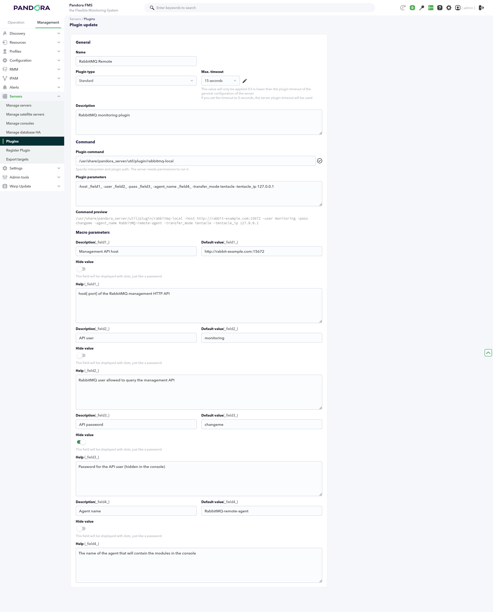
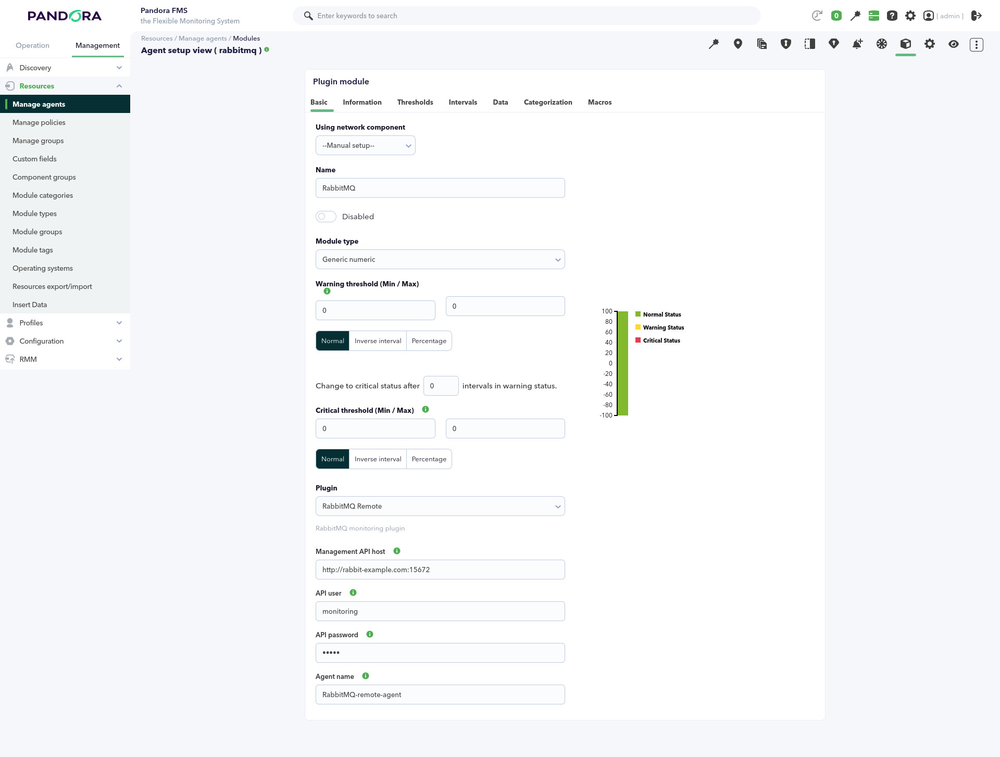
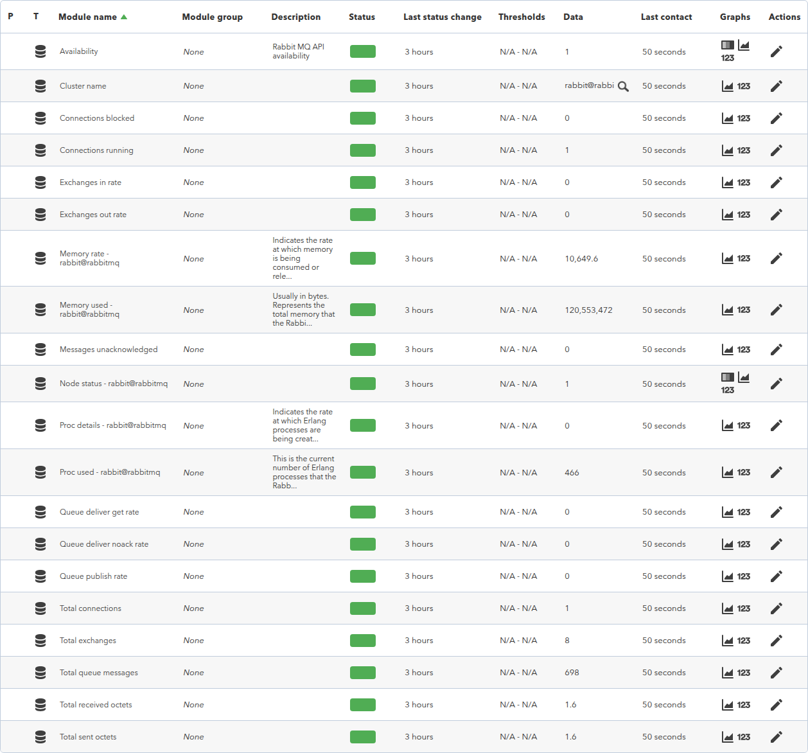

# RabbitMQ Local monitoring plugin

*Article last updated: 2026-10-19.*

## What it does

The `rabbitmq-local` plugin monitors the state of a RabbitMQ cluster from
Pandora FMS. Each run queries the RabbitMQ management HTTP API and turns the
result into Pandora FMS modules: cluster totals, per-node resource metrics,
exchange activity, connection counters and an availability check.

The plugin supports two execution models:

- **Server plugin mode** (default; selected when `as_agent_plugin` is absent,
  `0` or empty): each run builds an `agent_data` document and delivers it to
  Pandora FMS through Tentacle or through a local data folder.
- **Agent plugin mode** (requires an explicit `as_agent_plugin=1`): each run
  prints the generated modules as XML on standard output, for the Pandora FMS
  agent to ingest.

## Prepare

### Compatibility and availability

The plugin has been validated on Rocky Linux 9 against a RabbitMQ broker
running 3.13.7 with the management plugin enabled. The broker must expose its
management HTTP API on the management port — `15672` by default in RabbitMQ —
and the machine that runs the plugin must be able to reach it. The plugin adds
no default port: include the management port in `host` (see
[Configure](#configure)).

### Requirements

1. **A RabbitMQ broker with the management plugin enabled.**
2. **A RabbitMQ user allowed to query the management API.**
3. **A Pandora FMS installation** to receive the plugin output: the Pandora
   FMS server when running in server mode, or the monitored endpoint when
   running in agent plugin mode.
4. **The Tentacle client (`tentacle_client`) available in `PATH`**, only when
   the server mode delivers through Tentacle.

### Install the plugin

The plugin is distributed as the `rabbitmq-local` executable and its
`rabbitmq-local.conf` configuration file. Copy both files to the host that
will run the plugin. The configuration file is optional: when it is used, it is
passed to the executable as its only positional argument.

## Configure

The plugin combines three configuration sources, in increasing precedence:

```text
defaults < configuration file < command-line flags
```

The configuration file is optional. When it is used, it must be the single
positional argument: the first command-line argument that does not start with
`-`, and no other. It is a plain-text file with `key=value` lines. Every key
can also be passed as a command-line flag, in any of these four forms:

```text
-key value    --key value    -key=value    --key=value
```

Flags override the file values, so a shared file can hold the common settings
while each execution overrides what it needs. The configuration is validated
strictly: an unknown flag, a flag without a value at the end of the command
line and a second positional argument are configuration errors reported on
standard error with exit status 1.

Server plugin mode is the default and needs an agent name and a delivery
target. This is the minimum configuration for a server plugin run with
Tentacle:

```ini
host=<RABBITMQ_HOST>:<MANAGEMENT_PORT>
user=<RABBITMQ_USER>
pass=<RABBITMQ_PASSWORD>
agent_name=rabbitmq-local
interval=300
transfer_mode=tentacle
tentacle_ip=<PANDORA_FMS_SERVER>
tentacle_port=41121
```

Or copy the generated XML to a local data folder:

```ini
host=<RABBITMQ_HOST>:<MANAGEMENT_PORT>
user=<RABBITMQ_USER>
pass=<RABBITMQ_PASSWORD>
agent_name=rabbitmq-local
transfer_mode=local
local_folder=/var/spool/pandora/data_in
```

Agent plugin mode requires an explicit `as_agent_plugin=1`. This is the
minimum configuration for an agent plugin run:

```ini
host=<RABBITMQ_HOST>:<MANAGEMENT_PORT>
user=<RABBITMQ_USER>
pass=<RABBITMQ_PASSWORD>
as_agent_plugin=1
```

The same agent plugin configuration with flags only, without a configuration
file:

```bash
./rabbitmq-local -host <RABBITMQ_HOST>:<MANAGEMENT_PORT> -user <RABBITMQ_USER> -pass <RABBITMQ_PASSWORD> -as_agent_plugin 1
```

The credentials can also be read from a separate file, so neither the user nor
the password appears in the command line or in the operating system process
list:

```bash
# Credentials read from a file (readable only by the plugin user).
./rabbitmq-local -host <RABBITMQ_HOST>:<MANAGEMENT_PORT> \
    -cred_file /etc/pandora/plugins/rabbitmq-local.creds -as_agent_plugin 1
```

The credentials file uses `key=value` lines:

```ini
user=<RABBITMQ_USER>
pass=<RABBITMQ_PASSWORD>
```

`agent_name`, `interval`, `transfer_mode`, `local_folder` and the `tentacle_*`
keys are server mode only: they are ignored while the plugin runs in agent
plugin mode. The same server mode run with flags, overriding the file values:

```bash
./rabbitmq-local rabbitmq-local.conf -agent_name rabbitmq-local \
    -transfer_mode tentacle -tentacle_ip <PANDORA_FMS_SERVER>
```

Key points:

- `host` accepts `host`, `host:port`, `http://host:port` or
  `https://host:port`; when no scheme is given the plugin queries
  `http://<host>`. The plugin adds no default port: a `host` without a port
  uses the scheme default (`80` for HTTP, `443` for HTTPS), so include the
  management port — `15672` is RabbitMQ's default — unless a proxy serves the
  API on the scheme default port.
- `ca_file` points to a PEM bundle with the CA that signs the management API
  certificate. It is only used with an `https` host; without it, HTTPS verifies
  against the system trust store.
- The credentials can be set inline (`user` and `pass`) or in a separate
  `key=value` file (`cred_file`) with the `user` and `pass` lines. When
  `cred_file` is set — in the configuration file or as a flag — it takes
  precedence over `user` and `pass`. An unreadable file, or a file without
  `user` or `pass`, is an error.
- In server mode, `agent_name` names the agent created in Pandora FMS, and
  `interval` is the agent interval in seconds.
- The transfer mode is Tentacle only when `transfer_mode=tentacle`; any other
  value, including the default, copies the XML into `local_folder`.
- Command-line flags replace the file values, for example
  `./rabbitmq-local rabbitmq-local.conf -interval 60`.
- The shipped `rabbitmq-local.conf` sets `as_agent_plugin=1` and leaves the
  server mode keys commented out, so it starts in agent plugin mode as it is.

### Credentials and transport

- Prefer HTTPS: with an `https://` host the credentials and the collected
  metrics travel encrypted. With plain HTTP they travel unencrypted, so
  restrict the management API to a trusted network, or place a TLS proxy in
  front of it.
- HTTPS verifies the server certificate against the system trust store, or
  against the `ca_file` bundle when one is configured.
- Inline `pass` is stored in the configuration file in plain text: restrict the
  file permissions to the user that runs the plugin.
- Avoid `-pass` on the command line: the command is stored in the shell
  history and the operating system process list can expose it while the plugin
  runs. Use `-cred_file` with a credentials file readable only by the plugin
  user (for example `chmod 600`).
- The credentials file is stored in plain text as well: its protection is the
  file system permission model, so keep it owned by the plugin user and
  readable by nobody else.

### Register the plugin in the console

The plugin can also be registered in the Pandora FMS console as a server
plugin, so Pandora FMS executes it on the server that runs the modules — the
main server or a remote server — instead of in a command line. Registered this
way the plugin keeps its server mode: every run builds the agent XML and
delivers it, and the agent with its modules appears in the console.

1. Open **Servers → Plugins** and click **Register Plugin**.
2. Set the name, the plugin type **Standard**, an optional maximum timeout and
   a description.
3. In **Plugin command**, enter the path to the `rabbitmq-local` executable on
   the Pandora FMS server, for example
   `/usr/share/pandora_server/util/plugin/rabbitmq-local`.
4. In **Plugin parameters**, keep server mode (no `as_agent_plugin` key) and
   use the plugin macros `_field1_`, `_field2_`, ... as placeholders:

```text
-host _field1_ -user _field2_ -pass _field3_ -agent_name _field4_ -transfer_mode tentacle -tentacle_ip 127.0.0.1
```

5. In **Macro parameters**, describe each field. The example uses these values:

| Field | Description | Example value |
| --- | --- | --- |
| `_field1_` | Management API host, including the port | `http://rabbit.example.com:15672` |
| `_field2_` | RabbitMQ user allowed to query the management API | `monitoring` |
| `_field3_` | Password for that user; mark **Hide value** | — |
| `_field4_` | Name of the agent that will hold the modules in the console | `RabbitMQ-remote-agent` |



`-transfer_mode tentacle -tentacle_ip 127.0.0.1` delivers the agent to the
Tentacle server of the machine that runs the plugin, so the agent lands in the
Pandora FMS server that executes the module. To copy the XML to a local data
folder instead, replace those flags with
`-transfer_mode local -local_folder /var/spool/pandora/data_in`.

Once registered, the plugin is available when creating plugin modules, and
each module fills the fields individually. The module is executed on the
server selected for it, including a remote Pandora FMS server, so each broker
is monitored from the Pandora FMS server closest to it without installing
anything on the broker host. The same registered plugin serves several
RabbitMQ instances, and the field values can use the Pandora FMS macros
documented in the console *Plug-in macros* help.



The registered parameters can also include `-cred_file` — with a fixed path or
as a field — so the modules read the credentials from a file on the Pandora FMS
server instead of holding them in module fields. The parameters can also point
to a configuration file on the server — a literal path or a `_fieldN_` field —
so the file supplies the shared settings.

## Verify

Run the plugin manually from a terminal, passing the configuration file as
its only positional argument:

```bash
./rabbitmq-local /etc/pandora/plugins/rabbitmq-local.conf
```

The relative form `./rabbitmq-local rabbitmq-local.conf` works when the
terminal is already in the directory that contains both files. Each run
executes once and exits.

The plugin prints its usage summary (every parameter and five examples) with
`./rabbitmq-local -h`.

In agent plugin mode, a successful run prints one XML `<module>` block per
generated module on standard output. The sample below shows an excerpt of a
run against a single-node cluster:

```xml
<module>
  <name><![CDATA[Cluster name]]></name>
  <type>generic_data_string</type>
  <data><![CDATA[rabbit@node01]]></data>
</module>
<module>
  <name><![CDATA[Total queue messages]]></name>
  <type>generic_data</type>
  <data><![CDATA[12]]></data>
</module>
<module>
  <name><![CDATA[Availability]]></name>
  <type>generic_proc</type>
  <data><![CDATA[1]]></data>
  <description><![CDATA[Rabbit MQ API availability]]></description>
</module>
<module>
  <name><![CDATA[Memory used - rabbit@node01]]></name>
  <type>generic_data</type>
  <data><![CDATA[174895104]]></data>
  <description><![CDATA[Usually in bytes. Represents the total memory that the RabbitMQ node is using at that instant.]]></description>
</module>
```

In server mode, a successful run prints `1 ` and the agent configured in
`agent_name` appears in Pandora FMS with its modules. If the run does not
generate modules, see [Operate and troubleshoot](#operate-and-troubleshoot).



## Understand the results

The plugin generates the same module catalog in both execution models. The
modules cover five groups:

- **Cluster level.** `Cluster name`, `Total queue messages`,
  `Messages unacknowledged`, `Total exchanges` and the `Queue publish rate`,
  `Queue deliver get rate` and `Queue deliver noack rate` modules report the
  totals and rates of the whole cluster.
- **Node level.** For every cluster node, `Memory used - <node>` and
  `Memory rate - <node>` report its memory consumption, `Proc used - <node>`
  and `Proc details - <node>` its Erlang processes, and `Node status - <node>`
  whether the node is running.
- **Exchange level.** `Exchanges in rate` and `Exchanges out rate` report the
  publish-in and publish-out rate of the last exchange that reports activity;
  when no exchange reports a rate, both modules report `0`.
- **Connection level.** `Total connections`, `Connections running` and
  `Connections blocked` count the open connections, and
  `Total received octets` and `Total sent octets` sum their received and sent
  octet rates.
- **Availability.** `Availability` is `1` when the cluster overview request
  succeeds and `0` otherwise.

When the management API cannot be reached — wrong credentials, network
problem, disabled management plugin — `Availability` reports `0`, the node
modules are omitted from the output, and the exchange and connection modules
report `0`.

## Operate and troubleshoot

- The plugin keeps no state between runs: every execution queries the broker
  at that moment, so it can be executed manually at any time.
- In server mode, schedule the plugin from Pandora FMS (for example, through
  the server plugin scheduler or `cron`) and use `interval` to match the
  desired agent interval. In agent plugin mode, the Pandora FMS agent
  executes it according to the configured plugin schedule.
- **`Availability` reports `0`** — the cluster overview request failed. Check
  that the management plugin is enabled, that `host` names the management port
  and that the credentials can query the management API. With an `https` host,
  also check that the server certificate verifies: point `ca_file` at the CA
  bundle when the API uses a private certificate.
- **No module XML is printed** — running with no arguments at all, or with
  `-h`/`--help`, prints the usage summary and stops instead of generating
  modules. Run the plugin with the configuration flags or with the path to an
  existing configuration file. When the configuration is missing a required
  value (`host`, `user`, the password from any of its sources, `agent_name` in
  server mode, `tentacle_ip` for Tentacle delivery or `local_folder`
  otherwise), the plugin prints the error and a pointer to `-h` without
  generating modules.
- **The plugin exits with `cannot read cred_file`, `cred_file ... is missing
  user` or `cred_file ... is missing pass`** — the credentials file must exist,
  be readable by the plugin user and define both `user` and `pass`. Fix the
  file or fall back to inline `user` and `pass`.
- **No per-node modules appear** while `Availability` reports `1` — the nodes
  request failed; the rest of the cluster modules are still generated. Repeat
  the run and check the broker node list.
- **Server mode does not print `1 `** — the delivery failed. Check that
  `tentacle_client` is available and can reach `tentacle_ip:tentacle_port`, or
  that `local_folder` exists and is writable.
- **The data looks stale in Pandora FMS** — the plugin always reports the
  values the broker returns at execution time; check the broker itself and the
  execution schedule.

## Reference

### Configuration file

The configuration file is optional: without it, the plugin runs from the
defaults plus the flags.

| Name | Required | Default | Description |
| --- | --- | --- | --- |
| `host` | Yes | — | Management API host, in `host`, `host:port`, `http://host:port` or `https://host:port` form. HTTP is the default. Include the management port: no default port is added. |
| `ca_file` | No | — | PEM bundle with the CA that signs the management API certificate (only used with an `https` host). |
| `user` | Yes, unless `cred_file` is set | — | RabbitMQ user allowed to query the management API. |
| `pass` | Yes, unless `cred_file` is set | — | Password for `user`. |
| `cred_file` | No | — | File with the credentials as `key=value` lines (`user` and `pass`), with the same format as the configuration file. When set, it takes precedence over `user` and `pass`. Use an absolute path readable only by the plugin user. An unreadable file, or a file without `user` or `pass`, is an error. |
| `agent_name` | Required in server mode | — | Server mode only. Name of the agent created in Pandora FMS. |
| `interval` | No | `300` | Server mode only. Agent interval in seconds. |
| `as_agent_plugin` | No | `0` (server plugin) | `1` (or any value other than `0`) prints the module XML on standard output; `0` (or an empty value) builds and delivers an agent. |
| `tmp` | No | System temporary folder | Folder used to write the XML document before delivery. |
| `transfer_mode` | Conditional | Empty (local copy) | Server mode only. `tentacle` delivers with the Tentacle client; any other value, including the default, copies the XML into `local_folder`. |
| `local_folder` | Required when not using Tentacle | — | Server mode only. Destination folder for the XML copy. |
| `tentacle_ip` | Required when `transfer_mode=tentacle` | — | Server mode only. Tentacle server address. |
| `tentacle_port` | No | `41121` | Server mode only. Tentacle server port. |
| `tentacle_opts` | No | Empty | Server mode only. Extra options passed to the Tentacle client, separated by whitespace. |

The file uses `key=value` lines. Blank lines and lines that start with `#` are
skipped, keys and values are trimmed, and the last occurrence of a repeated
key wins.

When `cred_file` is set — in the configuration file or on the command line —
the credentials are read from that file and used instead of `user` and `pass`.

### Command-line execution

```bash
./rabbitmq-local [config-file] [ -key value ... ]
```

| Condition | Behavior |
| --- | --- |
| The command line is empty | The plugin prints the usage summary and stops |
| No positional argument, but flags are present | The plugin runs from the defaults plus the flags |
| The positional argument names an existing file | The plugin runs with the file configuration, overridden by the flags |
| The positional argument names a file that does not exist | The plugin reports the error on standard error and exits with status 1 |
| `-key value`, `--key value`, `-key=value` or `--key=value` | Each flag replaces the value with the same key from the file or the defaults |
| `-h` or `--help` anywhere in the command line | The plugin prints the usage summary and stops |
| An unknown flag, a flag without a value, or a second positional argument | The plugin reports the error on standard error and exits with status 1 |

Flags can appear before or after the configuration file path.

### Generated modules

In the names below, `<node>` is a cluster node name:

| Module name | Type | Meaning |
| --- | --- | --- |
| `Cluster name` | `generic_data_string` | Cluster name reported by the broker |
| `Total queue messages` | `generic_data` | Total messages in all queues |
| `Messages unacknowledged` | `generic_data` | Total messages delivered but not acknowledged |
| `Total exchanges` | `generic_data` | Total number of exchanges |
| `Queue publish rate` | `generic_data` | Cluster publish rate |
| `Queue deliver get rate` | `generic_data` | Rate of messages fetched directly from queues |
| `Queue deliver noack rate` | `generic_data` | Rate of messages delivered to consumers without acknowledgement |
| `Availability` | `generic_proc` | `1` when the cluster overview request succeeds, `0` otherwise |
| `Memory used - <node>` | `generic_data` | Memory used by the node, in bytes |
| `Memory rate - <node>` | `generic_data` | Rate at which the node memory is consumed or released |
| `Proc used - <node>` | `generic_data` | Erlang processes used by the node |
| `Proc details - <node>` | `generic_data` | Rate at which the node Erlang processes are created or terminated |
| `Node status - <node>` | `generic_proc` | `1` while the node is running, `0` otherwise |
| `Exchanges in rate` | `generic_data` | Publish-in rate of the last exchange that reports one; `0` when none reports activity |
| `Exchanges out rate` | `generic_data` | Publish-out rate of the last exchange that reports one; `0` when none reports activity |
| `Total connections` | `generic_data` | Number of open client connections |
| `Connections running` | `generic_data` | Connections in the running state |
| `Connections blocked` | `generic_data` | Connections that are not in the running state |
| `Total received octets` | `generic_data` | Sum of the received-octet rate over all connections |
| `Total sent octets` | `generic_data` | Sum of the sent-octet rate over all connections |
