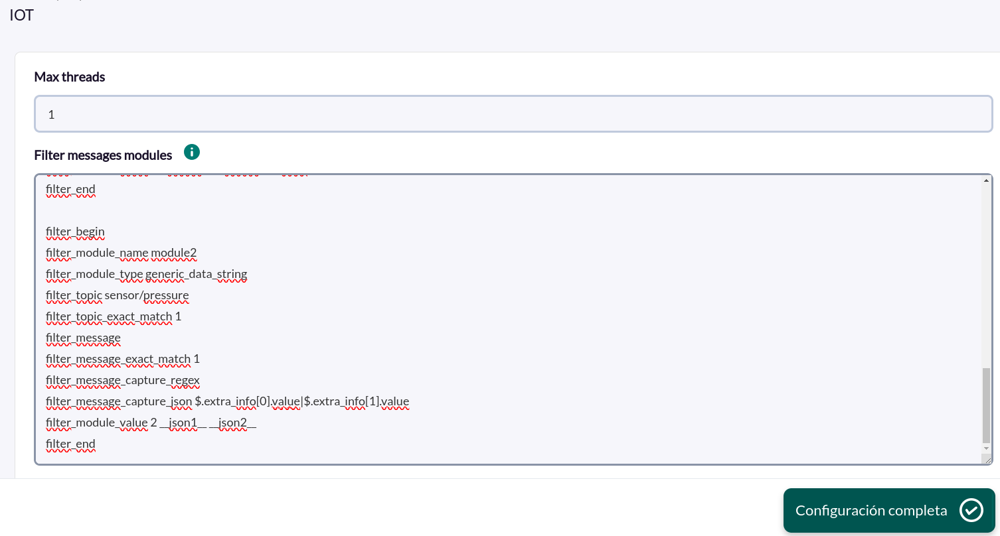
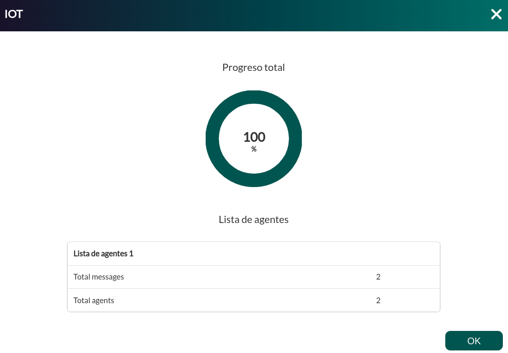

# IoT Discovery

*Última actualización del artículo: 2026-10-26.*

## Qué monitoriza

El addon IoT Discovery monitoriza los mensajes que dispositivos y sensores publican en un broker MQTT. Se suscribe a uno o varios filtros de tópico MQTT, almacena cada mensaje recibido y permite definir filtros que convierten los mensajes coincidentes en agentes y módulos de Pandora FMS.

La integración consta de dos partes que cooperan:

- **El servidor IoT** es un servicio que se conecta al broker MQTT, se suscribe a los filtros de tópico configurados y almacena cada mensaje recibido en una base de datos local. Se gestiona desde la consola de Pandora FMS.
- **La aplicación de Discovery** se ejecuta como una tarea de Discovery. En cada ejecución lee los mensajes que aún no se han procesado, aplica los filtros y envía el resultado a Pandora FMS como agentes y módulos.

Por ejemplo, si unos sensores de temperatura publican una lectura cada minuto, un filtro puede conservar solo las lecturas por encima de un umbral y exponerlas como un módulo sobre el que alertar.

La tarea crea **un agente por cada valor distinto de `filter_topic`** definido en los filtros, con un módulo por cada filtro que ha coincidido con un mensaje. Consulte [Comprender los resultados](#comprender-los-resultados).

## Preparar

### Compatibilidad

| Ámbito | Estado | Evidencia |
|--------|--------|-----------|
| Addon `pandorafms.iot`, versión `1.1` | Objetivo documentado | La versión que describe esta página. Consulte [Identidad del addon](#identidad-del-addon) |
| Pandora FMS NG 784 y posteriores | `Soportado` | El Marketplace indica que todas sus integraciones son compatibles con Pandora FMS NG 784 y versiones posteriores |
| Un broker MQTT accesible desde el equipo del servidor IoT | `Requerido` | Requisito previo, no una declaración de compatibilidad |
| Acceso de red desde el servidor de Discovery a la base de datos del servidor IoT | `Requerido` | La tarea lee la ruta del fichero de base de datos que configure |
| Versiones del protocolo MQTT y productos de broker concretos | `Sin validar` | No se ha registrado ninguna matriz de versiones de broker o protocolo |
| Sistema operativo del servidor de Discovery | `Sin validar` | No se ha registrado ningún sistema operativo para esta versión |

### Requisitos previos

1. **Un broker MQTT accesible**, con host, puerto y, si se requiere, usuario y contraseña.
2. **Permiso para suscribirse** a los tópicos que desea monitorizar. El broker, no el addon, acepta o rechaza cada filtro de tópico.
3. **El servidor IoT** instalado en el equipo que recibe los mensajes. Almacena los mensajes en una base de datos local, por lo que la tarea de Discovery debe poder leer ese fichero en la ruta configurada. La ubicación por defecto es `/opt/pandora/pandora_iot_server/db/pandora_iot.db`.
4. **Pandora FMS**: un servidor de Discovery que ejecute la tarea y un usuario administrador para los ajustes de la consola.

### Instalar el addon

Cargue el paquete `.disco` desde el Marketplace de Pandora FMS:

[https://marketplace.pandorafms.com/entries/pandorafms.iot](https://marketplace.pandorafms.com/entries/pandorafms.iot)

Una vez cargado, la aplicación **IOT** está disponible al crear tareas de Discovery.

### Habilitar el servidor IoT

El servidor de Pandora FMS puede iniciar y detener el servidor IoT por usted. Para habilitarlo:

1. En la consola, abra **Management → Settings → System Settings → General Setup**, vaya a la pestaña **Features** y active **Enable IOT Server**. Pulse **Update**.
2. Aparece una nueva página **IoT Server** en System Settings. Configure allí la conexión con el broker. Consulte [Configurar el servidor IoT](#configurar-el-servidor-iot).


Cuando el servidor de Pandora FMS arranca con la función habilitada, escribe el fichero de configuración del servidor IoT a partir de los ajustes de la consola (ruta por defecto `/etc/pandora/pandora_iot_config.ini`) e inicia el servicio `pandora_iot_server` con `systemctl`. Si la función está deshabilitada, el servidor registra que el demonio IoT está deshabilitado y no inicia el servicio.

El paquete del servidor IoT instala el ejecutable `/usr/bin/pandora_iot_server`, el fichero de configuración `/etc/pandora/pandora_iot_config.ini` y la unidad systemd `pandora_iot_server.service`, que se ejecuta como `root`. Los nombres de los paquetes para cada sistema operativo no se han registrado para esta versión.

## Configurar

### Configurar el servidor IoT

Abra **Management → Settings → System Settings → IoT Server** y complete la conexión con el broker. Cada campo está documentado en [Ajustes de consola del servidor IoT](#ajustes-de-consola-del-servidor-iot). El mínimo es:

- **Server host** y **Server port** del broker MQTT.
- **Server topic**: el filtro de tópico al que suscribirse, por ejemplo `factory/+/temperature`.


Para suscribirse a varios filtros de tópico, introduzca un array JSON en una sola línea:

```
["factory/+/temperature", "factory/+/humidity", "alerts/#"]
```

El valor completo, incluidos corchetes y comillas, debe caber en los 200 caracteres que admite el campo.

Los ajustes guardados en la consola llegan al servidor IoT cuando el servidor de Pandora FMS regenera el fichero de configuración e inicia el servicio, es decir, cuando arranca el servidor de Pandora FMS. Reinicie el servidor de Pandora FMS, o el servicio `pandora_iot_server` si edita el fichero a mano, tras cambiar la conexión.

> La contraseña del broker se guarda en la consola y se escribe en texto claro en el fichero de configuración del servidor IoT. Restrinja el acceso a ese fichero y use una cuenta del broker que solo pueda suscribirse a los tópicos necesarios.

> TLS se usa únicamente cuando están activados **Enable SSL** (`ssl = 1`) y **Trust SSL certificate** (`trust_ssl = 1`), y en ese caso el certificado del broker **no se verifica**. Con **Enable SSL** activado y **Trust SSL certificate** desactivado, el servidor IoT se conecta **sin** TLS. La verificación de certificados no está disponible.

### Crear la tarea de Discovery

Cree la tarea desde **Management → Discovery → Application → IOT**. La consola presenta los campos en dos pasos; cada campo está documentado en [Parámetros de la tarea](#parametros-de-la-tarea).

1. **Iot base**:

    - **DB path**: ruta del fichero de base de datos del servidor IoT.
    - **Time window**: consulte [Parámetros de la tarea](#parametros-de-la-tarea). Actualmente no restringe los mensajes que se leen.
    - **Tentacle IP**, **Tentacle port** y **Tentacle extra options**: dónde y cómo se envían los datos de los agentes generados. Rara vez es necesario cambiarlos.

    

2. **Iot detailed**:

    - **Max threads**: número de procesos usados para evaluar los mensajes.
    - **Filter messages modules**: las definiciones de filtro que deciden qué mensajes se convierten en módulos. Consulte [Definir los filtros de mensajes](#definir-los-filtros-de-mensajes).

    

El intervalo y el grupo de la tarea son los que establezca en la propia tarea; los agentes generados los utilizan.

### Definir los filtros de mensajes

El campo **Filter messages modules** contiene un bloque por filtro. Un filtro empieza con `filter_begin` y termina con `filter_end`, cada uno solo en su línea. Dentro del bloque, cada línea es el nombre de la opción, un espacio en blanco y su valor. No añada dos puntos tras el nombre de la opción, comillas alrededor del valor ni comentarios al final. Las líneas fuera de un bloque y las que empiezan por `#` se ignoran.

```
filter_begin
filter_module_name Temperature __regex1__
filter_module_type generic_data
filter_topic ^sensors/.*/livingroom$
filter_topic_exact_match 0
filter_message_capture_regex Temp: (\d+)
filter_module_value __regex1__
filter_end
```

Un mensaje supera un filtro cuando coincide con **ambos**, `filter_topic` y `filter_message`. Un mismo mensaje puede superar varios filtros. Consulte [Opciones de filtro](#opciones-de-filtro) para cada opción.

#### Coincidir por tópico o por mensaje

`filter_topic` y `filter_message` se evalúan contra el tópico y el contenido de cada mensaje almacenado. Su modo de coincidencia lo fijan `filter_topic_exact_match` y `filter_message_exact_match`:

- `0` (por defecto): el valor es una expresión regular, buscada en cualquier punto del texto. Use `^` y `$` para que coincida con el texto completo.
- `1`: el valor es texto plano y el filtro coincide cuando el texto lo **contiene**. A pesar del nombre de la opción, no es una prueba de igualdad: `sensors/temperature/` coincide con el tópico `sensors/temperature/livingroom`.

Un valor vacío u omitido coincide con cualquier tópico o mensaje.

#### Capturar valores del mensaje

Use las capturas para incluir partes del mensaje en el nombre o el valor del módulo.

Con `filter_message_capture_regex`, cada grupo de captura de la expresión se almacena en `__regexN__`, donde `N` es la posición del grupo. Para el mensaje `Temp: 85 C` y este filtro:

```
filter_message_capture_regex Temp: (\d+) (\w)
filter_module_value __regex1__ __regex2__
```

el valor del módulo es `85 C`.

Con `filter_message_capture_json`, indique una o más expresiones JSONPath separadas por `|`. Cada expresión empieza por `$`, que es la raíz del documento JSON, y el resultado de cada una se almacena en `__jsonN__`, donde `N` es la posición de la expresión. Cuando una expresión devuelve varios valores, se unen con `, `. Para este mensaje:

```
{"message":"Move up right","data":{"yaw_direction":"right","pitch_direction":"up"}}
```

este filtro:

```
filter_begin
filter_module_name __topic__ get right
filter_module_type generic_data_string
filter_topic testtopic/rgb/test/action/
filter_topic_exact_match 1
filter_message Move up right
filter_message_exact_match 1
filter_message_capture_json $.data.yaw_direction|$.data.pitch_direction|$.message
filter_module_value __topic__ | Yaw: __json1__ | Pitch: __json2__ | Message: __json3__
filter_end
```

crea un módulo llamado `testtopic/rgb/test/action/ get right` con el valor `testtopic/rgb/test/action/ | Yaw: right | Pitch: up | Message: Move up right`.

`__topic__` se sustituye por el tópico del mensaje que ha coincidido. Una macro sin valor capturado se sustituye por una cadena vacía. Si el mensaje no es JSON válido, todas las macros `__jsonN__` quedan vacías.

## Verificar la primera ejecución

1. Confirme que el servidor IoT recibe mensajes: el servicio está activo y el fichero de base de datos existe y crece. Consulte [Operar](#operar).
2. Publique un mensaje de prueba en un tópico que su filtro admita.
3. Fuerce la tarea desde **Management → Discovery → Task list**.
4. Cuando la tarea termine, revise su resumen:

    - **Total agents**: número de agentes generados.
    - **Total messages**: número de módulos generados a partir de mensajes que han superado un filtro.

    

5. Abra el agente generado y confirme que tiene el módulo y el valor que produce su filtro.

    

## Comprender los resultados

### Cómo funciona una ejecución

Cada ejecución lee de la base de datos todos los mensajes que aún no se han procesado y los evalúa contra todos sus filtros. Tenga en cuenta estas reglas:

- **Todo mensaje leído se marca como procesado, incluso cuando no coincide con ningún filtro.** Cambiar un filtro no hace que la tarea reprocese mensajes anteriores.
- **Agentes**: se crea un agente por cada valor distinto de `filter_topic`, y su nombre es ese valor tal como está escrito en el filtro, no el tópico MQTT del mensaje. Los filtros con el mismo texto de `filter_topic` comparten agente. Defina `filter_topic` en todos los filtros y prefiera texto plano o un patrón legible, porque una expresión regular se convierte en el nombre del agente.
- **Módulos**: dentro de una ejecución y de un agente, se conserva el primer módulo generado con un nombre dado y se descartan los mensajes posteriores que resuelven al mismo nombre. Use `__topic__` o valores capturados en `filter_module_name` cuando varios tópicos o mensajes deban producir módulos distintos.
- **Marcas de tiempo**: la tarea lee los mensajes almacenados después del instante dado por la ventana de tiempo efectiva; consulte la nota en [Parámetros de la tarea](#parametros-de-la-tarea).
- **Retención**: con independencia del procesamiento, el servidor IoT elimina los mensajes almacenados más antiguos que el periodo de retención (por defecto 86400 segundos), comprobándolo con el intervalo de limpieza configurado.

### Agentes y módulos generados

| Elemento | Contenido |
|----------|-----------|
| Agente | Se nombra con el valor de `filter_topic`. El grupo y el intervalo son los de la tarea. |
| Nombre del módulo | `filter_module_name` tras la sustitución de macros. |
| Tipo del módulo | `filter_module_type`, por ejemplo `generic_data_string` o `generic_data`. |
| Valor del módulo | `filter_module_value` tras la sustitución de macros. |

## Operar

### Comprobar el servicio del servidor IoT

```bash
systemctl status pandora_iot_server
journalctl -u pandora_iot_server
```

El servidor IoT escribe su propio log en `log_location`/`log_name` (por defecto `/var/log/pandora/pandora_iot.log`) con rotación. Para ver además el log en el terminal cuando lo ejecute manualmente, inícielo con `-v`.

### Inspeccionar los mensajes almacenados

Los mensajes se almacenan en la tabla `pandora_mqtt_data` de una base de datos SQLite, con las columnas `topic`, `message`, `unix_timestamp` y `processed` (`0` si aún no se ha procesado, `1` si ya se procesó).

### Límites y comportamiento

- Las suscripciones usan QoS 0. No es configurable.
- Todos los filtros de tópico comparten una única conexión con el broker. Añadir filtros no añade conexiones.
- Las suscripciones se envían de nuevo tras cada reconexión.
- En el nivel de log `debug`, el servidor IoT escribe en el log todos sus ajustes, incluida la contraseña del broker. No deje `debug` activado en un sistema de producción con credenciales.

## Solucionar problemas

| Síntoma | Comprobación |
|---------|--------------|
| La tarea informa de que no se encuentra el fichero de base de datos | El **DB path** no existe desde el servidor de Discovery. Confirme la ruta y que el fichero es legible desde ese equipo. |
| La tarea informa de `Failed to connect` | El fichero existe pero no contiene la tabla `pandora_mqtt_data`. Confirme que la ruta es la base de datos del servidor IoT. |
| La tarea informa de un error al analizar los filtros | No se pudo leer el texto de los filtros. Compruebe que cada bloque tiene `filter_begin` y `filter_end` y que es texto plano. |
| `Total agents` es `0` | Ningún mensaje sin procesar ha superado un filtro. Confirme que llegan mensajes y que `filter_topic` y `filter_message` coinciden con ellos. Recuerde que las ejecuciones anteriores marcan los mensajes como procesados. |
| Faltan módulos de algunos mensajes | Varios mensajes resuelven al mismo nombre de módulo en el mismo agente. Solo se conserva el primero. Incluya `__topic__` o valores capturados en el nombre del módulo. |
| El valor de un módulo contiene una macro sin sustituir o vacía | La captura no coincidió. Pruebe la expresión regular o el JSONPath con un mensaje real. Una expresión regular no válida se ignora; una expresión JSONPath no válida detiene la tarea. |
| El servidor IoT no arranca | Revise `journalctl -u pandora_iot_server` y el log del servidor IoT. Confirme que **Enable IOT Server** está activado y que el usuario del servicio puede escribir en los directorios de base de datos y de logs. |
| El arranque falla con `Invalid topic configuration` | El valor del tópico es un array JSON mal formado. Use una línea, comillas dobles y al menos una cadena no vacía. No añada coma final. |
| Los mensajes no se almacenan | Revise host, puerto, protocolo y credenciales del broker, y los permisos del broker para cada filtro de tópico. Una suscripción rechazada por el broker se escribe en el log del servidor IoT. |

## Referencia

### Ajustes de consola del servidor IoT

Estos campos están en la página **IoT Server** de System Settings y se escriben en el fichero de configuración del servidor IoT cuando arranca el servidor de Pandora FMS.

| Campo de consola | Clave de configuración | Obligatorio | Por defecto | Descripción |
|------------------|------------------------|-------------|-------------|-------------|
| Server configuration | Ninguna | No | `/etc/pandora/pandora_iot_config.ini` | Ruta donde se escribe el fichero de configuración. |
| Server topic | `topic` | Sí | `testtopic/#` | Un filtro de tópico o un array JSON de filtros en una línea. Máximo 200 caracteres. |
| Server host | `host` | Sí | `test.mosquitto.org` | Host del broker MQTT. Sustituya el valor por defecto por su propio broker. |
| Server port | `port` | Sí | `1883` | Puerto del broker MQTT. |
| Server protocol | `protocol` | No | `tcp` | Transporte: `tcp`, `websockets` o `unix`. |
| Server user | `user` | No | Vacío | Usuario del broker. |
| Server password | `password` | No | Vacío | Contraseña del broker. |
| Enable SSL | `ssl` | No | `0` | `1` habilita TLS solo junto con `trust_ssl = 1`. |
| Trust SSL certificate | `trust_ssl` | No | `1` | Con `ssl = 1`, omite la verificación del certificado. |
| Database location | `dblocation` | No | `/opt/pandora/pandora_iot_server/db` | Directorio de la base de datos. |
| Database name | `dbname` | No | `pandora_iot.db` | Nombre del fichero de base de datos. |
| Data cleaning interval | `data_cleaning_interval` | No | `300` | Segundos mínimos entre comprobaciones de retención. |
| Data cleaning period | `data_cleaning_period` | No | `86400` | Los mensajes con más de estos segundos de antigüedad se eliminan. |
| Log name | `log_name` | No | `pandora_iot.log` | Nombre del fichero de log. |
| Log location | `log_location` | No | `/var/log/pandora/` | Directorio de logs. |
| Log level | `log_level` | No | `info` | Nombre del nivel de log. Un valor desconocido equivale a `INFO`. |
| Max log bytes | `max_log_bytes` | No | `50000000` | Tamaño al que rota el log. |
| Log rotation count | `log_rotation_count` | No | `3` | Ficheros de log rotados que se conservan. |

### Línea de comandos del servidor IoT

El ejecutable `pandora_iot_server` acepta:

| Opción | Obligatorio | Por defecto | Descripción |
|--------|-------------|-------------|-------------|
| `-c`, `--conf_file <PATH_TO_CONFIG>` | No | `pandora_iot_config.ini` junto al ejecutable | Fichero de configuración. |
| `-v`, `--verbosity` | No | Deshabilitado | Escribe además el log en el terminal. |

El fichero de configuración usa una sección `[DEFAULT]` con las claves indicadas arriba. Ejemplo:

```ini
[DEFAULT]
topic = ["factory/+/temperature", "factory/+/humidity", "alerts/#"]
host = <MQTT_BROKER_HOST>
port = 1883
dblocation = /opt/pandora/pandora_iot_server/db
dbname = pandora_iot.db
log_name = pandora_iot.log
log_location = /var/log/pandora/
```

### Parámetros de la tarea

#### Iot base

| Campo | Obligatorio | Por defecto | Descripción |
|-------|-------------|-------------|-------------|
| DB path | Sí | `/opt/pandora/pandora_iot_server/db/pandora_iot.db` | Ruta completa del fichero de base de datos del servidor IoT. |
| Time window | No | Vacío | Pensado para limitar los mensajes por antigüedad. En la versión `1.1` el valor no se transmite al procesador, por lo que no tiene efecto: se leen todos los mensajes sin procesar. Déjelo vacío. |
| Tentacle IP | Sí | `127.0.0.1` | Servidor Tentacle que recibe los datos de los agentes. |
| Tentacle port | Sí | `41121` | Puerto de Tentacle. |
| Tentacle extra options | No | Vacío | Opciones adicionales de Tentacle. Esta versión escribe el valor en la configuración pero no lo lee, por lo que no tiene efecto. |

#### Iot detailed

| Campo | Obligatorio | Por defecto | Descripción |
|-------|-------------|-------------|-------------|
| Max threads | No | `1` | Número de procesos que evalúan los mensajes. Se limita al número de mensajes leídos. |
| Filter messages modules | Sí | Plantilla comentada | Definiciones de filtro. Consulte [Opciones de filtro](#opciones-de-filtro). |

### Opciones de filtro

| Opción | Obligatorio | Por defecto | Descripción |
|--------|-------------|-------------|-------------|
| `filter_begin` | Sí | Ninguno | Inicia un filtro. Solo en su línea. |
| `filter_module_name` | Sí | Ninguno | Nombre del módulo. Admite `__topic__`, `__regexN__` y `__jsonN__`. |
| `filter_module_type` | Sí | Ninguno | Tipo de módulo de Pandora FMS, por ejemplo `generic_data_string`. |
| `filter_module_value` | Sí | Ninguno | Valor del módulo. Admite las mismas macros. Un filtro sin él no es válido. |
| `filter_topic` | No | Cualquier tópico | Texto o expresión regular para el tópico. También da nombre al agente. |
| `filter_topic_exact_match` | No | `0` | `1`: el tópico debe contener el texto. En otro caso, expresión regular. |
| `filter_message` | No | Cualquier mensaje | Texto o expresión regular para el contenido del mensaje. |
| `filter_message_exact_match` | No | `0` | `1`: el mensaje debe contener el texto. En otro caso, expresión regular. |
| `filter_message_capture_regex` | No | Ninguno | Expresión regular cuyos grupos de captura rellenan `__regexN__`. |
| `filter_message_capture_json` | No | Ninguno | Expresiones JSONPath que empiezan por `$`, separadas por `\|`, que rellenan `__jsonN__`. |
| `filter_end` | Sí | Ninguno | Termina un filtro. Solo en su línea. |

### Opciones del procesador

La aplicación de Discovery ejecuta su procesador con la configuración de la tarea (`--conf`) y las definiciones de filtro (`--filter_conf`), ambas generadas desde el asistente. También admite `--verbosity` para escribir salida de depuración, que la tarea no transmite.

### Identidad del addon

| Elemento | Valor |
|----------|-------|
| Nombre | IOT |
| Identificador | `pandorafms.iot` |
| Versión | `1.1` |
| Tipo y sección | Discovery, `app` |
| Entrada del Marketplace | [pandorafms.iot](https://marketplace.pandorafms.com/entries/pandorafms.iot), actualizada el 2025-11-14 |
| Disponibilidad | La entrada del Marketplace indica que la descarga está limitada a usuarios con licencia |
